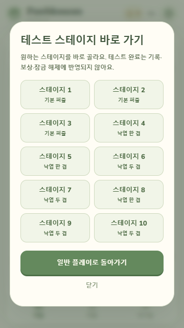
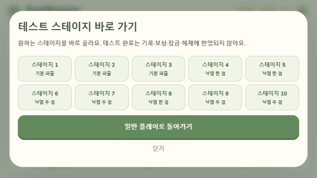

# 현재 개발 · 2026-10-21 · #190 mask 보드와 31–35

## #190 가로 화면 검수 후속 · 2026-10-21

최초 PR CI39604397961/45ce4ad는 양Node2644성공2실패로 스토어·빌드 단계가 미실행입니다. 고정3×3 SpecialTapPractice getter가 nullable 대응 중 복제본을 반환해 기존 첫 before 참조 계약을 어긴 원인을 확인하고 원래 배열 참조를 반환하도록 복구했습니다. 테스트 기대는 그대로이며 관련3파일300개·두 웹 빌드(전체/앱/서버 타입·에셋 포함)가 통과했습니다. 각38파일/public23전수/flags를 확인하고 production으로 복원했습니다. 최종 CI는 새 head에서 확인하며 #122의 원장 잠금/시간초과와 별개입니다. 검수 후 바뀐 연습 getter의 실제 최종 화면 전체 재실행을 이전 빌드의 브라우저 성공과 합산하지 않습니다.


초기 빌드의 실제640×360 EN 스테이지33에서 puzzle-view는241px인데 grid 자동 최소 높이가261.34px로 커져 보드 하단 약20px이 하단 메뉴 뒤에서 잘렸습니다. 원본 `qa/feedback-20261021/190/stage33-layout.jpg`와 `browser-before-layout-fix.json`은 그대로 보존합니다. 실플레이는 짧은 한영 maskPlayHint 한 문장으로 분리해 기본 힌트 중복을 제거하고, 상세 maskHint는 미리보기에 유지합니다. 가로 grid의 남은 행은 minmax(0,1fr), 안내 영역은 min-height:0과 overflow:auto로 제한해 긴 키보드 도움말이 전체 보드 높이를 밀지 않게 했습니다.

UI 1파일292개와 두 빌드의 전체/앱/서버 타입·에셋 검사가 통과했습니다. testing `index-CRyp5hlF.js`, production `index-BilCi2Fu.js`와 CSS `index-4uRkxrjH.css`를 별도 보존했고 production dist로 복원했습니다. 새 검사 준비의 첫2실패(존재하지 않는 미리보기 함수명), 다음2실패(동적 dialog 대신 별도 DOM 대역을 읽음)는 테스트 연결을 고쳐 해결했으며 원문을 보존합니다. 픽셀 경계 통과는 자동 UI 대역 검사와 구분합니다.

원본190 sourcefreeze/dist/manifest와 브라우저 증거는 덮어쓰지 않고 `qa/feedback-20261021/190/root-layout-final`에 새 소스와 빌드를 보존합니다. 엔진682b986c·서버 hash·콘텐츠·저장·난수는 그대로이며 관련 엔진/원장 검사를 반복하지 않습니다. 총괄이 최종 testing CRyp5hlF의640×360 KO/EN·키보드 상태를 실제 확인했습니다. 네 경우 모두 canvas 하단304px=puzzle-view 하단304px=메뉴 상단304px로 보드8행이 잘리지 않았고 일반1/26이동/0점/0재화로 복귀했습니다. 수정 전 자연 플레이와 최종 화면 검수는 각각 browser-before-layout-fix.json과 root-layout-final/browser-layout.json으로 구분합니다.


기준 main `c23650b1431c6f08b070fa476c45757d3ca4a91c`, 브랜치 `codex/190-shaped-boards`입니다. 새 canonical Level.mask의 inactive는 null/낙엽0으로 고정하며 생성·매치·교환·특수 제거·섞기·저장·서버가 같은 활성 칸을 사용합니다. 엔진이 세로 연속 구간별 from→to와 보충 시작점을 기록하고 씬은 살아 있는 객체/생성 특수를 그대로 이동합니다. 기존 #192 실제 제거 종류/좌표 표시와 정산은 유지합니다. 구멍에는52×52 배경도 그리지 않으며 키보드는 다음 활성 칸을 찾습니다.

기존1–30 JSON/levelSignature·V1/V2·누락 버전 회차와 Pip/영구 재화를 유지합니다. 신규31–35는 규칙2이며 저장된 mask를 신뢰하지 않고 canonical 모양/null을 대조합니다. 30 완료 해금·35 완료·재플레이 무보상과 테스트 선택/한영 빈칸 안내를 연결했습니다. 서버 profile은 `pawblossom-board-mask-v2`이며 최종 LF 엔진 SHA-256은 `682b986c23f8999d238789abdbbd42852bf963c330fb8878c7ee8f9c3e80c81e`입니다. 옛 실제 V1/V2 DDL·행 fixture는 불변 보존하고 새 엔진의 열기 거절/DB 보존을 검사합니다. 같은 새 엔진의 합성 schema1→2 회귀와 구엔진 호환을 구분하며 운영DB 이전/재서명/배포는 없습니다.

검증: core/geometry/기존 golden/상수 RNG/서버 상태8파일164개, UI/저장/씬3파일507개, 서버·HTTP·보상·저장복구 통합7파일의 최초684통과/1실패 후 수정한 원장1파일156개가 통과했습니다(나머지6파일529개는 변경 없는 통과 결과). 최초 관련3실패는 수동 낙하 fixture의 falls 누락 두 모션 케이스와31을 잘못된 ID로 기대하던 저장 입력이었습니다. 다음 UI1실패는3개 챕터만 생성하던 테스트 DOM 대역이었고 통합1실패도31을 범위 밖으로 기대하던 입력표였습니다. 실제 기대/seed·timeout·500ms·8worker를 완화하지 않았으며 #122 원인 해결로 해석하지 않습니다. 로그 원문과 수정 근거를 QA에 보존합니다.

testing/production 빌드의 전체·앱·서버 타입과 에셋 검사가 통과했습니다. 두 dist는 각각38파일이며 public23파일 전수 바이트가 원본과 같고 flags는 testing 모두true/production 모두false입니다. JS는 testing `index-B4wYbLq8.js`, production `index-C4jiWXno.js`이며 앱 버전0.1.7을 유지하고 repo dist는 production 바이트로 복원했습니다. 기존500kB 청크 경고를 유지합니다. 브라우저 자연 입력/작은 화면은 총괄 검수, 전체 회귀는 최초 필수 PR CI로 남기며 단말·실서비스·스토어 검증 완료를 뜻하지 않습니다.

고정seed 표본은 roadmap 상단과 QA190에 보존합니다. crate/36–40은 #195이며 새 에셋·오디오·Android sync/APK·실키/계정/상품·운영 설정을 변경하지 않았습니다.

## 개발 이력 · 2026-10-21 · #192 목표 수집 비행·상단 핍 반응

기준 main `07e9dc19a568ca9f7590a7217a4c5ae0f351d272`, 브랜치 `codex/192-goal-flights-pip`입니다. BoardScene의 제거 fade 직전에 각 단계의 실제 제거 종류/좌표와 완전히 사라진 낙엽만 복사해 표시 모듈로 전달합니다. 일반 목표 타일도 HUD로 비행하며 특수 생성 보호 칸과 한 겹 감소는 제외합니다. 이동 시작 잔량에서 실제 제거 수를 차감하고 종류별 단계당3개/동시12개, 지연 포함468ms 이내로 제한합니다. 비행 도착은 최신 목표 DOM을 다시 강조할 뿐 숫자·이동·점수·재화·저장을 갱신하지 않습니다. 기존 엔진 정산/난수/500ms 제거·낙하 대기와 오디오는 유지합니다.

별도36px 얼굴 crop 슬롯을 기존44px 헤더 안에 두고 기존 자체 `pip.png`/`pip-play-v1.webp`를 재사용합니다. 특수 생성/발동·연쇄의 핍 반응은 이동당 최대2회이며 결과창 이미지 캐시와 분리합니다. 짧은 가로190px 열에서는 제목을 두 줄로 배치합니다. 회차 교체·정원/핍/설정·Scene pause/stop/shutdown·섞기·크기/스크롤/언어·창 초점 상실·백그라운드에서 표시 세대와 객체를 취소하며 늦은 도착/해독을 차단합니다. 모션 감소에서는 추가 타이머/비행/움직임 없이 정적 목표 강조와 표정만 표시하며 도착 시에도 현재 설정을 다시 확인합니다.

관련7파일587개와 전체/앱/서버 타입·에셋 검사, testing/production 웹 빌드가 통과했습니다. 새 UI 검사 준비의 최초2실패와 테스트 타입 주석 보완, 마지막 도착의 모션 설정 보완 원문은 Git 밖 `Pawblossom-builds/qa/feedback-20261021/192`에 보존합니다. Vite의 기존500kB 청크 경고는 유지합니다. 최종 전체 회귀는 최초 필수 PR CI에서 확인하며 실제 브라우저 자연 교환·320px/낮은 가로·얼굴 가독성은 총괄 검수 대기입니다. 새 이미지/카메라/Android sync·APK·버전·계정·서버 변경은 없습니다.

## 개발 이력 · 2026-10-21 · #189 2×2 꽃폭탄·기존 회차 규칙 보존

기준 main `7ff7b0700e870a4eb808067635f0dcbc90ea645e`, `codex/189-square-flower-bomb`입니다. 새 회차는 규칙2로 같은 색 2×2 정사각에서도 기존 꽃폭탄을 만듭니다. 연결 그룹당 하나이며 우선순위는 5직선 무지개 → 실제 T/L 교차 또는 정사각 꽃폭탄 → 4직선 가로/세로 특수입니다. 조회·교환·연쇄·낙엽 피해·초기 생성·섞기·51번째 단계 이후 안정화에 같은 판정을 사용합니다. 기존 특수 조합/생성 칸 보호/수집 규칙과 레벨1~30의 목표·이동 수·ID는 유지합니다.

버전 없는 로컬 checkpoint는 규칙1로 복원하며 보드 재생성이나 규칙 승격을 하지 않습니다. 저장에는 실제 `scene.engine.ruleVersion`을 기록하고, 구 판 복원 안내와 도움말은 한영으로 “새 판부터 2×2 적용”을 구분합니다. 기존 실습은 규칙1을 유지하고 본판과 분리된 선택형 규칙2 정사각 실습을 추가했습니다. 영구 완료·별/코인·정원·Pip 선택 필드는 보존하며 미지원 규칙값은 회차 검증에서 거절합니다.

서버 신규 회차는 명시2와 공개 HTTP 허용 필드에 연결했습니다. profile은 `pawblossom-board-square-v2`, 엔진 LF SHA256은 `c02c8278090d332b3d56f05636158d360947d55e8ef84cddff20aa81c7fd3778`입니다. **실제 구엔진 profile DB는 원본 DDL/행을 유지한 채 안전 거절하며 자동 이관·재서명·해시 검사 우회를 추가하지 않았습니다.** 원본 `ledger-v1-fixture.json`은 불변입니다. 통합 회귀는 새 V2 상태와 실제 명령/영수증으로 만든 합성 fixture를 사용하며, 같은 엔진의 스키마1→2 기존 이전 계약과 실제 구엔진 DB 거절을 별도로 검증합니다.

관련 회귀 **18파일 1,295개**와 전체/앱/서버 타입 검사를 통과했습니다. V1은 기준 소스의 seed0/42/4294967295, 교환·무효 입력·섞기·특수 탭의 실제 결과/보드/누적 난수 golden으로 비교하며 CI는 과거 Git 이력에 의존하지 않습니다. 최초 관련503성공1실패는 V2에서 달라진 seed3 무지개 예제 좌표였고, 같은 seed·난수 상태에 명시적인5직선 예제를 구성했습니다. 최초 통합3suite/검사0은 새 합성 실패 회차가 승리한 구성 오류였습니다. seed 변경·미래 보충 조회 없이 현재 목표 피해가 작은 합성 교환 경로로 실패 회차를 구성했습니다. 원문·수정 근거·최종 검사/타입/두 웹 빌드·소스 동결·STOP는 Git 밖 `Pawblossom-builds/qa/feedback-20261021/189`에 보존합니다.

최종 testing/production 웹 빌드 각38파일과 flags3true/3false, public 에셋 전수 바이트, 제품 bundle의 규칙/실습 포함·서버/합성 fixture 마커 제외, workspace `dist`의 production 복원을 확인했습니다. 기존 Vite 500kB 청크 경고는 남습니다.

총괄은 표시 보완 전 production `index-B7qPv-P2.js`에서 구 판 복원 안내·명시 새 판의 정사각 꽃폭탄 생성(24→23이동/0→30점)·폭탄 Enter 사용과 연쇄(22이동/270점)·영어/reload 유지·격리 실습의 본판 불변을 실제 UI로 확인했습니다. 실습 완료 폭탄이 흐린 일반 딸기처럼 보이고 설명이 중복된 점은 **전용 CSS 폭탄 몸체/심지/작은 타일·완전 불투명도·생성 특수 접근성 이름·짧은 성공 피드백**으로 보완했습니다. 이후 검증은 UI/실습3파일290개·타입·두 빌드로 분리하며 엔진/hash/서버에 변경이 없어 관련18파일1,295개·통합372개를 다시 실행하거나 합산하지 않았습니다. 새 빌드는 `testing-final/production-final`, 표시 보완 전 산출물과 로그는 원래 폴더 및 `pre-practice-polish/`에 보존합니다. 최종 표시의 실제 브라우저 검수는 총괄이 별도로 기록합니다.

총괄은 동결 엔진 `c02c8278`에서 고정 seed1~16·레벨1~30·두 정책·V1/V2, 총1,920게임(버전/정책별480게임)을 별도로 비교했습니다. random 정책의 승률은59.79→67.50%, 이동당 제거5.556→6.098·특수 생성0.121→0.213이지만 연쇄 이동 비율은34.34→33.13%였습니다. 현재 보이는 목표만 평가하는 goal 정책은 승률94.17→99.375%, 제거7.067→8.384·생성0.282→0.443·연쇄38.75→43.00%였습니다. **모든 정책에서 연쇄가 늘었다고 일반화하지 않습니다.** `balance-v1-v2.json`과 `balance-summary.json`에 표본을 보존하며 미래 보충 조회·seed 선별·추가 이동·섞기는 없습니다. 같은 seed도 규칙에 따라 생성/보충 순서가 달라질 수 있고, 사람 난이도·전체 seed 전수 검증이 아닙니다. 이 수치를 맞추려는 레벨 변경은 하지 않았습니다.

실제 브라우저 자연 입력·독립 검수·최초 필수 PR 전체 검사/정확 main CI·단말/실SDK/스토어는 별도입니다. 이번 관련 성공을 과거 #122 원인 해결로 합산하지 않으며 timeout/worker/기존 동시검사 seed·업무 기대는 바꾸지 않았습니다. Android sync/APK·에셋/핍 그림·최종 믹스·계정·광고/결제 설정은 변경하지 않았고, 아래 APK는 이 변경 전 전달본입니다.

## 개발 이력 · 2026-10-21 · #188 핍 육성과 정원·핍 체험

핍 반응 그림과 먹이·놀이 버튼을 작은 화면에서도 함께 보도록 카드 배치를 압축하고, 상점에서 돌아오거나 회전한 뒤의 스크롤을 필요한 경우에만 보정했습니다. 구매·비활성 버튼과 화면 밖 교감 버튼은 핍 제목으로 초점을 잇고, 활성 먹이/놀이 버튼의 초점은 유지합니다. 체험 진입/종료는 새 종료/진입 버튼으로 연결합니다.

검증은 빌드별로 분리합니다. **care-final** production의 자연 입력으로1·2단계를 완료해 별2/코인80을 얻고 먹이→놀이→먹이→리본 구매와 꽃밭1개를 적용한 뒤 reload에서 코인10/성장24/친밀도18/리본·꽃밭 유지·스테이지3을 확인했습니다. 별도 testing은 먹이6회·소품2개·꽃밭5개·언어변경 뒤 원래0코인/스테이지1·26이동으로 복귀했습니다. 저장·Scene·RNG 주입이나 브라우저 숨은 상태 조회 없이 실제 UI로 진행했으며, 저장3키 원문/참조 보존은 별도 VM 검사 근거입니다.

**최종 root-final-v2**는 UI279개·전체/앱/서버 타입·두 웹 빌드 성공입니다. care-final의 관련6파일388개 이후 변경은 표시/초점뿐이며 검사 수를 합산하지 않습니다. 최종 testing에서320×568 구매·인사,640×360 회전 후 놀이·영어,390×844 한국어 놀이와 진입/종료 초점을 확인했고, production640×360 보유 소품 무료 해제도 확인했습니다. 그림·핵심 버튼 동시 가시성과 수평 넘침0을 실측했으며, 가로 화면의0.27~0.41 CSS px 상단 차이는 정수 스크롤 반올림의1px 범위로 구분하고 사진도 확인했습니다. console 오류0, 독립 읽기검수 완료입니다. 임시 탭·5188/5190서버·viewport를 정리했습니다. 이전 UI-final의 회전 후 그림 잘림은 root-final-v2에서 보완했고, 이전 사진을 최종 전수 검증으로 합산하지 않습니다. 전체 검사는 최초 필수 PR CI에서 확인하며 사용자 감각/단말/실SDK/스토어는 미검증입니다. 기존f375 APK에는 이번 변경이 없습니다.

기준 main `ae216c084d801ca3f288dc89ef8c60da7a40538a`, 작업 브랜치 `codex/188-pip-care-garden-demo`입니다. 첫 완료 보상 별1/코인40과 별2 꽃밭 확장을 유지하고, 핍 먹이·놀이(각 코인10), 성장/친밀도(각100 상한), 성장20/60 단계 해금과 소품(리본40·물뿌리개80)을 구현했습니다. 소유 소품 장착 변경과 두 수치가 가득 찬 뒤 교감은 무료이며 접속하지 않아도 감소하지 않습니다. 코인 그림은 달러에서 자체 꽃무늬로 바꿨습니다. 퍼즐 도움 아이템·일반 이어하기는 별도 후속 범위입니다.

핍 필드가 없는 v1 저장은 원래 기록을 보존하며 첫 육성 때 확장합니다. 존재하는 신규 필드의 수치·소유·장착 조건은 검증하고, 재화와 효과는 복제본을 저장한 뒤 함께 반영합니다. 저장 실패/충돌/초기화 대기에서 임의 지급·소비를 하지 않습니다. 다른 탭의 비교→쓰기 사이 경쟁은 기존 저장 제한대로 남습니다.

체험 진입은 TEST_TOOLS_ENABLED 빌드에서만 보이며 production에서는 UI와 진입을 차단합니다. 정원·핍 화면만 체험하고 일반 save/scene/engine 참조, 회차·종료 상태·보드와 세 저장 키를 보존합니다. 체험 코인240/별10/꽃밭0/초기 핍은 메모리에서만 사용하고 종료하면 버립니다. 언어·오디오 설정은 일반 저장 기준으로 복원하며 초기화/재시도/스테이지 전환 및 이전 비용 버튼을 차단합니다.

care-final 소스의 관련 회귀는6파일388개 통과했습니다. 명시적 체험 종료의 초점 복귀와 리본 장착 중 정원 돌보기의 물뿌리개 반응도 기존 UI case에서 확인했으며, 퍼즐/설정/브랜드 경유 종료는 원래 초점을 가로채지 않습니다. care-final 소스의 전체/앱/서버 타입 검사와 testing/production 웹 빌드·정적 검증이 통과했습니다. Vite의 기존 500kB 청크 경고는 남습니다. 두 빌드의 TEST_TOOLS/Android 광고·구매 시험 플래그는 testing=true, production=false이며 반응 WebP 바이트 일치와 PNG 원본의 비배포를 확인했습니다. 전체 회귀는 최초 필수 PR CI에서 별도 실행합니다. 명령 원문·최초 실패·수정 뒤 결과·소스 동결본은 Git 밖 `Pawblossom-builds/qa/feedback-20261021/188`에 보존합니다. 실제 브라우저는 상단 빌드별 근거로 확인하며, 사용자 감각과 실기기는 별도이고 새 APK/Android sync·키·콘솔·서버 계약·최종 오디오 믹스 변경은 없습니다.

## 개발 이력 · 2026-10-21 · #187 타일·특수블록 시각 개선

기준 main `afdb09c0f275b97d4f4e9af9d82c90ef4fa32ff5`, `codex/187-tile-special-effects`에서 기존 자체 타일 여섯 SVG를 보존한 v2 벡터와 본판/목표/도움말/실습 경로를 적용했습니다. 가로·세로 방향판·폭탄·무지개를 형태와 대비로 구분하고, 짧은 전조·넓은 빔·파편·충격파를 보강했습니다. 제거범위 표시를 포함한 임시 객체 120개 상한과 중복/종료 정리, 움직임 줄이기를 유지합니다. 엔진·저장·재화·난수·음량·카메라·핍 반응은 변경하지 않았습니다.

관련 회귀 5파일 437개 및 전체/앱/서버 타입, testing/production 두 웹 빌드 통과입니다. Vite의 기존 500kB 청크 크기 경고는 남습니다. 전체 회귀는 같은 head에서 별도 반복하지 않고 최초 필수 PR CI에서 총괄이 실행합니다. 두 웹 빌드와 정적 산출물 근거, 소스 동결본·STOP-checkpoint를 Git 밖 `Pawblossom-builds/qa/feedback-20261021/187`에 보존하며 커밋 전 총괄 독립 검수와 실제 브라우저 자연 입력을 기다립니다. 새 PNG/외부 이미지·Android sync/APK·단말/SDK/스토어 검증은 수행하지 않았습니다. #122 과거 동시검사 원인은 미확정이며 timeout/worker/업무 assertion을 바꾸지 않았습니다. 아래 f375 APK는 이 변경 전 전달본입니다.

총괄은390×844에서 자연 입력을 확인했습니다. **최종 장식 우선순위 보완 전 B5obdbrO production**에서 실제 드래그4매치→가로 특수 생성(26→25이동/0→30점), 키보드 Enter→가로 빔 발동(24이동/110점)을 관측했습니다. **최종 CxDbU2nU production**에서는 저장된 동일 회차를 이어 실제 드래그 일반 매치(24→23이동/110→140점/목표 딸기7·당근7남음)를 확인했습니다. 두 빌드의 근거를 `187/natural-browser.json`과 `187/final-natural-browser.json`으로 분리했으며 앞선 특수 사진을 최종 빌드 전수 검증으로 합산하지 않습니다. 저장·Scene·RNG 주입 없이 진행했고 오류 로그0입니다. 좌표 click1회는 동작 변화가 관측되지 않아 포인터 탭 성공으로 세지 않았습니다. 네 특수 전체 실제화면 행렬과 폰 검증은 미실행입니다. 임시 탭/5188서버/viewport를 정리했고 독립 읽기검수에서 확정 결함은 없었습니다.

## 개발 이력 · 2026-10-21 · #185 시작 배경음·언어·세로 도구

검수 피드백 #184의 첫 묶음입니다. Android 첫 활성 상태와 문서 표시가 모두 확인되고 광고/구매가 오디오를 막지 않을 때 저장된 배경음 켜짐을 존중해 오디오 준비를 한 번 시도합니다. 자동 재생 제한/실패 시 기존 다음 입력 재시도를 유지하며 음량·멜로디·최종 믹스는 변경하지 않습니다. 웹은 기존 사용자 입력 시작을 유지합니다. 상단은 현재 언어를 표시하는 한국어/English 선택 목록이며 설정의 선택과 동기화합니다. 톱니 버튼/그림은44×44/22×22로 고정하고 작은 폭에서는 로고 이름을 접어 재화·언어·설정 터치 영역을 보존합니다.

관련 회귀의 최초295성공1실패는 새 검사에서 존재하지 않는 snapshot 메서드를 호출한 오류로 Git 밖 QA에 보존했고, 실제 board/leaves 보존 비교로 수정했습니다. 최종 관련 회귀/두 웹 빌드 및 브라우저·독립 검토 결과는 PR에 연결합니다. Android 무입력 실제 청취·새 APK/sync·실SDK/Play/폰/스토어 성공을 뜻하지 않습니다. 이전 전달 APK f375는 아래 이력으로 보존합니다.

## 최종 전달 · 2026-10-21 · #169 결과 복귀 수정을 포함한 APK

결과 정원→퍼즐 복귀 수정 [PR182](https://github.com/ChoiDaeYoung-94/Pawblossom-Puzzle/pull/182)을 최초 필수 CI39552922868 성공 후 병합했습니다. 게임 main `f375ed6a209c56ad439af3f88b1ec8ebd079b568`의 [정확한 최초 CI39553093859](https://github.com/ChoiDaeYoung-94/Pawblossom-Puzzle/actions/runs/39553093859)도 Node22·24 각각37파일2,523개·스토어12개·타입/두 웹 빌드/flags 성공입니다. [PR180](https://github.com/ChoiDaeYoung-94/Pawblossom-Puzzle/pull/180)의 한영 소개 화면6장은 브라우저 초안이며 게임 런타임에는 포함하지 않습니다. 이전 #181의 커밋 전 표현은 아래 검증 당시의 이력입니다.

최종 파일은 **`Pawblossom-Puzzle-v0.1.7-2026-10-21-f375ed6-debug.apk`**, **14,479,213바이트**, SHA256 **`3f073bc15ec071463314f49d7bb2314d837dad11a28e5a940440749f8276d985`**입니다. [기존 Drive 폴더의 새 APK](https://drive.google.com/file/d/1pukXwa1aAJFVsbAIG9vf7mhmkP7tZuu-/view)와 전용 checksum만 추가하고 실제 재다운로드 크기·SHA 일치를 확인했습니다. 오전089와 오후e442 APK·기존 자료·공유 범위는 보존했으며 새 테스트 안내 파일은 만들지 않았습니다. 이 문서 PR은 제품 변경이 없는 전달 근거 기록입니다.

testing sync→debug assemble/unit/lint→APK 보존→production sync 복원을 완료했습니다. Gradle20초/169작업(실행40·UP-TO-DATE129) 성공이며 **JVM16개(유의미15개)는 오전 동일 native 결과 UP-TO-DATE 재사용**입니다. 결과 XML3개 SHA가 동일하고 Android/설정/의존성/스크립트 변경0을 확인했습니다. lintAnalyzeDebug 실행·unit/androidTest 분석과 report 캐시를 구분하며 오류0/기존 경고15개입니다. APK의 testing 웹30개/빈 호환2개와 production30개가 #181 동결본과 각각 전수 일치하고, 저장소 dist/Android public의 최종 production 복원을 확인했습니다.

버전0.1.7/code8·appId/min24/target36·기존 v2 인증서 SHA256 `3db1481f54ab024e442493713f4d5dd400b985e4c2a41852b4b389a6e2df47b3`를 유지했습니다. Google 공식 시험 앱 ID·광고/결제 SDK와 시험 플러그인 정적 포함, 광고 식별자4권한/자동 초기화 provider·실상품 properties 제외도 확인했습니다. Git 밖 `Pawblossom-builds/2026-10-21-f375ed6`의 전수 검증·로그·실재다운로드·깨끗한 Drive 화면과 `qa/issue-169-final-apk/independent-f375-artifact-review.json`의 독립 검수를 보존합니다. 실제 단말 설치/업데이트/청취·실SDK/Play 구매·복원·환불·스토어는 미검증이며 #73을 유지합니다. 현재 녹색은 #122 과거 실패 원인 해결이 아닙니다. AAB/공개 배포·콘솔/상품·실키env·폰 자동 검사·최종 믹스 보류를 유지하고17시 채팅에 테스트 안내와 미정 사항을 모읍니다.

## 검증 기록 · 2026-10-21 · #181 종료된 퍼즐의 결과 복귀

기준 main `5ce9444ae879599870377182ee2667971b26de22`, `codex/181-ended-round-return`입니다. production에서 스테이지1을 자연 완료한 뒤 결과의 정원 버튼→하단 퍼즐로 돌아오면 결과창이 닫힌 채 종료 보드/tabindex=-1만 남는 문제를 재현했습니다. 명시적인 퍼즐 복귀 시 기존 결과 DOM과 다음/재시도 버튼을 다시 표시하고 초점을 돌려줍니다. 비활성·다른 modal·보드 준비·결과 타이머·현재 Scene 불일치·시험 광고/결제 중단 중이면 화면을 옮기기 전에 거절하여 현재 화면을 유지하며, 조건 해제만으로 자동 결과창/초점 이동은 하지 않습니다. 보상/저장·완료 처리·결과 아트·효과음·Scene/보드/RNG는 다시 실행하지 않습니다.

native 시험 보상 광고는 화면을 떠날 때 기존 요청 폐기를 유지합니다. 초기 결과의 광고 버튼 바인딩만 공통 함수로 추출하고, 재방문은 기존 dialog를 연 뒤 새로운 context·요청ID 미설정 상태로 연결합니다. 이전 earned/closed/오래된 show는 지급하지 않고 새 명시 prepare/show 요청만 사용합니다. 광고 취소 중 빠른 복귀는 정원에 머물고 취소 완료 후 사용자가 다시 퍼즐을 선택하면 결과를 엽니다. 구매자 모든 광고 차단과 미정인 광고 없는 이어하기 혜택·횟수는 변경하지 않았습니다.

**UI263개·전체/앱/서버 타입·에셋 검사·격리 testing/production 빌드 각30파일/flags3true·3false/서버 마커0을 통과했습니다.** 새 경계20개는 일반/테스트 성공·실패·마지막 스테이지·정원/Escape/native back·반복 왕복 시 보상/아트/소리/회차 동일·일시 차단·언어·진행 중/새 회차·실제 시험 컨트롤러의 옛 receipt 차단/새 요청·취소 중 복귀를 확인합니다. 첫 실행260통과/1실패는 기존 lifecycle 검사가 닫힌 결과 뒤 종료 보드 재개를 기대했기 때문입니다. 기존 기대를 결과 open/paused=true→다음 버튼 뒤 재개로 보강하고 원문 로그/JSON을 보존했으며 최종263개를 확인했습니다. 로컬 전체나 같은 head CI를 반복하지 않았습니다.

수정 production 실화면은 자연 스테이지1 재완료→정원/퍼즐·Escape/퍼즐3회 왕복에서 결과/버튼 초점·별1/120코인 유지, 정원에서 영어 전환 후 결과 재방문, Enter로2번 진입→즉시 Right·24이동 유지와 오류 로그0을 확인했습니다. 접근성 칸 안내를 실제 키로 읽고 외부 순수 인접 매치 계산 후 포인터로 교환했으며 저장/Scene/보드/RNG 주입은 없습니다. 실패/테스트/마지막/native back/SDK 늦은 callback은 하네스 범위이며 이번 production 브라우저 실행과 합산하지 않습니다. 청취·단말/실SDK/Play 구매·복원·환불은 미검증입니다.

Git 밖 `Pawblossom-builds/qa/issue-181-ended-return`에 before/after 화면·조작 JSON·최초 실패/최종 UI·타입/빌드·소스/전수 dist SHA·독립 검수를 보존합니다. 임시 IAB 탭/5187 서버를 정리하고 한국어를 복원했습니다. 아래 e442 APK는 이 수정 전 전달본으로 보존하며 수정 병합/정확 main CI 후 필요한 최종 APK 갱신을 별도 기록합니다. #122 과거 간헐 원인 미확정과 #73 출시 검증은 유지하며 AAB/공개 배포·콘솔/상품·실키env·폰 자동 검사·최종 믹스는 보류합니다. 사용자 조치·질문은17시 보고에 모읍니다.

## 최신 통합 APK · 2026-10-21 · #169 오후 UI 개선 전달

사용자의14:34 작업 재개 지시에 따라16시 대기 계획을 취소하고 최신 게임 main `e4429b84c3a8a3186f34d47f1498b398a005fcfd`로 debug APK를 갱신했습니다. 이 소스의 [정확한 main CI39547250064](https://github.com/ChoiDaeYoung-94/Pawblossom-Puzzle/actions/runs/39547250064)는 Node22·24 각각37파일2,503개·스토어12개·타입/두 웹 빌드/flags 검사를 통과했습니다. [PR170](https://github.com/ChoiDaeYoung-94/Pawblossom-Puzzle/pull/170)의 목표 미리보기·같은 Scene 이어하기·명시 재시작, [PR172](https://github.com/ChoiDaeYoung-94/Pawblossom-Puzzle/pull/172)의 가로 정원 배치, [PR173](https://github.com/ChoiDaeYoung-94/Pawblossom-Puzzle/pull/173)의 핍 도움말, [PR177](https://github.com/ChoiDaeYoung-94/Pawblossom-Puzzle/pull/177)의 새 보드 준비 후 일회 키보드 초점 복구가 포함됐습니다. 이 전달 기록 PR은 제품 변경이 없는 후속 문서입니다.

- 파일 `Pawblossom-Puzzle-v0.1.7-2026-10-21-e4429b8-debug.apk`, **14,479,084바이트**, SHA256 `eb035dcaf3696a909dde5294cbe8f131c39cd19c4e3e1ff86ae3b0ece952f5bd`입니다. appId `com.choidaeyoung.pawblossompuzzle`, 버전0.1.7/code8·min24/target36을 유지했습니다. 기존 전달본과 같은 v2 인증서 SHA256 `3db1481f54ab024e442493713f4d5dd400b985e4c2a41852b4b389a6e2df47b3`를 확인했습니다. 동일 서명은 실제 단말 업데이트 성공을 뜻하지 않습니다.
- `npm run android:sync:test` → Gradle `:app:assembleDebug :app:testDebugUnitTest :app:lintDebug` → APK 보존 → `npm run android:sync`로 production 복원을 완료했습니다. Gradle17초/169작업(실행40·UP-TO-DATE129) 성공입니다. **JVM은 UP-TO-DATE로 오전16개(유의미15개) 결과를 재사용**했으며 새 실행으로 세지 않습니다. 오전089 이후 Android/설정/의존성/스크립트 변경0과 결과 XML3개 SHA 동일성을 확인했습니다. `lintAnalyzeDebug`는 실행됐고 unit/androidTest 분석·report는 UP-TO-DATE이며 최종 오류0/기존 경고15개입니다.
- APK/testing 웹30파일·추가 빈 Capacitor 호환파일2개와 production30파일을 전수 해시 비교했습니다. 두 빌드는 #176 브라우저 검증 동결본과 각각 전수 일치하며 최종 저장소 dist/Android public은 production입니다. testing flags3true/production3false, Google 공식 시험 앱 ID·시험 광고/결제 플러그인·SDK 클래스 포함, MobileAds 자동 초기화 provider와 광고 식별자 관련4권한·실상품 properties 제외를 확인했습니다. 이 정적 포함 확인은 실SDK 광고 표시·결제·복원·환불 성공이 아닙니다.
- 기존 `doeud1410@gmail.com`의 Pawblossom 테스트 폴더에 [새 APK](https://drive.google.com/file/d/1fnqdNuGH6EB_jax8FvoV2pD6p1TSBFIv/view)와 `SHA256SUMS-2026-10-21-e4429b8.txt`만 추가했습니다. 실제 재다운로드 APK의 크기·SHA가 원본과 일치했습니다. 오전089 APK·기존 자료·공유 범위를 보존하고 테스트 안내 파일은 만들지 않았습니다.

Git 밖 `C:/Users/user/Documents/ChatGPT/Pawblossom-builds/2026-10-21-e4429b8`에 소스 경계·두 sync/Gradle 로그·APK·양 dist·정적 패키지/서명/전수 웹 검증·오전 재사용 XML/lint·Drive 실제 다운로드 검증/깨끗한 폴더 스크린샷을 보존했습니다. `qa/issue-169-final-apk/independent-artifact-review.json`의 독립 읽기 검수는 패키지/해시·production 복원·캐시 경계에 한정하며 Drive 성공을 대신하지 않습니다. Drive는 별도 `drive-delivery.json`과 원본/다운로드 해시로 확인했습니다.

이전 자연 UI 검증(소스13eca6b)의 스테이지1·2 완주→별2/80코인→첫 정원 심기→재접속 유지와 수정 소스의 스테이지3 완주→Enter로4 진입/즉시 방향키·재시작·미리보기 초점 확인은 버전별 근거를 유지합니다. 실패 후 재시도 실화면·실기기/청취·실SDK/Play 구매·복원·환불·스토어 #73은 미검증입니다. 과거 #122 timeout/BUSY/결과 수량 실패는 원인 미확정이며 현재 녹색이나 관측 PR174/175를 해결 근거로 합산하지 않습니다. AAB/공개 배포·콘솔/상품·실키/env·폰 자동 테스트·최종 믹스는 보류합니다. 아래 현재/제출 전 표현과 오전 APK 기록은 당시 이력입니다.

## 현재 작업 · 2026-10-21 · #176 스테이지 전환 뒤 키보드 초점

기준 main `548b07a33f2ab679a8c68bbacf263f4b9945e899`, 브랜치 `codex/176-board-focus`입니다. 저장·보드 주입 없이 스테이지1·2를 완료하고 첫 꽃밭을 심어 재접속 유지까지 확인하던 중, 결과창의 「다음 스테이지」를 Enter로 선택하면 BODY로 초점이 빠지는 것을 관측했습니다. 결과 다음/재시도와 미리보기 새 시작/재시작에서만 새 Scene 준비 후 보드 초점을 한 번 요청합니다. 다른 회차·화면·modal·비활성·사용자 초점 이동이면 폐기하고 재시도하지 않으며, 같은 DOM에 초점이 남은 경우 focus-visible일 때만 키보드 커서를 준비합니다. 기본 로드/저장 복원·기존 계속/취소·업무/저장/RNG/광고·믹스·버전은 유지합니다.

UI 하네스243개(새 준비 경계12개 포함), 전체/앱/서버 타입·에셋 검사와 격리 testing/production 웹 빌드를 통과했습니다. 로컬 전체는 반복하지 않았으며 새 소스 전체는 최초 필수 PR CI에서 확인합니다. 기존 큰 chunk 경고는 유지합니다. production 실화면에서는 키보드 재시작 직후 방향키, 자연 스테이지3 완료 뒤 Enter로4번 진입/즉시 방향키, 미리보기 새 시작의 보드 초점과 포인터 재시작의 focus-visible=false/커서 강제 없음, 콘솔 오류0을 확인했습니다. 후반 플레이는 보드 접근성 안내에서 읽은 칸 이름과 실제 키/포인터 조작만 사용했고 저장·Scene·RNG를 주입하지 않았습니다. 브라우저 실패 재시도 경로·별도 testing 행렬·실기기/SDK/오디오 검증은 실행하지 않았으며 하네스·브라우저 범위를 합산하지 않습니다.

Git 밖 `qa/issue-176-board-focus`에 실제 변경/검증·스크린샷·자연 조작·독립 읽기 검수와 소스/두 dist SHA를 보존합니다. 이전 자연 여정은 `qa/natural-20261021-main13/progression`에 별도 보존하며 게임 소스/범위를 구분합니다. main175의 정확 CI39545061436 양Node37파일2,491개·스토어12/타입/두 빌드 성공과 이전 main174 CI39543053732의5초 실패 원인 미확정은 별도입니다. #122는 계속 열어둡니다. APK#169의16–17시 통합 제작·Drive 전달과 실SDK/구매·복원·환불/단말/스토어 #73 미완료는 유지합니다. 사용자 조치·질문은 없습니다. 아래 현재/검수 대기 표현은 당시 이력입니다.

## 현재 작업 · 2026-10-21 · #122 파일 원장 종료 재생의 단계 관측 (커밋 전 검수)

기준 main `9fdf06153193956de47c051ddcdd83f198ac24a8`, 브랜치 `codex/122-terminal-replay-observation`입니다. 기존 고정 seed 종료 검증 한 case에 기존 `round-worker` trace와 open1·두 round의 seed/while/verify **7단계**만 연결했습니다. 대상 실패 시에만 `onTestFailed`가 고정 prefix와 `projectTrace` JSON을 콘솔에 남기며 출력 예외는 삼킵니다. 성공 로그·업무 호출/기대·마지막 won1/failed1 위치·5초·worker/DB/retry·afterEach·제품/CI 설정은 유지합니다. native hook·반복 카운터·새 helper/schema는 추가하지 않았고 빈 native 배열은 hook `not-requested`의 미관측 상태입니다.

정확한 이름으로 실제 target을 **한 번 실행해1개 통과·155개 선택 제외**, 7단계 유한 시간과 성공 안전 출력0회를 확인했습니다(Node24.21.0, target475.7824ms). Git 밖 전용 root/config와 현재 설치 Vitest4.1.11의 fixture도 최초1회만 실행해 **성공1·의도된 assertion 실패2(exit1 예상)**를 확인했습니다. 기본 reporter를 포함한 출력 경로의 안전 JSON1회·합성 원문 비노출, 출력 예외 시 원래 assertion1개 유지와 console 복원을 확인했으며 실제5초 timeout을 재현한 것은 아닙니다. 전체/앱/서버 타입은 통과했습니다. 제품·설정 빌드 입력 해시와 기존 두 dist 각30파일의 동일 근거를 재확인해 재사용하며 웹 빌드·브라우저·Android를 반복하지 않습니다.

Git 밖 `Pawblossom-builds/qa/issue-122-terminal-replay-observation`에 exact-t 명령·raw/safe metadata·예상 실패 fixture·타입·소스 LF/기존 dist SHA·전체 diff·STOP을 보존하고 총괄 독립 검수 전 커밋/푸시/PR을 보류합니다. 로컬 전체·기존8worker·CI 재실행은 하지 않았습니다. **main174 CI39543053732의 Node22 2490통과/1실패(동기 종료 case 5초), Node24 2491통과는 구분해 유지하며 이번 관측 추가가 원인 해결은 아닙니다.** 기존 #122의 callback4/기대7·다른 timeout/BUSY도 각각 미해결입니다. APK#169와16–17시 작업은 총괄의 별도 범위입니다. 사용자 조치·질문은 없습니다. 아래 현재/검수 대기 표현은 당시 이력입니다.

## 현재 작업 · 2026-10-21 · #122 callback 결과 안전 분류 (커밋 전 검수)

기준 main `13eca6b850a444980eea1eff571c4c1ca1ff0791`, 브랜치 `codex/122-callback-outcome-trace`에서 [#122](https://github.com/ChoiDaeYoung-94/Pawblossom-Puzzle/issues/122)의 검사 전용 관측만 추가했습니다. 기존 reward callback 동시8worker 한 case만 opt-in envelope를 사용하고 부모는 원래 결과·순서·신규1/중복7/DB행1 기대를 유지합니다. 고정 kind/code·newGrant boolean/null·생성자/비동기 callback/close 단계와 관측 실패/누락을 최대8행으로 보존합니다. 기본 worker/child IPC·생성/처리/close 횟수·5초/DB500ms를 유지하며 서버 소스·DB hook·자동 retry를 추가하지 않았습니다. SQL/SSV/키/owner/경로/오류 원문을 진단에 복사하지 않습니다.

Node24.21.0/SQLite3.53.4에서 상위 플래그의 엄격 boolean 투영·배열 사용자 정의 메서드 우회를 포함한 helper로 관련2파일 **75개(안전15·기존 reward60)**를 통과했습니다. 이후 원문 객체 플래그 합성 fixture만 추가해 **최종 안전15개와 전체/앱/서버 타입**을 재확인했으며 helper·worker·기존 reward case는 그대로이고 8worker/전체/빌드는 추가 실행하지 않았습니다. 앞선 합성 getter 반환형 추론 오류1건은 원문을 보존하고 `never` 표기를 보완한 뒤 검증했습니다. 새8결과는 신규1/중복7·관측 실패0·close 호출 반환으로 기록됐지만 native BUSY/site/잠금 소유자·worker 종료/부모 정리 완료를 관측한 것은 아닙니다. 에셋 검사·격리 testing/production 빌드는 성공했고 게임 빌드 입력은 후속 안전 보완과 무관하게 유지했습니다. 두 dist는 각각30파일 전수 byte/SHA가 #171 최종 동결본과 같고 testing flags3true/production3false·src/dist 서버 마커0입니다. 기존 큰 chunk 경고는 유지합니다.

Git 밖 `Pawblossom-builds/qa/issue-122-callback-outcome-trace`에 명령·최초 타입 실패·최종 raw/safe metadata·소스 LF/산출물 SHA·diff와 STOP을 보존합니다. **로컬 전체·브라우저 행렬은 이번에 실행하지 않았고, 총괄 독립 검수와 커밋/푸시/PR 승인을 기다립니다.** 기준 main의 기존 CI39540843710 성공과 새 소스 PR의 필수 Node22/24 전체 검증은 구분합니다. #167의 과거 중복4/기대7에서 미관측3결과를 소급 복원하거나 해결한 것이 아니며, #171 로컬2474통과/2실패(callback5초·Round start BEGIN/BUSY5), main319/39·옛5초 원인은 각각 미확정으로 유지합니다. UI·실기기·실제 SDK/스토어 완료가 아니며 APK/sync/Drive·버전·오디오·운영 설정은 이 세션 범위 밖입니다. 사용자 조치·질문은 없습니다. 아래 현재/대기 표현은 당시 이력입니다.

## 현재 작업 · 2026-10-21 · #161 통합 테스트 APK·Drive 전달 검증

오늘 광고 전체 제거 결정 #159, 검사 전용 트랜잭션 관측 #162, 광고 제거 상태 안내·늦은 보상 회귀 #164, 선택형 특수 탭 실습·실제 터치 초점 보완 #165를 병합했습니다. APK의 게임 소스는 `08912a050b7929a78f588ec74e4d4b2fce725793`입니다. [정확 main CI39533204430](https://github.com/ChoiDaeYoung-94/Pawblossom-Puzzle/actions/runs/39533204430)는 Node22·24 각각36파일2,418개/store12/타입/production·testing 웹 빌드와 flags 검사를 통과했습니다. 이전 main319의 CI39531343063은 Node22 보상권 소비 BEGIN/BUSY5 1실패이며 [#122 관측](https://github.com/ChoiDaeYoung-94/Pawblossom-Puzzle/issues/122#issuecomment-6306317059)에 보존했습니다. 새 UI 버전의 성공은 이전 잠금 원인 해결이나 같은 head 재실행을 뜻하지 않습니다.

- `npm run android:sync:test` 뒤 Gradle `:app:assembleDebug :app:testDebugUnitTest :app:lintDebug`를 실행했습니다. 53초/169작업으로 성공했고, JVM은 BillingLogic8·RewardLedger7·기본 산술1의16개(의미 있는15개)가 새로 실행되어 실패/오류/skip0입니다. lint는 오류0·경고15개입니다. 경고는 AGP 버전1·아이콘3·manifest 순서1·구형 SDK 조건1·미사용 자원9로 기록했으며 실제 배포 적합성 완료로 처리하지 않습니다.
- `Pawblossom-Puzzle-v0.1.7-2026-10-21-08912a0-debug.apk`, 14,476,717바이트, SHA256 `d31c9162d87727685ee71216a5f663ed014dab663d985cbf5fac60288b640603`입니다. appId `com.choidaeyoung.pawblossompuzzle`, 버전0.1.7/code8·min24/target36을 유지합니다. v2 서명과 이전 전달본의 동일 인증서 SHA256 `3db1481f54ab024e442493713f4d5dd400b985e4c2a41852b4b389a6e2df47b3`를 확인했으며 실제 설치·업데이트는 아직 검증하지 않았습니다.
- APK 웹 파일30개 전수 크기/SHA는 testing dist와 일치하고, Capacitor 호환 파일2개는 실제 빈 파일입니다. 이번 testing·production dist의30개 전체는 #163 최종 브라우저 검증본과 각각 byte 동일합니다. APK의 testing flags3true, 공식 Google 시험 App ID·debug 광고/결제 브리지 및 SDK 클래스 descriptor 존재를 확인했습니다. 자동 광고 초기화 provider와 지정 광고 식별자 권한4개는 없습니다. 이 정적 존재 검사는 실제 SDK 실행·구매·보상 지급의 증명이 아닙니다.
- APK 사본 보존 뒤 `npm run android:sync`로 현재 production을 복원했습니다. dist/Android 웹 파일30개 전수 SHA와 production flags3false를 대조했고, 실상품 로컬 설정은 없습니다. 새 AAB·폰 자동 검사·실계정 키/env·상품/콘솔·공개 배포·최종 오디오 믹스 변경은 하지 않았습니다.
- 기존 작업용 `doeud1410@gmail.com`의 [Pawblossom Puzzle 테스트 폴더](https://drive.google.com/drive/u/1/folders/1dUUwNPZXmSpX8z0t1GsLjbnHuYI-MSHm)에 날짜/커밋으로 구분한 [APK](https://drive.google.com/file/d/1FcGg42rdwjAu-ZXXu7ocGX_vBX48cdya/view)와 `SHA256SUMS-2026-10-21-08912a0.txt`만 업로드했습니다. 실제 업로드 완료 목록과 파일 ID·제목을 확인하고 APK를 다시 다운로드해 크기14,476,717바이트·SHA256이 원본과 일치하는 것을 검증했습니다. Drive의 APK 형식 확인창을 확인한 정상 다운로드이며 Chrome 보안 차단을 우회하지 않았습니다. 기존 파일·공유 범위를 보존했고 별도 APK 테스트 안내 문서를 만들지 않았습니다. 안내는 채팅에 직접 제공합니다. 재다운로드 근거는 `drive-delivery.json`, 최종 폴더 증빙은 `drive-delivery-proof.jpg`입니다.

Git 밖 `C:/Users/user/Documents/ChatGPT/Pawblossom-builds/2026-10-21-08912a0`에 사본·두 dist·기존 산출물 보존본·Gradle/JVM/lint·메타데이터·인증서/전체 에셋 검증·checkpoint를 보존합니다. APK 전용 검증 도구는 `qa/issue-161-apk-delivery`에 있으며 AAB를 요구하는 예전 스크립트를 그대로 실행하지 않았습니다. 실제 단말·청취·광고/구매/복원/환불·스토어와 #122 원인 추적은 미완료입니다. 이번 문서의 독립 검수·PR CI·정확 main CI는 제출 후 별도로 확인합니다.

## 이전 작업 · 2026-10-21 · #160 모든 광고 제거 안내·통합 회귀 (당시 커밋 전 검수)

기준 main/origin main `ad793a0b20e064aef5afe5c36f85914c9ddf9b63`, 브랜치 `codex/160-all-ads-removal-state`입니다. 기준의 [정확 main CI39529995708](https://github.com/ChoiDaeYoung-94/Pawblossom-Puzzle/actions/runs/39529995708)는 총괄이 Node22·24 각각35파일2,390개·store12·타입·두 빌드 성공을 확인한 버전입니다. **이번 변경은 관련232개·전체35파일2,403개 한 번·타입/store12/에셋·두 웹 빌드·실제 testing/production dist 브라우저 검증을 통과했고 커밋 전 총괄 독립검수 대기**입니다. 커밋·푸시·PR은 아직 없으며 아래 이전 현재/제출 전 표현은 당시 이력입니다.

`billingCopy.entitlement.owned`는 KO/EN 모두 검증된 권한으로 전면·보상형 시험 광고를 차단한다고 명시합니다. 작은 `adBlockMessage()`를 광고 창과 보상 이어하기가 공유하고, unknown/pending/busy 등 나머지 차단은 구매 확인/처리 중 전체 광고 보류로 구분합니다. 기존 차단 조건·권한 판정·준비/표시·보상·저장 동작은 그대로입니다. 무료 이어하기 혜택/횟수·가격·운영 SKU·native 코드·Android/버전·최종 믹스는 변경하지 않았습니다.

UI 하네스에 두 실제 `TestAdsController`/`TestBillingController`와 명시적인 두 합성 브리지를 함께 연결했습니다. 두 형식×loading/ready×owned 이벤트/restore의8경우에서 추가 prepare/show IPC0을 확인합니다. KO/EN의 unknown/pending/querying/owned 문구·차단, owned 상태 또는 닫힘 전 미구매 재전환의 늦은 earned/closed와 이전 receipt 재사용 지급0, 이후 새 요청의 기존 +5 시험 이어하기1회, scene/engine·회차·이동·저장 보존, 표시 중 owned여도 실제 closed 이벤트 전 닫기/Escape/back 보호를 검증합니다. 기존 단순 blocksAds 객체 주입1경우를 실제 컨트롤러 회귀14경우로 대체하여 전체는13개 증가했습니다. 하네스의 disabled 속성도 기록하여 버튼 상태를 확인합니다.

| 단계 | 명령·결과·버전 경계 |
| --- | --- |
| 관련 | `npm.cmd test -- tests/ui-flow.test.ts tests/test-ads.test.ts tests/test-billing.test.ts --reporter=default --reporter=json --outputFile.json=<QA>/related-final.json` · 3파일232/232, 1.28초. 최초 관련231개 성공 뒤 닫힘 전 미구매 전환 여부1경우와 문구 assertion을 보강한 최종본입니다. |
| 최종 전체1회 | `npm.cmd test -- --reporter=default --reporter=json --outputFile.json=<QA>/full.json` · 35파일2,403/2,403, 56.35초. Node24.21.0/Vitest4.1.11, 기존 worker/5초/SQLite500ms/retry/업무 assertion/CI 유지입니다. 이후 저장소 변경은 이 문서2개뿐입니다. |
| 정적·스토어 | `npm.cmd run typecheck`, `store:check`, `store:test`12/12, `assets:check`, `build:test`→`build` 모두 성공입니다. 기존 chunk 크기/SQLite·타입변환 experimental 경고를 로그에 보존했습니다. |
| testing 실제 dist | `node scripts/test-ads-qa.mjs --dist --output=<QA>/browser-testing-initial` · 격리 headless Chrome155.0.8059.85. 기존3비율×KO/EN×2형식×10상태120배치 + 새 KO/EN×2형식×loading/ready8조합, 총14체크·12PNG·페이지오류0·외부요청0입니다. 새 조합은 owned/unknown/pending/busy·합성 늦은ready/클릭의 추가 prepare/show0·복원1·언어왕복·44px/히트·화면내 배치·owned overlay/closed·이동/점수/저장 byte 불변을 확인했습니다. 세로320×568 KO와 가로640×360 EN PNG도 직접 검토했습니다. |
| production 실제 dist | 동일 `test-ads-qa.mjs --dist`와 기존 `billing-qa.mjs --dist` · 실제 웹/Android IPC 대역 모두 광고 진입 없음·광고IPC0, 결제 진입/모달 없음·Billing IPC0, 페이지오류0·외부요청0입니다. 사용자 Chrome·5173·실제 저장을 사용하지 않았습니다. |
| flags·산출물 | testing3true/production3false, src와 양 빌드의 서버/진단 마커0입니다. production SDK 플러그인명/광고·시험선택 진입 마커가 없으며 실제 DOM·IPC 검증도 위와 같습니다. production JS는 공통 i18n의 보류 문구2개 때문에 기준과 byte 동일하지 않습니다. 청크 파일명을 정규화하면 main JS는 그2문구 치환만으로 동일, web JS도 동일, CSS SHA는 그대로입니다. 최종 main JS `index-B3OEUStf.js` SHA256=`ba63d1ad5e1bd1c158a52a0f817608160ad70f9a69e61eb20259c5dcd2bfc553`입니다. |

Git 밖 `<QA>=C:/Users/user/Documents/ChatGPT/Pawblossom-builds/qa/issue-160-all-ads-state`에 명령 로그/JSON·PNG·기준/testing/production JS/CSS·flags·소스 사본/LF SHA·`source-build-review.json`·`checkpoint.json`을 보존합니다. 최초 Git 밖 산출물 검사에서 `test-billing-button` 문자열의 완전 소거를 가정한 assertion1건이 실패했습니다. 기준/최종 모두 기존 닫기 함수의 focus 선택자를 보유하므로 그 가정을 정정했고, 변경하지 않은 billing QA로 실제 결제 진입/모달/IPC 부재를 별도 확인했습니다. 제품 소스 보완이나 전체검사 재실행은 없으며 실패/정정 근거도 보존합니다.

네이티브 `TestCommerce.blocksAds`와 `TestAdsPlugin`의 두 형식 prepare/load/show·광고 객체/receipt 폐기·늦은 earn/dismiss 재확인은 읽기로 확인했으며 이번에 우회 결함을 발견/수정한 것이 아닙니다. 합성 브리지에 명시한 폐기/overlay 모델은 Android SDK 동작의 증명이 아닙니다. 실제 ready 객체·지연 콜백·Play 구매/복원·단말/스토어는 #73에 남기고, #122의 과거 BEGIN BUSY/보상 timeout 원인도 미해결로 유지합니다. 총괄의 독립검수·후속 PR/main CI·병합은 별도이며 이번 결과를 그 성공으로 합산하지 않습니다. 사용자 조치·질문은 없고 오늘17시 APK/Drive는 총괄이 별도로 담당합니다.

## 이전 작업 · 2026-10-21 · #122 트랜잭션 호출 구간 관측 (당시 커밋 전 검수)

기준 main/origin main `aac84bba5ac2477cbbead77bd08ae0eef2c524e4`, 브랜치 `codex/122-transaction-observation`에서 검사 전용 hook의 정적 BEGIN IMMEDIATE/COMMIT/ROLLBACK 호출만 관측했습니다. **최종 안전15개·관련3파일338개·전체35파일2,390개 한 번·타입/스토어12/에셋/두 웹 빌드 통과, 커밋 전 총괄 독립검수 대기**입니다. 새 커밋/푸시/PR은 없으며 Refs #122로 제출할 예정입니다. 아래 과거 현재/제출 전 표현은 당시 이력입니다.

새 `sqliteTransactions` 행에는 trace 안의 연결 번호1..8, 기존 phase·고정 site, `startedAtProcessMs/finishedAtProcessMs`, `returned/threw/unknown`만 기록합니다. 실제 연결은 WeakMap에만 두며 SQL·인자·경로·owner·키·오류 원문은 저장하지 않습니다. 최대8호출과 `sqliteTransactionsTruncated`, 관측 실패의 `sqliteTransactionObservationFailed`를 추가했고 기존 native8/step8·오류 allowlist·hook 설치/복원은 유지했습니다. 비정상 시각은 null이며 성공/throw와 관측 완전성을 혼동하지 않습니다. 상한 뒤 해제 기록이 없어도 잠금 유지·소유자를 확정하지 않습니다.

기존 native 함수1회·receiver/인자·반환·동일 예외를 보존하고 관측 준비/완료 실패를 각각 삼켜 별도 실패 표시로 남깁니다. 정확한 정적3종 외에는 새 시계 읽기를 하지 않으며, 대상 호출마다 시계 읽기2회와 제한된 기록만 추가합니다. 추가 SQL/native getter/대기/업무 IPC는 없습니다. worker ready/go·생성자/업무 혼합 순서·retry·5초/file2/내부worker/SQLite500ms·업무 assertion·afterEach·제품/서버/CI/의존성은 바꾸지 않았습니다. 관측의 스케줄링 영향이0이라고 보장하지 않습니다.

새 시각은 [Node22](https://nodejs.org/download/release/v22.21.1/docs/api/perf_hooks.html#performancenow)·[Node24](https://nodejs.org/docs/latest-v24.x/api/perf_hooks.html#performancenow)의 performance.now 프로세스 시작 기준입니다. 안전 회귀 안의 전용 worker에서 부모와 같은 timeOrigin 및 부모 호출 전/수신 후 사이의 시각을 확인했으며 원래 round worker는 수정하지 않았습니다. Node24 로컬 확인과 향후 Node22 CI를 구분합니다. 기존 elapsed/step의 trace 상대 시간·메시지 수신 시각을 실행 시각으로 대체하거나 다른 프로세스/파일 worker/CI 실행의 시각을 합치지 않습니다. [SQLite 계약](https://www.sqlite.org/lang_transaction.html)에 따라 성공 BEGIN 반환부터 성공 COMMIT/ROLLBACK 호출까지를 연결별 관측 구간으로 볼 수 있지만 native 내부의 정확한 획득/해제 순간이나 독점 소유자를 입증하지는 못합니다. COMMIT BUSY는 해제로 취급하지 않습니다.

| 검증 | 명령·결과 |
| --- | --- |
| 안전/관련 | `npm.cmd test -- tests/server-round-ledger.test.ts -t '검사 진단\|검사 SQLite\|검사 transaction'` · 15통과/기존141필터제외(806ms). `npm.cmd test -- tests/reward-redemption.test.ts tests/server-round-ledger.test.ts tests/reward-ledger.test.ts` · 338/338(18.17초)입니다. JSON reporter도 함께 사용했습니다. |
| 최종 전체1회 | `npm.cmd test -- --reporter=default --reporter=json --outputFile.json=<QA>/full.json` · 35파일2,390/2,390(50.68초)입니다. |
| 타입/스토어/빌드 | `npm.cmd run typecheck`, `store:check`, `store:test`12/12, `assets:check`, `build:test`→`build` 성공입니다. testing flags3true→최종 production flags3false, src/dist 서버·진단 마커0건·기준 main production JS/CSS3개 SHA256 동일·diff 통과입니다. |

Node24.21.0/Vitest4.1.11·정식 use-dev-tools.ps1/npm.cmd를 사용했습니다. 최초 타입 검사에서 새 spy 회귀의 tuple 추가 인자(TS2493)·this 표기(TS2683)가 실패해 타입 단언/this 표기만 보완했고 원문 `typecheck-initial.log`를 보존했습니다. 이후 안전/관련/전체/최종 타입은 같은 소스이며 전체/CI를 성공 맞추기로 재실행하지 않았습니다. 기존 빌드 chunk 크기 경고도 보존합니다. 실제 BEGIN 잠금·COMMIT BUSY 후 ROLLBACK/원본 값 보존·성공 BEGIN/COMMIT/ROLLBACK·관측 시계/기록 실패6종·위조 투영·상한 회귀를 포함했습니다.

관련/전체 JSON의74trace295호출·82trace293호출은 모두 허용 필드/연결 번호/유한 비음수 시각·결과를 확인했고 관측 실패0입니다. 각 실행의 잘림5trace는 보상 생성자 회귀 worker1개·잔여행수3개·결정적 상한 회귀1개이며, 해제 누락을 완전한 기록으로 해석하지 않습니다. main39 `39c5f54`의 [CI39407512908](https://github.com/ChoiDaeYoung-94/Pawblossom-Puzzle/actions/runs/39407512908) Node22 다른 명령 경쟁 worker0·Node24 동일 특수 탭 worker0/7의 command/transaction-begin/BUSY5·transactionActive=false와 이전 PR155 실패·과거 보상5초 timeout은 그대로 보존합니다. 이번 성공은 당시 잠금 소유자·지속 원인·생성자/업무 중첩 인과의 해결 근거가 아니며 #122를 열어 둡니다.

Git 밖 `C:/Users/user/Documents/ChatGPT/Pawblossom-builds/qa/issue-122-transaction-observation`의 checkpoint.json·소스 LF SHA·단계별 로그/JSON·metadata-review.json·source-build-review.json을 보존합니다. 다음은 총괄 독립검수·승인 뒤 한국어 test 커밋/푸시/PR이며 CI·병합/정리는 총괄 담당입니다. 사용자 조치/질문은 없습니다. 오늘 APK/Drive 전달은 총괄이 일괄 담당하며 이 세션은 Android/APK·계정/상품·폰·최종 믹스·배포를 변경하지 않았습니다.

## 최신 결정 · 2026-10-21 · #158 모든 광고 제거·오늘 APK 전달

사용자는 광고 제거 구매 시 **전면·보상형을 포함한 모든 광고 제거**를 확정했습니다. 한국 일회성3,000원/미국US$2.50·동일 Play 구매 계정의 비소모성 소유권 복원 범위는 유지합니다. 이전 선택형 보상 광고 유지 제안/범위 미확정 표기는 당시 이력이며 이번 지시가 우선합니다. 구매자에게 광고 시청을 요구하지 않으며 광고 없는 이어하기 횟수/혜택은 별도 결정 전입니다. 무제한 이동·미검증 소유권·자동 보상을 임의 추가하지 않습니다. 현재 시험 브리지/내부 모듈과 실제 상품·구매/환불·운영 SDK/수익화 완료는 구분합니다.

오늘17시 보고에서 최신 개발 상태를 확인할 **테스트용 APK 제작과 기존 작업용 Google Drive 테스트 폴더 전달**을 요청받았습니다. 필요한 testing 웹 빌드·Android sync·debug APK/서명·포함 에셋 검사, APK/체크섬 업로드와 재다운로드 검증을 허용합니다. 실제 빌드/업로드 성공·커밋/버전/해시는 후속 기록 전까지 미완료입니다. 파일명에 날짜/커밋을 넣고 기존 파일·공유 권한을 유지하며 별도 테스트 안내 파일은 만들지 않습니다. AAB/공개 배포·Play Console/상품·실계정 키/env·폰 자동 테스트·최종 믹스 변경은 보류합니다.

시작 기준 main은 `39c5f54b6fd5ee379bc5e7fe34ada4c22dc788ce`입니다. PR155 통합 head054eada의 CI39407298024는 Node22·24 각각2,379개·스토어12·타입/두 빌드 성공 뒤 병합했지만, 정확한 main CI39407512908는 양쪽 각각2,378성공/1실패·후속 스토어/빌드 skip입니다. 마지막 전체 녹색 main은90845643/CI39406780626(각2,375개)입니다. 새 분류로 업무 BEGIN IMMEDIATE/BUSY5를 직접 관측했으나 잠금 소유자·지속 원인은 미확정입니다. [#122 최신 실패와 다음 관측 계획](https://github.com/ChoiDaeYoung-94/Pawblossom-Puzzle/issues/122#issuecomment-6288845661)을 유지하며 같은 head 재실행이나 기대/5초/500ms/worker 완화로 넘기지 않습니다. 이번 #158은 결정·권한 기록이며 앱/Android/최종 믹스를 변경하지 않습니다. 아래 현재/대기 표기는 당시 이력입니다.

## 현재 통합 · 2026-10-20 19시 연장 · #153 최신 main 반영 (로컬 통과·새 CI 대기)

사용자 요청으로 작업 종료를20시로 연장했습니다. [PR157](https://github.com/ChoiDaeYoung-94/Pawblossom-Puzzle/pull/157)의 검사 전용 정적 SQL 분류는 main `90845643e37197674a901936892c06b03a7f947b`에 반영됐고 [정확한 main CI39406780626](https://github.com/ChoiDaeYoung-94/Pawblossom-Puzzle/actions/runs/39406780626)가 Node22·24 각각35파일2,375개·스토어12개·타입·두 빌드를 통과했습니다. 오늘 이 시점까지 병합 PR은7개입니다. 진단 관측 보강이며 #122의 잠금/과거 timeout 원인 해결을 뜻하지 않습니다.

[PR155](https://github.com/ChoiDaeYoung-94/Pawblossom-Puzzle/pull/155)의 원래 head `9ad4579499385d7da4b9a04a72c6025bcc2e854b`와 실패 CI39400594900은 보존하고, 최신 main908의 새 진단 코드·검사·문서 이력을 실제 병합했습니다. 충돌2개는 기존 기록을 모두 보존하는 문서 통합이며 앱·UI 검사·브라우저 QA 소스는 원래 PR155와 동일합니다. 기본5초/file2/8worker·ready/go·SQLite500ms·기대값·운영 코드·CI를 바꾸거나 동일 head를 재실행하지 않았습니다.

통합 작업 트리에서 Node24.21.0/Vitest4.1.11 전체35파일2,379/2,379·47.59초를1회 실행했고, 타입·스토어12개·에셋·build:test→build를 통과했습니다. testing flags3true/production3false·src/dist 진단 마커0이며 production30파일 전체가 원래 PR155의 최종 브라우저 검증 manifest와 SHA256 동일합니다. 기존 Chrome32조합144PNG·오류0과 총괄 자연 입력은 동일 산출물의 과거 근거이며 이번 브라우저 재실행이 아닙니다. Git 밖 `Pawblossom-builds/qa/issue-153-integration`에 전체 JSON/로그·두 빌드·source-build-review.json을 보존합니다. 새 통합 head의 필수 CI와 병합은 아직 확인 전이며, 실패 시 원인을 보존하고 조건 완화/통과 맞추기 재실행을 하지 않습니다. 아래 현재/제출 전/미병합 표현은 해당 시점 이력입니다. Android·실서비스·스토어·최종 오디오 및 기존 보류는 그대로입니다.

## 현재 작업 · 2026-10-20 · #122 SQLite 오류의 정적 분류 (커밋 전 검수)

기준 main/origin main은 `6dc9b3c0a063e535b5db0e4d5314f013cb306ef9`, 브랜치는 `codex/122-sqlite-error-site`입니다. [#122](https://github.com/ChoiDaeYoung-94/Pawblossom-Puzzle/issues/122)의 검사 전용 native 오류 행에 고정 `site` 분류만 추가했습니다. **관련327개·전체35파일2,375개 한 번 성공 후 타입 비교 오류를 보완했고, 최종 타입·안전4개·두 빌드와 소거 JS 동일성을 확인했습니다. 커밋 전 총괄 최종 체크포인트 검수·제출 승인 대기**입니다. 새 커밋·푸시·PR은 아직 없습니다. 아래 이전 통합/제출 전 표현은 당시 이력입니다.

`database-exec`가 오류를 던졌을 때 첫 인자가 정확한 정적 문자열인 경우만 `transaction-begin`/`transaction-commit`/`transaction-rollback`/`pragma-synchronous-full`로 분류합니다. 각각 BEGIN IMMEDIATE/COMMIT/ROLLBACK/PRAGMA synchronous=FULL 완전 일치이며 공백·대소문자·세미콜론·주석·복수 SQL을 정규화하지 않습니다. 문자열 외 입력에 getter/toString/강제 변환을 추가하지 않고 다른 SQL·prepare/statement는 `unknown`으로 둡니다. **site는 정적 문자열의 종류이며 호출자 위치나 잠금 소유자를 판정하지 않습니다.** 원문 SQL·인자·오류 message/stack·경로·owner·grant·키·토큰은 metadata에 저장/출력하지 않습니다. projectTrace도 허용 enum만 투영하고 미허용·객체·throwing getter와 database-exec 외의 위조 분류는 unknown으로 제한합니다.

원래 native 함수의 this/인자/호출1회·반환·동일 예외·descriptor 설치/복원과 최대8native/8step·기존 오류 allowlist를 유지합니다. 새 회귀2개와 기존 안전 회귀 보강은 server-round-ledger.test.ts에만 두었고, reward-redemption.test.ts의 기존 합성 old-busy 행1곳에는 필수 site:unknown을 추가했습니다. worker ready/go·생성자/업무 중첩·취소/afterEach·retry·기본5초/file2/내부worker/SQLite500ms·제품·서버·CI·의존성은 그대로입니다. 준비 barrier를 도입하거나 기존 혼합 실행을 대체하지 않았습니다.

| 실행 단계 | 명령·결과와 버전 경계 |
| --- | --- |
| 최초 관련/전체 | `npm.cmd test -- tests/reward-redemption.test.ts tests/server-round-ledger.test.ts tests/reward-ledger.test.ts --reporter=default --reporter=json --outputFile.json=<QA>/related-before-type-fix.json` · 3파일327/327, 17.34초. `npm.cmd test -- --reporter=default --reporter=json --outputFile.json=<QA>/full.json` · 35파일2,375/2,375, 47.30초, 전체1회입니다. 관련 원본 파일은 이후 보존용 이름으로 복사했습니다. |
| 초기 타입 실패 | `npm.cmd run typecheck` · 새 합성 반환 회귀의 void 대 객체 직접 비교 TS2367, server-round-ledger.test.ts:200입니다. 원문 typecheck-initial-failed.log와 최초 전체/관련 JSON을 보존했습니다. |
| 최종 타입/안전 | Reflect.apply 호출과 === 비교는 그대로 두고 왼쪽 반환값에 `as unknown`만 추가했습니다. 최종 `npm.cmd run typecheck` 및 `npm.cmd test -- tests/server-round-ledger.test.ts -t '검사 진단\|검사 SQLite' --reporter=default --reporter=json --outputFile.json=<QA>/safety-final.json` · 전체/앱/서버 타입 성공, 안전4통과/기존141건 필터 제외, 420ms입니다. |
| 소거/독립 검수 | Node24.21.0 stripTypeScriptTypes(mode=transform)로 타입 단언 전/후 JS 바이트 동일을 확인했습니다. 소거 JS SHA256=`738735d3da8c7df1c2ce812e3223faebf2ab28afc31bc7fa9348145f2db6f012`입니다. 총괄도 타입 보완 전 관련327개·최종 타입과 핵심2회귀·privacy/호출/복원 경계를 독립 확인했습니다. 최종 전체를 다시 실행했다고 표현하지 않습니다. |
| 스토어/웹 | `npm.cmd run store:check`, `store:test`12/12, `assets:check`, `build:test`→`build` 성공입니다. testing flags3true→최종 production flags3false, src/dist 서버·진단 마커0건이며 production JS/CSS3개는 기준 main을 먼저 빌드한 bundle과 SHA256이 같습니다. |

중간에 동일 객체 확인을 toBe로 표현한 본문도 관련327개(18.30초)/타입 성공으로 별도 보존했습니다. 최종 본문은 최초 전체 실행본과 타입 소거 후 동일한 비교식으로 확정했으며, 중간본 결과를 최종 전체로 합산하지 않습니다. Node24.21.0/Vitest4.1.11·정식 use-dev-tools.ps1/npm.cmd를 사용했고 전체/CI의 성공 맞추기 재실행은 하지 않았습니다. 기존 chunk 크기 경고와 stripTypeScriptTypes의 experimental 경고도 보존합니다.

관련/전체 JSON은 각각73trace/12native,81trace/16native에서 새 필드/enum·원문 비노출을 확인했습니다. 최종 안전 JSON은 실제 결정적 오류4건을 수집했습니다. 부모 연결 잠금 중 BEGIN은 code5/transactionActive=false, 활성 거래 중 PRAGMA와 거래 없는 COMMIT/ROLLBACK은 code1이며 네 정적 분류와 원래 실패를 유지합니다. 합성 회귀는 네 literal·유사/복수SQL·객체/Proxy/getter·비exec·위조 투영·8건 상한·단일 호출/receiver/반환/동일 throw/복원을 검증합니다. 성공한 오래 걸린 native 호출의 시간과 잠금 소유자는 여전히 관측하지 않습니다.

**보존한 미해결 실패:** [PR155](https://github.com/ChoiDaeYoung-94/Pawblossom-Puzzle/pull/155)의 head `9ad4579499385d7da4b9a04a72c6025bcc2e854b`와 [CI39400594900](https://github.com/ChoiDaeYoung-94/Pawblossom-Puzzle/actions/runs/39400594900)은 그대로입니다. 양쪽 각각2,376통과/1실패이며 Node22 동일 명령 worker7 command501.953894ms·Node24 동시 생성 worker2 start503.123828ms의 database-exec/base·extended5/transactionActive=false를 확인했습니다. 해당 생성자는8.18/3.75ms에 성공했습니다. 당시 로그에는 site가 없으므로 BEGIN 진입 실패는 코드/상태에 따른 추론이며 새 필드를 과거 로그에 소급하지 않습니다. 실제 잠금 소유자·지속 원인·생성자/업무 중첩의 인과는 미확정입니다. 예전 main136 reward-redemption:163의5초 timeout과도 동일 원인으로 합치지 않습니다. 이번 관측 검증 성공으로 PR155 실패나 #122를 해결했다고 처리하지 않습니다.

Git 밖 QA는 `C:/Users/user/Documents/ChatGPT/Pawblossom-builds/qa/issue-122-sqlite-site`이며 checkpoint.json·각 단계 JSON/로그·metadata-review.json·type-erasure-review.json·source-build-review.json·소스 LF SHA를 보존합니다. 최초 전체의 test source LF SHA는 `50b47e6d32e203cf9d530f6c1f74e8f16f24b9438813ea3f008247c04e1e86b6`, 최종은 `ca42f72255c92c510b81aa4358448f807eec06d6e14f857dfe6130f86638cf89`입니다. helper=`7c2eb79f7275f80ef02b2ef9dabc1840984f665e960c700116cd59908dd913d0`, reward-redemption=`5f8bcf51b03ebee5bf49b3761506edbab5240fe974a757b20f94bd8b8330a469`입니다. 다음은 총괄 최종검수·승인 뒤 한국어 test 커밋·푸시·Refs #122 PR 제출이며 CI/병합/정리는 총괄 담당입니다. 사용자 조치/질문은 없습니다. APK/AAB·Android sync·버전·최종 오디오 믹스·SDK·계정/키/env·콘솔/상품/Drive·폰/전달·배포 보류를 유지합니다.

## 현재 통합 상태 · 2026-10-20 · #154

오늘 시작 main `a4b4992c5499ed8a7ca5adee8eec2a4e1c3a0f23`부터 **5개 PR을 병합**했습니다. 제품·검사 기준 main은 `be328c75372d4a1b2a2dd36faf39722330406186`이며, [정확한 main CI39397742294](https://github.com/ChoiDaeYoung-94/Pawblossom-Puzzle/actions/runs/39397742294)는 Node22·24 각각35파일2,373개·스토어12개·타입·두 웹 빌드 성공입니다. 이번 #154는 기존4문서의 현황 정리이며 자체 PR/main CI·병합은 제출 뒤 별도 확인합니다. 아래 과거의 현재/승인/제출 전 표현은 당시 이력입니다.

| 이슈·PR | 반영 결과 | 실제 squash main · 정확한 main CI |
|---|---|---|
| #144 · [PR146](https://github.com/ChoiDaeYoung-94/Pawblossom-Puzzle/pull/146) | 문구·장식 축소, 퍼즐 중심 배치, 상태/보상 접근성·꽃 심기 초점 | `c37ceba8eac43d238665b90e192a7c89edde0b6b` · [39391338805](https://github.com/ChoiDaeYoung-94/Pawblossom-Puzzle/actions/runs/39391338805) |
| #145 · [PR148](https://github.com/ChoiDaeYoung-94/Pawblossom-Puzzle/pull/148) | 한국3,000원·미국US$2.50 확정 기록 | `2d31df97720b7ad180b6949c1ed0f54946289fae` · [39391701617](https://github.com/ChoiDaeYoung-94/Pawblossom-Puzzle/actions/runs/39391701617) |
| #147 · [PR150](https://github.com/ChoiDaeYoung-94/Pawblossom-Puzzle/pull/150) | 회차 복원 안내의 메뉴 겹침·섞기 설명 줄바꿈 수정 | `1917ee84c07fb13193a01c58b14a2448a13f8893` · [39393448039](https://github.com/ChoiDaeYoung-94/Pawblossom-Puzzle/actions/runs/39393448039) |
| #149 · [PR151](https://github.com/ChoiDaeYoung-94/Pawblossom-Puzzle/pull/151) | 정상 저장 중복 안내 축소·문제 복구/초점 유지·고객센터 표시 | `5839e22e6e52190d87321be00d4b291842ca4365` · [39396115390](https://github.com/ChoiDaeYoung-94/Pawblossom-Puzzle/actions/runs/39396115390) |
| #122 · [PR152](https://github.com/ChoiDaeYoung-94/Pawblossom-Puzzle/pull/152) | 잔여 행수0/1/2 검사의 고정7단계·안전 진단 보강 | `be328c75372d4a1b2a2dd36faf39722330406186` · [39397742294](https://github.com/ChoiDaeYoung-94/Pawblossom-Puzzle/actions/runs/39397742294) |

**#153의 [PR155](https://github.com/ChoiDaeYoung-94/Pawblossom-Puzzle/pull/155)는 미병합 Draft입니다.** head `9ad4579499385d7da4b9a04a72c6025bcc2e854b`의 종료 안내 정리·API 미제공 방어·화면 복귀 재표시 수정은 로컬 UI153/전체2,377개·타입/스토어12/두 빌드와 최종 Chrome32조합144PNG·오류0을 통과했습니다. 그러나 [필수 CI39400594900](https://github.com/ChoiDaeYoung-94/Pawblossom-Puzzle/actions/runs/39400594900)는 양쪽 모두 서버 회차 동시 검사1개 실패/2,376개 성공이므로 병합하지 않았습니다. 이후 단계의 스토어/빌드 CI도 실행 성공으로 합산하지 않습니다. 재실행·기대/timeout/worker/500ms 완화·운영 코드 변경은 하지 않았습니다.

Node22는 동일 명령 검사 worker7의 command(501.954ms), Node24는 동시 생성 검사 worker2의 start(503.124ms)에서 SQLite base/extended5와 storage-unavailable을 관측했습니다. 해당 worker의 round-open은 각각8.18/3.75ms에 성공했습니다. 잠금 소유자·전체 대기 원인은 미확정이며, go 이후 생성자/업무가 섞이는 구조는 후속 조사 후보입니다. 예전 main136 reward-redemption:163의5초 timeout과 동일 원인으로 합치지 않습니다. 원문·안전 투영은 Git 밖 `Pawblossom-builds/qa/issue-153/pr155-ci-failed.log`와 `pr155-ci-safe-summary.json`에 보존하고 #122를 열어 둡니다.

실제 자연 플레이와 fixture QA의 버전 경계는 [브라우저 기록](browser-qa.ko.md) 상단을 우선합니다. 완료5브랜치는 개별 squash/tree/tip·종속 PR·worktree 확인 후 정리했고, 미병합153과 이번154는 보존합니다. 완료 UI 세션은 정식 보관했으며 미해결 진단·미병합 안내 세션은 총괄 아래 유지합니다. 영구 삭제로 보고하지 않습니다.

다음 순서는 원장 실패의 소유자/준비·업무 경계를 근거로 좁히고 PR155의 필수 검증을 충족하는 것입니다. 실제 광고 SDK/동의·Play 구매/복원/환불·연령/개인정보·단말·스토어는 #73 미완료입니다. 별도 게임 로그인/클라우드 진행 복구는 제외하고 동일 Play 구매 계정의 광고 제거 소유권 복원만 준비합니다. 고객센터는 doeud1410@gmail.com, 가격은 한국3,000원/미국US$2.50이며 광고 제거 범위·최소 구매 검증 운영 구성은 후속 결정입니다. 개발자 표시명/사업자·정확한 홈페이지는 사용자가 준비될 때 결정합니다. 당장 사용자 조치·질문은 없습니다.

자체 게임 서버 계약/비용/배포는 승인되지 않았습니다. APK/AAB·Android sync·버전·폰 테스트/전달·실계정/키/env·Drive/Play Console/상품·최종 오디오 믹스·공개 배포 보류와 폰 연결 후 총괄 일괄 점검→사용자 감각 검수→개선 순서를 유지합니다.

## 현재 작업 · 2026-10-20 · #153 임시 안내 접근성 정리 (로컬 최종 검증 완료·PR 제출 승인 대기)

기준 `be328c75372d4a1b2a2dd36faf39722330406186`, 브랜치 `codex/153-transient-notice-cleanup`의 웹 변경입니다. 보드 안내의 새 회차/시험 이어하기/종료와 일반 toast 만료에서 키·표시·DOM 텍스트를 함께 비웁니다. 1300ms/3200ms·활성 한영 전환·현재 회차/타이머 보호를 유지하고, 새 안내 재생 중 늦은 종료 이벤트를 무시합니다. getAnimations API 미제공 시 예외 없이 정리하는 최소 방어도 포함합니다.

최종 API 방어·화면 이탈 포함 UI153/153, 전체35파일2,377/2,377·52.44초·변경 후1회, 전체/앱/서버 타입·스토어12개·에셋·두 웹 빌드가 통과했습니다. testing 세 flags true/production 세 flags false입니다. 최종 testing 일반/감소 모션 8조합24PNG와 기본6화면 8조합48PNG는 오류0이며 최종 production도 동일16조합72PNG·오류0을 확인했습니다. 두 모드 합계32조합144PNG입니다. 총괄 독립 UI153·타입도 통과했습니다. 앞선 API 방어 전 전체2,375개·브라우저 성공은 별도 버전 기록으로 보존합니다. 세부 절차·실패 원인·Chrome AX·fixture 경계는 [브라우저 QA](browser-qa.ko.md) 상단과 Git 밖 `Pawblossom-builds/qa/issue-153/checkpoint.json`에 연결합니다. PR 제출은 총괄 후속 승인 대기이며 병합·브랜치 정리는 총괄이 담당합니다.

모션 감소의 기존 CSS .01ms를 일반 모션1300ms 노출과 혼동하지 않습니다. 최신 Chrome과 API 미제공 단위 fixture만 확인했으며 Chrome60/구형 WebView에서 전체 게임이 작동하거나 지원 범위를 확대한 것으로 주장하지 않습니다. 실제 Android/TalkBack·구형 단말·광고·결제·스토어 검증은 미완료입니다. APK/AAB·Android sync·폰 테스트/전달·버전·오디오 믹스·계정/운영 설정은 변경하지 않았습니다. 아래 과거 현재/최신/승인 표현은 당시 이력입니다.

## 현재 작업 · 2026-10-20 · #122 잔여 행수 검사 단계 관측 (총괄 검수 완료·Ready PR 제출 승인)

기준 main/origin main은 `5839e22e6e52190d87321be00d4b291842ca4365`, 브랜치는 `codex/122-reward-capacity-trace`입니다. [#122](https://github.com/ChoiDaeYoung-94/Pawblossom-Puzzle/issues/122)의 남은 전체 행수0/1/2 동기 검사만 기존 순서·같은 제목의 `it.for`로 옮기고 `task.meta.ledgerDiagnostic`의 고정 family `reward-capacity`와 `caseIndex=space`를 연결했습니다. 현재 **관련325개·최신 전체35파일2,373개 한 번·타입/스토어12/에셋/두 빌드 통과, 총괄 독립검수 완료·Ready PR 제출 승인**입니다. 총괄은 관련3파일325개·전체/앱/서버 타입·JSON 세 사례/7단계/hook·범위·소스 SHA·동일 UI bundle을 독립 확인했습니다. 승인된5파일의 한국어 test 커밋·푸시·Refs #122 Ready PR 제출을 진행하며 CI/병합은 총괄이 담당합니다. 아래 이전 현재/제출 전 표현은 당시 이력입니다.

고정 단계는 `fixture → reprofile → round-open → prepare → redeem → eligibility → apply` 7개입니다. fixture는 기존 path/load/count이며 모듈 초기화 때 한 번 읽는 fixture JSON은 포함하지 않습니다. 인라인 profile/MAC 갱신 전체를 기존 그대로 reprofile에 두고, 기존 `round(p,{maxRows:n+space})` → 별도 setup 전체 → `redeem(f.reward).grant` → 자격 query/assert → 적용 call/assert 순서를 유지했습니다. 인라인 갱신을 기존 reprofile helper로 합치거나 fixture·업무 assertion·afterEach 정리 순서를 바꾸지 않았습니다. 기준 소스와 인라인 갱신·두 assertion의 문자열 동일성도 확인했습니다.

기존 `withSqliteDiagnostics` 동기 hook은 이 세 사례 본문에만 설치/복원합니다. helper의 family union과 고정 phase `reprofile/eligibility`만 추가했으며 metadata shape·caseIndex·최대8단계/8native 오류·오류 allowlist는 유지했습니다. 기존 `server-round-ledger.test.ts`의 안전 투영 회귀에 새 phase7개·8단계 상한·SQL/args/path/owner/grant/profile/MAC/message/stack/tokens 제외를 보강했고, 기존 hook의 this/반환/동일 예외/descriptor 복원·설치/복원 실패 회귀도 실제 관련 검사에 포함했습니다. 기본5초·file worker2·내부 worker·SQLite·retry·제품·CI·의존성을 변경하지 않았습니다.

검증은 정식 `scripts/use-dev-tools.ps1`과 Node24.21.0/npm.cmd, 설치된 Vitest4.1.11로 실행했습니다. 없는 필터를 통과로 세지 않도록 먼저 `rg --files`로 실제 파일을 확인했습니다.

| 검증 | 명령·결과 |
| --- | --- |
| 관련 원장·진단 | `npm.cmd test -- tests/reward-redemption.test.ts tests/server-round-ledger.test.ts tests/reward-ledger.test.ts --reporter=default --reporter=json --outputFile.json=<QA>/related.json` · 3파일325/325, 22.51초 |
| 최종 소스 전체 | `npm.cmd test -- --reporter=default --reporter=json --outputFile.json=<QA>/full.json` · 35파일2,373/2,373, 52.74초, 최종1회 |
| 전체/앱/서버 타입 | `npm.cmd run typecheck` · 세 tsc 성공 |
| 스토어/에셋 | `npm.cmd run store:check`, `npm.cmd run store:test`, `npm.cmd run assets:check` · 원본 일치·12/12·생성 파일 일치 |
| 웹 빌드 | `npm.cmd run build:test` → `npm.cmd run build` · 둘 다 성공, testing flags3true → 최종 production flags3false |
| 분리/범위 | src/dist 서버·진단 마커0건, production JS/CSS3개가 작업 전 및 #149 최종 UI bundle과 SHA256 동일, `git diff --check` 통과 |

관련/전체 JSON을 각각 검사해 정확히 세 사례·caseIndex0/1/2·같은7단계·유한 비음수 시작/소요 시간·hook 설치5개/복원 성공·원문 미노출을 확인했습니다. 두 실행 모두 이 세 사례의 native 오류0건·constructorAttempts/workers/children 빈 배열입니다. 아래 수치는 검사 전체 시간이며 단계 시간과 구분합니다.

| 실행 | space0 | space1 | space2 |
| --- | ---: | ---: | ---: |
| 관련 검사 소요(ms) | 613.04 | 496.34 | 485.96 |
| 전체 검사 소요(ms) | 603.72 | 501.72 | 492.80 |

SQLite hook은 **오류를 던진 native 호출만** 관측합니다. 성공한 오래 걸린 native 호출의 개별 시간·I/O/BUSY 원인은 관측하지 못하며, 이번 단계 시간이나 native 오류0건으로 원인을 확정하지 않습니다. 동기 본문 바깥의 모듈 초기화/정리 시간도 7단계에 포함되지 않습니다. [main136 CI39109768855](https://github.com/ChoiDaeYoung-94/Pawblossom-Puzzle/actions/runs/39109768855)의 Node22 `reward-redemption.test.ts:163:19` 기본5000ms timeout은 계속 원인 미확정입니다. 원문 `C:/Users/user/AppData/Local/Temp/pawblossom-main136-failed.log`와 [실패 기록](https://github.com/ChoiDaeYoung-94/Pawblossom-Puzzle/issues/122#issuecomment-6247419321)·[관측 계획](https://github.com/ChoiDaeYoung-94/Pawblossom-Puzzle/issues/122#issuecomment-6247672376)을 보존하며 이번 성공을 과거 원인 해결로 처리하지 않습니다. 전체/CI 재실행이나 조건 완화 없이 #122를 열어 둡니다.

Git 밖 QA 경로는 `C:/Users/user/Documents/ChatGPT/Pawblossom-builds/qa/issue-122-reward-capacity`입니다. `related/full.json`·각 로그, `metadata-review.json`, `source-build-review.json`, `checkpoint.json`에 버전·명령·안전 투영·bundle/SHA를 연결합니다. 최초 별도 비교 스크립트는 CRLF 소스에서 LF 경계를 찾지 못해 인라인 범위를 과다 추출했고, LF 정규화로 스크립트만 수정한 경위를 `review-adjustment.json`에 보존했습니다. 실제 소스/검사 결과 변경이나 전체 재실행은 없습니다. 빌드의 기존 500kB 초과 chunk 경고는 성공과 함께 보존했습니다.

검증 소스 LF SHA256은 `tests/helpers/ledgerDiagnostics.ts`=`f56d50113f5dc1ef6eb5d4d84f981b65bfc889f0b66a5b46644cf41f86693ea9`, `tests/reward-redemption.test.ts`=`4fd194aa83b22ee68fe879a1f3b5d83c4fb15715e1a7d81868bb8da3da1ea3f6`, `tests/server-round-ledger.test.ts`=`193507d9c07f2ee2f7639a410a24c6b27be82302cbc0fd9d81cdd68f99d753ce`입니다. 총괄 독립검수와 별도 읽기 검수를 마쳐 Ready PR 제출 승인을 받았습니다. 다음은 승인된5파일의 한국어 test 커밋·푸시·Ready PR 제출이며 CI/병합·정리는 총괄이 담당합니다. 사용자 조치/질문은 없습니다. Android/APK/AAB/sync·버전·최종 오디오 믹스·SDK·계정/키/env·콘솔/상품/Drive·폰/전달·배포 보류를 유지합니다.

## 현재 작업 · 2026-10-20 · 설정 안내와 고객센터 (#149, PR 제출 승인)

기준 main `1917ee84c07fb13193a01c58b14a2448a13f8893`의 `codex/149-settings-clarity`에서 [#149](https://github.com/ChoiDaeYoung-94/Pawblossom-Puzzle/issues/149)를 구현했고 **로컬 검증·총괄 독립검수 완료·Ready PR 제출 승인**입니다. 총괄은 관련UI149개·전체/앱/서버 타입·diff·최종 production PNG와 상태/검증 버전 경계를 독립 대조했습니다. 승인된 커밋·푸시·PR 제출 뒤 필수CI·최신 main 확인·병합은 총괄이 진행하며 아래 이전 상태는 당시 이력입니다.

진행 안내를 짧게 하고 정상 saveNew/saveSaved 카드만 접었습니다. recovered/problem·retry/reload·설정!/live는 유지하며 회복 후 초점된 재시도와 언어 DOM 교체의 초점을 보호합니다. 고객센터 doeud1410@gmail.com을 선택 가능한 일반 텍스트로 표시했습니다. 게임의 진행 이전 기능 미제공만 안내하며 OS 백업/D2D 불가능이나 구매 복원 미지원을 뜻하지 않습니다. 메일 발송/mailto·새 홈페이지/구매 동작·Android 백업 설정은 추가/변경하지 않았습니다.

여백 보강 전 관련UI149/149·전체35파일2,373/2,373(45.71초·전체1회), 전체/앱/서버 타입·store12개·에셋 원본·testing→production 빌드가 통과했습니다. 총괄의 초점 링 접촉 지적 후 실제 글자/outline 겹침을 확인해 카드 버튼 위 여백8px만 보강했습니다. 이후 앱 로직/테스트/고정lock은 같은 LF SHA이며, 최종 CSS는 두 빌드(타입/에셋 포함)·KO/EN4크기 설정 testing/production 각80PNG와 production6화면48PNG로 별도 재검증했습니다. 글자/링 간격3.1875px·겹침0·오류0·가시 버튼44px/hit를 확인했으며 CSS 전 전체 성공과 최종 시각 검증을 구분합니다.

정상 설정 높이는31~85px 줄었고 내부 스크롤은 허용합니다. 소리/언어 조작은 원래 중복 안내 앞이었으므로 해당 조작이 밀려났다고 과장하지 않습니다. 지원 메일 줄바꿈/DOM 선택·실제 저장 실패/복구·충돌·손상/미지원·경고/liveness·회복/언어 변경 초점을 [브라우저 QA 기록](browser-qa.ko.md)에 구분했습니다. 최종 flags3false·서버마커0·범위/whitespace·LF SHA를 Git 밖 `Pawblossom-builds/qa/issue-149/checkpoint.json`에 보존했습니다. 실기기/OS 백업·운영 광고/결제·스토어/출시는 미검증이며 단말/APK 전달 보류를 유지합니다. 사용자 조치·질문은 없습니다.

## 현재 작업 · 2026-10-20 · 복원 안내 UI (#147, PR 제출 승인)

기준 main `2d31df97720b7ad180b6949c1ed0f54946289fae`의 `codex/147-resume-notice-ui`에서 [#147](https://github.com/ChoiDaeYoung-94/Pawblossom-Puzzle/issues/147)을 구현했고 **로컬 검증·총괄 독립검수 완료·Ready PR 제출 승인**입니다. 총괄이 관련 UI134개·전체/앱/서버 타입·LF SHA/production 플래그/diff·주요 PNG와 전체/브라우저 근거를 독립 대조했습니다. 승인된 커밋·푸시·PR 제출 뒤 필수CI·최신 main 확인과 병합은 총괄이 진행하며 아래 이전 작업의 상태는 당시 이력입니다.

최신 production의 활성 복원 toast가 KO/EN4뷰포트 모두 하단 메뉴와 겹치는 것을 재현한 뒤, roundResumed만 기존 힌트 높이 안의 상대 표시로 옮겼습니다. 키보드 도움말 우선·3200ms 만료·언어 변경·첫 유효 입력·새 회차/화면 이탈·늦은 콜백 정리를 보강했습니다. 섞기 안내를 짧게 바꿔 KO1280의 마지막 글자 단독 줄바꿈을 줄였습니다. 일반 planted/저장 안내 toast·별/코인·저장 형식·엔진·가격·광고/결제/SDK·서버·Android·버전·최종 오디오 믹스·의존성·계정/콘솔·공개 배포는 바꾸지 않았습니다.

Node24.21.0/Vitest4.1.11 관련UI134개·최종 전체35파일2,358개(50.39초, 기본5초·worker2·최종1회), 전체/앱/서버 타입·store원본/12개·에셋 원본·testing→production 빌드·flags3false/서버마커0·diff 검사를 통과했습니다. 활성 복원 기준16PNG, 수정testing/production 각32PNG와 기존6화면 흐름 각48PNG에서 오류0이며, 기존 목표 QA도 testing24/production20 확인을 통과했습니다. [실제 재현·표시/초점·자연 만료·단위 mock/늦은 콜백 경계](browser-qa.ko.md)를 구분해 기록했습니다.

Git 밖 `Pawblossom-builds/qa/issue-147/checkpoint.json`에 기준SHA·소스LF SHA·로그·PNG·보류를 연결합니다. 이번 명령 실패는 없고 기존 경고는 남습니다. PR/main 필수CI·실기기/TalkBack·운영 광고/결제·스토어/출시는 별도입니다. 단말 테스트와 APK 전달 보류를 유지하며 사용자 조치·질문은 없습니다.

## 가격 후속 결정 · 2026-10-20 · #145

사용자의 2026-10-19 후속 답변인 「미국 가격은 2.5달러 정도 … 그렇게 하고」를 확정 지시로 반영합니다. 광고 제거 비소모성 상품의 일회성 판매 가격은 **한국 3,000원·미국 US$2.50**입니다. 아래 #142의 미국 가격 미확정 표현은 이 답변 전 이력입니다. 전면 광고 제거와 선택형 보상 광고 유지 등 세부 범위는 확정 전으로 남깁니다.

기준 main은 `c37ceba8eac43d238665b90e192a7c89edde0b6b`이며 #145는 AGENTS.md와 기존 문서3개만 수정합니다. 앱/서버/Android·버전·최종 믹스·상품/콘솔/계정/키/env·공개 배포는 변경하지 않습니다. 실제 상품 등록·가격 표시·구매/승인/환불·동일 Play 구매 계정 복원은 #73 미완료입니다. 가격 결정과 판매 기능 완료를 구분하고, 문서 diff·허용4파일·과거 이력 보존을 확인합니다. 실행 코드가 같으므로 로컬 전체/브라우저 검사를 반복하지 않으며 최신 PR/main 필수 CI는 제출 후 별도 확인합니다.

## 현재 작업 · 2026-10-20 · 플레이 중심 UI (#144, PR 제출 승인)

기준 main `a4b4992c5499ed8a7ca5adee8eec2a4e1c3a0f23`에서 `codex/144-play-focused-ui`로 작업했습니다. [#144](https://github.com/ChoiDaeYoung-94/Pawblossom-Puzzle/issues/144)는 **UI 구현/로컬 검증·총괄 독립검수 완료, Ready PR 제출 승인**입니다. 총괄은 관련 UI130개·전체/앱/서버 타입·diff/체크포인트·주요 PNG를 독립 검수했습니다. 승인된 브랜치의 커밋·푸시·PR 제출 뒤 필수CI와 최신 main 검증·병합은 총괄이 진행하며, 아래 이전 기록과 구분합니다.

긴 감성 문구·미구현 이웃 약속을 줄이고, 한영 제목/튜토리얼/결과를 실제 행동과 보상 중심으로 정리했습니다. 기존 핍/숲 에셋을 유지하면서 데스크톱 보조 그림을 축소하고 그림자/반짝임·카드 장식을 절제했습니다. 점수 label, 완료/잠금 스테이지 읽기, 결과 보상 종류, 심기 뒤 상태 초점·정원 스크롤 보존을 보강했습니다. 게임 엔진/점수 규칙·30스테이지·별/코인 보상량/스키마·가격·광고/결제·서버·Android·버전·최종 오디오 믹스·계정/키/콘솔·공개 배포는 수정하지 않았습니다.

최신 Node24.21.0/Vitest4.1.11에서 관련UI130개, 전체35파일2,354개(기본5초·worker2·전체 최종1회), 전체/앱/서버 타입, store:check/store:test12개, 에셋 원본, build:test→build, flags3false/서버마커0, diff 검사를 통과했습니다. KO/EN×4뷰포트×6화면의 baseline/testing/production PNG 각48개와 실제 조작/AX 결과를 구분해 보존했습니다. 기존 목표 회귀는 testing24/production20 확인이며 유휴 힌트는 production 일반/모션 감소 각5확인=10·오류0·PNG8입니다. [브라우저 근거·실패/도구 복구·제약](browser-qa.ko.md)을 참고해 주세요.

Git 밖 `Pawblossom-builds/qa/issue-144/checkpoint.json`은 기준SHA·변경 파일LF SHA·명령/결과·초기 실패 원문·브라우저PNG·보류 상태를 연결합니다. 의존성 복구의 EPERM/도구 PATH 실패와 초기 옛문구 검사 실패를 최종 성공에 합산하지 않습니다. npm 고정lock 설치본으로 복구를 마쳤고 package/lock·테스트 시간/retry/worker·CI는 바꾸지 않았습니다. 이번 성공은 #122의 미확정 CI 실패 원인 해결을 뜻하지 않습니다. 실기기·운영 광고/결제·스토어·출시는 미검증이며 단말 테스트와 APK 전달 보류를 유지합니다.

## 사용자 결정 · 2026-10-19 · 첫 출시 범위 (#142)

기준 main `11f4bb05909b0102eebfbd1bbc67e6be011d8edc`의 [#142](https://github.com/ChoiDaeYoung-94/Pawblossom-Puzzle/issues/142)는 사용자 후속 결정을 AGENTS.md와 기존 문서3개에 기록하는 작업입니다. 앱/서버/시험 bridge·Android·버전·오디오·콘솔/상품/실계정/키·배포 설정을 변경하지 않습니다. 아래10월18일의 제안/질문·진행 복구/서버 우선순위는 당시 이력이며 이번 확정 범위가 우선합니다.

| 항목 | 확정 또는 보류 상태 |
|---|---|
| 분위기/연령 | 아이도 즐길 수 있지만 주로 성인이 편하게 즐기는 귀여운 퍼즐, 제안한 기획상6세 이상/주 이용자30~50대 방향에 동의. 정책이 불편하면 성인 대상으로 조정 가능하다는 조건부 허용이며 즉시 연령 변경/스토어 등급 확정/어린이 정책 제외가 아님 |
| 공개 정보 | 게임명 유지, 지원/고객센터 메일 `doeud1410@gmail.com`. 개발자 표시명·사업자명·도메인은 추후 사용자 결정. 홈페이지는 사용자의 GitHub 주소 사용 의향이며 정확한 공개 URL은 확인 전 |
| 복원 | 별도 게임 로그인/선택 계정 연결·다른 기기 진행 복구는 첫 출시에서 제외. 동일 Google Play 구매 계정에서 광고 제거 비소모성 구매 소유권만 복원 |
| 서버 | 사용자가 필요성을 질문한 단계. 서버 계약/배포/월5만원 예산은 승인되지 않음. 최소 구성 및 검증 방식 비교 뒤 판단 |
| 가격 | 한국 광고 제거 일회성3,000원. 미국 가격 및 전면 제거/선택 보상 광고 유지 등 세부 범위는 이전 제안과 구분해 미확정. 상품 등록 승인/실제 판매 완료 아님 |

### 서버가 담당하도록 준비한 것과 줄일 범위

현재 일반 퍼즐 플레이와 스테이지/꽃밭 진행 저장은 앱에서 처리합니다. `server`의 구매 조회/승인/환불 회수·광고 SSV/보상 원장·서버 권한 회차/인증/listener는 내부 준비 모듈이며 공개 호스트/실제 Google/운영 SDK와 연결 완료 상태가 아닙니다. 이를 일반 퍼즐이나 Play 구매 복원의 필수 게임 서버로 설명하지 않습니다. 별도 게임 로그인 없이도 구매에 사용한 Play 계정의 비소모성 상품을 조회해 새 기기에 혜택을 반영하는 설계가 가능합니다. 실제 운영 구매/복원은 아직 미검증입니다.

Google의 [Billing 통합](https://developer.android.com/google/play/billing/integrate)은 연결/복귀 시 queryPurchasesAsync로 다중 기기와 pending 전환을 포함한 구매를 조회하고, PURCHASED 검증 뒤 혜택을 적용하며 구매를 승인하도록 안내합니다. client-only 비소모성 승인 경로도 문서화돼 있습니다. 다만 [구매 보안 권고](https://developer.android.com/google/play/billing/security)는 구매 검증/승인과 환불 권한 관리를 안전한 backend에 두도록 권고하므로, 서버 없는 구성과 동등한 위변조 방지·오프라인/환불 즉시 반영을 보장하지 않습니다. Play API 비밀키/OAuth를 앱에 넣지 않습니다.

AdMob의 [보상형 통합](https://developers.google.com/admob/android/next-gen/rewarded)은 SDK의 보상 콜백과 선택적인 SSV를 구분합니다. 광고+이동5회 혜택 자체 때문에 반드시 자체 게임 서버가 필요한 것은 아니지만, 기존 서버 보상/회차 구현을 앱 콜백 지급으로 바꾸려면 중복/복귀/지연/미완료 처리와 보안 차이를 별도 설계·검증해야 합니다. 이번에 기존 서버 코드를 삭제하거나 상품/소유권/광고 가드를 우회하지 않습니다. PlayFab·클라우드 진행 저장을 추가하지 않는 최소 구성을 우선 검토하고 서버 유지/제외는 확정 전으로 남깁니다.

### 지원 주소·연령·출시 미완료

지원 메일은 구매/환불 문의·오류 제보를 받는 공개 고객센터 연락처입니다. GitHub 저장소 링크 사용 의향과 별도로 개인정보처리방침·지원 페이지 및 [app-ads.txt의 개발자 사이트 호스트 루트 경로](https://support.google.com/admob/answer/9363762?hl=en-uk)를 검증해야 합니다. 저장소 URL의 호스트는 github.com이므로 계정/저장소 경로에 파일을 올린 것만으로 github.com/app-ads.txt를 통제할 수 없습니다. GitHub Pages 등 제어 가능한 정적 호스트는 후보이며 생성/게시/정확한 URL 확정은 이번 범위 밖입니다.

[Families 정책](https://support.google.com/googleplay/android-developer/answer/9893335?hl=en)은 실제 콘텐츠와 홍보를 검토하고 어린이/성인 혼합 대상의 연령 확인 및 어린이/연령 미확인 광고 처리를 요구합니다. 개발 편의를 이유로 표시 연령만 바꿔 적용을 피하지 않으며 성인 대상으로 조정한다면 실제 설계/소개와 함께 검증합니다. 광고 제거 가격/공개 연락처 결정은 콘솔·SDK·동의·결제·기기/스토어 검증 완료가 아닙니다. #73/#122 및 기존 단말/전달·APK/AAB/sync·버전·최종 믹스·실계정/키/env·Drive/Play Console/상품·공개 배포 보류를 유지합니다.

검증 범위는 docs-only 변경·기존 내용/앵커 보존·출처 확인이며 로컬 전체/브라우저/Android를 재실행하지 않습니다. 기준 main의 CI39111704852 Node22/24 각각2,349개 성공과 이번 문서 PR/main CI는 구분해 제출 뒤 확인합니다.

## 현재 통합 상태 · 2026-10-18 · 18시 보고 준비 (#139)

**구현·검사의 최신 통합 기준은 main `ca57341fbd269d82cfac63d1be9f173384ad68cc`입니다.** 오늘 기능·검사·중간 기록 13개 PR(#123, #124, #125, #127, #128, #130, #131, #132, #133, #135, #136, #138, #140)을 Squash merge했습니다. 정확한 [main CI39111374076](https://github.com/ChoiDaeYoung-94/Pawblossom-Puzzle/actions/runs/39111374076)에서 **Node22·24 각각 35파일2,349/2,349·스토어12/12·타입·production/testing 빌드와 구분 검사 성공**을 확인했습니다. 아래 현재/미커밋/제출 전 표현은 각 작업 당시 이력이며 이 상단을 우선합니다.

이번 [#139](https://github.com/ChoiDaeYoung-94/Pawblossom-Puzzle/issues/139)는 기존 문서5개의 현황 정리만 합니다. 앱/서버/검사·Android·버전0.1.7/code8·의존성·오디오 믹스는 변경하지 않습니다. 이 문서 PR 자신의 head/main CI와 병합 결과는 제출 뒤 별도로 확인하며 위 코드 기준 CI로 대체하지 않습니다. 오늘 앞선9개 PR의 세부 근거는 아래 #129 기록에 보존했습니다.

| #129 이후 작업 | PR head → 실제 squash/main | PR CI / 정확한 main CI |
|---|---|---|
| #129 중간 통합 기록 [PR#135](https://github.com/ChoiDaeYoung-94/Pawblossom-Puzzle/pull/135) | `6b474c17fdfb9461c01f9f462882e019509cd29e` → `74ae081d87ac15efb0baef25f487af5843b7ebe1` | [39108900325](https://github.com/ChoiDaeYoung-94/Pawblossom-Puzzle/actions/runs/39108900325) / [39109057700](https://github.com/ChoiDaeYoung-94/Pawblossom-Puzzle/actions/runs/39109057700) 양쪽 Node 성공·2,267개 |
| #134 구매 처리의 실제 종료 [PR#136](https://github.com/ChoiDaeYoung-94/Pawblossom-Puzzle/pull/136) | `afbf4f82745d8355e87ed2e7bf8cb37aff75526e` → `2e4e3451903a56c4febf94e7b8fba9ac320e0119` | [39109664442](https://github.com/ChoiDaeYoung-94/Pawblossom-Puzzle/actions/runs/39109664442) 양쪽 Node 성공 / [39109768855](https://github.com/ChoiDaeYoung-94/Pawblossom-Puzzle/actions/runs/39109768855) Node24 성공·Node22 기존1실패 |
| #137 회수 조회의 모든 페이지 정리 [PR#138](https://github.com/ChoiDaeYoung-94/Pawblossom-Puzzle/pull/138) | `4a85dbd25d7b69f20542361090325f3d9525f52c` → `aa7e3ca0e437080536a9d8e5916f7a0d51c11bb7` | [39110445295](https://github.com/ChoiDaeYoung-94/Pawblossom-Puzzle/actions/runs/39110445295) / [39110589558](https://github.com/ChoiDaeYoung-94/Pawblossom-Puzzle/actions/runs/39110589558) 양쪽 Node 성공·2,326개 |
| #122 parallel 검사 수명 [PR#140](https://github.com/ChoiDaeYoung-94/Pawblossom-Puzzle/pull/140) | `91f74cffb44717b1e39be377f8038b15f8424ddb` → `ca57341fbd269d82cfac63d1be9f173384ad68cc` | [39111267567](https://github.com/ChoiDaeYoung-94/Pawblossom-Puzzle/actions/runs/39111267567) / [39111374076](https://github.com/ChoiDaeYoung-94/Pawblossom-Puzzle/actions/runs/39111374076) 양쪽 Node 성공·2,349개 |

구매 그룹 기본8/최대32/대기열0은 OAuth·fetch/read·cancel의 실제 종료까지 유지하며 process/재시도/회수 조회가 공유합니다. 회수 조회는 기존 전체 기본30초/최대60초와 모든 페이지 검증 뒤 원자 회수를 유지합니다. parallel 검사는 준비/결과/실제 exit를 분리하고 오류 시 batch 대기를 정산하며 실제 종료 확인 뒤 부모 DB·폴더를 정리합니다. 이는 내부 모듈/검사 수명 보강이고 실제 Google·공개 호스팅·SDK 동작 완료가 아닙니다.

### 자동 검사·브라우저·실기기 구분

총괄 독립 관련 검사는 #134 406개, #137 274개, 최종 parallel 136개와 각 타입·소스 LF SHA·diff/production 동일성을 확인했습니다. 서로 다른 버전의 수를 최신 전체2,349개에 더하지 않습니다. #134/#137/parallel 각 PR head 전체 tree와 실제 해당 squash tree가 같고, 최신 main 포함·원격/로컬 tip·종속 PR와 사용 중 worktree·clean 상태를 확인한 뒤 완료 브랜치를 정리했습니다. 완료 구매 세션은 정식 보관했고 #122 미해결 진단 세션은 총괄 아래 유지합니다. 보관을 영구 삭제로 표현하지 않습니다.

브라우저는 #129에서 실제 실행한 **Chrome37개·목표 AX20개·pageerror0**입니다. 그 뒤 앱 src/public tree와 production JS/CSS3개 byte가 같은 것을 확인한 것이며, 이번에 브라우저37개를 다시 실행했다고 주장하지 않습니다. 유휴 힌트10개·목표20개·두 탭 저장7개의 fixture/실입력 구분과 PNG/AX/원문은 [브라우저 기록](browser-qa.ko.md)에 보존합니다. 실제 Android 터치·TalkBack·청취/오디오 포커스·회전/복귀·백업·서비스·스토어 검증은 별개로 남아 있습니다.

기존 #120/#122/#134 main 실패는 원문 그대로 보존합니다. 특히 main136 Node22 `reward-redemption.test.ts:163:19`의 기본5000ms timeout(2,302통과/1실패)은 내부 phase 원인 미확정입니다. #122의 생성자 exact5 관측과 확인한 child/parallel 정리 공백을 보강했지만, 최신 성공이 과거 모든 실패의 원인 해결 증거는 아닙니다. 전체/CI rerun·검사 기한·8worker·업무 assertion·제품 SQLite/재시도 조건을 완화하지 않았습니다. [#122](https://github.com/ChoiDaeYoung-94/Pawblossom-Puzzle/issues/122)는 계속 열어 둡니다.

### 다음 작업과 사용자 결정 대기

1. #122에서 아직 계측되지 않은 실패 원인을 실제 단계/안전 진단 근거로 좁힙니다. 단순 재실행 성공을 해결로 처리하지 않습니다.
2. 최소/주요 대상 연령, 공개 개발자명·지원 이메일·도메인, 로그인 없이 시작/다른 기기 진행 복구 범위, 월 서버 예산·운영 계정, 광고 제거 범위와 KR/US 일회성 가격을18시 대화에서 취합합니다. 어린이 포함·광고+광고 제거 결제라는 기존 기획을 유지하며 질문 답변을 임의 승인으로 간주하지 않습니다.
3. 결정과 별도 허용 범위가 마련되면 실제 인증/앱-서버 연결·운영 호스트/TLS/로그·저장/백업/용량·Google 구매/광고 SDK/동의·상품/지원 정보를 구현하고 검증합니다. 현재 제한된 listener와 O(N) 원장은 공개 운영 용량/가용성 보장이 아닙니다.
4. 사용자가 나중에 폰을 연결하면 총괄 설치·입력·저장·복귀·로그 일괄 점검 → 사용자 감각 검수/변경 결정 → 개선 → 한국·미국 스토어 검증 순서를 따릅니다. 복원 안내가 잠깐 하단 글자를 가리는 시각 후보는 감각 검수 항목으로 남겨 둡니다.

AdMob 앱·전면/보상형(이동5회) 광고 단위 생성은 완료했지만 실제 광고 게재·서버 검증 보상 지급·UMP/대상 연령·app-ads.txt·스토어 연결은 미완료입니다. 실제 구매·복원·pending/환불·운영 자격정보/상품도 미검증입니다. [#73](https://github.com/ChoiDaeYoung-94/Pawblossom-Puzzle/issues/73)을 유지하며 이번 문서 작업으로 출시 완료를 선언하지 않습니다. APK/AAB 생성·Android sync·버전·폰/전달·Drive/Play Console/상품·실계정/키/env·최종 믹스·공개 배포는 수행하지 않습니다. 테스트 안내는 별도 파일을 만들지 않고 대화로 전달합니다.

## 현재 작업 상태 · 2026-10-18 · #122 callback parallel 수명

기준 main/origin main은 `aa7e3ca0e437080536a9d8e5916f7a0d51c11bb7`, 작업 브랜치는 `codex/122-callback-parallel-lifecycle`입니다. [#122 작업 목적·범위·완료 기준](https://github.com/ChoiDaeYoung-94/Pawblossom-Puzzle/issues/122#issuecomment-6247529205)에 연결했습니다. **검사 전용 parallel Worker 수명 구현·최종 관련136/136·최신 전체35파일2,349/2,349 한 번·전체/앱/서버 타입·스토어12개·에셋·testing→production·최종 flags3false/마커0·diff/7파일 LF SHA 확인, 총괄 독립검수 완료·한국어 커밋/푸시/Ready PR 제출 승인**입니다. 한국어 test 커밋·푸시·Ready PR 제출을 승인받았습니다. 총괄이 확인한 [PR#138 CI39110445295](https://github.com/ChoiDaeYoung-94/Pawblossom-Puzzle/actions/runs/39110445295)와 [정확한 main CI39110589558](https://github.com/ChoiDaeYoung-94/Pawblossom-Puzzle/actions/runs/39110589558)의 Node22·24 성공/기존2,326개와 이번 미커밋 소스 결과는 구분합니다. 아래 #137 및 선행 현재/제출 전 표현은 당시 이력입니다.

### 확인한 harness 공백과 보강 계약

기존 callback `parallel()`은 error를 ready Promise의 reject에만 연결했습니다. ready 후 error가 발생하면 이미 완료된 ready를 바꿀 수 없어 result 대기가 남고, 최종 결과 없는 exit도 정산하지 못하는 공백을 확인했습니다. 과거 간헐 timeout의 실제 내부 원인을 새로 관측한 것은 아닙니다.

- callback 전용 `createCallbackParallelScope()`는 각 Worker 생성 직후 소유 등록하고 준비/결과/실제 exit를 분리합니다. 중간 생성자 실패도 앞선 Worker를 정리 목록에 남깁니다. 주입 factory에서 기존 Worker 오류가 동기 재진입해도 이후 등록된 job의 ready/result를 같은 오류로 거절하는 방어를 검사합니다. 이를 실제 native 오류의 원인이라고 주장하지 않습니다.
- 첫 고정 오류로 **같은 batch의 모든 미완료 ready/result를 거절**합니다. A가 ready 또는 자기 결과를 보낸 뒤 실패하고 B가 ready/결과 대기 중인 경우도 대기를 끝냅니다. 개별·집계·호출 반환 Promise의 거부 처리기를 즉시 연결하며 원문 오류/SQL/입력/토큰/DB 내용을 복사하거나 새 metadata를 추가하지 않습니다.
- 모든 ready 뒤 기존 입력 순서대로 `'go'`를 한 번 보냅니다. 실패 상태에서는 추가 송신하지 않고 postMessage throw도 batch 실패로 정산합니다. 정상 결과는 받은 payload와 입력별 배열 순서를 그대로 반환하며 **자연 exit를 기다리지 않습니다**. 실제8worker/두 batch의 순서·입출력·기존 업무 assertion은 유지합니다.
- 결과 없는 exit는 코드0도 고정 오류로 거절합니다. Node22·24는 Worker가 보낸 모든 메시지를 exit 전에 전달하고 exit를 마지막 이벤트로 보장하므로 child process의 close 대기 계약과 구분합니다. [Node22 message/exit](https://nodejs.org/download/release/v22.22.0/docs/api/worker_threads.html#event-message), [Node24 message/exit](https://nodejs.org/docs/latest-v24.x/api/worker_threads.html#event-message).
- 정상 결과 후에도 소유 목록은 실제 exit까지 유지합니다. afterEach는 기존 위치에서 멱등 취소와 terminate를 요청하고 **각 Worker의 실제 exit와 terminate Promise를 모두 기다린 뒤** 잠금/부모 DB/폴더 정리로 진행합니다. 본문/result를 조인하지 않아 순환 대기를 만들지 않습니다. terminate Promise만 먼저 완료된 합성 상태, throw/reject, 일부만 종료된 상태에는 DB close/폴더 삭제0회를 확인합니다. 실제 종료 미확인 상태를 정리 성공으로 간주하지 않습니다. [Node terminate의 종료 계약](https://nodejs.org/docs/latest-v24.x/api/worker_threads.html#workerterminate).

새 합성23개는 정상8개 ready barrier·ordered go·역순 결과/동일 payload·exit 무대기, go 전 오류, **전체 go 확인 후 오류/자기 결과 뒤 오류** 각1개, 무결과 exit0/1, 송신 실패, 중간 생성 실패/재진입, 첫 오류 보존, 거부 지연 관측, 반복/재진입 취소·늦은 메시지, 실제 exit 전 DB/폴더 미접근, 종료 실패, 정리 중 신규 batch 거절/다음 batch 독립 실행을 포함합니다. 강제5초 timeout 검사는 추가하지 않았습니다.

제품 src·server와 보상/Round, callback worker 프로토콜/run/재시도/SQLite hooks, 기존 fork helper·회귀는 변경하지 않았습니다. SQLite500ms·검사 기본5초·file worker2·내부8worker·운영 정책·CI·의존성도 그대로입니다. 이번 변경은 검사 코드3개와 기존 문서4개입니다.

### 검증 단계와 과거 실패 보존

로컬 Node24.21.0에서 동일 기준 main으로 실행했습니다. 최종 코드3개 LF SHA를 명령별로 수집하고 관련/전체/타입/스토어/에셋/testing→production에서 동일함을 확인합니다.

| 단계(KST) | 결과와 구분 |
|---|---|
| 초기 관련·타입 | 관련3파일134/134·전체/앱/서버 타입 통과. 정확한 초기 실행 시각은 JSON 시작 시각으로 남기며 당시 별도 소스 SHA는 미수집입니다. |
| exit 증거 보강 후17:17:30~17:18:44 | 관련134/134, 전체35파일2,347/2,347 한 번, 타입/스토어12/에셋/testing→production 통과. 이 단계는 go 이후 명시 회귀2개 추가 전입니다. |
| 읽기 검수 반영 | 기존 after-ready/after-own-result 합성은 실제 go 이전 경로였습니다. 이를 유지하고 모든 ready→go 송신 확인/flush 뒤 error 및 자기 결과 뒤 error가 다른 미완료 result를 거절하는2개를 추가했습니다. helper 결함을 관측한 것이 아닌 회귀 범위 보강입니다. |
| 최종 관련17:18:53~17:19:07 | **3파일136/136**(parallel23+Inbox93+fork20), exit0. |
| 최종 전체17:19:07~17:19:56 | **35파일2,349/2,349·pending0·exit0**. 기존2,326개+새 합성23개이며 이 최종 소스 전체를 한 번 실행했습니다. 위 보강 전 전체 성공과 합산하지 않습니다. |
| 최종 타입/스토어/에셋17:19:56~17:20:00 | 전체/앱/서버 타입·store:check·store:test12/12·assets:check 모두 exit0입니다. |
| 최종 두 빌드17:20:00~17:20:09 | build:test→build 모두 exit0, 각각 flags3true/false를 보존했고 마지막 production은 모두false입니다. 기존 Vite500kB 청크 경고는 남습니다. |
| 정적 체크포인트 | src/dist 서버·검사 helper 마커0건, tracked 및 신규 LF snapshot whitespace 진단0건, 보호한 제품/worker/fork/설정/Android의 기준 main 대비 diff0과 최종7파일 SHA를 확인합니다. |

총괄 독립검수에서 정확한 같은 코드3파일 관련136/136과 전체/앱/서버 타입이 통과했습니다. 검수 전7파일 LF SHA가 모두 checkpoint와 일치했고 production3개 bundle 동일·src/server/public/android/package/lock/vite 무변경·diff 확인을 마쳤습니다. 최종 코드 읽기에서도 중요 결함/누락이 없고 실제 go 이후 오류2개 회귀를 확인하여 코드/검사 변경 없이 Ready PR 제출을 승인받았습니다. 독립 관련 JSON은 Git 밖 QA의 `root-related.json`, 승인 전 SHA는 `checkpoint-before-approval.json`에 보존하며 이후 문서 상단 승인 상태만 갱신했습니다.

초기 두 버전의 성공·최종 결과와 별도로, #134의 PR#136 Node22·24 성공 후 정확한 main `2e4e3451903a56c4febf94e7b8fba9ac320e0119`의 [CI39109768855](https://github.com/ChoiDaeYoung-94/Pawblossom-Puzzle/actions/runs/39109768855)는 Node24 성공/Node22 기존 `reward-redemption.test.ts:163:19` 「남은 전체 행수0」5,000ms timeout·2,302/2,303이었습니다. 당시 신규 구매36개는 통과했으며 내부 phase/native code는 미관측입니다. 개별 UPDATE autocommit 등이 실제 timeout 원인이라고 단정하거나 이번 helper가 고쳤다고 주장하지 않습니다. 원문 `pawblossom-main136-failed.log`를 Git 밖 QA에 사본 보존했고 CI rerun은 하지 않았습니다. 최초 callback timeout·실제 EPERM 핸들 소유자·과거 Round/보상 실패 원인도 미확정으로 [#122](https://github.com/ChoiDaeYoung-94/Pawblossom-Puzzle/issues/122)에 열린 상태로 유지합니다(Refs, 닫지 않음).

| 최종 코드 파일 | LF UTF-8 SHA-256 |
|---|---|
| `tests/helpers/callbackParallel.ts` | `54c69013d9d7fe3adc8183e06029a0e4c8f3733b87c65b5d256f42e0af0c0edb` |
| `tests/callback-parallel.test.ts` | `77dc91e3bae1ae23e30e9884d84e38aab11dc65917e3ed545f8b4144a8c5a22e` |
| `tests/callback-inbox.test.ts` | `e7c555d9c4fb84f98eebffb5948e0a294ef8b18e8dd56ee9047f5137f4c29be8` |

Git 밖 `C:\Users\user\Documents\ChatGPT\Pawblossom-builds\qa\issue-122-callback-parallel-lifecycle`에 초기/보강 전/최종 관련 및 전체 JSON·명령/UTC/exit/단계별 소스 SHA·보강 전 코드 snapshot·원문 로그·두 빌드 flags·최종7파일 SHA/체크포인트를 보존합니다. 재현은 `node node_modules/vitest/vitest.mjs run tests/callback-parallel.test.ts tests/callback-inbox.test.ts tests/callback-child.test.ts --reporter=json --outputFile=<Git 밖 JSON>`→파일 인수 없는 전체 run→npm typecheck/store:check/store:test/assets:check/build:test/build 순서입니다. 실행기에만 Node 폴더 PATH를 설정합니다.

총괄 독립검수를 마쳤으며 **한국어 test 커밋·푸시·Ready PR 제출 승인** 상태입니다. 최신 PR/main Node22·24 CI는 제출 후 별도 확인 대상이고, 최신 PR/main CI·Ready 이후 병합/정리는 총괄이 담당합니다. 사용자 조치/질문은 없고18시 총괄 취합입니다. APK/AAB·Android sync·버전·폰/전달·계정/키/env·Drive/콘솔/상품·최종 오디오 믹스·공개 배포 보류를 유지합니다. 브라우저 UI·Android·실서비스·광고 지급·스토어 검증 완료로 확대하지 않습니다.

## 이전 작업 상태 · 2026-10-18 · #137

[회수 조회 수명 #137](https://github.com/ChoiDaeYoung-94/Pawblossom-Puzzle/issues/137)는 기준 main `2e4e3451903a56c4febf94e7b8fba9ac320e0119`의 `codex/137-voided-operation-lifetime`에서 구현했습니다. **관련5파일274개, 최신 전체34파일2,326개, 전체/앱/서버 타입·스토어12개·에셋·testing→production 빌드와 총괄 독립검수를 마쳤으며 한국어 커밋·푸시·Ready PR 제출 승인 상태**입니다. 현재 변경은 생산 코드2개·새 회귀1개·이 기존 문서의4파일입니다. 기존 #134 helper/GET/ACK/수량 설정·DB schema/profile을 변경하지 않았습니다. 아래 #134의 voided 제외 등은 당시 이력이며 현재 범위는 이 상단을 우선합니다.

기준 main은 양쪽 CI 성공 상태가 아닙니다. #134의 [PR #136 CI39109664442](https://github.com/ChoiDaeYoung-94/Pawblossom-Puzzle/actions/runs/39109664442)는 Node22/24 성공 후 병합했지만, 정확한 [main CI39109768855](https://github.com/ChoiDaeYoung-94/Pawblossom-Puzzle/actions/runs/39109768855)는 Node24 성공·Node22 실패입니다. 원문에서 기존 `reward-redemption.test.ts:163:19`의 「남은 전체 행수0」 검사가 기본5000ms timeout으로1건 실패하고2,302/2,303 통과한 것을 확인했습니다. 내부 phase 원인은 미확정이고 이번 회수 조회 수정 때문이라고 확정하지 않습니다. #122를 열어 두고 CI rerun 없이 원문을 보존하며 #134 완료 브랜치도 총괄의 후속 정확 main CI 확인 전까지 보존합니다. 아래 최신 로컬 성공으로 이 실패를 성공으로 바꾸거나 합산하지 않습니다. 이번 #137 PR/main CI는 아직 실행하지 않았습니다.

### 회수 조회와 모든 페이지의 실제 종료

`reconcileVoided`도 기존 `maxPendingOperations` 공유 그룹을 최초 OAuth/DB 변경 전에 확보하고, 포화는 기존 voided-error/transport-error로 반환합니다. 새 cap·공개 kind·schema/profile은 없습니다. process/재시도/회수 조회가 같은 그룹을 사용하며 포화된 호출은 OAuth·DB·attempt/lease/cooldown을 소비하지 않습니다. 회수 조회에는 원장의10초를 덧씌우지 않고 기존 전체 기본30초/최대60초를 유지합니다.

기존 `trackedCallable/startOperation/OperationGroup`을 재사용해 공개 result와 실제 settled를 분리했습니다. 페이지마다 고유 response/reader와 한 번 메모한 cancel Promise를 보존하고, raw fetch/read를 await하는 페이지 finally에서만 정리를 등록합니다. cancel이 먼저 끝나도 read가 미완료이면 lock을 풀지 않습니다. cancel Promise 선등록으로 동기 abort 재진입을 막고, 응답 전 빈 취소는 메모하지 않아 늦은 Response도 한 번 취소합니다. 현재 페이지 참조가 바뀌어도 이전 페이지의 정리 Promise를 전체 join에 남겨, OAuth·진행 중 fetch/read와 모든 페이지 cancel/lock 정리가 실제 종료되어야 그룹을 반환합니다. 공개 결과의 timer/listener 정리는 이와 별개입니다.

모든 페이지 검증이 정상 완료되면 cleanup이 미완료여도 기존 원자 회수 트랜잭션을 그대로 수행합니다. timeout·중단·뒷페이지 오류·늦은 작업은 부분 회수나 추가 DB 갱신을 하지 않습니다. 최초30일 창/now snapshot·페이지마다 fresh OAuth·페이지/항목/바이트/읽기 상한·단일수량 전액 회수 profile과 결과·소유자/권한 의미를 유지했습니다. 그룹8은 Promise/소켓 총8개나 프로세스 전체/성능 보장이 아니며, 한 그룹은 설정된 maxPages 이내 여러 페이지 정리를 포함할 수 있습니다. standalone adapter·다른 원장 인스턴스/프로세스 및 외부 함수의 숨긴 별도 작업은 보장 범위 밖입니다. 내부 등록은 수명 전달이며 인증/권한 증명이 아닙니다. 현재 공개 서비스·앱/SDK 미연결이고 실제 Google/운영 사고를 관측한 것은 아닙니다.

### 검증과 실패 보존

새23개 회귀는 미협조 OAuth/fetch/read의 timeout 후 late resolve/reject, 기존30초/60초 경계와10초 미종료, process/retry/reconcile max1 상호 포화와 OAuth/DB 불변, 최초 창/now snapshot과 fresh OAuth, 늦은 Response의 cancel1회/대기, read-first/cancel-first의 resolve/reject, 한 페이지 및 앞/뒤/양쪽 cancel pending 중 정상 원자 회수, 뒷페이지 timeout/abort/HTTP/JSON 실패의 부분 회수 금지와 동기 abort 재진입을 확인합니다. 기존 회수/중복/재시작·비밀정보 비노출 검사는 관련/전체에 포함했습니다. 가짜 시간만 진행하며 실제30초/60초 대기를 추가하지 않았습니다.

| 단계 | 결과와 구분 |
|---|---|
| 최초 타입 추출 | 내부 분리 메서드의 결과 kind가 string으로 넓어진 TS2322 1건, exit1. 기존 공개 결과형을 참조하는 반환형을 명시하여 수정했습니다. 당시 별도 SHA/원문 파일은 미수집이며 도구 출력과 단계 기록을 보존합니다. |
| 최초 관련 · 17:04:57 KST 시작 | 5파일 중1파일 실패,272 passed/1 failed. 창 snapshot fixture에서 구매 등록 없이 revoked1을 기대해 실제0을 받은 오류였습니다. 구매 등록 단계를 추가하고 OAuth 총3회(등록1+페이지2)로 확인했습니다. 원문 related-initial.log를 보존하고 최종 성공으로 합산하지 않습니다. |
| 최종 관련 · 17:05:31 KST 시작 | `npm test -- tests/voided-operation-lifetime.test.ts tests/google-play-voided.test.ts tests/purchase-revocation.test.ts tests/purchase-operation-lifetime.test.ts tests/purchase-ledger.test.ts` · 5파일274/274, exit0. 늦은 Response의 cancel-only 대기 회귀1개도 추가한 최종 소스입니다. |
| 최신 전체 · 17:06:13 KST 시작 | `npm test` · 34파일2,326/2,326, exit0,49.70초. 이 최종 소스의 전체 실행은1회이며 이전 CI/실행과 합산하지 않습니다. |
| 타입·원본·스토어·빌드 | `typecheck` 전체/앱/서버, `store:check`, `store:test`12/12, `assets:check`, `build:test→build` 모두 exit0. 두 빌드 flags3개는 각각true/false이며 최종 production은 모두false입니다. 기존 청크/Node 실험 경고는 유지합니다. |

검사 기본5초·file worker2·기존 내부 경합8·제품/업무 assertion/retry/CI를 변경하거나 rerun하지 않았습니다. 구매 SQLite5000ms와 Reward/Round/Inbox500ms, 구매 query/attempt 각10초·lease60초·통산5회/cooldown도 기존값입니다. 최종 diff/신규 파일 후행공백·변경4파일·기존 문서 전체 보존·src/dist 서버 마커0과 소스/빌드 SHA 일치를 checkpoint에서 확인했습니다.

| 전체 실행 전부터 유지한 소스 LF SHA-256 | 값 |
|---|---|
| `server/commerce/purchaseLedger.ts` | `df74a394ea75aeafd648e63a9572cf990ad43a1a46c5ed835016bdafd0d53e1a` |
| `server/commerce/googlePlayVoidedPurchases.ts` | `936644eba52c4091a7a1ac51112fbb48d5b31e45023f42cbcfb8fe58ed0184b3` |
| `tests/voided-operation-lifetime.test.ts` | `34d154e0d027f10aa0a27a99f6dc8ac6cd973b37c846a0e3077dacbd4ebc2baa` |

Git 밖 `C:\Users\user\Documents\ChatGPT\Pawblossom-builds\qa\issue-137`에 related-initial/final·full-tests·타입/스토어/에셋/두 빌드 원문 로그와 최초 타입 실패 단계 기록, 이전 main136 실패 원문 사본, source-before-checks/두 flags/checkpoint/검사 도우미를 보존합니다. 소스 LF SHA는 전체 실행 직전17:06:12 KST에 수집하여 정적/빌드/최종 checkpoint와 비교합니다. 최초 관련 실패의 별도 SHA는 수집하지 않았고 최종 성공과 구분합니다. checkpoint 뒤 커밋 전 STOP했으며 총괄이 관련 정확5파일274/274와 전체/앱/서버 타입, 생산2+검사1+재사용helper LF SHA 일치, production3bundle byte 동일·diff/소스를 독립 확인하여 확정 결함 없이 제출을 승인했습니다. 독립 관련 JSON은 `C:\Users\user\AppData\Local\Temp\pawblossom-137-root-related.json`입니다. 이 승인으로 문서 현재 상태만 갱신하여 한국어 커밋·푸시·Ready PR을 제출하며 최신 PR/main CI와 병합/정리는 총괄이 담당합니다. APK/AAB·Android sync·버전·폰/전달·실계정/키/env·Drive/Play Console/상품·최종 오디오·공개 배포는 수행하지 않았습니다. 실제 Google/SDK·운영·단말·스토어/출시는 #73 미검증이며 사용자 조치와 질문은 없습니다.

## 현재 작업 상태 · 2026-10-18 · #134

[구매 작업 수명 #134](https://github.com/ChoiDaeYoung-94/Pawblossom-Puzzle/issues/134)는 기준 main `74ae081d87ac15efb0baef25f487af5843b7ebe1`의 `codex/134-purchase-operation-lifetime`에서 구현했습니다. **관련5파일406개, 최신 전체33파일2,303개, 전체/앱/서버 타입·스토어12개·에셋 원본·testing→production 빌드 검증과 총괄 독립검수를 마쳤으며 한국어 커밋·푸시·Ready PR 제출 승인 상태**입니다. 총괄이 전달한 이전 기준 [main CI39109057700](https://github.com/ChoiDaeYoung-94/Pawblossom-Puzzle/actions/runs/39109057700)의 Node22/24 성공과 이번 소스의 로컬 검증은 별도입니다. 이번 변경의 새 PR/main CI는 제출 후 별도로 확인합니다. 아래 #129 이하 기록과 실패 이력은 당시 상태 그대로 보존합니다.

### 실제 종료까지 유지하는 구매 처리 한도

`PurchaseLedgerOptions.maxPendingOperations`는 인스턴스별 `process`/재시도 처리 그룹의 실행 수명 설정입니다. 기본8·정수1..32·대기열0이며 생성자에서 한 번 복사/검증하고 잘못된 한도는 DB를 열기 전에 거절합니다. 상품 정책이나 DB schema/profile에 넣지 않습니다. `process`는 입력 검사 뒤 첫 OAuth/DB 변경 전에 확보하고, `process→query→attempt→query`는 그룹 하나를 공유하여 max1에서도 정상 처리합니다. 재시도는 후보마다 DB 선점 전에 별도 그룹을 확보하고 포화 시 즉시 중단합니다. 거절 후보는 processed에서 제외하며 attempts/lease/next_at/cooldown을 소비하지 않습니다. 포화 process는 기존 lookup-error/transport-error, 재시도는 기존 retry-result 형식을 사용하고 공개 kind를 추가하지 않았습니다.

내부 `TrackedOperation.result/settled`와 WeakMap의 동일 함수 등록으로 공개 결과와 실제 종료를 분리했습니다. 원장 실제 work는 OAuth 반환 Promise와 외부 승인 callback을 관찰하고, 내장 GET/ACK 및 `createLedgerAcknowledger`는 raw fetch/read와 취소 정리가 모두 끝난 settled까지 전달합니다. timeout/abort/공개 결과만으로 슬롯을 회수하지 않으며 늦은 resolve/reject도 관찰합니다. 기존 catch가 이미 늦은 오류를 관찰하던 경로를 무조건적인 unhandled 오류라고 설명하지 않습니다.

취소 Promise를 먼저 등록하고 대상의 cancel을 호출하여 동기 abort 재진입도 대상별 한 번으로 제한합니다. 아직 응답이 없을 때 빈 취소를 메모하지 않아 늦은 Response도 한 번 취소합니다. read와 cancel 양쪽 종료 후 reader lock을 해제하며 공개 결과의 timer/listener 정리는 별개입니다. 늦은 결과가 신규 read/승인/DB 갱신으로 이어지지 않도록 기존 중단·lease 검사를 유지합니다. 정리 Promise가 영구 미완료이면 해당 슬롯도 남아 추가 누적을 막습니다. `close()`는 외부 작업을 강제로 끝내거나 drain 완료를 보장하는 API가 아닙니다. [Node 공식 Web Streams의 cancel/reader/lock 계약](https://nodejs.org/api/webstreams.html#class-readablestreamdefaultreader)을 참고했습니다.

이 한도8은 개별 Promise/소켓 총8개나 성능 보장이 아닙니다. process 그룹에서 내장 GET 최대2회/ACK 최대1회, 재시도 그룹에서 GET 최대1회/ACK 최대1회이며 이들 정리가 같은 그룹에 속합니다. 독립 cap들을 합쳐 전체8이라고 표현하는 구조가 아닙니다. 임의 async wrapper나 외부 주입 함수가 내부 작업을 분리하고 먼저 반환하면 반환 Promise까지만 관찰할 수 있습니다. WeakMap 등록은 수명 전달 방식이며 인증/권한 보장이 아닙니다. standalone adapter 호출·`reconcileVoided`·다른 원장 인스턴스·다른 프로세스는 이 상한의 대상이 아닙니다. 공개 CommerceService/HTTP·앱/SDK에는 연결하지 않았고 운영 사고 관측이나 실제 Google OAuth/구매 검증 완료도 아닙니다.

### 검증 범위와 보존 근거

새36개 회귀는 합성 deferred와 fake timer로 OAuth/외부 ACK/ACK 직전 OAuth·내장 GET/ACK fetch/read/cancel의 미협조와 늦은 resolve/reject, read-first/cancel-first, 정상 결과 뒤 cancel만 미완료, 늦은 Response의 취소1회와 lock 해제, 동기 abort 재진입, 포화 시 DB/시도 불변과 배치 processed, 기본8/설정 경계·snapshot/profile·max1 중첩 및 외부 wrapper 신뢰 경계를 확인합니다. 기존 구매 중복·프로세스 재시작·통산5회/lease·회수 회귀도 관련/전체에 포함했습니다. 9,999+1ms는 [Vitest 공식 fake timer/비동기 시간 진행](https://vitest.dev/api/vi.html#vi-advancetimersbytimeasync)을 사용하며 실제10초 대기를 추가하지 않았습니다.

| 단계 | 결과 |
|---|---|
| 최초 타입·관련 초안 | 타입 통과, 관련5파일402개 통과. 재진입/OAuth 회귀4개 추가 전 결과이며 최종 성공 개수에 합산하지 않습니다. |
| 최종 관련 · 16:53:33 KST 시작 | `npm test -- tests/purchase-operation-lifetime.test.ts tests/server-commerce.test.ts tests/google-play-acknowledge.test.ts tests/purchase-ledger.test.ts tests/purchase-revocation.test.ts` · 5파일406/406, exit0. |
| 최신 전체 · 16:53:59 KST 시작 | `npm test` · 33파일2,303/2,303, exit0, 45.59초. 이 소스의 전체 실행은1회이며 이전 실행/CI와 합산하지 않습니다. |
| 타입·원본·스토어 | `npm run typecheck`, `store:check`, `store:test`12/12, `assets:check` 모두 exit0. 전체/앱/서버 타입을 포함합니다. |
| 빌드·정적 확인 | `build:test→build` 모두 exit0, 각각 flags3개 true/false. 최종 production flags3false와 src/dist 서버 마커0, diff와 신규 파일 후행공백, 변경 범위6파일/기존 문서 전체 보존을 checkpoint에서 확인했습니다. 기존 Vite500kB 청크 경고와 Node 타입 변환 실험 경고는 남습니다. |

검사 기본5초·파일 worker2·기존 내부 경합8, 업무 assertion/retry/CI는 변경하지 않았습니다. **SQLite 잠금 대기는 원장별 기존값을 유지합니다: 구매5000ms, Reward/Round/Inbox500ms**이며 일반 테스트 기본5초와 별개입니다. 원장 query/attempt 공개 기한은 각각10초, lease60초, 통산5회와 기존 cooldown·상품/환경/소유자·DB schema/profile·승인/환불 정책도 유지했습니다. #122의 과거 PR/main 실패 및 간헐 원장 문제는 미해결 기록으로 보존하고 이번1회 전체 성공으로 해결 처리하지 않습니다.

| 최종 소스 LF SHA-256 | 값 |
|---|---|
| `server/commerce/purchaseLedger.ts` | `963ae44a79df034510e101c2f216c801e0c3b7e4af37666c111bb55e03992d5a` |
| `server/commerce/googlePlayPurchase.ts` | `a78ee10bd8f32fd5f0c2306f7f4bc63fbf9018b1fc2cc8c1a0ac01230e77fe0b` |
| `server/commerce/googlePlayAcknowledge.ts` | `31985f96536d15f2b52c21dbde644674b8a1e08f3507270f4881977675f54c5e` |
| `server/commerce/operationLifetime.ts` | `37a25cb54d2f15a3d224429e46680ca2d60b5842258579744120104db0080dff` |
| `tests/purchase-operation-lifetime.test.ts` | `7830ec8778606761de41bca5130ef3a543482e4cdc3abe6b6336dd20adb05692` |

Git 밖 `C:\Users\user\Documents\ChatGPT\Pawblossom-builds\qa\issue-134`에 전체/정적/스토어/에셋/빌드 원문 로그·두 빌드 flags·소스 LF SHA·최종 checkpoint/번들 byte SHA를 보존합니다. `source-before-checks.json`의 최초 LF SHA 수집은 관련/전체 뒤16:55:05 KST이며 이후 정적/빌드 검사와 최종 checkpoint에서 일치를 확인합니다. 그 전 관련/전체는 위 명령·시각·기준 main/미커밋 변경으로 구분하고 실행 시작 시점 SHA를 수집했다고 주장하지 않습니다. 코드·검사 소스는 최종 관련 이후 변경하지 않았습니다. checkpoint에서 멈춘 뒤 총괄이 같은 소스5개 LF SHA, 관련5파일406/406과 전체/앱/서버 타입, 기존 배포3개 bundle byte 일치·diff 및 소스/별도 읽기 검토에서 확정 결함 없음을 독립 확인했습니다. 이 승인에 따라 한국어 커밋·푸시·Ready PR을 제출하며 병합/정리는 총괄이 담당합니다. APK/AAB·Android sync·버전·폰/전달·Drive/Play Console·상품·실계정/키/env·최종 오디오 믹스·공개 배포는 수행하지 않았습니다. 단말·실서비스·스토어/출시 검증은 #73 미완료이며 현재 사용자 조치와 질문은 없습니다.

## 현재 통합 상태 · 2026-10-18 · #129

구현 검증 기준은 main `dc210437bc3ec02b07cc2e86cd4ebb430ac891bc`입니다. [main CI39108513692](https://github.com/ChoiDaeYoung-94/Pawblossom-Puzzle/actions/runs/39108513692)의 **Node22·24가 각각32파일2,267개와 타입·스토어12개·두 웹 빌드 검사를 통과**했습니다. 실행 로그의 각2,267 passed를 직접 확인했습니다. 아래 제출 전·현재·미구현 표현은 각 작업 당시의 이력이며 이 통합 현황과 GitHub 최신 근거를 우선합니다. 현재 #129는 누적 브라우저 확인과 기존 기록 정리이며 제품·Android·의존성·버전·오디오를 변경하지 않습니다.

| 오늘 반영한 목적 | PR | 실제 main squash |
|---|---|---|
| 게임의 엄격한 HTTP snapshot 경계 | [#123](https://github.com/ChoiDaeYoung-94/Pawblossom-Puzzle/pull/123) | `fdfc242` |
| 외부 저장 원문 변경 시 덮어쓰기 차단 | [#124](https://github.com/ChoiDaeYoung-94/Pawblossom-Puzzle/pull/124) | `00dfc3b` |
| 선택 해제·복귀 뒤 유휴 힌트 재예약 | [#125](https://github.com/ChoiDaeYoung-94/Pawblossom-Puzzle/pull/125) | `013188d` |
| 한국어·영어 목표 완료/남음과 보드 상태 읽기 | [#127](https://github.com/ChoiDaeYoung-94/Pawblossom-Puzzle/pull/127) | `b9782b6` |
| 검사 전용 원장 오류 진단 | [#128](https://github.com/ChoiDaeYoung-94/Pawblossom-Puzzle/pull/128) | `75773eb` |
| 관측된 exact BUSY5 생성자만 제한 재개방 | [#130](https://github.com/ChoiDaeYoung-94/Pawblossom-Puzzle/pull/130) | `f1660bd` |
| 제한된 게임 Node 요청·응답 수명 | [#131](https://github.com/ChoiDaeYoung-94/Pawblossom-Puzzle/pull/131) | `c995a00` |
| 별도 SSV 동기 Node 수신·내구 ACK 경계 | [#132](https://github.com/ChoiDaeYoung-94/Pawblossom-Puzzle/pull/132) | `4938d3f` |
| 검사 자식 프로세스 close 뒤 DB·폴더 정리 | [#133](https://github.com/ChoiDaeYoung-94/Pawblossom-Puzzle/pull/133) | `dc21043` |

모든 head와 실제 squash tree, 각 최신 PR 검사와 병합 main 검사를 구분해서 확인했습니다. PR#127의 당시 [main CI39102714284](https://github.com/ChoiDaeYoung-94/Pawblossom-Puzzle/actions/runs/39102714284)는 Node24 실패, PR#128의 당시 [main CI39103936163](https://github.com/ChoiDaeYoung-94/Pawblossom-Puzzle/actions/runs/39103936163)는 Node22 실패였습니다. 후속 main 성공으로 이 과거 실행을 성공으로 바꾸거나 실패 원인을 모두 해결했다고 처리하지 않습니다. 완료 브랜치는 원격/로컬 tip·실제 tree·종속 PR·worktree 사용 여부를 확인한 뒤 정리했습니다. 총괄은 맨 위, 미해결 #122 세션은 유지합니다. 정리한 완료 세션은 보관이며 영구 삭제로 보고하지 않습니다.

### 같은 배포 파일의 누적 브라우저 확인

16:38~16:40 KST에 격리된 headless Chrome155.0.8059.80에서 **힌트10·목표20·두 탭 저장7 = 37개 순차 확인**, 각 pageerror0을 확인했습니다. 목표는 KO/EN ×320×568·640×360, 힌트는390×844 일반/모션 감소입니다. 목표 영역 Chrome AX 스냅샷20개와 실제 viewport PNG를 대조했습니다. [구체적 입력·fixture·사진·접근성 범위](browser-qa.ko.md#2026-10-18--누적-통합-확인-이슈-129)를 참조합니다.

시작 head는 PR#133의 `3d3b52f8cec63cbb24ea8ef8aa586cd49e608558`이고 실제 병합 main의 전체 tree `5f16300b2d0cf085ece502bcbd0805d1ee723cdd`와 같습니다. 이후 `src` tree `ee84c38eb23f5a14cb3ad6f7ed3fd8807cb73957`, `public` tree `b5ad8ad523c3a88df34503c6e482672aa2efff72` 및 production JS/CSS3개의 byte hash가 변하지 않았음을 확인했습니다. 서로 다른 앱 버전의 성공을 누적 합산한 결과가 아닙니다. production 세 flags는 모두false이며 서버/검사 helper 마커는 앱에 포함되지 않습니다.

Git 밖 `C:\Users\user\Documents\ChatGPT\Pawblossom-builds\qa\issue-129`에 pre-browser.json, 각 browser-hint/goals/two-tabs의 summary·AX·PNG·로그와 main-133-ci.log를 보존합니다. 두 탭 QA는 기존 #118의 올바른 작은 화면 스크립트를 복사해 **결과 폴더와 시작 head 표기만** 바꿨습니다. 원본 SHA256 `0310d682b64fa92fa0c5d873a85536f075a37d490bce4a42081cdb012cb05515`, 사본 `091b674069d56b9824d52661286359bd43d50c58d9f51e64c403c54127760898`입니다. 사용자5173·기존 Chrome·실제 저장을 사용하지 않고 모든 임시 browser/context/preview server를 finally에서 닫았습니다.

### 성공으로 합치지 않은 실패와 남은 경계

- PR#133 최종 로컬 전체는2,265통과/2실패입니다. game-service 잠금 복구5,531.6698ms timeout과 reward cancel/callback 경합의 worker-error를 보존했습니다. 그 코드의 독립 callback113개·타입과 이후 정확한 PR/main Node22·24 전체 성공은 각각 별도 실행입니다. 최초 callback timeout·EPERM 핸들 소유자·과거 Round 등의 원인 미확정과 기존 parallel ready 뒤 error 처리 공백은 [#122](https://github.com/ChoiDaeYoung-94/Pawblossom-Puzzle/issues/122)에 남습니다. 검사 기본5초/file2/내부8worker·제품500ms·업무 assertion을 완화하지 않았고 CI rerun은 하지 않았습니다.
- 게임·SSV listener는 서버 생성/listen·TLS/parser/slow-header·Expect/clientError/upgrade/CONNECT·공개 속도 제한·배포·운영 worker를 완성한 호스트가 아닙니다. SSV200은 내구 수신 ACK이며 서명 검증/보상 지급 완료가 아닙니다. SQLite 논리 상한·전체 상태 검사 비용·보존/백업/키/감시는 공개 운영 용량 검증이 필요합니다.
- npm audit 읽기 검사에서 알려진 advisory0을 확인했고 의존성을 설치/수정하지 않았습니다. 에셋 생성 프롬프트·자체 음원·폰트 OFL·스토어 원본 기록에 새 확정 누락은 없었습니다. 이를 앱/Android 전체 보안·최종 권리/독창성·상표 조사·사용자 아트 승인으로 확대하지 않습니다.
- 복원 토스트가3.2초 동안 하단 메뉴 글자를 일부 가리는 시각 후보를 발견했습니다. pointer-events:none이고 포커스를 바꾸지 않아 입력 차단으로 확인된 것은 아닙니다. 단순 위치 상승은 가로 보드를 가릴 수 있어 이번 기록 작업에서 UI를 바꾸지 않고 최종 감각 검수 후보로 남깁니다.

실서비스/실제 Google·UMP/GMA/SSV·구매/복원/환불·Android OS 백업·폰/TalkBack·스토어 검증은 [#73](https://github.com/ChoiDaeYoung-94/Pawblossom-Puzzle/issues/73)에 미완료입니다. 연령/공개 개발자·지원 정보/선택형 로그인·진행 복구/서버 예산/광고 제거 범위·KR/US 가격은 오늘18시 총괄이 사용자님께 취합합니다. 지금 별도 조치를 요청하지 않습니다. APK/AAB·Android sync·버전·폰/전달·Drive/Play Console/상품·실계정/키/env·최종 믹스·공개 배포 보류를 유지합니다. #129 문서 PR 및 그 최신 CI/병합 근거는 연결 이슈에 추가하며 아래 구현 버전 성공과 구분합니다.

## 현재 작업 상태 · 2026-10-18 · #122 callback 자식 정리

기준 main/origin main은 `4938d3ff515f06369fa793279497e2cd86d591f3`, 작업 브랜치는 `codex/122-callback-child-cleanup`, 연결 이슈는 [#122](https://github.com/ChoiDaeYoung-94/Pawblossom-Puzzle/issues/122)입니다. **callback fork 수명 정리 구현·관련113/113 통과, 최신 전체32파일2,265통과/2실패 보존, 커밋 전 총괄 독립검수 대기**입니다. 새 커밋·푸시·PR은 아직 없습니다. 총괄 확인 기준 [PR #132](https://github.com/ChoiDaeYoung-94/Pawblossom-Puzzle/pull/132) 및 위 main의 Node22·24 CI와 기존2,246개 성공은 이번 미커밋 소스의 전체 결과와 구분합니다. 아래 #126 및 이전 현재/제출 대기 표현은 당시 이력입니다.

### 확인한 정리 공백과 제한된 변경

기존 `child()`는 fork를 공유 정리 목록에 등록하지 않고 본문의 결과 대기 뒤 finally에서만 종료를 기다렸습니다. 검사 timeout 이후 afterEach가 자식을 기다리지 않고 부모 DB와 폴더를 정리할 수 있는 순서 공백을 확인했습니다. Git 밖 기존 `pawblossom-122-round-open-full.json`의 BUSY 잠금 해제 회귀는5,113.0861ms·failureMessages2개이며, 첫 STACK_TRACE_ERROR와 두 번째 rmSync EPERM(`callback-inbox.test.ts:48`)을 함께 보존합니다. **최초 timeout의 내부 단계와 실제 EPERM 핸들 소유자는 미확정**입니다. 자식이 실제 EPERM 소유자였다고 확정하거나 과거 Round/보상 실패를 모두 같은 원인으로 묶지 않습니다.

- fork 직후 공유 scope에 등록하고 결과 `result`, 실제 `close`의 `done`, 호출자가 받는 `output`을 분리했습니다. 정상 결과는 기존 객체 그대로 반환하며 close 전에는 완료하지 않습니다.
- 멱등 `cancelAndWait()`는 BUSY 콜백을 먼저 차단하고 pending 결과를 고정 오류로 정산한 뒤, 소유한 살아 있는 자식에만 종료를 한 번 요청합니다. 본문/output을 다시 기다리지 않고 공유 done만 기다리므로 순환 대기가 없습니다. kill 반환값·killed 상태를 실제 종료로 간주하지 않습니다.
- 송신 throw/콜백 오류·spawn/process 오류·비정상/signal 종료·결과 없는 IPC 종료를 고정 오류로 처리하고 거부를 즉시 관측합니다. exit 없는 spawn 실패도 close를 기다립니다. 정상 exit(0) 뒤 마지막 IPC가 drain될 수 있으므로 무결과는 close에서 판정합니다. [Node child_process의 close·error·kill 계약](https://nodejs.org/docs/latest-v24.x/api/child_process.html)을 기준으로 구분했습니다.
- afterEach는 **자식 close 조인→기존 Worker terminate→잠금 단발 해제→부모 DB/Inbox/원장 close→소유 임시 폴더 삭제** 순서입니다. 종료가 미확인인 동안 뒤 정리로 넘어가지 않고, 부모 정리 오류가 있으면 폴더를 보존합니다. BUSY 알림/본문 finally/afterEach는 같은 ROLLBACK 단발 가드를 공유하여 늦은 finally가 닫힌 DB에 접근하지 않습니다.
- 합성 EventEmitter20개는 결과 수신 전/후 취소, exit만 도착한 상태의 삭제0회, 늦은 BUSY 무시, 중복/재진입 취소와 kill1회, 정상 payload 동일성/kill0, exit0 뒤 IPC→close, 무결과·오류·signal·kill false/throw·부모 정리 실패를 확인합니다. 실제 SQLite BUSY를 알림으로 관측한 뒤 명시 취소하고 소유 DB/폴더를 정리하는 회귀1개를 추가했습니다. 의도적인5초 timeout 검사는 만들지 않았습니다.

제품 `src/server`, callback worker의 run/SQLite hook/IPC 최종 송신, 생성자 재시도 총3회/25ms, 기존 업무 결과/assertion, SQLite500ms·검사 기본5초·file worker2·내부8worker·CI는 변경하지 않았습니다. 기존 parallel Worker ready 이후 error 처리 공백은 이번 범위 밖으로 남깁니다. 새 task metadata·원문 SQL/토큰/키/DB 내용 진단 출력은 추가하지 않았습니다.

### 검증·실패 보존·체크포인트

로컬 Node24.21.0, 같은 기준 main에서 실행했습니다. 최종 코드3개 LF SHA는 관련/전체/타입/스토어/에셋/두 빌드 명령마다 수집하여 동일함을 확인합니다.

| 단계(KST) | 결과 |
|---|---|
| 초기 관련 | 110/110 통과. 이후 결과 뒤 오류 취소·exit0/close·마지막 IPC drain 회귀를 보강했으므로 최종 버전의 성공과 합산하지 않습니다. 초안 소스 SHA/정확한 실행 시각은 별도 미수집이며 원문 JSON을 보존했습니다. |
| 초기 타입 실행기 | 저장소 `node_modules/npm/bin/npm-cli.js`로 잘못 지정해 MODULE_NOT_FOUND/exit1. Node 설치 폴더의 npm CLI로 수정한 전체/앱/서버 타입이 통과했습니다. 제품·환경 파일 변경은 없으며 명령·원인·실행 결과를 보존합니다. |
| drain 추가 전 관련 | 112/112 통과. 최종 추가 전 소스의 결과로 보존합니다. |
| 최종 관련16:33:37~16:33:48 | 2파일113/113(callback child20+기존 Inbox92+실제 취소1), exit0. |
| 최종 전체16:33:48~16:34:35 | **32파일2,267개 중2,265통과/2실패·pending0, exit1**. 이 최종 소스 전체를 한 번 실행했고 재실행하지 않았습니다. callback 두 파일113개는 전체에서도 모두 통과했습니다. |
| 전체 실패1 | game-service `실제 보상 DB lock으로 cleanup 실패해도 게임 commit·동일 재시도 복구`,5,531.6698ms. 총괄은5초 timeout으로 확인했으며 원문은 STACK_TRACE_ERROR/위치170:3만 있습니다. 내부 phase는 미계측입니다. |
| 전체 실패2 | reward-ledger `cancel/callback 경합 순서와 무관하게 후속 지급/발급 차단`,2,195.649ms. 기대 rejected 또는 voucher-recorded와 달리 worker-error를 받았습니다. 원문 assertion은 kind만 드러내며 stage/native code가 없어 exact BUSY5라고 추정하지 않습니다. |
| 타입/스토어/에셋16:35:09~16:35:13 | 전체/앱/서버 타입·store:check·store:test12/12·assets:check, 모두 exit0. |
| 두 빌드16:35:13~16:35:23 | build:test→build 모두 exit0, 각각 flags3개 true/false. 최종 production은 모두false이며 기존 Vite500kB 청크 경고는 남습니다. |
| 정적 검증 | src/dist 서버·검사 helper 마커0건, tracked/new LF snapshot whitespace 진단0건. 제품·worker·설정·Android 경로의 기준 main 대비 diff0을 확인합니다. |

| 최종 코드 파일 | LF UTF-8 SHA-256 |
|---|---|
| `tests/helpers/callbackChild.ts` | `9e43b9558409f688cd7a4852d95c7f87f9a93c4618f63d4305c71af50a63c546` |
| `tests/callback-child.test.ts` | `fd8d0457198c91419039898933ba26ae70daa236b4880ab7d24add960d7e6e83` |
| `tests/callback-inbox.test.ts` | `6753890889896468e7adac54d4e5ec0d9c681bb7093d660c1a2fb968fcca12ce` |

Git 밖 `C:\Users\user\Documents\ChatGPT\Pawblossom-builds\qa\issue-122-callback-child-cleanup`에 초기/중간/최종 관련 JSON·최신 전체 JSON·이전 실패 JSON 사본·명령/UTC 시작/끝/exit/소스 SHA·단계별 로그·testing/production flags·최종7파일 SHA/체크포인트를 보존합니다. 재현 명령은 `node node_modules/vitest/vitest.mjs run tests/callback-child.test.ts tests/callback-inbox.test.ts --reporter=json --outputFile=<Git 밖 JSON>`와 최종 전체의 파일 인수 없는 `run`, 이후 npm의 typecheck/store:check/store:test/assets:check/build:test/build 순서입니다. 실행기에만 Node 폴더 PATH를 설정했습니다.

다음은 총괄 독립검수이며 **커밋 전 STOP** 상태입니다. 실패2개와 최초 timeout/실제 EPERM 소유자/과거 Round 원인은 [#122](https://github.com/ChoiDaeYoung-94/Pawblossom-Puzzle/issues/122)에 열린 상태로 남기고 Refs로 연결합니다. 최신 PR/main Node22·24 CI는 후속 제출 뒤 별도 확인 대상입니다. 브라우저 UI·Android·실서비스·광고/보상 지급·스토어 검증 완료로 확대하지 않습니다. 사용자 조치/질문은 없고18시 총괄 취합입니다. APK/AAB·Android sync·버전·폰/전달·Drive/콘솔/상품·실계정/키/env·최종 오디오 믹스·공개 배포 보류를 유지합니다.

## 이전 작업 상태 · 2026-10-18 · #126

기준 main/origin main은 `c995a001db98ef1219a71dff6fe53c10c83a9872`, 작업 브랜치는 `codex/126-ssv-node-listener`, 연결 이슈는 [#126 SSV GET 콜백 Node 수신](https://github.com/ChoiDaeYoung-94/Pawblossom-Puzzle/issues/126)입니다. **SSV 동기 adapter 전용 listener와 회귀를 구현했고, 최종 관련392개·Node22 listener103개·전체31파일2,246개·전체/앱/서버 타입·스토어12개·에셋 원본·testing→production 빌드·flags3false/서버 마커0·whitespace 확인을 마쳤습니다. 커밋 전 총괄 독립검수 대기**입니다. #121은 [PR #131](https://github.com/ChoiDaeYoung-94/Pawblossom-Puzzle/pull/131)에서 위 main에 반영되었고, 아래 #121 커밋/CI 대기 표현은 당시 이력입니다. 이번 작업에서 기존 game/callback HTTP·Inbox/SSV·원장·정책·CI 설정은 수정하지 않았습니다.

### SSV 전용 입력·응답 계약

| 항목 | #126 계약 |
|---|---|
| 소유 범위 | `createCallbackNodeListener(syncAdapter, options)`의 `{listener,close():void}`만 제공합니다. 서버 생성/listen·CLI·env/키 읽기·Inbox 생성/종료·processNext/worker/scheduler·외부 자원 소유권은 없습니다. |
| 독립 상한 | `maxConcurrent` 기본8/정수1..32, `deadlineMs` 기본10,000/정수1..30,000, queue0입니다. 옵션은 생성 시 data descriptor로 snapshot/검증하며 getter/proxy/추가 필드는 고정 오류로 거절합니다. 게임 listener와 별도 cap이므로 서버 전체 합산 제한으로 주장하지 않습니다. |
| 원문·본문 | method/raw `req.url`을 진입 시 snapshot하고 URL/URLSearchParams/decode/정렬/재인코딩하지 않습니다. 본문은0, target은 `CALLBACK_PATH.length+1+4096` 이하입니다. 정상 end/complete 전에는 adapter를 호출하지 않습니다. 게임 POST·JSON·CORS·Bearer·8KiB 본문 정책은 적용하지 않습니다. |
| 헤더·프레이밍 | native rawHeaders에서32쌍·합계8,192byte·이름64·값4,096을 검사합니다. 합계는 이름+값+구분자4byte의 합이며 Node가 제거한 wire 공백 전체의 계측이 아닙니다. 배열 복사 전에 개수를 제한하고 불필요한 전체 복사는 하지 않습니다. CL 없음/단일 canonical `0`만 허용하고 양수413, 중복(양수 포함)/형식불량·TE·Content-Encoding·Trailer·수신 trailer는400입니다. parser의 선행 거절은 factory 판정과 구분합니다. |
| 수신200 | 기존 adapter의 구조 적합+Inbox 내구 COMMIT 뒤200 `received`, 구조불량400 `rejected`, 저장/capacity/clock/닫힘/예외503 `unavailable`을 유지합니다. 동일 원문 digest는 terminal을 포함해 같은 ACK이며 행/attempt/보상권을 늘리지 않습니다. 다른 원문을 임의 정규화해 중복으로 합치지 않습니다. |
| 서명·보상 | 구조 적합 오서명은 먼저200으로 저장되고 이후 worker discarded·보상권0일 수 있습니다. **수신200은 서명 검증·보상 지급 완료가 아닙니다.** 새 즉시 서명400이나 중복 전용 응답을 만들지 않았습니다. 원문 URL/서명/user_id/custom_data/키/SQL/예외를 응답·console에 노출하지 않습니다. |

### 수명·취소·호스트 책임

- 진입→수신 완료 대기→동기 adapter 실행→응답 종료 대기→해제를 구분합니다. `req.closed`는 수신 수명 초기값과 terminate 뒤 재확인에 쓰며, 정상 최적화의 `req.closed/destroyed`만으로 실행을 막지 않습니다. 실제 req.aborted/socket/res 중단·terminal은 별도로 검사합니다.
- Node24.21 `optimizeEmptyRequests`는 listener 전에 readableEnded/closed/destroyed를 설정하고 data/end/close를 생략할 수 있습니다. 이미 끝난 빈 stream은 complete를 확인하고, parser callback 뒤 설정되는 경우 microtask1회에서 readableEnded&&complete를 재확인합니다. 조기 target/header 거절에서도 이미 닫힌 req의 미래 close를 기다리지 않으므로 슬롯이 남지 않습니다. [빈 readable 종료](https://github.com/nodejs/node/blob/v24.21.0/lib/_http_incoming.js#L466), [호스트 최적화 순서](https://github.com/nodejs/node/blob/v24.21.0/lib/_http_server.js#L1134), [parser complete](https://github.com/nodejs/node/blob/v24.21.0/lib/_http_common.js#L134)를 대조했습니다.
- 절대 기한은 performance.now 기준으로 수신/호출 전후/응답 대기에 적용하며 chunk로 연장하지 않습니다. 동기 adapter에는 Promise나 AbortSignal을 전달하지 않습니다. 실행 중 COMMIT을 선점 중단하거나 완료된 COMMIT을 timeout으로 rollback하지 않으며, 실제 저장 뒤 기한 초과503이어도 동일 원문 재수신 ACK200으로 수습할 수 있음을 검사합니다.
- 슬롯은 수신 수명+동기 실행 종료+응답 finish/close 뒤 한 번 반환합니다. 포화 검사는 지연 Promise 대신 미완료 수신/지연 finish 합성 fixture로 확인합니다. 정상 finish/정상 req.close는 keep-alive를 파괴하지 않으며, 조기 거절은 Connection: close와 단절로 무한 drain을 피합니다. 조기 오류 본문 전달과 pipelining 보존은 보장하지 않습니다.
- 응답 선택/해제는 단발이며 UTF-8 CL과 HEAD 무본문을 적용합니다. 미전송 setHeader/실제 end 내부 writeHead/end 예외만 고정503으로 한 번 복구하고, 부분 응답·writableEnded·destroyed에는 본문을 덧붙이지 않습니다. 비동기 error/조기 res.close·중복 이벤트·멱등 close를 처리하며 close는 외부 Inbox/server를 닫지 않습니다.
- TLS·listener 진입 전 slow header/parser 상한·연결 수·Expect/clientError/upgrade/CONNECT·공개 per-IP/속도 제한·프록시 원문 보존·로그 마스킹은 호스트 책임입니다. 실제 Google query/키 URL 통신·운영 정책/보존·한국/미국 및 연령/동의·SDK·실서비스·기기/스토어는 [#73](https://github.com/ChoiDaeYoung-94/Pawblossom-Puzzle/issues/73)에 미완료로 남깁니다.

### 검증 단계와 체크포인트

기준 main은 위 SHA이며 검사 기본5초·file worker2·내부8worker·제품 SQLite500ms와 재시도/assertion/CI를 완화하지 않았습니다. wire는127.0.0.1:0의 Node HTTP/raw TCP이며 브라우저·Android·실서비스 검증과 구분합니다. 합성 키/합성 transport만 사용합니다.

| 단계 | 결과와 범위 |
|---|---|
| 최초 초안 | 관련383개 통과 후 타입4건 실패. native framing each 매개변수·mock 인수 추론·동적 메서드 indexing을 수정했습니다. 최초383개는 올바른 framing matrix/최종 소스의 성공으로 합산하지 않습니다. 당시 미커밋 LF SHA·정확한 시작/끝은 미수집이며 기준 main/단계·JSON·타입 원문을 보존했습니다. |
| 상한/중복CL 보강 | 실제 wire의 상한±1/정확값과 양수 포함 중복CL400 우선을 추가한 관련392/392, Node22.20 listener103/103 통과입니다. 제품 LF SHA는 아래와 같고 당시 검사 SHA는 `b04e532917bfd04a68d0a203d561fcdbd3d31e981b7a190168bfd0ebdecd73cd`입니다. |
| 정리 보강 전 전체 | 16:19:16~16:20:01, 전체31파일2,246/2,246 통과입니다. 아래 최종 정리 보강 후 검사와 별도 버전이며 합산하지 않습니다. |
| 실패 경로 정리 보강 | 읽기 검수의 테스트 helper 보강입니다. 실제 누수 관측/제품 결함이 아닙니다. 폴더 생성 직후 cleanup을 등록해 키/원장/claim/Inbox 중간 실패에도 자원을 정리하고, raw/send client와 accepted server socket을 생성 시 추적하여 destroy·close 관찰 뒤 server.close를 완료합니다. |
| 정리 보강 후 관련·Node22 | 16:20:21~16:20:34 관련392/392, 16:20:34~16:20:36 Node22.20 listener103/103 통과입니다. Node22에는 optimizeEmptyRequests가 없어 true 옵션도 일반 빈 stream 경로이며 Node24 최적화 수명 검증과 구분합니다. Node22 전체/최신 PR CI 성공으로 확대하지 않습니다. |
| 정리 보강 후 최종 전체 | 16:20:47~16:21:34, 최신31파일2,246/2,246 통과입니다. 이 최종 검사 소스로 전체를 한 번 실행했으며 정리 보강 전 전체 성공과 합산하지 않습니다. |
| 타입·스토어·에셋 | 16:21:34~16:21:38 전체/앱/서버 타입·store:check·store:test12개·assets:check 통과입니다. |
| 빌드 실행기 실패·복구 | 최초 build:test는 하위 npm의 PATH 누락으로 exit1/약0.16초에 중단했습니다. 제품/환경 파일을 바꾸지 않고 QA 자식 프로세스 PATH만 보완하여 16:21:53~16:22:02 testing→production 빌드가 통과했습니다. 두 빌드 각각 flags3개 true/false를 보존했고 마지막 production은 모두false입니다. 기존 Vite500kB 청크 경고는 남습니다. |
| 정적 체크포인트 | src/dist의 서버 마커 파일0건, tracked diff 및 신규 파일 LF snapshot whitespace 진단0건을 확인했습니다. QA 첫 정적 도우미가 tracked CRLF 문서에도 core.autocrlf=false를 적용해 CR을 trailing whitespace로 오인한 실패를 별도 보존했습니다. tracked는 저장소 기본 diff, 신규 파일은 Git 밖 LF snapshot no-index diff(exit0/1·진단없음)로 확인했으며 저장소 설정은 변경하지 않았습니다. |

신규 listener103개는 실제 빈 GET 최적화 on/off·CL 없음/0·keep-alive·microtask 전 factory/socket 중단·조기 cap 거절 후 슬롯 회수, 원문 query/순서/%/+·native framing과 factory 경계·wire/합성 상한±1/정확값, 실제 COMMIT 실패 rollback/503/행0·Inbox 재시작 terminal 중복·오서명200→discarded/보상0, 동기 실행 후 timeout에도 저장행 보존, 수신/응답/동기 재진입 close·포화·기한·쓰기 실패·비노출을 포함합니다.

최종 제품/검사 LF 정규화 UTF-8 SHA-256은 다음과 같습니다. 관련·전체·타입·빌드 결과를 다른 소스 버전의 성공으로 합산하지 않습니다.

| 파일 | LF SHA-256 |
|---|---|
| `server/ads/callbackNodeListener.ts` | `06ae948f1b6d13b3dbe7e958cd93b07dbadc08f3291d556162d647096c514020` |
| `tests/callback-node-listener.test.ts` | `909dce993aff4bfa8f681af2407eed98aac9989b6e8172a9b11cb5f884a10169` |

Git 밖 `C:\Users\user\Documents\ChatGPT\Pawblossom-builds\qa\issue-126`에 원문 로그·각 JSON·명령/UTC 시작/끝/exit·단계별 소스 LF SHA와 checkpoint를 보존합니다. `initial-typecheck.log`, `related-initial/typed.json`, `related/related-final/related-cleanup`, `node22/node22-cleanup`, `full/full-cleanup`, `checks-*`/`builds-*`/`build-info-*`, `whitespace-config-initial.log`는 서로 다른 단계입니다. 커밋·푸시·PR은 총괄 독립검수/승인 전 수행하지 않습니다. APK/AAB·Android sync·버전·폰/전달·Drive/Play Console·상품·실계정/키/env·최종 오디오 믹스 변경은 하지 않았으며 사용자 조치/질문은 없습니다.

## 이전 작업 상태 · 2026-10-18 · #121

기준 main/origin main은 `f1660bda2c797f62bf5119eb642c4f4fbb5e4aba`, 작업 브랜치는 `codex/121-game-node-listener`입니다. [제한된 게임 Node 요청 수신 #121](https://github.com/ChoiDaeYoung-94/Pawblossom-Puzzle/issues/121)의 **구현·로컬 검사 완료 / 커밋 전 총괄 독립검수 대기**입니다. 관련3파일327/327·최신 전체30파일2,143/2,143 한 번·전체/앱/서버 타입·스토어12개·에셋 원본·testing→production 빌드가 통과했습니다. 기존2,065개에 listener 신규78개를 더한 최신 전체이며 부분/이전 검사 횟수를 합산하지 않았습니다. 이전 #122는 PR#130으로 기준 main에 반영되었고, 아래 Draft/후속 CI 대기 표현은 당시 기록입니다. #122의 나머지 과거 callback timeout/다른 원인 미확정 실패는 열린 상태로 유지합니다.

### 구현 계약과 소유 범위

`server/game/gameNodeListener.ts`의 `createGameNodeListener(adapter, options)`는 trusted `GameNodeAdapter`를 받아 `{listener, close}`만 반환합니다. 구현 모듈은 서버 생성/listen·CLI·환경 조회·TLS/계정/키·앱 연결을 하지 않습니다. 기존 `gameHttp.ts`·GameService/Auth/Round/Reward·스키마/TTL·POST/OPTIONS 의미는 변경하지 않았으며 SSV callback #126과도 분리합니다.

| 항목 | 현재 계약 |
| --- | --- |
| 입장 제한 | factory 전체 `maxConcurrent` 기본8, 정수1..32. 본문 수신부터 슬롯 확보·대기열0. `deadlineMs` 기본10,000ms, 정수1..30,000ms. 허용 범위 밖/알 수 없는 설정은 고정 설정 오류입니다. 공개 호스트 운영값을 확정한 것은 아닙니다. |
| 원문 snapshot | 첫 await 전에 method/url과 native rawHeaders를 쌍·순서·대소문자·중복 그대로 복사합니다. req.headers/Object.fromEntries로 합치거나 URL을 정규화하지 않습니다. target128·header32개/총16,384·이름64/값8,192와 body8,192는 기존 GAME_HTTP_LIMITS를 사용합니다. |
| 본문 완료 | 실제 Buffer byte 합계를 복사 전에 검사하고 문자열 변환/압축 해제를 하지 않습니다. `end && complete` 뒤 호출하며 raw trailer도 거절합니다. TE/content-encoding/trailer는 기존 금지를 유지하고 미디어·인증·엄격 JSON/CORS/Origin은 기존 adapter가 처리합니다. |
| 빈 요청 | Node24 최적화 요청은 이미 readableEnded/closed/destroyed이고 end/close가 생략될 수 있습니다. 이미 닫힌 수신 수명은 별도로 기록하고, request callback 뒤 complete가 설정되는 경우 microtask에서 readableEnded&&complete를 재확인합니다. req.destroyed만으로 정상 완료를 취소하지 않으며 실제 socket/res 중단과 terminal 상태를 확인합니다. |
| 슬롯 수명 | 수신/응답 수명 종료 **AND adapter 실제 settle** 뒤 반환합니다. timeout 응답·disconnect·close·Promise.race 완료로 미협조 promise의 슬롯을 재사용하지 않습니다. adapter가 끝나도 응답 finish/close가 안 끝났으면 기한까지 관리합니다. 늦은 resolve/reject는 관찰하고 두 번째 응답은 쓰지 않습니다. |
| 절대 기한 | performance.now 기준 진입 시점부터 고정하며 chunk가 연장하지 않습니다. 본문 완료·호출 전·await 후·쓰기 전에 재확인하여 timer callback보다 결과가 먼저 실행되는 event-loop 지연도 거절합니다. 이미 끝난 동기 SQLite commit은 abort/timeout으로 rollback되지 않으므로 timeout을 ‘변경 없음’으로 해석하지 않습니다. |
| 전송 종료 | 정상 req.close는 취소하지 않고 불완전 close만 취소합니다. res.close는 !writableFinished일 때만 조기 중단입니다. 정상 응답 뒤 req.destroy를 호출하지 않아 keep-alive를 보존합니다. writableEnded/finish/클라이언트 수신 확인은 서로 다릅니다. |
| 응답·오류 | terminal 응답 선택은 한 번입니다. admission의 포화/닫힘/기한/내부 오류는503 unavailable, 상한 초과는413 request-too-large, 잘못된 transport 입력은400 invalid-request입니다. admission 오류에 임의 Origin을 반사하지 않습니다. 미전송 상태에서만 고정 오류를 한 번 시도하고 headersSent/end/destroyed 상태에는 오류 JSON을 추가하지 않습니다. 동기 setHeader/writeHead/end와 비동기 error를 처리하며 UTF-8 CL·204 body/CL 생략·HEAD 무본문을 지킵니다. |
| 조기 거절 | Connection:close/재사용 금지 후 수신·응답을 종료하며 무제한 drain하지 않습니다. 오류 JSON 전달이나 같은 socket의 pipelined 요청 보존은 보장하지 않습니다. |
| close():void | 멱등 취소 요청입니다. 신규 거절·활성 abort·수신/응답 종료·타이머 정리를 수행하며 drain 완료를 뜻하지 않습니다. 외부 server/GameService/DB를 닫지 않으며 미협조 작업이 settle하기 전에 외부 DB를 안전하게 닫아도 된다고 보장하지 않습니다. |

TLS·parser maxHeaderSize/headersTimeout/requestTimeout·연결/socket/per-IP 제한·Expect/checkContinue/checkExpectation·clientError·upgrade/CONNECT·감사 로그 마스킹과 배포는 외부 호스트 책임입니다. checkContinue/checkExpectation을 처리하면 일반 request 이벤트가 생기지 않는 경로도 호스트가 소유합니다. 작은 Content-Length 뒤 초과 byte가 다음 요청으로 해석될 수 있으므로 listener가 요청 smuggling 전체를 차단한다고 주장하지 않습니다. 원문 토큰·target/body·예외를 로그/응답에 기록하지 않습니다.

공식 근거: [Node22 HTTP](https://nodejs.org/download/release/v22.20.0/docs/api/http.html), [Node24 HTTP](https://nodejs.org/docs/latest-v24.x/api/http.html), Node24.21의 [빈 readable 종료](https://github.com/nodejs/node/blob/v24.21.0/lib/_http_incoming.js#L466), [호스트 빈 요청 처리](https://github.com/nodejs/node/blob/v24.21.0/lib/_http_server.js#L1134), [parser 완료 순서](https://github.com/nodejs/node/blob/v24.21.0/lib/_http_common.js#L134)를 대조했습니다.

### 실제 wire·합성 fixture와 검증 근거

테스트에서만 127.0.0.1:0과 synthetic adapter/토큰·입력 거절 전용 service prototype fixture를 사용했습니다. 정상 req.close/destroyed 뒤 지연 성공·동일 keep-alive socket의 두 요청, 본문 도중/완료 뒤 응답 전 peer 단절, rawHeaders 중복 Authorization과 기존 adapter 거절, 모든 크기 정확한 상한/초과, 느린 body·기한·수신부터 포화·timeout/단절 뒤 늦은 성공/거절의 슬롯 유지, 멱등 close/외부 자원 미종료, HEAD/204 rejectNonStandardBodyWrites와 UTF-8 byte 길이를 확인했습니다.

응답 중 단절은 OS loopback 버퍼 크기에 의존하지 않도록 **호스트가 실제 부분 응답을 먼저 쓰는 주입** 뒤 실제 peer socket을 끊습니다. end 이후 finish 전 응답 정체·쓰기 예외·비동기 error·8192 뒤 추가1 byte·절대 기한의 event-loop 지연은 제어 가능한 **합성 transport**입니다. 실제 ServerResponse.end 내부 writeHead 첫 예외는 별도 실제 wire 검사로 고정 오류 복구를 확인합니다. Node parser의 TE+CL 거절은 listener 이전 경로로 구분합니다. CL8193은 수신 전 거절하고 TE도 금지하므로 native framing을 무시한 임의 8193 byte 분할 수신은 합성 fixture로 검사합니다. 각 검사 종료에서는 finally 역할의 afterEach에서 미완료 gate를 settle시키고 client/server socket·agent·server·timer를 정리합니다.

| 실행 단계·기준 | 결과 |
| --- | --- |
| 최초 관련 초안·16:01:07 KST | 3파일310개 중308통과/2실패. optimizeEmptyRequests:true의 complete 설정 순서로5초 timeout, paused client만으로 res.writableFinished=false를 보장하지 못한 fixture 기대 실패입니다. 빈 요청 microtask 처리와 명시적인 부분 응답 주입으로 보완했습니다. |
| 추가 수명 검사 초안·16:03:13 | 3파일318개 중317통과/1실패. 정상 finish의 합성 microtask를 fake timer에서 기다리는 시점 오류입니다. 수동 finish fixture로 이벤트를 명시한 뒤 timer0을 확인하며 assertion/기본5초/worker를 완화하지 않았습니다. |
| 최종 관련·16:05:11 | **3파일327/327**, Node24.21.0. listener78+기존 game-http188+game-service61. 약9.17초입니다. |
| 최신 전체·16:05:24 시작 | **30파일2,143/2,143**, Node24.21.0, JSON 기준 약47.14초. 최신 코드 전체를 한 번 실행했고 전체/CI rerun은 하지 않았습니다. |
| Node22 추가 호환·16:06:54 | **listener1파일78/78**, Node22.20.0 약1.22초. 공식 Windows ZIP을 Git 밖 QA 폴더에만 풀어 사용하고 SHASUMS256과 SHA256 `bb819d6eb8f5bfda294bbc83a7e4ec6539da67c4233d54b0d655b9248b15e29d`를 대조했습니다. Node22에는 optimizeEmptyRequests가 없어 옵션 true 표본도 보통 빈 stream 경로이며 Node24의 최적화 수명 검증과 구분합니다. 전체 Node22 성공이나 최신 PR CI 성공으로 확대하지 않습니다. |
| 타입/원본/스토어/빌드·16:06:19 이후 | 전체/앱/서버 tsc·store:check·store:test12/12·assets:check·testing→production Vite 빌드 모두 exit0. 최종 flags3개 false·src/dist 서버 마커0건·diff/신규 파일 whitespace 검사 통과입니다. 기존500kB chunk 경고와 Node의 SQLite/타입 변환 실험 경고는 남습니다. |

실행은 현재 셸에만 `scripts/use-dev-tools.ps1`을 적용한 Node24.21.0입니다. `node node_modules/vitest/vitest.mjs run tests/game-node-listener.test.ts tests/game-http.test.ts tests/game-service.test.ts` → `node node_modules/vitest/vitest.mjs run` → tsc `--noEmit`/`-p tsconfig.app.json`/`-p tsconfig.server.json` → store/asset scripts → `node node_modules/vite/bin/vite.js build --mode testing` → `build` 순서입니다. package.json의 같은 설치 CLI를 직접 호출했으며 추가 프로덕션 의존성/worker/검사 timeout/운영 재시도 정책을 바꾸지 않았습니다.

기준 SHA는 모든 단계에서 위 main이며, 초기 두 실패는 당시 미커밋 초안으로 최종 소스 SHA와 동일한 버전의 실패로 합산하지 않습니다. 원문 로그와 JSON, 명령·UTC 시작/끝·Node 버전·exit code 및 최종 소스 LF SHA는 Git 밖 `C:\Users\user\Documents\ChatGPT\Pawblossom-builds\qa\issue-121`의 `related-initial.*`, `related-final.*`, `listener-corrected.*`, `listener-optimized-lifetime.*`, `related-complete.*`, `related-latest.*`, `full.*`, `wire-node22.*`, `*-commands.json`, `verify.mjs`, `checkpoint.json`에 보존합니다. 최초 두 초안의 별도 소스 LF SHA는 수집하지 않았으며 원문 출력과 단계/기준 main으로 구분합니다. 정적 체크 도우미의 첫 실행은 신규 파일 no-index diff의 차이 exit1을 오류로 오인했으며 `checkpoint-initial.log`에 보존했습니다. 명령에만 autocrlf=false를 적용하고 허용 exit0/1과 stdout/stderr 공백을 함께 검사하여 실제 whitespace 진단이 없음을 확인합니다. 저장소 설정을 변경하지 않았습니다.

| 최종 소스 LF SHA-256 | 값 |
| --- | --- |
| server/game/gameNodeListener.ts | `9bbb6e63c960031276ccfffc3ae7cdc5887098b4b8a074e3632d1d8936184a7c` |
| tests/game-node-listener.test.ts | `8996c1dfd133f05f3916fb06b85cb3ff7174344affe2010da740c2fd64fb88ac` |

다음은 총괄의 독립검수와 커밋/푸시/PR 제출 승인입니다. 아직 새 커밋·PR·최신 PR/main CI는 없으며 병합/정리는 총괄이 담당합니다. 이번 성공은 공개 host/실서비스·브라우저 UI·광고 SDK·보상 지급·실기기/스토어 검증 완료가 아닙니다. 사용자 조치/질문은 없고 오늘18시 총괄이 취합합니다. APK/AAB·Android sync·버전·폰/전달·Drive/콘솔/상품·실계정/키/env·최종 오디오 믹스·공개 배포 보류를 유지합니다.

## 이전 작업 상태 · 2026-10-18 · #122 원장 후속

기준 main `75773eb9b94c865e90bfc44831ca94e57bc26cc0`, 브랜치 `codex/122-reward-open-busy`입니다. **보상·Round 검사 생성자 exact BUSY5의 제한 재개방 구현 / 최종 관련521/521 통과·전체2,064통과/기존 callback timeout1 / 총괄 독립검수 완료·Draft 제출 승인**입니다. [#122](https://github.com/ChoiDaeYoung-94/Pawblossom-Puzzle/issues/122)는 열린 상태이며 제품 원장/operation 오류 수정이나 전체 통과로 보고하지 않습니다. 아래 `#122 후속`은 보상에만 적용했던 이전 코드 단계의 기록입니다.

### Round 생성자에 대한 좁은 확장

총괄은15:34:22 관련 실행의 Round 특수 탭7worker(worker0/1/2/3/4/6/7)에서 round-open/database-exec/ERR_SQLITE_ERROR/exact extended5/base5·transactionActive=false를 확인한 뒤 같은 목적의 범위를 승인했습니다. 이 근거를 과거 main CI39103936163의 별도 Round 동일 명령 실패와 같은 원인이라고 확정하지 않습니다. main의 보상 worker1/5 생성자5와 앞선 관련 실패·성공은 모두 보존합니다.

변경 범위는 검사2파일·기존 helper3파일·신규 helper1파일·기존 docs4파일의10파일입니다. 신규 helper를 `ledgerOpenRetry.ts`로 정리했습니다. 검사 전용 phase는 reward-open 또는 round-open만 받고, 매 시도의 새 native 행이 모두 해당 phase/database-exec/exact5이고 트랜잭션 비활성·실제 연결 닫힘·close 관측/정상 반환/복원·관측5메서드 설치·잘림 없음까지 확인해야 재개방합니다. 조건 미충족/active/unknown/무결성/LOCKED6/다른 phase/닫기·복원 실패는 원래 실패를 보존합니다. 총3회·추가 시도 전25ms 두 번·동기 경계·Boolean/null/최대3개 시도 기록과 내부 WeakMap은 그대로입니다. src/server의 공통 프레임워크나 운영 재시도 정책은 만들지 않습니다.

`round-ledger-worker.mjs`의 new RoundLedger 한 호출만 diagnostics===true && retryConstructorBusy===true의 명시 opt-in에서 같은 gate를 사용합니다. 기존 concurrent5개 호출의 flag를 각각 명시했고 child·start/command/get·전체 execute는 재시도하지 않습니다. `reward-redemption-worker.mjs`의 두 번째 RoundLedger 호출은 그대로 두어 한 trace의 생성 시도 최대3개·단계 최대7개를 유지합니다. 보상 기존30개/child 중단형식/소비·적용1회 및 기존8worker·행/영수증/special/RNG 조건은 유지합니다. 운영500ms·기본5초·파일2/내부8worker·CI·계정·Android는 변경하지 않습니다.

Round 신규16개는 factory/wait3개, active/unknown/close 실패·noop/관측 null/다른 phase/LOCKED6/미관측/hook 실패/비활성화의10개 음성 조건, 실제 worker3개입니다. 실제 첫 잠금5→부모 해제→같은 worker 재개방 후 command1회·RNG/영수증을 확인하고, 잠금 유지 시3회 뒤 start/행 변경 없이 실패·무결성은1회/operation 없이 보존함을 확인했습니다. 전용 회귀의 유한 공유 플래그만 쓰고 일반 concurrent의 ready/go·추가 barrier/시차/순차화는 바꾸지 않습니다. close 정상 반환만으로 실제 닫힘을 추정하지 않고 native own getter를 수정하지 않습니다.

| 최신 코드 검증 | 결과 |
| --- | --- |
| Round 지정16개 | 16개 통과, 나머지127개 선택 제외. 실제 잠금·상한·무결성과 phase별 gate 확인입니다. |
| 관련4파일·15:47:27 KST 시작 | **521/521 통과**, JSON 기준28.97초·기존475+보상30+Round16. 전체의 부분집합이므로 합산하지 않습니다. |
| 최신 전체1회·15:48:24 KST 시작 | **29파일2,065개 중2,064통과/1실패**, JSON 기준42.69초. 기존 callback-inbox의 `worker 생성자 SQLite BUSY 진단→잠금 해제→같은 요청 제한 재시도`가5,113.09ms에 timeout됐습니다. meta={}·최종 수신 결과가 없어 단계/실제 native 코드/원인은 미확정입니다. 대상 코드·기존 callback 재시도/기대는 바꾸지 않았고 전체/CI를 다시 실행하지 않았습니다. |
| 타입/스토어/빌드 | 전체/앱/서버 타입·원본/스토어12개·testing→production 빌드·diff·신규 helper 후행공백 통과. 마지막 production 세 flags=false, src/dist 서버/진단/재시도 마커0건입니다. 기존 청크 크기·Node 실험 경고는 남습니다. |

최신21개 metadata/56worker의 관측 설치·복원과 두 phase의 gate·재개방 기록을 확인했습니다. native오류8개는 두 도메인의 전용 잠금 회귀(복구 각1/소진 각3)이며 일반 보상16/Round34worker는 모두 생성1회였습니다. CI 실패 조건에서 자연 재개방이 성공한 실행으로 세지 않습니다. 실제 Node24.21.0 결과이며 Node22 새 getter/close 동작은 후속 CI 전 미확인입니다. 물리적 정리·원자성·재개방 안전성이나5초 내 완료를 보장하지 않습니다. callback/HTTP/구매 등 나머지 실패의 원인을 생성자5로 일반화하지 않고 원인 미확정 항목을 남깁니다.

최신 명령/시각/성공·실패·21metadata/56worker·안전 샘플·코드6개 LF SHA는 Git 밖 `C:\Users\user\Documents\ChatGPT\Pawblossom-builds\qa\issue-122-reward-open-busy\final-round\checkpoint.json`과 같은 폴더의 JSON/log에 보존합니다. 공통 helper LF SHA-256은 `cc3ec3ae6d753a39956216a1f5e018987f87c47f97bd4a7ad5df056e722ac214`입니다. 이전 보상 한정 단계 결과는 `final`에 그대로 남습니다. 총괄은 독립 관련4파일521/521·전체/앱/서버 타입·diff·6개 LF SHA 일치·21metadata/56worker 설치/복원56개·실제 최대시도3/관측 steps6/native8개(전용 잠금 회귀)를 확인했습니다. production JS/CSS3개는 #120 기준과 같고 src/server/android/package/CI 무변경입니다. 별도 읽기 검토에서도 두 gate·명령1회·길이8/predicate·row/receipt/RNG/fullDump 비교와 마스킹에 결함/약화가 없음을 확인했습니다. 독립 보고서는 `C:\Users\user\AppData\Local\Temp\pawblossom-122-busy-root-related.json`입니다. 승인된10파일의 한국어 test 커밋·푸시·Draft PR 제출 단계이며 Refs #122로 연결합니다. 최신 PR/main Node22·24·Ready/병합·정리·다음 작성권은 총괄이 담당합니다. 앱/서버/오디오/버전/Android·실계정/키/env·콘솔/상품·Drive·폰·공개 배포를 변경/실행하지 않았고 브라우저·단말·실서비스 검증도 새로 주장하지 않습니다. 사용자 조치·질문은 없고18시에 총괄이 취합합니다.

## 현재 작업 상태 · 2026-10-18 · #122 후속

기준 main `75773eb9b94c865e90bfc44831ca94e57bc26cc0`, 브랜치 `codex/122-reward-open-busy`입니다. **보상 생성자 BUSY5의 검사 전용 제한 재개방·Round 동시 검사 진단 확대 구현 / 최종 관련505개·전체2,049개 통과 / 커밋 전 총괄 독립검수 대기**입니다. [#122](https://github.com/ChoiDaeYoung-94/Pawblossom-Puzzle/issues/122)는 열린 상태로 유지하며 제품 원장 정책이나 모든 간헐 실패를 수정한 것으로 보고하지 않습니다. 아래 첫 진단 PR 단계의 Draft/미병합 표현은 당시 기록입니다.

### 정확한 main 실패와 좁은 후속 범위

총괄은 [PR#128](https://github.com/ChoiDaeYoung-94/Pawblossom-Puzzle/pull/128)의 head `b585ddcc39788b340e702898e8448054fc7fc09a`가 [PR CI39103833208](https://github.com/ChoiDaeYoung-94/Pawblossom-Puzzle/actions/runs/39103833208)의 Node22·24 성공 후 Ready/Squash 병합되었음을 확인했습니다. 위 main과 PR head의 tree는 `37136325765b30a07a91b09b9a6192e0dc4cb391`로 같지만 [정확한 main CI39103936163](https://github.com/ChoiDaeYoung-94/Pawblossom-Puzzle/actions/runs/39103936163)는 Node22 **2,017통과/2실패·34.54초**, Node24 성공입니다. 이전 PR 성공으로 main 실패를 덮지 않았고 rerun하지 않았습니다.

원문 `C:\Users\user\AppData\Local\Temp\pawblossom-main128-failed.log`에서 보상 소비+적용8worker의 worker1(510.26ms)과 worker5(505.31ms)가 reward-open/database-exec/ERR_SQLITE_ERROR/exact extended5/base5로 실패했고 관측5메서드 설치·복원은 성공했습니다. 생성자 BUSY5는 실제 관측됐지만 SQL을 기록하지 않아 BEGIN 등 세부 명령은 확정하지 않습니다. 별도 Round 동일 명령8worker의 every=false는 당시 진단이 꺼져 원인이 미확정입니다. 두 실패와 이후 다른 실행 결과를 합산하지 않습니다.

변경은 검사2파일·검사 helper3파일(신규 `rewardOpenRetry.ts`)·기존 docs4파일의9파일입니다. 실제 보상8worker2개에서만 diagnostics===true와 retryConstructorBusy===true를 명시합니다. worker의 new RewardLedger **한 호출**만 최대3회, 추가 시도 전25ms Atomics.wait로 실행합니다. 각 대기는 해당 worker의 별도 공유 버퍼를 사용하고 일반8worker의 ready/go·DB 개방 시점·추가 barrier/시차/순차화는 바꾸지 않습니다. 전체 execute/redeem/apply·반환된 storage 결과를 재시도하지 않고 child 중단형식/기존 결과를 유지합니다. Round에는 재시도를 넣지 않고 기존 concurrent5개 호출 모두에 준비 전 trace·safeRows를 연결했습니다(8+2+8+8+8 worker, 기존 입력/성공·DB/영수증/RNG 조건 유지).

매 생성자 시도의 새 native 행만 판정하며 행이 없거나 잘리거나 관측5메서드 설치가 실패하면 재시도하지 않습니다. 새 행 모두 reward-open/database-exec/ERR_SQLITE_ERROR/exact extended5/base5이고 오류 당시 실제 isTransaction===false, 실패 뒤 실제 isOpen===false임을 확인해야 합니다. active/unknown·LOCKED6·확장 코드·다른 phase/operation/code·이전 BUSY만 있는 경우는 즉시 원래 실패를 보존합니다. 이 조건으로 COMMIT/rollback 장애를 우회하지 않습니다.

native receiver는 worker 내부 WeakMap에만 보관하고 공개 trace에는 transactionActive/connectionClosed의 Boolean/null만 넣습니다. 생성자 한 시도 동안 DatabaseSync.close 원래 descriptor/this/args/return/동일 throw를 보존하는 임시 관측을 설치합니다. 해당 실패 연결의 close 관측·정상 반환·wrapper 복원까지 확인해야 다음 시도를 허용합니다. close 성공 반환만으로 닫힘을 추정하지 않습니다. close/설치/복원 실패나 미관측도 즉시 종료하며 관측 자체 오류가 원래 결과·예외를 덮지 않도록 합니다. 최대3개 시도 기록과 실제 native 오류를 남기고 errorPhase는 최종 실패만 기록합니다. 보상 worker 단계는 최대7개이며 중간 실패를 성공으로 지우지 않습니다.

첫 지정 검사에서 isOpen/isTransaction을 prototype에서만 찾은 구현 오류로21통과/4실패가 있었습니다. Node24.21.0의 두 속성이 실제 인스턴스 getter임을 확인해 own getter 우선·prototype fallback으로 고쳤고 해당25개가 통과했습니다. 속성이 없거나 읽을 수 없으면 null로 유지해 재시도를 차단합니다. [Node22](https://raw.githubusercontent.com/nodejs/node/v22.x/doc/api/sqlite.md)·[Node24](https://raw.githubusercontent.com/nodejs/node/v24.x/doc/api/sqlite.md) 공식 계약을 대조했으나 이번 새 속성/close 관측의 **실제 로컬 검증은24.21.0뿐**이고 Node22 실제 동작은 후속 CI 전 미확인입니다.

### 검증과 보존한 실패

신규30개는 factory/wait의 첫 성공1회/0대기, BUSY→성공2회/25ms1회, BUSY3회 소진/25ms2회,21개 재시도 금지 조건, 통지/대기 실패3개, 실제 worker 잠금 해제·소진·무결성3개입니다. 실제 해제 검사는 첫 BUSY 통지→부모 ROLLBACK→공유 플래그 확인(해당 전용 검사만 최대500ms)→25ms 후 같은 worker 복구로 제어합니다. 복구 뒤 redeem/apply 각1회·이동5·소비행/보상행/영수증 각1회·기존 상태/RNG를 확인합니다. 소진/무결성은 소비·적용 없이 DB 상태를 보존하고 기존 migration COMMIT rollback/reopen 검사도 유지합니다.

총괄의 추가 독립 검토에 따라 close spy가 noop 정상 반환해 closeSucceeded=true지만 실제 연결이 열린 경우와 isOpen 관측이 null인 경우를 분리해 각각1회/0대기임을 확인했습니다. native own getter를 수정하지 않고 해당 조회 경로에 관측 불가를 주입했으며 원본 close/descriptor로 finally 정리했습니다. 새 DB 상태 비교와 특수 탭8개 kind/outcome 비교는 동일 성공 조건의 Boolean 결과로 검사하여 실패 시 원문 SQL/행/snapshot을 matcher에 넘기지 않습니다. 허용 코드/고정 단계·횟수·시간·Boolean/null만 metadata/추가 assertion 설명에 기록합니다.

| 코드 단계·시작(KST) | 결과 |
| --- | --- |
| getter 수정 뒤 최초 관련,15:34:22 | 4파일502/503 통과·32.50초. 기존 Round 특수 탭8worker1실패(1,876.48ms). 새 진단에서 worker0/1/2/3/4/6/7의 round-open/database-exec/exact5·transactionActive=false를 관측했습니다. 연결 종료는 미관측(null)이고 Round 재시도는 추가하지 않았습니다. 이 실행이 과거 main의 다른 Round 실패 원인을 확정하지는 않습니다. |
| 초기 전체,15:35:13 | 29파일2,047/2,047 통과·JSON 기준42.34초. 다음 검사 코드 변경 전 결과이며 최종 검증과 합산하지 않습니다. |
| 실패 출력 안전 보완 뒤,15:37:33/15:38:01 | 관련503/503·전체2,047/2,047 통과(각26.88/37.85초). 원문 대신 같은 조건의 Boolean 비교를 적용한 코드 단계입니다. |
| 추가 음성2개 뒤 최종 관련,15:39:03 | **4파일505/505 통과**, JSON 기준29.08초. 기존475+신규30이며 전체의 부분집합입니다. |
| 최종 전체1회,15:39:32 | **29파일2,049/2,049 통과**, JSON 기준39.56초. 검사 코드 단계별 변경 후 필요한 전체를 한 번씩 실행했으며 동일 코드 실패를 가리기 위한 반복/CI rerun은 없습니다. |
| 최종 정적·빌드 | 전체/앱/서버 typecheck·store:check·store:test12개·build:test→build(원본/타입 포함)·diff·신규 helper 후행공백 통과. production 세 flags=false, src/dist 서버/진단/재시도 마커0건. 기존500kB 청크·Node 타입 변환 경고는 남습니다. |

최종18개 metadata/53worker의 안전 투영·관측5메서드 설치/복원, 실제 재개방 기록·close/상태 gate·전용 해제 handshake를 확인했습니다. native오류4건은 전용 잠금 회귀의 복구1건/소진3건이며, 일반 보상16worker는 모두 생성1회였습니다. 이번 실행을 CI 실패 조건에서의 자연 재시도 복구로 세지 않습니다. 생성자 내부 close 정상 반환과 isOpen=false는 관측 근거이며 모든 물리적 정리·원자성·재개방 안전성을 증명한 것은 아닙니다. active/unknown이나 부족한 진단은 계속 실패로 남고5초 안에 끝나지 않는 실행도 보장하지 않습니다. 운영500ms/구매5초·기본 test5초·파일2/내부8worker·원장/서비스/스키마·광고/상품/계정 설정은 그대로입니다. 이번 전체 성공으로 #122 전체 원인 해결이나 출시 완료를 주장하지 않습니다.

명령·UTC 시각·exit code·처음4실패/관련 Round 실패를 포함한 JSON/log·main128 원문·안전 metadata·코드5개 LF SHA는 Git 밖 `C:\Users\user\Documents\ChatGPT\Pawblossom-builds\qa\issue-122-reward-open-busy\final\checkpoint.json`과 같은 폴더에 보존합니다. 총괄 독립 검수 전 커밋/푸시/PR은 만들지 않았으며 후속 PR은 Refs #122입니다. src/server/android/package/CI·오디오·버전·실계정/키/env·콘솔/상품·Drive·폰·공개 배포는 변경/실행하지 않았습니다. 브라우저·실서비스·단말·스토어 검증은 새로 수행하지 않았고 사용자 조치·질문은 없으며18시에 총괄이 취합합니다.

## 이전 진단 PR 상태 · 2026-10-18 · #122

기준 main `b9782b6c36b8abba88511cb937e80a2e07daff32`, 브랜치 `codex/122-ledger-test-diagnostics`, [원장 검사 실패 관측 #122](https://github.com/ChoiDaeYoung-94/Pawblossom-Puzzle/issues/122)입니다. **테스트 전용 진단 구현·관련475개 통과 / 최종 로컬 전체2,018통과·기존 Round 특수 탭1실패 / 원인 미확정 / 총괄 독립검수 완료·Draft 제출 승인**입니다. 제품 오류 수정이나 전체 검사 성공으로 보고하지 않습니다. #120 PR#127의 head `ccceed33`/base `013188d`에서 Node22·24가 성공한 뒤 병합되었지만, [정확한 병합 main CI39102714284](https://github.com/ChoiDaeYoung-94/Pawblossom-Puzzle/actions/runs/39102714284)는 Node22 성공·Node24 실패였습니다. 기존 Round 동시 생성 검사는1,204ms에 첫 `every(kind==='round-started')`가 false였고(29파일2,016통과/1실패·30.21초), 실제 결과 배열은 없었습니다. 원문은 Temp의 `pawblossom-main-127-failed-d0223e1bade048fcb06b052c698b8bf2.log`에 남습니다. 이전 PR/로컬 성공으로 이 main의 실패를 덮지 않습니다. 아래 #120 이하 현재/완료 표현은 당시 기록입니다.

### 2026-10-18 · 안전한 단계·worker·SQLite 오류 관측 (이슈 #122)

변경 범위는 검사4파일·기존 worker helper2파일·검사 전용 `ledgerDiagnostics.ts`·기존 docs4파일입니다. 보상 소비8worker2개와 Round 동시 생성8worker1개만 `diagnostics:true`의 선택적 `synthetic-worker-report` envelope를 사용합니다. 부모는 기존 `result`만 반환하므로 기존 child의 consume-stop/apply-stop/정확한 결과 비교와 일반 worker 결과 형식을 유지합니다. ready→전체 준비→go 이후 DB 개방 시점·파일 maxWorkers2·내부8worker·보상/회차500ms·구매5초 잠금 대기·기본 test5초·원래 성공/횟수 assertion·fixture·스키마·재시도는 유지합니다. 제품/원장 소스와 빌드/CI 설정은 수정하지 않습니다.

준비 전에 `task.meta.ledgerDiagnostic`를 연결하고 `node:perf_hooks`의 단조 시각으로 고정 phase·시작 상대시간·완료 소요를 기록합니다. 보상은 reward-open/redeem/round-open/apply/close, 회차는 round-open/start/close이며 결과·예외 단계는 close와 별도로 보존합니다. 부모는 worker 순번·ready/go/result/exit 상대시간·kind/code·exitCode·terminationRequested를 기록합니다. afterEach 종료 요청은 이미 관측한 자연 exit를 덮지 않으며 종료 코드만으로 자연 실패를 판단하지 않습니다. 최종 결과 미수신이면 내부 phase는 미관측(null/unknown)이고 go 시각만 근거입니다. 중간 IPC/polling·추가 barrier/재시도는 없습니다.

HTTP 본문6개는 같은 입력/이름/검사 수의 `it.for`로 context를 받아 caseIndex·fixture/service-open/adapter-create/adapter-call 소요·status/authCallCount만 남깁니다. fixture는 실제 SQLite 생성·FULL commit·이전을 포함하므로 느린 준비를 인증 통신5초 대기로 해석하지 않습니다. 구매 재시작은 부모의 child 생성/전송/결과/종료3회·reconcile·verify, 배치는 open·초기 process3회·retry·잘못된 한도4회만 기록하며 구매 child 내부는 바꾸지 않습니다. 설치 Vitest4.1.11 소스와 [공식 metadata 계약](https://vitest.dev/api/advanced/metadata)을 대조했고 JSON reporter의11개 실제 진단 기록을 확인했습니다.

총괄의 후속 지시에 따라 진단을 켠 단발 worker의 동기 execute 전체에서만 DatabaseSync.exec/prepare와 StatementSync.run/get/all의 원래 descriptor를 저장하고 임시 wrapper를 설치합니다. Reflect.apply로 원래 this/args/return/동일 throw 객체를 전달하고 catch에서 고정 operation/현재 phase·허용 errorCode와 정수 SQLite extended/base code만 최대8개 기록합니다. `ERR_SQLITE_ERROR`의 errcode는1..65,535 정수와 하위 byte의 공식 primary1..28 조건을 확인하고 그 외는 null입니다. parent도 다시 명시 투영하고 base를 재계산합니다. [Node22 소스](https://raw.githubusercontent.com/nodejs/node/v22.x/src/node_sqlite.cc), [Node24 소스](https://raw.githubusercontent.com/nodejs/node/v24.x/src/node_sqlite.cc), [SQLite 코드 정의](https://www.sqlite.org/rescode.html)를 대조했습니다. 로컬 실제 런타임 검증은 Node24.21.0이며 Node22는 아직 실행하지 않았습니다.

설치 실패는 부분 설치를 복원한 뒤 실제 작업을 한 번 실행하고, 복원은 항목별 실패에도 나머지 항목을 끝까지 시도해 원래 작업 return/throw를 덮지 않습니다. 설치/복원 고정 상태·설치 수·복원 실패 수를 남깁니다. 복원 실패 환경에서는 descriptor 복원을 보장할 수 없고 단발 worker 종료 전까지 잔존 wrapper가 있을 수 있습니다. 함수 identity/stack·미세 시간 비용도 달라지므로 완전 무간섭이나 운영 성능 지표라고 주장하지 않습니다. new DatabaseSync 자체 및 close 오류는 native5메서드 관측 밖이며 native 기록 없음은 무결성/저장 정상의 증거가 아닙니다. diagnostics:false/기존 child는 후킹하지 않습니다.

metadata와 추가 assertion 설명은 명시 허용한 phase/kind/code/errorName·유한 숫자·불리언·null만 사용하고 미허용 문자열은 other/unknown/null로 바꿉니다. SQL/인자·token·owner/id·DB 경로·키·본문·errstr·원문 error.message/stack/cause·result/snapshot/grant·envelope 전체를 기록하지 않습니다. 신규2개 회귀는 비허용 문자열/숫자·원문 오류·snapshot/grant 비노출/결과 참조 유지와 실제 임시 SQLite 잠금 코드5·같은 throw 참조·descriptor 복원을 확인합니다. 부분 설치 실패/첫 복원 실패를 주입해5개 복원 시도·원래 return/throw 유지까지 확인하고, 주입 검사는 원본 defineProperty로 별도 finally 정리합니다.

| 코드 단계·실행 시작(KST) | 결과와 보존한 한계 |
| --- | --- |
| phase 진단 초안, 15:09:59 | 전체29파일2,018개 중2,017통과/1실패·51.70초. 기존 reward-ledger의3worker `동시 다른claim/transaction 같은round 신규1회`가1,220.42ms에 두 번째 round-closed2개 기대/실제0개로 실패했습니다. 신규1회 assertion은 통과했고 meta={}·배열 없음이라 원인 미확정입니다. 관련474개는 별도 통과입니다. |
| native 관측 추가, 15:14:37 | 전체29파일2,019개 중2,018통과/1실패·42.96초. 기존 callback-inbox8worker가3,200.56ms에 completed1·idle6·process 단계 unavailable/storage/busy1로 실패했습니다. 기존 helper는 native primary5/6을 busy로 묶으므로 BUSY5 또는 BEGIN 단계라고 확정하지 않습니다. 해당 검사/helper·기존 재시도/기대는 변경하지 않았습니다. 관련475개는 별도 통과입니다. |
| 최종 복원 보호, 15:16:38/15:16:52 | 지정3개(안전 투영/실제 잠금·복원/Round 동시 생성) 통과·나머지124개 skip. 관련4파일 **475/475 통과**, JSON 기준25.01초입니다. 기존473+신규2이며 전체에 합산하지 않습니다. |
| 최종 전체1회, 15:17:18 | **29파일2,019개 중2,018통과·기존 Round 특수 탭1실패**, JSON 기준46.95초. `8worker 동일 특수 탭은 정확히1회만 차감·영수증 적용`이2,198.99ms에 worker-error 포함 배열과 기대 배열이 달라 실패했습니다. 이 항목은 동일 helper지만 이번 지정 진단 옵션이 꺼진 검사로 meta={}·세부 원인 미관측입니다. |
| 최종 진단/정적 검증 | 지정11개는 최종 전체에서도 모두 통과했고24worker의 관측5메서드 설치/복원이 성공했습니다. 이24worker의 native 오류 기록은0개입니다. HTTP6개는400/auth0, 구매 child3회 결과/exit 확인입니다. 전체/앱/서버 typecheck·store:check·store:test12개·build:test→build·diff/신규 helper 후행공백 통과, production flags3개false·src/dist 서버/진단 마커0건입니다. |

각 소스 단계 변경에 필요한 전체를 한 번씩 실행했으며 같은 코드의 실패를 감추기 위한 전체 반복/CI rerun은 하지 않았습니다. 기존500kB 청크·Node 타입 변환 경고는 남습니다. 과거 HTTP/구매 timeout·보상/동시 생성·새 특수 탭 실패의 원인은 여전히 미확정이며 성공한24worker에서 native 오류가 없었다는 사실로 다른 실패를 설명하지 않습니다. #122는 열린 상태로 유지하고 후속 PR은 Refs #122로 연결합니다.

최초 결과는 Git 밖 `C:\Users\user\Documents\ChatGPT\Pawblossom-builds\qa\issue-122`, 최종 명령/UTC 시각/exit code·JSON·안전 샘플·코드7파일 LF SHA-256은 같은 폴더의 `final\checkpoint.json`과 `final\verify.mjs`/각 log에 보존합니다. 중간 native JSON/log도 같은 작업 결과에 보존합니다. 총괄은 별도 관련4파일475/475·전체/앱/서버 타입·diff·코드7개 LF SHA 일치·11metadata/24worker 설치/복원24개/native 오류0개를 독립 확인했습니다. production JS/CSS3개는 #120 기준과 SHA가 같고 src/server/android/package/CI 무변경을 확인했습니다. 독립 보고서는 `C:\Users\user\AppData\Local\Temp\pawblossom-122-root-related.json`입니다. 승인된11파일의 한국어 test 커밋·푸시·Draft PR 제출 단계이며 Refs #122로 연결합니다. 최신 PR/main Node22·24·Ready/병합·정리는 총괄이 별도 판단합니다. 앱·오디오·Android/APK/AAB/sync·버전·계정/키/env·콘솔/상품·Drive·폰·공개 배포는 변경/실행하지 않았고 브라우저·실서비스·단말 검증을 새로 주장하지 않습니다. 사용자 조치·질문은 없고 총괄이18시에 취합합니다.

## 과거 작업 상태 · 2026-10-18 · #120

기준 main `013188d3286166d2bd187c6372ff1773a7449cb8`, 작업 브랜치 `codex/120-goal-accessibility`입니다. 목표별 KO/EN 남음·완료 문장과 기존 보드 상태의 남은 이동·목표 요약을 구현했습니다. `goalDescriptions()`는 기존 회차 집계의 목표 수에서0까지 clamp한 값을 쓰며 낙엽은 남은 **더미 수**, 현재 칸은 기존 **겹 수**를 유지합니다. 목표의 sr-only 문장 하나/그림 빈 alt/시각 숫자·체크 aria-hidden으로 중복을 막습니다. updateGoals에 live 쓰기·scene 상태 재조회를 추가하지 않았습니다. 최종 onMove 집계 뒤 busy=false→changed와 시작/복원·언어 전환, +5의 모달 해제→새 이동 값 갱신 순서를 유지했습니다. 시각 CSS·게임 판정·저장·경제·오디오·서비스 설정은 바꾸지 않았습니다.

**구현·로컬 검증·총괄 독립검수 완료, Ready PR 제출 승인** 상태입니다. 최신 PR/main Node22·24 CI와 병합은 제출 뒤 별도 확인 대상이며 결과는 GitHub 이슈·PR에 보존합니다. 아래 #119 이하의 현재 상태/승인 표현은 당시 이력이며 이후 병합 상태는 기준 main과 PR#125로 구분합니다. #122 간헐 원장 검사 원인은 이번 성공으로 해결한 것으로 간주하지 않고 열린 상태로 둡니다.

총괄은 Node24.21에서 관련 UI **125/125**, 전체/앱/서버 타입, diff·신규 QA 구문/후행공백 검사와 소스/번역/검사/QA의 LF SHA4개 일치를 독립 확인했습니다. full.json의2,017/2,017과 실제 AX의 목표 문장1회/장식 이미지 제외, production4화면 각5확인·5AX·pageerror0, KO320×568 일부완료 PNG의 체크·더미3·배치를 검토해 Ready 제출을 승인했습니다. 독립 보고서는 Git 밖 `C:\Users\user\AppData\Local\Temp\pawblossom-120-root-related-3bc481682d3f42e398e8da1482831fc5.json`입니다. 관련125는 전체의 부분집합으로 합산하지 않습니다.

| 검증 | 이번 기준 결과 |
| --- | --- |
| 관련 UI 검사 | 1파일 **125/125**, 기존107+신규18. KO/EN 남음/일부완료/전체완료·2겹→1겹 더미수 불변·최종 집계·updateGoals live무쓰기/상태재조회없음·같은 상태 무쓰기·busy/finished/modal/hidden/pending/settings·복원/언어·+5 이른 콜백·마지막 이동 완료를 포함합니다. |
| 전체 자동 검사 | Node **24.19.0**, 2026-10-18 **14:56:14 KST 시작**, 39.73초, **29파일 2,017/2,017**. 전체는 한 번 실행했으며 관련125는 부분집합이라 더하지 않습니다. 파일worker2/내부8worker/기본5초 timeout·운영 잠금 정책 변경 없음. |
| 타입·스토어·빌드 | 전체/앱/서버 typecheck, store:check, store:test **12/12**, assets:check, testing→production 웹 빌드 성공. production flags testTools/androidTestAds/androidTestBilling **모두 false**. 기존500kB chunk 경고와 Node 타입 변환 실험 경고는 남습니다. |
| 실제 브라우저 | Chrome155.0.8059.80, testing4화면24확인/production4화면20확인, AX총40스냅샷, PNG총20장, pageerror0. 실제 입력과 합성 준비 경계는 [브라우저 기록](browser-qa.ko.md#2026-10-18--목표-완료남은-이동-접근성-이슈-120)에 구분합니다. |

현재 PATH에 npm이 없어 package.json의 동일 설치 CLI를 `node node_modules/vitest/vitest.mjs run`, `node node_modules/typescript/bin/tsc --noEmit`/`-p tsconfig.app.json`/`-p tsconfig.server.json`, `node scripts/check-store-assets.mjs`, `node --test scripts/store-assets-qa.mjs`, `node scripts/generate-launcher-assets.mjs --check`, `node node_modules/vite/bin/vite.js build --mode testing`→`build`로 호출했습니다. 명령·시각·exit code·원문 출력과 full.json은 Git 밖 `C:\Users\user\Documents\ChatGPT\Pawblossom-builds\qa\issue-120`의 verify.mjs/full-commands.json/checks-commands.json/각 log에 보존했습니다. 개발 중 최초 관련 검사는 준비 fixture의 자동 프레임 추가 호출2건·pending 프레임 진행1건·highestLevel/실제 낙엽 수 불일치 복원2건으로5실패, 다음은 기존 영어 Selected 문구 기대값 차이1실패였습니다. 대역 준비/기대값만 고친 뒤125개와 전체가 성공했으며 제품 코드·정책을 바꿔 통과시키지 않았습니다. 두 번째 실패 원문과 최종 관련 log를 외부 결과에 보존하고 첫 실패 원문은 작업 대화의 도구 출력에 남깁니다. 전체 및 브라우저 실패는 없습니다.

검증 소스 LF SHA-256(브라우저 summary와 최종 checkpoint.json): main.ts `aa39532ffa249c84c0174d66f6fe05e69b77c56b786e519f7053441dc2b9f4d1`, i18n.ts `d2b9affd41dd5ceb042abf84a54ebe6785332d2335a73670543cb6bb43ee4a5c`, ui-flow.test.ts `fdfd843b7f4dd3a5aacf366033cf6d61990dfd8279b8b841a7395336b91c87e8`, goal-accessibility-qa.mjs `11e233603d66fa69460a63120f4560e22e9696edc7113ff67c8191335a5ed1d6`입니다. 최종 diff/신규 QA 구문/후행공백 검사와 production 서버 번들 마커0 근거 및 dist JS/CSS SHA는 checkpoint.json에 보존합니다.

APK/AAB·Android sync·버전·최종 오디오 믹스·실계정/키/env·Drive/콘솔/상품·폰/TalkBack/전달은 수행하지 않았습니다. 사용자 조치·질문은 없으며 총괄이18시에 취합합니다. 최신 PR/main Node22·24 CI·병합은 이번 로컬 검증과 별도인 후속 단계입니다.

# Android 빌드와 출시 준비

## 현재 작업 상태 · 2026-10-18 · #119

기준 main `00dfc3b0b8ff77f6f40aa3376e710a4a6ed251bc`, `codex/119-idle-hint-recovery`, [유휴 힌트 복구 #119](https://github.com/ChoiDaeYoung-94/Pawblossom-Puzzle/issues/119)입니다. 선택 중 7.5초가 지나 소진된 힌트는 Escape·입력 취소·화면 복귀 후 새 7.5초 유휴 시간을 기다려 다시 표시합니다. 선택 중에는 표시하지 않습니다. 최초 예약은 RUNNING 이후 CREATE에서 onReady의 활동 상태 반영 뒤 실행합니다. pause/sleep/finished/unready에서는 예약하지 않고, 종료 시 CREATE/입력/수명 리스너와 타이머를 정리합니다. 취소된 타이머 객체와 현재 예약을 비교하여 종료·재시작 이전의 늦은 callback이 효과·블록·새 예약에 접근하지 않게 했습니다. 매 프레임 polling이나 상태 구조 변경은 없습니다.

### 2026-10-18 · 선택 해제·화면 복귀 후 유휴 힌트 복구 (이슈 #119)

로컬 **29파일/1,999개(기존1,959+신규40), 14:43:04 시작/41.19초** 전체 자동 검사 한 번이 통과했습니다. 관련 보드 검사는 **154개**이며 실제 설치된 Phaser3.90.0의 Clock/TimerEvent로 pending insertion/removal·remove(false)·7,499+1ms·pause/resume·sleep/wake·onReady 내 pause·정상/무효 교환·섞기·반복 취소·실패 복귀·shutdown/restart/destroy·이전 callback과 리스너 수를 확인합니다. 렌더링/입력 대역과 실제 브라우저 검증은 구분합니다. 기존 worker2/내부8worker/5초 timeout을 바꾸지 않았고 전체를 반복하지 않았습니다. 기존 간헐 실패 [#122](https://github.com/ChoiDaeYoung-94/Pawblossom-Puzzle/issues/122)는 원인 미확정으로 유지합니다.

전체/앱/서버 타입 검사, 스토어 원본 검사·12개, launcher 원본 검사, testing→production 웹 빌드가 통과했습니다. 현재 세션 PATH에는 npm 실행 파일이 없어 package.json의 동일 설치 CLI를 `node node_modules/vitest/vitest.mjs run`, `node node_modules/typescript/bin/tsc --noEmit`/`-p tsconfig.app.json`/`-p tsconfig.server.json`, `node scripts/check-store-assets.mjs`, `node --test scripts/store-assets-qa.mjs`, `node scripts/generate-launcher-assets.mjs --check`, `node node_modules/vite/bin/vite.js build --mode testing`→`build`로 호출했습니다. 명령·Node24.19.0·exit code·원문 로그는 Git 밖 `C:\Users\user\Documents\ChatGPT\Pawblossom-builds\qa\issue-119`의 `verify.mjs`, `full-commands.json`, `full.json`, `full.log`, `checks-commands.json`과 각 log에 보존합니다. 500kB 번들 경고와 기존 Node 타입 변환 실험 경고는 남습니다.

검사 준비 중 최초 관련 검사의2실패는 실제 Clock의 BOOT/destroy 연결을 빠뜨린 fixture였고, 타입 진단3개는 Phaser 공개 타입에 없는 내부 start 및 preUpdate 인자 문제였습니다. BOOT 이벤트·좁은 start 타입·명시 인자를 사용한 뒤 관련154개/타입/전체가 통과했습니다. 첫 브라우저 실행은 일반 모드의 Escape·설정 복귀를 확인한 뒤 재시작 리스너 기대값에서 멈췄습니다. 실제 InputPlugin도 pause/sleep을 구독하므로 개수를 임의로1로 고정하지 않고 최초 생성과 재시작의 전체 수를 비교하도록 QA만 수정했습니다. 최초 실패 `browser-production/summary.json`과 최종 결과는 별도로 보존합니다. 이 실패들을 제품 결함이나 #122 원인 해결로 세지 않습니다.

실제 Chrome 자연 시간 검증·최종 viewport 근거와 최종 정적 검사/SHA는 아래 완료 체크포인트 및 [브라우저 기록](browser-qa.ko.md#2026-10-18--유휴-힌트-자연-만료와-복귀-이슈-119)에 기록합니다. 총괄 독립검수 완료·Ready PR 제출 승인을 받았으며 최신 PR/main Node22·24 CI는 제출 후 별도 확인 대상입니다. APK/AAB·Android sync·버전·최종 오디오 믹스·실계정/키/env·Drive/콘솔/상품·폰/TalkBack/전달은 수행하지 않습니다. 이전 #118 및 아래 현재 표현은 당시 이력이며 #118의 후속 병합/CI 상태는 PR#124와 현재 기준 main으로 구분합니다.

최종 체크포인트: 실제 Chrome **155.0.8059.80**, production dist, 일반/모션 감소 **각5개 확인=10개**, pageerror0, 실제390×844 viewport PNG8개가 통과했습니다. 선택 만료·Escape·설정 복귀·shutdown/restart 후 자연 힌트·destroy 이전 callback 무접근, 최초/재시작 리스너 수 동일(create0/pause2/resume1/sleep2/wake1, 자체 pointerdown1)을 확인했습니다. 실제 InputPlugin이 포함된 수이며 대역의 자체 리스너 수1과 구분합니다. 화면 안 canvas·center hit test·수평 넘침0을 검사했고 최종 일반 재시작/모션 감소 설정 복귀 PNG를 직접 검토했습니다. `browser-production-final/summary.json`의 wall 측정7,480~7,508ms는 실제 handler 이후 응답/ready 관찰에서 측정을 시작하므로 정확한 timer 기한 측정이 아닙니다. 새 timer delay7500과 7초 미표시/이후 표시, 실제 Clock의7,499+1ms 경계 검사를 함께 근거로 사용합니다. 임시 서버 없이 새 headless context/browser를 finally에서 정리했으며 사용자 origin/Chrome은 보존했습니다.

`checkpoint.json`에 최종 source LF SHA·production JS/CSS SHA·정적 검사 근거를 보존했습니다. `git diff --check`와 신규 QA 파일의 no-index whitespace 검사, QA 구문 검사 통과, production flags3개 false, src/dist에서 `createGameHttpAdapter|game-http-input|PlayFabSessionAuthenticator|RoundLedger|RewardLedger|PurchaseLedger|node:sqlite|readRedeemedGrant|BEGIN IMMEDIATE|ledger.lock` **0건**입니다. 파일명과 소스를 검색한 배제 검사이며 실제 서버/서비스 검증으로 세지 않습니다. 변경 범위는 BoardScene1·보드 검사1·QA script1·기존 docs4의7파일이고 API·서비스·저장·오디오·Android·버전·빌드 설정은 변경하지 않았습니다. 총괄 독립검수를 마쳤고 승인된7파일의 커밋·푸시·Ready PR 제출 단계입니다. 최신 PR/main Node22·24 CI는 아직 실행하지 않았습니다.

총괄 독립검수는 Node24.21에서 관련1파일154/154·전체/앱/서버 타입·diff·신규 QA 구문/후행공백 검사 통과, source/tests/QA LF SHA3개 체크포인트 일치, full.json의29파일1,999/1,999를 확인했습니다. 실제 브라우저10개/pageerror0·390×844 PNG8개 근거와 모션 감소 설정 복귀의 정적 두 칸 힌트/레이아웃도 총괄이 직접 확인했습니다. 보고서는 `C:\Users\user\AppData\Local\Temp\pawblossom-119-root-related-05990c059148473fac37cb3a037b84be.json`입니다. 읽기 점검자도 확정 문제 없음으로 보고하여 **총괄 독립검수 완료·Ready PR 제출 승인**을 받았습니다. 관련 검사를 전체 수에 추가 합산하지 않으며 최신 PR/main Node22·24 원격 검사와 병합·정리는 총괄이 확인합니다.

| 최종 LF SHA-256 | 값 |
| --- | --- |
| `src/BoardScene.ts` | `cdb07ddf83aa931dbdad41dac510cdf01cba456a9247eb29fcb028c873be4b05` |
| `tests/board-animation.test.ts` | `dc641b7cf2f4b3843e09e87446051369dbc32e1c9a6fb7f1219cff8f5646405f` |
| `scripts/idle-hint-qa.mjs` | `5a8653eec0d1ca8fa2c8ad053ef435fae922124b85446dc73c4706835a5f4149` |

## 현재 작업 상태 · 2026-10-18 · #118

기준 main `fdfc242f81723bc5dd0d34962b57517f7d3c589e`, `codex/118-save-source-conflict`, [저장 원문 충돌 보호 #118](https://github.com/ChoiDaeYoung-94/Pawblossom-Puzzle/issues/118)입니다. 저장 전 이미 달라진 외부 primary/backup/reset 원문을 무쓰기 conflict로 차단하고 최신 메모리·기존 부분 실패 재시도를 유지하도록 구현했습니다. **저장/UI171개·최종 타입/스토어12/두 웹 빌드/production 두 탭 검증 완료, 최신 전체는1958통과/기존 구매1실패이며 총괄 관련 독립검수 완료·Draft 제출 승인·최신 head 원격 전체 Node22/24 대기**입니다. 코드 변경 없이 한국어 fix 커밋/푸시/Draft PR 제출을 승인받았습니다. Ready/merge는 최신 head 원격 전체 검사 뒤 총괄 검토 대상입니다. 아래 #117의 현재/CI 대기 표현은 당시 이력이며 #117은 [PR #123](https://github.com/ChoiDaeYoung-94/Pawblossom-Puzzle/pull/123)과 위 main에 반영된 기준입니다.

총괄 독립검수: 저장/UI2파일171/171·전체/앱/서버 타입·diff 통과, production3flags=false·소스/검사5개 LF SHA 체크포인트 일치입니다. 최종 browser-checkpoint의 A320×568/B390×844·44px/좌표·7개/pageerror0와 한국어 PNG를 총괄이 직접 대조했습니다. 보고서 `C:\Users\user\AppData\Local\Temp\pawblossom-118-root-related-ab96e8769fd14c7186ab11eb2e35e25d.json`을 근거로 **관련 독립검수 완료·Draft 제출 승인**을 받았으며 로컬 전체1958통과/1실패는 그대로입니다. 최신 head의 원격 전체 Node22/24 CI는 제출 후 총괄 확인 대상이고 Ready/merge 승인은 아직 없습니다.
## 2026-10-18 · 저장 전 외부 원문 변경 차단 (이슈 #118)

- 정규화한 `baseline`은 백업 데이터로 유지하고 원문 관찰값과 분리합니다. primary/backup/reset 각각 성공한 읽기와 본인 쓰기/제거만 기대값을 갱신합니다. 손상 primary→정상 backup 복구·구형 선택 필드 정규화·본인 backup 성공/primary 실패·marker 제거 실패를 외부 충돌로 오판하지 않습니다.
- 저장 직전 재읽기 실패는 무쓰기 read-error이며, 독립 probe의 재검증 결과를 현재 메모리 기준으로 자동 승격하지 않습니다. 기존 최초/순차 읽기 실패 보호·정상 primary/backup 읽기 장애 회복·marker1 초기화 의도/기본 메모리·초기화 중 읽기 실패/본인 부분 쓰기 뒤 최신 메모리 retry를 유지합니다.
- 외부 저장/완료 초기화/미래 형식/삭제/backup만 변경/동일 의미의 다른 원문을 발견하면 `false`, load=conflict/write=blocked이며 모든 키와 메모리를 보존합니다. 확정 conflict는 반복 retry/외부 삭제·복원으로 풀지 않습니다. 명시 load 또는 사용자 reset만 새 기준을 만듭니다. pending marker만 있던 상태를 이전 구현에서 즉시 부활했다고 표현하지 않습니다.
- 기존 KO/EN 상태/재시도/확인 후 새로 불러오기를 재사용하고 충돌 안내 문구·초기화 대기보다 충돌 안내 우선순위만 조정했습니다. 전체 persist 비동기화·잠금/스키마/클라우드/자동 병합은 추가하지 않았습니다.
- 여러 키 원자성·check→write 경쟁·ABA/관찰하지 못한 변경은 보장 밖입니다. [HTML 표준의 locking 비가정 근거](https://html.spec.whatwg.org/multipage/webstorage.html#the-localstorage-attribute), [실제 두 탭 순차 브라우저 검증](browser-qa.ko.md#2026-10-18--저장-전-외부-원문-변경-차단-이슈-118)을 보존합니다.

검증 이력(Node24.21.0, file maxWorkers2/내부8worker/기본5초·운영 정책 유지):

1. 초기 부분 `npx vitest run tests/save-recovery.test.ts tests/ui-flow.test.ts` 134개 → 저장 회귀36개 추가 후170개 및 `npm run typecheck` 전체/앱/서버 통과.
2. 첫 전체 KST **14:21:51 시작**, JSON 기준29파일/54.09초, **1956통과/2실패(총1958)**입니다. HTTP `실제 단독 Uint8Array 외 본문 0 거절` 5105.80ms/STACK_TRACE_ERROR와 보상 `8worker 소비+적용 동시 실행은 이동5/적용1회·보상행1·영수증1` 3491.16ms/expected false to be true입니다. 후자는 worker 반환 종류 assertion 실패로 원본이 SQL 오류인지 확인할 수 없습니다. 빌드와 병행한 실행이나 원인 인과는 미확정입니다. 신규 저장 검사와 별개이며, 실패를 통과로 합산하지 않습니다.
3. 분리 진단 KST **14:23:03 시작**, `npx vitest run tests/game-http.test.ts tests/reward-redemption.test.ts --reporter=json ...`, **280개/19.40초 통과**. 위 HTTP47.75ms/8worker343.87ms였습니다. 원인 수정 완료를 뜻하지 않습니다. [#122 기존 구매 배치 간헐 timeout](https://github.com/ChoiDaeYoung-94/Pawblossom-Puzzle/issues/122)과 이 두 실패의 공통 원인도 미확정입니다.

   총괄의 읽기 진단: HTTP 케이스0의 setup에는 실제 SQLite fixture/FULL commit/migration 동기 I/O가 포함되어 기본5초 초과 가능성이 있으나 네트워크/인증 대기로 단정하지 않습니다. 8worker는 8개 메시지를 받은 뒤 첫 every(kind) assertion이 실패했고 결과 배열이 남지 않아 worker-error/service-error/rejected를 구분할 수 없습니다. helper/원장의 예외 마스킹으로 실제 BUSY 여부를 확정하지 못하며 DB 경로 충돌/잔존 worker 누수 근거도 없습니다. 공유 I/O 지연은 미입증 가설이며 이번 제품 코드에 관련 수정을 추가하지 않습니다. 후속 #122의 테스트 전용 단계/결과 계측으로 추적합니다.
4. pending conflict UI 변경이 후반에 포함된 두 번째 전체는1959개 중1958통과/새 UI1실패입니다. 초기화가 언어도 한국어로 돌리는데 검사만 영어 문구를 기대한 오류였으며 한국어 기대값으로 수정했습니다. 이 실행은 최종 전체 근거가 아닙니다.
5. 한국어 기대값 수정 후 부분171개 통과. 최종 코드 전체 KST **14:25:01 시작**, **29파일/1959개(기존1922+신규37) 중1958통과/1실패**입니다. JSON testResults 범위247.62초, 총괄이 관찰한 전체 명령282.7초를 구분합니다. 실패는 기존 purchase-ledger `실제 프로세스 재시작 뒤 최신 GET로 수렴하고 POST·재지급하지 않습니다` 5273.40ms/STACK_TRACE_ERROR입니다. 저장/UI와 이전 HTTP/8worker 항목은 이 실행에서 통과했습니다. 전체 성공으로 표시하지 않고 추가 전체 반복은 중지했습니다.
6. 위 구매 재시작 항목만 고정 분리한 진단 KST **14:31:08 시작**은 **1개1690.62ms 통과/나머지67개 선택 제외**입니다. 이 결과를 전체 통과나 원인 해결로 합산하지 않습니다. 최종 빌드/브라우저·정적 검증을 마친 뒤 총괄 독립검수 대기하며 Ready/merge 승인은 아직 없습니다.

최종 코드 체크포인트의 SHA-256은 UTF-8/LF 기준입니다. `checkpoint/source-lf-sha256.json`에도 보존합니다.

| 파일 | LF SHA-256 |
| --- | --- |
| `src/state.ts` | `04ec2f6864c4d6335af7451a85260ccbbfeecbcb6df87ae3b71382f8cdf4cc1c` |
| `src/i18n.ts` | `5ca81271a682c3ab68c3bbebd5e42135b04e357151f47996bd0210f5508c5b76` |
| `src/main.ts` | `4e5aa10739ed32dff5c28ef45ef82e82f510272624b3418f8b74420677b64579` |
| `tests/save-recovery.test.ts` | `3d93d9feef9c66ed43f1c31af66865dbf2877f3d894b2fb6cd7a6f5f6c3956cc` |
| `tests/ui-flow.test.ts` | `f8fb7c61aa55a99693b9381feac88d1034e767cd973b3d129e104e313dc33019` |

최종 코드 이후 `npm run store:check`/스토어12개, `npm run build:test`→`npm run build`(각 전체/앱/서버 typecheck·원본 에셋 검사 포함) 통과, 최종 production 세 flags=false·src/dist 서버 마커0건·whitespace 통과입니다. 최종 브라우저는 `checkpoint/browser-checkpoint/summary.json`의7개 순차 확인, KO/EN390×844/KO320×568, pageerror0,320px 수평 넘침0·실제 재시도 click/44px·화면 안 hit test를 검증했습니다. 모든 QA context/browser/preview는 종료했으며 기존5173/사용자 창은 보존했습니다. 기존500kB chunk/Node 타입 변환 경고는 남습니다. 원본 JSON과 브라우저 harness/화면은 Git 밖 `C:\Users\user\Documents\ChatGPT\Pawblossom-builds\qa\issue-118`에 보존하며 사용자 테스트 안내 문서는 만들지 않습니다. 후속 실제 API/공개 호스트/앱/SDK/연령·국가/운영·단말/스토어는 #73이며 APK/AAB·sync·버전·믹스·실계정/키/env·Drive/콘솔·폰 보류를 유지합니다. 중간 사용자 질문·조치는 없으며 미결정은 총괄의 오늘18시 종합 보고에 모읍니다.

## 현재 작업 상태 · 2026-10-18 · #117

기준 main `cfe9d32b47567056864ab09789818643d668248b`, 작업 브랜치 `codex/117-game-http-boundary`, [이슈 #117](https://github.com/ChoiDaeYoung-94/Pawblossom-Puzzle/issues/117)입니다. **제한된 순수 게임 HTTP 요청/응답·OPTIONS 어댑터 구현·로컬 검증·총괄 최종 독립검수 완료, 커밋/푸시/Ready PR 제출 승인**입니다. 승인 시점의 기록이며 최신 PR/main 원격 검사·반영 결과는 GitHub에 별도 기록합니다. 아래 #115 및 날짜별 “현재” 표현은 당시 이력입니다. 기존 GameService/Auth/Round/Reward의 핵심 API·스키마·TTL과 앱/광고 콜백 경로는 수정하지 않았습니다.

최신 코드 검증: KST **14:09:25 시작**, Node24.21.0 `npm test` **29파일/1,922개(기존1,734+신규188), 40.25초 통과**입니다. 스토어 원본/규격 검사·스토어12개·전체/앱/서버 타입·testing→production 웹 빌드도 통과했습니다. 최종 `dist/build-info.json`의 `testTools/androidTestAds/androidTestBilling=false`, src/dist의 서비스/HTTP/인증/원장/SQLite/capability 마커0건입니다. 500kB chunk 경고와 Node 타입 변환 실험 경고는 기존 상태로 남습니다. 아래 상세 계약·검증과 SHA가 이번 체크포인트의 근거이며, 최신 PR/main Node22·24 CI는 아직 실행하지 않았습니다.

실제 listen/스트림 읽기·TLS·공개 호스트/배포·앱/SDK 연결·실계정/키/env·운영 광고/결제·연령/동의·단말/스토어 검증은 [#73](https://github.com/ChoiDaeYoung-94/Pawblossom-Puzzle/issues/73)에 남습니다. APK/AAB·Android sync·버전·최종 오디오 믹스·Drive/콘솔·폰 테스트/전달은 수행하지 않았습니다. 이 제한된 어댑터의 합성 검증을 공개 서버 안전 또는 서비스/출시 완료로 표시하지 않습니다.

중간 사용자 확인 없이 진행하며, 다음 미결정은 **오늘 18시 종합 보고**로 모읍니다: 실제 최저 이용연령/대상연령, 공개 개발자명·지원 이메일·개발자 사이트, 바로 시작+선택 계정 연결과 첫 출시 기기간 진행 복원 필수 중 우선순위, 월 서버 운영비 상한/운영 계정, 광고 제거 범위(전면만/선택 보상형 예외)와 한국·미국 가격입니다. 광고+비소모성 제거 상품1개 방향은 이미 확정이며 도입 여부를 다시 묻거나 실제 값/정책을 임의 확정하지 않습니다. 지금 사용자께 요청할 조치는 없습니다.

## 2026-10-18 · 제한된 게임 HTTP 요청·응답과 preflight (이슈 #117)

### 경로와 입력 계약

`createGameHttpAdapter(service, {allowedOrigins?})`는 신뢰된 호스트가 완성하여 전달한 `{method, target, headers, body, signal?}`만 받습니다. raw header는 병합 전 이름/값 쌍 배열이며 body는 실제 `Uint8Array` view(Buffer 포함)입니다. 실제 네트워크 요청 수신기를 만들지 않습니다. service-like 객체/Proxy를 거절하고 모듈 로딩 때 보존한 `GameService.prototype` 메서드를 호출하여 instance/subclass override를 신뢰하지 않습니다. prototype만 위조한 객체는 실제 private 필드가 없으므로 503이며 위조 성공 응답을 만들지 못합니다. 같은 프로세스의 악성 코드에 대한 격리 장치는 아닙니다.

| 정확한 원문 경로 | POST JSON의 허용 필드 |
| --- | --- |
| `/v1/rounds/start` | `requestId, levelId` |
| `/v1/rounds/get` | `roundId` |
| `/v1/rounds/command` | `roundId, operationId, expectedRevision, command` |
| `/v1/rounds/reward/claim` | `roundId, expectedRevision` |
| `/v1/rounds/reward/apply` | `roundId` |

- 원문 target 최대128자, 쿼리·fragment·percent escape·절대 URL은 400, 다른 경로는 404입니다. 경로를 decode/정규화하지 않으며 callback `/callbacks/admob`는 별도 `callbackHttp`/Inbox 경로에 유지합니다. 알려진 경로의 POST/OPTIONS 이외 메서드는 405/`Allow: POST, OPTIONS`입니다.
- raw header 최대32개·총16KiB(ASCII 이름+값+콜론/공백/CRLF 4byte 계산), 이름64byte·값8KiB입니다. ASCII token 이름·출력 가능한 ASCII/HTAB 값만 받고 CR/LF/NUL/obs-text를 거절합니다. **모든 이름의 중복을 대소문자 구분 없이 거절**하므로 authorization/content-type/content-length/Origin도 병합으로 유실되지 않습니다. 이는 일반 HTTP 전체를 허용하는 파서가 아닌 자체 strict profile입니다.
- POST body 최대8KiB입니다. typed array의 native buffer/offset/length로 실제 view를 제한하고 별도 복제하므로 사용자 getter/iterator/species를 실행하지 않습니다. SharedArrayBuffer와 분리된 buffer/Proxy/다른 형식은 거절합니다. `Content-Length`는 선택이지만 있으면 선행0 없는 십진수와 실제 byte 수가 일치해야 합니다. transfer-encoding/content-encoding/trailer는 이 계층에서 거절합니다. 원시 프레이밍/압축/중복 원본을 정규화하기 전의 제한은 여전히 호스트 책임입니다.
- Content-Type은 대소문자 무관 `application/json` 또는 `application/json; charset=utf-8`만 허용합니다(그 외415). fatal UTF-8·BOM/잘못된 JSON·루트 object·정확한 필드·중복 키/escape 등가 키·최대 깊이32를 검사합니다. 기존 `strictSessionJson`을 import만 하여 재사용하며 인증 응답 파서/성공 shape는 바꾸지 않았습니다. 중첩 command/좌표는 기존 `commandSnapshot`으로 검증합니다. body/query의 ticket·owner/context/board/score/grant/adunit/동의 bool 등 추가 필드는 인증 전에 거절합니다.
- 인증은 **Authorization 헤더만** 사용합니다. Bearer scheme은 대소문자를 구분하지 않고 scheme 뒤1개 이상 ASCII SP, 이어서 RFC6750 b64token/token68(`ALPHA/DIGIT/-/./_/~/+//` 뒤 선택 `=`)만 허용합니다. 티켓1~4096자이고 앞뒤 OWS·HTAB·쉼표·중간 공백은 400입니다. 내부 PlayFab의 `0x21..0x7e` strict ASCII ticket 전체가 이 문자 집합에 포함된다는 주장은 하지 않습니다. 실제 provider/티켓 호환 검증은 미완료입니다.
- 요청·헤더·body·명령과 Origin 구성은 첫 await 전에 snapshot합니다. 선택 signal은 Proxy/위조·자체 문자열 필드/변형 프로토타입을 거절하고 native AbortSignal getter로 확인합니다. 실제 취소 신호는 보존하여 인증 중 abort/close 이후 늦은 성공이 DB를 바꾸지 못하게 합니다. 동기 SQLite 진입 이후 선점 취소를 제공하지는 않습니다.

### CORS와 OPTIONS

기본 Origin 허용 목록은 비어 있습니다. 명시된 Origin이 있으면 정확한 허용 목록과 일치해야 하며 없으면403입니다. 서버 구성은 최대16개·각256자 이내의 정규화된 **HTTPS origin**만 받고 wildcard·`null`·경로/쿼리·userinfo·중복·비정규 표기를 거절합니다. 구성/배열은 생성 시 복제합니다. Origin 없는 native POST도 반드시 세션 인증을 받습니다. Origin 검사는 인증을 대신하지 않습니다.

초기 초안의 OPTIONS 미지원 상태에서 총괄 읽기 검토 후 같은 #117 범위에 순수 preflight를 추가했습니다. **현재는 알려진 5개 경로의 OPTIONS를 지원합니다.** 원문 헤더의 같은 형식/중복/크기 제한과 실제 body0byte(있으면413), 선택 Content-Length0을 확인합니다. 정확히 허용된 Origin과 `Access-Control-Request-Method: POST`, `Access-Control-Request-Headers`의 authorization/content-type 중1~2개 comma 목록만 허용합니다. 헤더명 대소문자·항목 앞뒤 SP/HTAB은 허용하고 중복/빈 항목/문법 오류/128자 초과는400, 미허용 이름은403입니다. ACRM 누락/문법 오류는400, 문법상 유효하지만 다른 method는405입니다. 필수 Origin 누락/비허용은403입니다.

성공은 인증/DB 호출 없이 **204·빈 body**, 정확한 ACAO·`Access-Control-Allow-Methods: POST`·`Access-Control-Allow-Headers: authorization, content-type`·`Access-Control-Max-Age: 0`입니다. OPTIONS 응답의 Vary는 Origin/Access-Control-Request-Method/Access-Control-Request-Headers이며 POST는 Origin입니다. wildcard와 Access-Control-Allow-Credentials를 반환하지 않습니다. preflight 성공은 실제 POST의 인증/정책/보상 성공을 뜻하지 않습니다. 실제 브라우저 fetch/HTTP 호스트 연결은 이번에 검사하지 않았습니다.

### 응답과 호스트 책임

모든 오류 body는 고정 `{code}`이며 ticket/원문/provider ID·비밀키/예외·provider 세부 code를 반환하거나 로그/파일에 기록하지 않습니다. 성공은 실제 서비스의 공개 snapshot/created/applied/outcome/선택 rewardCleanup 또는 SDK용 opaque claim(`customData/userId/expiresAt`)만 선택합니다. owner/provider context/RNG/private grant는 반환하지 않습니다. `voucher-missing`은409이며 성공/큐접수로 표시하지 않고 같은 보상 중복/재시작은 최신 snapshot과 `applied:false`를 유지합니다.

| HTTP 상태 | 고정 공개 오류 code/계약 |
| --- | --- |
| 400 | `invalid-request`, `aborted` |
| 401 | `unauthenticated` + `WWW-Authenticate: Bearer realm="pawblossom"` |
| 403 | `forbidden`, `ads-unavailable`, `origin-denied`, `preflight-denied` |
| 404 | `not-found`(존재하지 않음/다른 owner 동일) |
| 405 | `method-not-allowed` + `Allow: POST, OPTIONS` |
| 409 | `request-conflict/revision-conflict/round-terminal/shuffle-used/expired/operation-limit/reward-used/voucher-missing/round-closed/round-limit` |
| 413 | `request-too-large` |
| 415 | `unsupported-media-type` |
| 429 | `temporarily-limited`(기존 인증 busy/상류 rate limit만 매핑) |
| 503 | `unavailable`(닫힘/저장/상류/알 수 없는 내부 결과·예외 포함) |

모든 응답은 `Cache-Control: no-store`, `X-Content-Type-Options: nosniff`, JSON Content-Type을 포함하며, 204는 본문이 없습니다. 이 매핑과 크기·Origin·JSON profile은 프로젝트의 자체 제한입니다. **신뢰된 호스트가 TLS/Host·socket/stream의 읽기 전 크기/시간·프레이밍·인코딩 제한, 헤더 원본 보존, 외부 signal 생성, 로그의 Authorization/본문 마스킹, 공개 요청 rate limit/연결·동시성 제한, SSV 원문 callback 경로 분리, 키/파일 ACL/운영 감시를 책임져야 합니다.** 이 어댑터의 429 반환은 공개 rate limiter 구현 완료가 아닙니다. 기존 원장 TTL·최대행·내부 인증 기한/슬롯·두 DB 비원자성도 그대로입니다.

직접 확인한 1차 자료(2026-10-18): [RFC6750 §2.1/§3/§5](https://www.rfc-editor.org/rfc/rfc6750.html#section-2.1)의 Bearer 자격 문법·challenge·TLS 요구, [RFC9110 §11.1/§15](https://www.rfc-editor.org/rfc/rfc9110.html#section-11.1)의 scheme 대소문자·상태/Allow 의미, [WHATWG Fetch CORS-preflight](https://fetch.spec.whatwg.org/#cors-preflight-fetch)의 사전 요청/허용 헤더와 [CORS credentials](https://fetch.spec.whatwg.org/#cors-protocol-and-credentials)를 참고했습니다. 원문 규격과 위 자체 strict profile을 구분하며 OAuth/PlayFab 전체 적합성 또는 실제 브라우저/서비스 검증을 주장하지 않습니다.

### #117 검증 체크포인트

신규 `tests/game-http.test.ts` **188개**는 실제 파일 SQLite+실제 GameService+합성 PlayFab transport, 기존 실패 회차 fixture의 합성 owner 재서명, 별도 CallbackInbox의 유효 SSV 서명 검증을 사용합니다. 정상 start/get/command/claim/+5·voucher-missing·중복/재시작·다른 owner·revision/TTL/gate·실제 SQLite 잠금·abort/close 늦은 인증, 원문 경로·헤더/byte 상한·중복·JSON escape 등가 키/UTF-8/추가 권한·본체 view/자체 getter·구성 snapshot·위조 service/signal·비노출과 preflight의 허용/거절/인증 무호출을 검증합니다. 실계정·실 API 통신은 사용하지 않습니다.

최초 부분 실행은 **380통과/1실패**(헤더 쌍3항목을 413으로 분류했으나 구조 오류400을 기대)였으며 쌍 길이 오류와 전체 개수 상한을 분리해 수정했습니다. 당시 결과를 성공 또는 최종 전체 수치에 합산하지 않습니다. 이후 부분 **3파일391개 = 당시 game-http154 + 기존 game-service61 + 기존 playfab-session176** 통과는 OPTIONS 추가 전 근거입니다. 이어서 OPTIONS 미지원 기대1개를 대체하고 preflight35개를 추가하여 **최신 game-http는1파일188개**, **최신 전체는29파일1922개**입니다. 391은 신규 검사 수나 전체 검사 수가 아니며 최신 수치에 합산하지 않습니다. 기존 `maxWorkers:2`·개별8worker·5초·SQLite 잠금 정책을 변경하지 않았습니다.

최종 로컬 명령: `npm test`(14:09:25/29파일1922개/40.25초), `npm run store:check`, `npm run store:test`(12개), `npm run typecheck`(전체/앱/서버), `npm run build:test` → `npm run build`, `git diff --check`, 신규2파일 no-index whitespace 검사 통과입니다. 최종 production 세 flags=false·src/dist 서버 마커0건입니다. 부분/반복 검사를 전체에 더하지 않았으며 브라우저/실제 HTTP/Android/실서비스/스토어 동작 검사는 수행하지 않았습니다.

검증 코드 LF SHA-256: `server/game/gameHttp.ts` = `707e182ef2a761f08a4ccac5ec15ca4fc8094a7a0255b22107ec986e869ed02d`, `tests/game-http.test.ts` = `7d5871df76368ea81beb932341f88fedd7f7d657d1d8e72a0944d59c2c21f155`입니다. 변경은 신규 코드/테스트2+기존docs3의5파일이며 기존 핵심 모듈/fixture/앱/빌드 설정은 변경하지 않았습니다. 처음 체크포인트에서 작성·명령을 멈췄으며 아래 최종 독립검수 승인 후 문서 근거만 갱신하여 커밋/푸시/Ready PR을 제출합니다. merge/정리는 총괄이 담당합니다.

총괄 독립검수 이력은 로컬 성공과 구분합니다. **14:11:48 시작 전체 검사(43.58초)는1921통과/1실패**이며 기존 `purchase-ledger.test.ts:432`의 “배치 한도와 잘못된 재시도 한도를 지킵니다”가5초 기한을 초과했습니다(5143ms). 같은 검사 단독 진단은113.13ms 통과, purchase-ledger+game-http 두 파일 진단은256개 통과했으며 별도 SQLite 잠금 검사의5559.88ms 관찰과 최초 실패의 인과는 미확정입니다. **14:14:41 시작 동일 코드 JSON 진단 전체 재검증은 실제 testResults29파일/1922개 전부 통과(보고 wall42.257초)**했고 문제 배치 검사는150.10ms 통과했습니다. JSON의 numPassedTestSuites114는 describe 포함 집계로 파일 수에 사용하지 않았습니다. 전체/앱/서버 타입·diff·최종3flags=false·src/dist 서버 마커0건과 코드2 LF SHA 일치도 총괄이 확인하여 커밋/PR 제출을 승인했습니다. 테스트/제품 코드·timeout/worker 설정은 바꾸지 않았으며 간헐 실패 원인을 수정 완료했다고 주장하지 않습니다. 원인 미확정·미해결 후속은 [#122](https://github.com/ChoiDaeYoung-94/Pawblossom-Puzzle/issues/122)에 남기고 부분/반복 결과를 합산하지 않습니다.

## 현재 통합 상태 · 2026-10-17 · #115

내부 서버 구현의 main 기준은 `b58f9c7da0b0c19393a26cd065be9b8e99e1cf6b`입니다. [#108](https://github.com/ChoiDaeYoung-94/Pawblossom-Puzzle/pull/108) 인증(`de72bdd`), [#110](https://github.com/ChoiDaeYoung-94/Pawblossom-Puzzle/pull/110) 회차(`d867e32`), [#112](https://github.com/ChoiDaeYoung-94/Pawblossom-Puzzle/pull/112) 보상권 소비/+5(`d890494`), [#114](https://github.com/ChoiDaeYoung-94/Pawblossom-Puzzle/pull/114) 인증된 서비스 연결(`b58f9c7`)을 Squash merge했습니다. 이 절 아래의 작업별 기록·실패 이력·검증 SHA는 작성 당시 근거로 보존합니다.

최신 코드 로컬 검증은 #114 head `00cdf77d6b13ffdd8e78ee11e942349f80952fc6` 기준 전체 **28파일/1,734개**, 스토어 **12개**, 전체/앱/서버 타입, testing→production 빌드입니다. 총괄 독립 재검증은 KST20:34:54 시작 전체1,734개/32.10초·타입/diff·최종 production 플래그3개 false·src/dist 서버 마커0건이며, 코드2 LF SHA가 아래 #113 기록과 같았습니다. 반복·부분 검사를 전체 수치에 더하지 않습니다.

| 반영 | PR 원격 검사 | main 원격 검사 |
| --- | --- | --- |
| #108 | [39025884135](https://github.com/ChoiDaeYoung-94/Pawblossom-Puzzle/actions/runs/39025884135) | [39025948445](https://github.com/ChoiDaeYoung-94/Pawblossom-Puzzle/actions/runs/39025948445) |
| #110 | [39027286517](https://github.com/ChoiDaeYoung-94/Pawblossom-Puzzle/actions/runs/39027286517) | [39027369369](https://github.com/ChoiDaeYoung-94/Pawblossom-Puzzle/actions/runs/39027369369) |
| #112 | [39028589982](https://github.com/ChoiDaeYoung-94/Pawblossom-Puzzle/actions/runs/39028589982) | [39028682313](https://github.com/ChoiDaeYoung-94/Pawblossom-Puzzle/actions/runs/39028682313) |
| #114 | [39029359948](https://github.com/ChoiDaeYoung-94/Pawblossom-Puzzle/actions/runs/39029359948) | [39029459766](https://github.com/ChoiDaeYoung-94/Pawblossom-Puzzle/actions/runs/39029459766) |

표의 8개 실행 모두 해당 main/PR head에서 Node22·24 두 검사가 completed/success임을 확인했습니다. #114의 main tree는 검증한 PR head와 일치합니다. 문서 정리 #115는 위 코드 기준에 현재 상태를 덧붙이는 작업이며, 정리 PR/main 자체의 검사 결과는 해당 GitHub에 별도 기록합니다.

실제 PlayFab provider/로그인·게스트 이전·공개 HTTP/호스팅·앱/SDK 연결·경제/진행·연령/한국·미국 동의·운영/키/보존/분산 조정·실Google/결제·단말/스토어는 [#73](https://github.com/ChoiDaeYoung-94/Pawblossom-Puzzle/issues/73) 후속입니다. 현재 `GameService`는 내부 모듈이고 신규 광고 gate는 기본 거절이며 실제 지급/출시를 보장하지 않습니다. APK/AAB·Android sync·버전·최종 믹스·실계정/키·Drive/Play Console/결제 상품·폰 테스트/전달을 수행하지 않았습니다. 현재 사용자 조치·질문은 없습니다.

아래 “현재 작업”, “커밋/PR 전”, “미구현” 등은 당시 이력으로 읽으며 위 통합 상태를 우선합니다. 자세한 다음 우선순위는 [개발 순서](roadmap.ko.md#현재-통합-현황--2026-10-17--115)를 따릅니다.

## 2026-10-17 · 인증된 내부 게임 요청·보상 연결 (이슈 #113)

기준 main `d890494e2f0c40314127ba288024de5d0fc910f9`, 작업 `codex/113-authenticated-game-service`, [이슈 #113](https://github.com/ChoiDaeYoung-94/Pawblossom-Puzzle/issues/113)입니다. 현재 **구현·로컬 검증·총괄 독립 최종검수 완료/커밋·PR 제출 승인**입니다. `GameService`만 추가하고 기존 Auth/Round/Reward의 핵심 API·TTL·스키마와 앱은 유지했습니다. 아래 발급/소비 orchestration 미구현 표현은 당시 이력입니다.

- `new GameService({auth,authTransport?,round,reward,rewardAdUnit,allowRewardClaim?})`는 세 인스턴스를 소유합니다. 생성 시 통신하거나 파일/env에서 키를 자동 조회하지 않습니다. 서버 구성을 한 번 복사하고 세 32바이트 키를 별도로 복제·분리하며 임시 사본은 성공/실패 모두 지웁니다. auth/round의 test·production과 reward의 synthetic·production을 대응시킵니다. round/reward DB는 절대 `.sqlite` 경로·실경로/기존 파일 inode를 비교해 동일 경로·symlink 별명·hardlink 공유를 거절합니다. 경로 검사는 생성 시점의 검사이며 외부 파일시스템 경합/ACL 보호를 대신하지 않습니다. 생성 도중 실패하면 이미 연 자원을 모두 정리하고 고정 오류만 냅니다.
- `start({sessionTicket,requestId,levelId,signal?})`, `get({sessionTicket,roundId,signal?})`, `command({sessionTicket,roundId,operationId,expectedRevision,command,signal?})`, `issueRewardClaim({sessionTicket,roundId,expectedRevision,signal?})`, `applyReward({sessionTicket,roundId,signal?})`만 사용자 요청 API입니다. 허용 필드·형식·중첩 명령/좌표를 첫 await 전에 snapshot합니다. 추가 owner/context/board/score/grant/adUnit/동의·나이/verified/raw SSV, 상속·accessor·symbol·위조/Proxy signal은 거절합니다. 매 유효 작업에서 `auth.authenticate()`를 새로 호출하고 성공 context에서 `{ownerId}`만 projection합니다. 인증 성공 캐시/장기 세션을 발급하지 않습니다.
- `issueRewardClaim`은 현재 소유권·TTL·failed/moves0·한도·보상 미사용·최신 revision을 확인한 뒤 신뢰된 동기 서버 gate가 정확히 `true`일 때만 고정 구성 adunit으로 발급합니다. gate 생략/false/throw/Promise/thenable은 기본 거절입니다. 잘못 주입한 실제 Promise의 reject는 관찰하여 미처리 오류를 남기지 않습니다. **이는 실제 어린이·한국/미국 국가·연령·동의 정책의 구현/검증 완료가 아닙니다.** 클라이언트 bool/연령을 gate로 전달하지 않습니다. 인증된 caller에게 반환하는 SDK용 opaque `customData/userId/expiresAt`만 의도된 예외이며 provider ID·ticket·키·내부 capability는 반환하지 않습니다.
- `applyReward`는 자격 성공 또는 이미 적용된 `reward-used`에서만 실제 `redeemVoucher`→private WeakMap capability→`RoundLedger.applyReward`를 호출합니다. 신규 광고 gate를 다시 요구하지 않아 이미 얻은 보상을 박탈하지 않습니다. `voucher-missing`은 거절이며 성공으로 표시하지 않습니다. active/won/abandoned/expired 최초 소비는 차단하고, 성공한 같은 소비는 재시작·후속 이동/종료 뒤 최신 snapshot/`applied:false`로 복구합니다. 기존 원장 계약대로 TTL 만료 뒤에는 동일 재시도도 expired입니다.
- 포기는 게임 command의 commit/중복 영수증 확인이 성공한 뒤 보상 `closeRound`를 호출합니다. 정리 성공에는 `rewardCleanup:'closed'`, 정리 거절/저장 실패/예외에는 원래 게임 결과와 `rewardCleanup:'retry-required'`를 반환합니다. 같은 operationId/원래 revision/명령 재전송은 `applied:false`로 게임 결과를 보존하면서 정리를 재시도합니다. 게임 revision conflict에는 보상 회차를 닫지 않습니다. **두 DB의 분산 원자성·정리 예약·자동 조정 스케줄러는 없습니다.** 소비 후 적용 전 실패도 소비 기록을 되돌리지 않고 같은 요청을 다시 인증/redeem/apply하여 복구합니다. 동시 다른 프로세스와의 자격 조회 이후 상태 변화는 적용 원장에서 다시 검사합니다.
- `close()`는 닫힘을 먼저 표시하고 한 자원 정리가 실패해도 세 자원을 모두 정리하며 원문 오류를 숨깁니다. 인증 await 뒤 closed/aborted를 다시 검사하여 늦은 인증이 DB를 변경하지 못하게 합니다. 동기 SQLite 작업에 이미 진입한 뒤의 선점 취소/롤백이나 외부 비협조 JS 작업 강제 종료를 제공하지 않습니다.
- `CallbackInbox`는 별도 보호된 서버 callback 경로에 남아 있습니다. 사용자 서비스에는 raw callback 처리/임의 verified 사실/임의 grant 접수 API가 없습니다. HTTP adapter/listen/TLS·호스팅·온라인 앱/SDK 연결은 이번 범위 밖이며 PlayFab 최종 provider 채택도 미확정입니다. #73의 진행/경제·인증 운영·실Google/키·연령/동의·공개 rate limit·보존/백업/회전·스케줄러/감시·실기기/스토어 검증은 계속 미완료입니다.
- 검증은 합성 transport·기존 `ledger-v1-fixture.json`의 실제 실패 회차(합성 인증 owner로 fixture HMAC 재서명)·실제 파일 SQLite/별도 Inbox/실제 SSV 서명 검증·+5·중복/재시작/후속 이동·소비 commit 후 적용 실패 복구·실제 소비/정리 DB lock·위조 요청·구성 변경·close/abort 늦은 인증을 포함합니다. 최초 fixture 적재의 FK 순서 오류는 테스트 전용 적재 트랜잭션/FK 설정을 바로잡아 해결했습니다. signal 추가 시험에서 Node24의 정상 signal Proxy가 native getter/listener를 통과하여 기대값1건이 실패했고, 서비스 입력 경계에서 Proxy를 명시적으로 거절하도록 수정했습니다. 이때 전체 검사 **1733통과/1실패**는 성공으로 합산하지 않습니다. 기존 #109/#111의 worker 간헐 timeout/진단 이력은 그대로 보존합니다.
- APK/AAB·Android sync·버전·최종 오디오 믹스·계정/실키/env·콘솔/Drive·폰 테스트/전달은 수행하지 않았습니다. 사용자 조치·질문은 없습니다. 최종 명령 결과와 LF SHA는 아래 체크포인트에 기록합니다.

### #113 검증 체크포인트

2026-10-17 KST **20:33:13 시작**, Node24.21.0 `npm test` **28파일/1734개(기존1673+신규61), 35.19초 통과**입니다. 신규 부분 검사를 전체와 합산하지 않습니다. `npm run store:check` 원본/규격·`npm run store:test` **12개**·`npm run typecheck` 전체/앱/서버·`npm run build:test`→`npm run build` 원본 에셋/타입/두 빌드·`git diff --check`와 신규2파일 no-index whitespace 검사를 통과했습니다. 최종 `dist/build-info.json`의 `testTools/androidTestAds/androidTestBilling=false`, src/dist의 서비스/인증/원장/SQLite/capability 마커 **0건**을 확인했습니다. 빌드의 기존 500kB chunk 경고는 남아 있습니다. 순수 서버 계층이어서 이번 경로에 브라우저/HTTP·실서비스 검증을 수행했다는 주장은 하지 않습니다.

검증 코드 LF SHA-256: `server/game/gameService.ts` = `27884cba2ec509e5f27b04cbad13a4891f1deb658003b123763429e866e4a2de`, `tests/game-service.test.ts` = `bcc55be1d6bc211593a48c8bfdb85cd569896d58c97f328fd5263fd163ed8d64`. 기존 fixture/원장 소스는 변경하지 않았습니다. 커밋 전 fetch로 HEAD/origin/main이 기준 커밋과 일치하고 변경은 코드/테스트2+기존docs3의 **5파일**뿐임을 확인했습니다. 최신 PR/main Node22·24 CI와 반영 결과는 GitHub에 별도 기록합니다.

총괄 독립 최종검수: KST **20:34:54 시작** `npm test` **28파일/1734개, 32.10초 통과**와 전체/앱/서버 타입·diff·최종 production 세 flags=false·src/dist 서버 마커0건을 확인했습니다. 코드2파일 LF SHA도 위 기록과 동일하여 코드 수정 없이 커밋/푸시/Ready PR 제출을 승인받았습니다. 독립 검사는 동일 1734개의 재검증이며 합산하지 않습니다. 총괄의 기존 개발 앱 부팅 확인(320×568/640×360, 캔버스1·문서 외부 스크롤0·console error0)은 앱의 읽기 회귀 확인만 뜻하며 신규 서버 경로의 실제 브라우저/HTTP 검증으로 합산하지 않습니다. 다음은 승인된 커밋·PR 제출이며 병합/정리는 총괄이 진행합니다.

## 2026-10-17 · 보상권 영구 소비·실패 회차 이동 추가 (이슈 #111)

기준 main `d867e32f3a3a5fa3839878bfda1feffe165bcf35`, 작업 `codex/111-reward-redemption-continue`, [이슈 #111](https://github.com/ChoiDaeYoung-94/Pawblossom-Puzzle/issues/111)입니다. **서버 내부 보상권 소비→런타임 권한→실패 회차 +5 구현·로컬 검증·총괄 최종검수를 마쳤고 커밋/PR 제출을 승인받았습니다.** 최신 PR/main의 Node22·24 CI와 반영 근거는 GitHub에 구분 기록합니다. 앱·엔진·30개 level·구매/인증·callback 수신함 설정과 기존 claim/SSV 시간 정책은 유지했습니다. 아래 #109의 보상 소비/+5 미구현 표현은 당시 이력입니다.

- `RewardLedger.redeemVoucher(trustedOwnerRound)`는 저장된 실제 voucher만 소비합니다. owner-round/transaction에 UNIQUE인 `reward_redemptions`와 안정적인 HMAC grant ID를 같은 SQLite 트랜잭션에 영구 저장하고 COMMIT 성공 뒤에만 `{kind:'voucher-redeemed',consumed,grant:{opaqueGrantId}}`를 반환합니다. 같은 소비의 재시도·재시작은 같은 ID/`consumed:false`이며 새 런타임 참조를 만듭니다. 미발급·다른 owner/round·pending은 `voucher-missing`, 아직 소비하지 않은 closed 회차는 `round-closed`입니다. 이미 저장한 voucher와 소비 기록은 삭제하지 않으며 `hasVoucher`는 종전처럼 voucher 존재를 뜻합니다. 소비에 claim TTL을 새로 적용하지 않고, 실제 회차 만료는 회차 원장이 판단합니다.
- 성공 소비만 모듈 private WeakMap에 실제 객체 참조와 owner/round/environment를 등록합니다. `readRedeemedGrant(grant,trustedOwnerRound,expectedEnvironment)`는 해당 참조·binding을 검사해 opaque ID만 반환합니다. synthetic 광고 환경은 test 회차, production은 production 회차에 대응합니다. string ID/verified 객체/JSON/spread/상속/Proxy 복제/다른 owner·round·환경은 권한이 아닙니다. 클라이언트 credential·직렬화 토큰·공개 암호학적 증명이 아니며 프로세스·worker 경계로 객체를 보내면 brand가 사라집니다. 같은 프로세스의 신뢰된 서버 계층이 현재 요청 안에서 전달해야 합니다. owner/round 타입·동결 객체 자체도 인증을 대신하지 않습니다.
- **수명 정책:** 영구 소비 후 `closeRound()`는 해당 소비를 철회하지 않으며 같은 소비의 복구 참조 재발급을 허용합니다. `close()`는 원장 인스턴스를 닫고 내부 키 사본을 지우므로 해당 인스턴스의 모든 API는 `storage-unavailable`입니다. 이미 발급한 capability 참조는 취소하지 않으며, 같은 ID의 새 참조는 새 인스턴스로 DB를 reopen한 뒤 다시 redeem해야 합니다. 호출자는 요청 종료 시 참조를 폐기해야 합니다. 실제 취소·만료·지급 여부는 별도 회차 원장의 abandon/TTL/기존 보상 기록으로 통제합니다. 소비 후 abandon·만료·한도·저장 실패가 발생해도 소비 기록은 보존하며 새 보상을 만들지 않습니다.
- `RoundLedger.rewardEligibility(trustedOwner,{roundId})`는 현재 소유자·회차 HMAC/스키마·시계/TTL·failed/moves0·보상 미사용·작업 한도·남은 전체행 두 개를 검사합니다. 신뢰된 서버가 광고 발급/소비 전에 조회할 계약이며 예약·두 DB의 분산 트랜잭션이 아닙니다. 조회 후 상태/한도는 달라질 수 있으므로 적용에서 모두 다시 검사합니다. 행수에는 round+모든 operation+reward를 포함합니다. 보상 적용은 operation 영수증1+reward행1, revision1을 소모합니다.
- `RoundLedger.applyReward(trustedOwner,{roundId},capability)`는 failed/moves0에만 moves5/status active/서명 state/보상 영수증/`round_rewards`를 하나의 BEGIN IMMEDIATE→COMMIT에 저장합니다. board/RNG/score/수집/낙엽/셔플은 그대로입니다. 보상 receipt는 일반 swap/activate/shuffle/abandon command로 만들 수 없습니다. 불변 조건은 `기본 moves + 보상5 - 유효 swap/activation 수`이며 보상 직전 유효 이동 수도 기본 moves와 같아야 합니다. round당1회이며 다른 실제 grant는 `reward-used`입니다. 같은 grant는 후속 이동·종료·행수/작업 한도 뒤에도 현재 snapshot/`applied:false`를 반환하지만, 소유권·HMAC·시간/만료는 재검사합니다. 타인 행은 소유자 SQL 조건에서 제외하여 손상 여부도 노출하지 않습니다.
- 두 파일 DB 사이에는 원자성이 없습니다. 소비 후 적용 전 중단은 다시 redeem→같은 ID의 새 capability→apply로 복구합니다. 적용 후 응답 유실은 같은 grant 재시도로 현재 상태를 돌려주며 +5를 반복하지 않습니다. 실패한 소비/적용·BEGIN/COMMIT 잠금은 성공으로 숨기지 않습니다. 보상 원장 전체행 서명·시간/참조 검사 실패는 고정 `storage-unavailable`, 회차 원장의 무결성/rollback 실패는 기존처럼 닫힘·키 사본 지우기입니다. DB의 과거 정상 전체 스냅샷 복원, 키/파일 접근권한, 외부 게임 경제/진행까지의 exactly-once를 보장하지 않습니다.

### v1→v2 파일 이전과 보상 원장 검사 비용

- 기존 reward v1은 개별 행 HMAC이 없었습니다. **신뢰된 기존 DB**의 정확한 DDL/PK/UNIQUE/FK/CHECK·단일 meta·키/환경/정책·시각·시도 수·pending/used/transaction/voucher 참조를 검사한 뒤 v2로 이전합니다. 과거 행의 존재하지 않던 서명을 복원하거나 과거 위변조까지 증명하는 작업이 아닙니다. v2는 새 redemption 테이블과 `reward_auth`의 전체 상태 HMAC을 추가하며 meta/high-water를 포함해 매 트랜잭션 전후 구조·참조를 검사하고 서명합니다. 임의 trigger/index/추가 table/혼합 스키마는 거절합니다.
- 보상 원장은 원자적인 전량 HMAC을 단순하게 유지하기 위해 **round+claim+voucher+redemption 총 10,000행 고정 상한**을 v2 profile에 결합했습니다. legacy/modern 모두 전량 SELECT·HMAC 전에 COUNT로 상한을 검사하고, 초과 v1은 DDL/profile 변경 없이 거절합니다. Map/카운트로 참조 검사는 O(N)이며 매 요청 전량 읽기·정렬/직렬화·HMAC 비용과 SQLite 쓰기 잠금이 있습니다. 한도 초과 새 쓰기는 rollback/저장 오류이며 자동 삭제·예약·고처리량 서비스/공개 DoS 방어를 제공하지 않습니다. 운영 규모의 행별 MAC·인덱스/속도 제한·보존/이전은 #73 후속입니다.
- round v1은 **OLD 전체 profile로 먼저 모든 state/receipt/meta HMAC·구조·불변 조건·FK를 검증**합니다. 새 outcome을 허용하는 round_ops를 재생성/복사하고 round_rewards를 추가한 뒤 NEW profile로 모든 state/receipt/meta를 재서명합니다. 원문 owner가 DB에 없으므로 기존 `pawblossom-round-v1` owner/create/operation 등 키 파생 prefix/domain은 유지하며 새 reward domain만 추가합니다. profile의 engine/source/content/환경/TTL/행수/작업 한도 변경을 동시에 이전하지 않습니다. 두 원장 각각의 스키마/행/서명/metadata 이전은 하나의 트랜잭션이며 실제 COMMIT 실패도 기존 v1으로 rollback합니다. 구매 DB 이전은 하지 않습니다.
- **운영 이전 전에는 구 worker를 모두 중지하고 신뢰된 백업·키·경로·정책을 확인해야 합니다.** 이미 열린 구 worker와 새 worker의 동시 운용/롤백 배포는 지원하지 않으며 구 코드는 v2 reopen을 거절합니다. callbackInbox의 기존 target 경로 정규화/키 fingerprint·`callback-inbox-target-reward-v1` binding은 유지하여 기존 수신함 reopen→보상 DB 이전→새 callback 실제 처리 호환을 검사했습니다. 키 회전·DB 이동·온라인 이전/대용량 이전·운영 백업 복원은 완료하지 않았습니다.

### 검증과 체크포인트

- Node24.21.0에서 `npm test` **27파일/1673개(신규96개)**, `npm run store:check` 원본 일치, `npm run store:test` **12개**, `npm run typecheck` 전체/앱/서버, `npm run build:test`→`npm run build`, `git diff --check`를 통과했습니다. 각 8worker·파일 `maxWorkers:2`·개별 기본5초를 유지합니다. testing 세 flags=true, 최종 production 세 flags=false, src/dist의 서버 마커 **0건**입니다. 기존 Vite 큰 청크·Node 타입 변환 경고는 남아 있습니다. 브라우저 UI/Android/실서비스는 이번 서버 변경으로 새 검증하지 않았습니다.
- 신규 검사는 실제 파일 SQLite·별도 프로세스·8worker의 동시 소비/소비+적용, 소비 후 중단·응답 전 중단·후속 이동 후 중복, 유효 특수 탭 차감, close/abandon/TTL/작업/전체행0·1·2 경계, wrong owner/environment/fakecap, BEGIN/COMMIT 잠금·HMAC/메타/참조/스키마 손상·키 사본 지우기·원문 비노출, v1 cap10,000/10,001·이전 COMMIT rollback·수신함 binding 호환을 포함합니다. 첫 전체 검사에서는 owner SQL 필터 변경에 대한 과거 기대값1건이 실패했고, 소유자 불일치만 not-found로 수정한 뒤 **1669개 전체 재검증**이 통과했습니다. 실패를 성공으로 합산하지 않습니다. #109의 간헐8worker 5초 timeout 이력은 아래에 보존합니다.
- 총괄의 첫 독립 전체 검사(20:16:43 시작)는 **1668통과/1실패**였습니다. 수신함8worker 검사에서 completed1은 맞고 idle7이 0이었으며, 나머지7개의 상세 결과가 미기록이라 **원인은 확정하지 않았습니다.** 진단을 추가한 전체1669 재실행과 독립5회 반복은 통과했으나 이것만으로 원인 해결을 주장하지 않습니다. 테스트 worker가 SQL/인수/원문 오류 없이 stage·고정 code·SQLite 숫자 오류5/6(BUSY/LOCKED)만 분류하도록 보강했습니다. 8worker 검사는 실제 생성자 BUSY에만 최대3회/25ms 간격으로 같은 구성을 재시도하고, 처리 단계 저장 오류·HMAC/스키마 영구 오류는 성공으로 바꾸지 않습니다. 강제 생성자 잠금→2회차 복구/처리1회, 잠금 유지→3회 후 오류, HMAC/스키마→1회 즉시 실패 **4개**를 추가했습니다. 진단 필드가 기본 clock 응답에 포함된 helper 검사1건은 진단 옵션 경계로 수정했고, 최신 **20:21:19 전체27파일/1673개(30.77초) 및 전체/앱/서버 타입 검사가 통과**했습니다. 검사 기한·운영 원장500ms 잠금 정책·8worker·파일 상한2는 유지하며, 한 수신행·한 receipt·한 선점/attempt·한 voucher 조건을 계속 검사합니다. 이후 실패 시에도 안전한 상세 분류를 남깁니다.
- 자동 CI용 `tests/helpers/ledger-v1-fixture.json`은 실제 `git show d867e32`의 v1 코드로 한 번 만든 DDL·profile·서명 state/receipt/보상 행을 저장한 정적 fixture입니다. 테스트 실행은 과거 Git 조회를 사용하지 않습니다. 별도로 총괄은 TEMP에 d867e32 실제 소스6파일을 복원하여 v1 실제34이동 실패/SSV voucher→두 DB v2 이전→보드/RNG 보존 +5→후속1이동/중복0→구 코드 reopen 거절→새 코드 restart sameID/newbrand 재적용0을 검증했습니다. 합성 seed1 상태를 테스트 HMAC으로 서명한 조건이며 운영 키/nonce/callback은 메모리에만 사용했습니다. 총괄 probe 스크립트 SHA-256은 `0d98a0550b8821d9f61d11d9b6cb3f572d2a7c3a98847d292b3879f7b5aaccb1`이고 임시 DB는 안전 정리했습니다. 총괄은 최종 코드에서도 이 probe를 재실행하여 이전·같은 ID 재소비·후속 이동4·재적용0·구 코드 reopen 거절·두 보상 기록 각1개를 확인했습니다. **최신 PR/main Node22/24 CI·반영 근거는 GitHub에 별도로 기록합니다.**

총괄 최종 독립 검수는 **20:22:51 시작 전체27파일/1673개(31.66초)**·전체/앱/서버 타입·diff·최종 production 세 flags=false·실제 v1 소스 probe 재실행까지 통과했습니다. 아래 코드/테스트8개 LF SHA가 총괄 검증본과 모두 같음을 확인하고 커밋/PR 제출을 승인받았습니다. 부분/반복 검사는 전체1673개에 합산하지 않습니다.

검증한 코드의 LF 정규화 UTF-8 SHA-256입니다. 코드가 바뀌면 필요한 검증과 SHA를 갱신합니다.

| 파일 | SHA-256 |
| --- | --- |
| `server/ads/rewardLedger.ts` | `88f4fa1bc3f35b8297ca835fc3607cc6bd45ce3942063381ef6021d7e8d73c40` |
| `server/game/roundLedger.ts` | `1a434c8a36bca6819758bb301d85f68a0e868f2d815e6ce9c516ba54660dfe71` |
| `tests/reward-redemption.test.ts` | `021cac1cfa5ec1188acd5e03a1d1c31c94672bd4c9eb999b1ade4b4f7c7f2cc5` |
| `tests/server-round-ledger.test.ts` | `6a6516f47839a87c5cc76e9c2b179fc3975df5b470d088df7c8d327b55ed06ef` |
| `tests/helpers/reward-redemption-worker.mjs` | `b8fc846f6e5cf359940d9a8e88ff5877befec51a23fb4e663ba5a071067a3900` |
| `tests/callback-inbox.test.ts` | `d854f308df5efaef0fd1ecc60ca60a7369fc3b42e0bd8a3d4099f5ca3ab69170` |
| `tests/helpers/callback-inbox-worker.mjs` | `e0904d8aded16daed6fe0dcb45208510381a7bab7df75cf236396329bb3f70e1` |
| `tests/helpers/ledger-v1-fixture.json` | `21be54d5287c146e6172a14b2e6de1c2c8aa083285c2a4bfad101915cf782673` |

다음은 승인된 한국어 커밋/푸시/PR 제출과 최신 Node22/24 CI 확인·총괄 병합입니다. PR/main 검사와 반영 근거는 GitHub에 기록합니다. [후속 #73](https://github.com/ChoiDaeYoung-94/Pawblossom-Puzzle/issues/73)의 실제 provider/인증 HTTP·온라인 앱·발급/소비 orchestration·SDK/Google·호스팅/경제/진행·분산 원자성·키/ACL/보존/이전/속도 제한·어린이 포함 한국·미국 동의·단말/스토어는 미완료입니다. APK/AAB·Android sync·버전·최종 오디오 믹스·실계정/키/env/콘솔/Drive/폰/실서비스를 변경하지 않았습니다. 사용자 조치·질문은 없습니다.

## 2026-10-17 · 서버 퍼즐 회차·멱등 이동 원장 (이슈 #109)

기준 main `de72bdd3b87de8eaa3a8a1dd9d8398235f7bce30`, 작업 `codex/109-server-round-ledger`, [이슈 #109](https://github.com/ChoiDaeYoung-94/Pawblossom-Puzzle/issues/109)입니다. `server/game/roundState.ts`·`roundLedger.ts`와 파일/프로세스/worker 검증을 추가했습니다. **서버 내부 회차 원장 구현·로컬 검증·총괄 최종검수를 마쳤고 커밋/PR 제출을 승인받았습니다**입니다. 기존 앱·BoardEngine·30개 level·저장·RewardLedger/구매/인증 schema와 TTL은 수정하지 않았습니다. 아래 과거 round 미구현 표현은 당시 이력입니다.

- 생성자는 절대 `.sqlite` 경로·별도 안정적인 32byte 키·`test/production` 환경을 명시적으로 받습니다. 실제 계정/키/파일/env를 읽거나 통신하지 않습니다. master 사본으로 owner/create/operation/state/receipt/meta의 HMAC 키를 용도 분리한 뒤 master는 지웁니다. 구성/DB 열기 실패·명시 close·무결성/rollback 실패는 내부 키를 지우고 닫으며 caller 키는 유지합니다. 안전하게 rollback한 일시 잠금/COMMIT 오류는 `storage-unavailable`을 반환하고 동일 인스턴스 재시도를 허용합니다. 오류 원문·키·경로를 반환/로그에 넣지 않습니다.
- `start(trustedOwner,{requestId,levelId})`는 서버 256bit random roundId와 32bit Mulberry32 상태로 생성합니다. 매 난수 호출마다 `(state+0x6d2b79f5)>>>0`를 저장하며 복원은 초기 보드 난수를 소비하지 않습니다. 응답 snapshot은 roundId/revision/생성·만료 시각과 보드/낙엽/목표/이동/수집/점수/셔플/상태의 깊은 복제·동결 사본입니다. 원본 owner/RNG/seed/키/요청 ID는 응답에 없으며 DB에는 owner/요청/operation HMAC과 내부 RNG 진행 상태를 보관합니다. RNG의 비암호학적 예측 가능성이나 DB 암호화/ACL까지 해결하지 않습니다.
- `TrustedRoundOwner`는 **현재 요청의 서버 인증 계층에서 만든 `{ownerId}`만** 받습니다. 타입·동결·roundId 자체는 인증 수단이 아닙니다. PlayFab 어댑터를 선택한다면 성공 뒤 서버 내부에서 `{ownerId:authenticated.context.ownerId}`로 projection합니다. `expectedObfuscatedAccountId`까지 포함한 전체 context는 거절하며 합성 통합 시험으로 확인했습니다. **HTTP body의 caller owner를 복사하면 안 됩니다.** `get(trustedOwner,{roundId})`는 타인/없는 회차 모두 `not-found`이고 후속 서비스에서 소유권과 `failed`를 확인할 수 있습니다. 조회→RewardLedger 발급/소비 사이의 원자 결합은 이번 범위 밖입니다.
- 생성 owner+requestId 중복은 같은 level이면 `created:false`·현재 snapshot, 다른 level이면 `request-conflict`입니다. `command(trustedOwner,{roundId,operationId,expectedRevision,command})`는 swap/activate/shuffle/abandon만 받고 고정 순서 snapshot의 digest와 서명 영수증을 저장합니다. 같은 ID/내용은 현재 snapshot·`applied:false`, 같은 ID/다른 내용은 충돌입니다. 중복 조회는 revision/종료/한도보다 먼저지만 소유권/만료/무결성 검사는 생략하지 않습니다. 동일 revision의 다른 ID 경쟁은 한 명령만 수락합니다.
- **revision은 영수증을 저장한 수락 명령 수**이며 불성립 인접 교환도 영수증/revision을 1 증가시킵니다. `outcome:'invalid-swap'`은 이동/보드/RNG/점수/수집/낙엽 불변이며 `applied:true`는 새로운 영수증 기록을 뜻합니다. 뒤의 다른 보드에서 재시도한 불성립 교환이 유효해지는 일을 막습니다. 유효 교환만 이동 1 차감 및 기존 엔진 결과를 반영하고 목표+낙엽 완료를 이동 0 실패보다 우선합니다. 셔플은 회차당1회·이동 불변, won/abandoned는 최종 종료, failed는 swap/activate/shuffle 거절·abandon 허용입니다. 특수 탭은 기존 `BoardEngine.activate(at)`를 재사용하며 코인/별/진행 잠금은 연결하지 않았습니다.
- 총괄의 PR 전 범위 보강으로 `{type:'activate',at:{row,col}}`도 엄격히 snapshot합니다. 특수 타일만 `valid-activation`으로 이동1/점수/수집/낙엽/승패를 반영하고 일반 타일은 `invalid-activation`으로 상태/RNG/이동을 보존합니다. 두 결과 모두 영수증/revision을 저장하며 중복/경합/한도 규칙은 교환과 같습니다. `round_ops` CHECK enum과 영수증의 유효 이동 수 불변 조건에도 활성화 결과를 반영했습니다. 아직 미반영 v1이라 migration은 추가하지 않았고 이전 개발용 schema DB는 거절합니다. 순수 상태 시험은 seed1~3의 정상 생성/실제 교환으로 만든 row/column/bomb/rainbow를 기준 엔진 탭과 비교합니다. 파일 시험은 합성 키로 고정 seed의 정상 초기 상태를 서명한 뒤 **실제 교환으로 특수를 생성**하며 특수 직접 주입은 하지 않습니다. 유효/일반 탭·점수/낙엽/RNG·마지막 이동 승패·재시작/중복·8worker 동일 탭·탭/교환 경쟁·서명된 잘못된 차감 영수증도 확인했습니다.
- 기본/최대 전체 행수는 **1000/10000**, meta 1행 제외 회차+명령 합계이고 terminal/만료도 포함합니다. 기본/최대 회차당 명령 **64/128**, 기본 TTL **1시간**, 구성 범위 1초~24시간이며 `now>=expiresAt`에서 만료됩니다. 불성립 교환/일반 타일 탭/포기도 명령 한도를 쓰고 자동 삭제하지 않습니다. 한도 뒤 새 명령(포기 포함)은 차단하되 유효한 기존 중복은 조회 가능합니다. 이는 자체 논리 상한이며 실제 조작감/보존 정책 최종 검수는 남았습니다. 반복 시작/불성립 교환으로 정상 진행도 막힐 수 있어 운영별 용량·보존·사용자별 제한이 필요합니다.
- schema/PK/UNIQUE/FK/CHECK·추가 객체는 생성 및 각 호출에서 검사합니다. metadata는 환경·전체 콘텐츠 hash·엔진 profile/LF source SHA-256·설정·키 확인값을 고정하고 high-water를 서명합니다. **상태/영수증 HMAC에도 전체 profile을 결합**해 동일 master 키의 환경 간 이식도 거절합니다. 시작 시 전체 행/영수증, 조회 시 해당 회차의 HMAC/연속 revision/이동·셔플·포기 수/정착 보드/목표·낙엽·종료 상태를 검사합니다. 저장 JSON은 최대32KiB·재직렬화 일치로 duplicate key/비canonical JSON을 거절합니다. 추가 board/score/rng/owner·getter/toJSON/symbol/상속·비인접/범위 밖 좌표도 거절합니다.
- 시각은 `1_000_000_000_000..9_999_999_999_999−ttlMs`의 안전한 정수, 만료는 전체 상한까지 허용합니다. 서명 persisted high-water와 인스턴스 high-water보다 시각이 후퇴하면 거절합니다. SQLite `BEGIN IMMEDIATE`·`synchronous=FULL`로 상태/영수증/시계를 한 트랜잭션에 저장하며 두 연결의 COMMIT 잠금에서 전체 rollback·동일 인스턴스 복구를 시험했습니다. 같은 호스트의 한 파일/프로세스·worker 범위이며 분산 transaction·별도 원장 원자성은 아닙니다. 과거 유효 DB 전체의 rollback/삭제, 시각/키 자체 신뢰, 물리 디스크 용량·완전 삭제를 보장하지 않습니다.
- [Node22 공식 TypeScript 실행 조건](https://nodejs.org/docs/latest-v22.x/api/typescript.html)에 따라 parameter properties는 타입 변환, 직접 import는 `.ts` 확장자가 필요합니다. 기존 엔진 constructor를 유지해 별도 process/worker는 **`--experimental-transform-types`**로 실행합니다. 실제 Node 실행과 Vitest 변환 결과를 구분합니다. SQLite 영구 디스크/Node 호스트용이며 PlayFab CloudScript에 그대로 배포 가능한 것으로 표시하지 않습니다. provider/호스팅 선택은 미정입니다.

특수 탭 보강 전 KST19:54 체크포인트는 신규 **182개(상태64/원장118)**·전체 **1556개** 통과였습니다. 첫 전체 실행은 회차/기존 구매 테스트 각1개가 5초 제한을 초과했습니다. 파일 원장의 반복 무작위 종료 회차를12→2로 줄이고 제한 시간/기존 테스트는 변경하지 않은 뒤 기본 `npm test` 전체1556개를 통과했습니다. 이후 파일 원장 종료 시험도 테스트 전용 합성 키로 **seed1의 유효 초기 상태를 서명**하여 level1 승리·level30 실패/실패 후 포기를 반드시 거치도록 바꾸고 전체1556개를 다시 통과했습니다. 운영 seed 입력 경로는 추가하지 않았고 다른 생성/경쟁 시험은 실제 서버 randomBytes를 사용합니다. 순수 상태의30level 기준 엔진 비교와 파일 원장 고정2회차를 구분합니다.

최종 로컬 검사(2026-10-17 KST20:00 기준, Node24.21.0): 특수 탭 포함 신규 **203개(상태78/원장125)**, 기본 `npm test` **26파일/1577개**, `npm run store:check`·`npm run store:test` **원본/12개**, `npm run typecheck` **전체/앱/서버**, `npm run build:test` → `npm run build` **모두 통과**입니다. `assets:check` 원본 일치, testing 세 flags=true, 마지막 production 세 flags=false, src/dist 서버 마커(`RoundLedger|round-ledger|roundState|node:sqlite|PlayFabSessionAuthenticator|RewardLedger|PurchaseLedger|SSV_PROFILE|BEGIN IMMEDIATE|server/game`) **0건**을 확인했습니다. 기존 Phaser 큰 청크·Node 타입 변환 경고는 남습니다. 브라우저 UI/실서비스/Android는 새로 검증하지 않았으며 최신 PR head Node22/24 CI는 **아직 미실행**입니다. 과거 main/보강 전 성공과 최신 검증을 합산하지 않습니다.

검증 실행 상한: 특수 탭 보강 뒤 기존 무제한 파일 병렬 전체 실행에서 timeout3건(회차/콜백/구매)과 8worker 특수 결과 검사1건이 실패했습니다. 당시 개별 worker 응답을 bool로 축약해 정확한 오류 kind는 보존하지 못했으며 storage 오류로 단정하지 않습니다. 재발 시 응답이 출력되도록 assertion을 보강했고 helper 재시도/실패 무시는 추가하지 않았습니다. 동일203개 회차 검사와 전체 `--maxWorkers=4`·`--maxWorkers=2`는 각각1577개 통과했습니다. 총괄의 명시 허용에 따라 `vite.config.ts`에 **파일 단위 `test.maxWorkers:2`**를 추가하고 typed 설정의 defineConfig를 `vitest/config`에서 가져옵니다. 개별 시험의 **8worker·경합·효과 멱등 검사·5초 제한은 유지**합니다. 설정 반영 직후 전체 실행은 기존 callback-inbox 잠금 시험1건이 5초를 넘었고, 이후 같은 기본 `npm test`가 **26파일/1577개·22.29초·실패0**으로 통과했습니다. 모든 호스트 부하/timeout의 완전한 해결을 주장하지 않으며 최신 Node22/24 CI를 별도 확인해야 합니다.

총괄 독립 최종검수: 동일 코드/설정6파일 LF 결합 SHA를 확인한 Node24.21.0에서 **2026-10-17 KST20:02:11 시작 기본 `npm test` 26파일/1577개·22.98초·실패0**, `npm run typecheck` 전체/앱/서버·`git diff --check` 통과와 production 세 flags=false를 확인했고 커밋/PR 제출을 승인했습니다. activate 추가 전 부분506개는 과거 검사이며 이 최신1577개와 합산하지 않습니다. 구현/로컬/총괄 검수 완료와 최신 PR/main Node22·24 CI/병합 근거는 구분하고 후자는 GitHub에 기록합니다.

보강 전 코드5파일 전체 LF SHA `1a4a6d46a369bda6d647af61678ba85776a91d3de80bd965b27db33f8c607b94`는 과거 체크포인트입니다. 아래는 최신 코드/검증 설정 **6파일**의 커밋 전 LF SHA-256이며, 아래 순서의 `경로 + 공백 + 해시 + LF`를 연결한 전체 SHA-256은 `84cb6d4bf8f2252a4bf697073197be6b1130eefb1613d8e16f9c37df5a997528`입니다.

| 파일 | SHA-256 (UTF-8/LF) |
| --- | --- |
| `server/game/roundState.ts` | `b22bb59a220d1f0103c59d226bd1216b0a69972d9c572793d677a33cf453e1cb` |
| `server/game/roundLedger.ts` | `41aab053988f9e9b3295faf4abff32902d467d0f32c84958626e782657380b08` |
| `tests/server-round-state.test.ts` | `c837dddabe85a0ecfd1f18057d6bc03f45df1355e80b3a2ceec5c2c0b8b71699` |
| `tests/server-round-ledger.test.ts` | `773c4f651ca7c78576f41460cdd3b876fc1bc04687c11b52129195503c24967b` |
| `tests/helpers/round-ledger-worker.mjs` | `2d2dff69318fe127d601c9d2a2d7b1f7095f8dcbbfb70333d7d9d28306eb338d` |
| `vite.config.ts` | `b28e0a4943753394a519a406c26083d53050a89403c4d0b610cbb1d957d36af4` |

제출 전 마지막 fetch에서 HEAD/origin/main 모두 기준 `de72bdd3b87de8eaa3a8a1dd9d8398235f7bce30`을 확인했습니다. 총괄 최종검수 승인에 따라 이 브랜치에 한국어 커밋·push·PR+attach를 수행합니다. 최신 PR/main CI와 실제 반영 근거는 GitHub에 보존하며 병합/브랜치/세션 정리는 총괄이 담당합니다.

실제 provider/HTTP·앱/로그인·게스트 이전/복구·경제/진행 잠금·온라인 동기화·보상 claim 결합/소비/+5·배포/ACL/백업/보존/키 회전/콘텐츠 migration·동의/한국·미국 단말/스토어는 [#73](https://github.com/ChoiDaeYoung-94/Pawblossom-Puzzle/issues/73) 미완료입니다. APK/AAB·Android sync·버전 증가·최종 믹스·실계정/키/콘솔/상품·Drive·폰 테스트/전달은 수행하지 않았습니다.

## 2026-10-17 · 선택형 PlayFab 세션 검증·소유자 binding (이슈 #107)

기준 main `3174a3dbc38d4f4e6b996b8c7c838e5600a39ad7`, 작업 `codex/107-server-session-auth`, [이슈 #107](https://github.com/ChoiDaeYoung-94/Pawblossom-Puzzle/issues/107)입니다. `server/auth/playfabSession.ts`·인증 응답 전용 `strictSessionJson.ts`와 합성 테스트를 추가했습니다. **PlayFab을 선택할 경우 사용할 서버 어댑터 준비이며 provider 최종 채택·운영 로그인 연결 완료가 아닙니다.** 구현·로컬 검증·총괄 읽기검수를 마쳤고 커밋/PR 제출을 허용받았습니다. 아래 과거 인증 미구현 표현은 당시 이력이며 실제 인증 서비스/앱 연결은 여전히 미완료입니다.

- `new PlayFabSessionAuthenticator(config, transport)`는 통신하지 않습니다. title ID, `production/test` 환경, 서비스별 `bindingDomain`, 안정적인 별도32byte `bindingKey`, 서버 비밀 공급 함수 `getSecretKey(signal)`을 외부에서 주입합니다. 환경·파일·계정·실키를 자동으로 읽거나 생성/저장하지 않습니다. 구성 getter는 한 번 snapshot하고 키는 복제합니다. 생성 중 후속 구성 오류와 `close()`에서 내부 키를 지우고 caller 키는 보존합니다. 구매/보상 원장의 키와 별도로 관리해야 합니다.
- `authenticate({sessionTicket, signal?})`만 통신합니다. 신뢰된 title로 고정한 `https://<title>.playfabapi.com/Server/AuthenticateSessionTicket`에 POST하고 `X-SecretKey`, JSON `{SessionTicket}`을 보냅니다. `redirect:error`·`credentials:omit`·`cache:no-store`이며 URL 객체의 canonical 주소를 fetch/응답 URL 비교에 함께 사용합니다. HMAC title은 대문자 정규화를 유지합니다. 입력 ticket/signal은 await 전에 snapshot하며 owner/context 등 추가 입력 필드를 거절합니다.
- [Microsoft 공식 AuthenticateSessionTicket](https://learn.microsoft.com/en-us/rest/api/playfab/server/authentication/authenticate-session-ticket?view=playfab-rest)은 위 경로/키 헤더/SessionTicket과 `IsSessionTicketExpired`·`UserInfo.PlayFabId`를 설명하고 응답에 PII가 포함될 수 있음을 명시합니다. **title=hex1–16자, ticket=공백 없는 ASCII1–4096자, secret=공백 없는 ASCII1–8192자, provider ID=hex16자 규칙은 이 어댑터의 자체 엄격 profile이며 실제 API 호환 미검증**입니다. HTTP200와 JSON wrapper `code:200,status:"OK",data`를 요구하고 data에는 boolean 만료 여부와 객체 UserInfo만 허용합니다. wrapper/data의 알 수 없는 필드·오류 wrapper, 만료, ID 누락/오류, duplicate key(escape 등가 포함),32단계 초과 JSON, 잘못된 UTF-8은 닫습니다. 정상 UserInfo의 부가 PII는 허용하되 해석/반환/저장하지 않습니다.
- 인증 성공 시 frozen `{kind:'authenticated',context:{ownerId,expectedObfuscatedAccountId}}`만 반환합니다. 두 값은 SHA-256 HMAC hex64자로, JSON 배열 `['pawblossom-session-v1',bindingDomain,정규화title,environment,용도,정규화PlayFabId]`를 안정적인 주입 키로 계산합니다. 용도는 `owner`와 `google-account`로 분리하며 원본 provider ID도 반환하지 않습니다. 같은 구성/키/계정의 새 ticket과 재시작은 동일 binding이고 title/environment/domain/key/계정 변경은 분리됩니다. 키 교체나 namespace 변경은 기존 원장 소유자를 자동 이전하지 않으므로 운영 키 보존/백업·회전/복구/이전 설계가 별도로 필요합니다.
- **성공 context는 현재 요청 내부용**입니다. 성공 캐시·장기 세션 발급·클라이언트 인증 증명서가 아니며 매번 ticket 검증을 호출합니다. HTTP body의 owner/context 원문이나 타입/`Object.freeze`만으로 인증을 대체하면 안 됩니다. 신뢰된 서버 middleware가 성공 결과를 같은 요청의 구매 원장 context로 전달하고, 보상 원장에는 별도 신뢰된 게임 계층이 관리하는 roundId를 결합해야 합니다. 인증 성공만으로 round 소유권·게임 이동+5 지급/소비·오프라인 권한·동의가 검증되는 것은 아닙니다. 기존 원장의 API/TTL/schema는 변경하지 않았습니다.
- 비밀 공급→fetch→본문 전체 읽기→cleanup을 호출당 기본5초/최대5초에 포함합니다. caller abort/close는 즉시 비공개 코드로 끝내고 공급/transport signal을 취소하며 늦은 secret 후 fetch와 늦은 response 후 read/HMAC을 시작하지 않습니다. 기본/최대64KiB, 기본/최대256회 read(EOF 포함), 기본8/최대32 동시 슬롯이며 대기 queue를 만들지 않고 초과 caller는 `busy`입니다. Content-Length 선언과 Fetch가 읽는 실제(해제된) body bytes를 독립 제한하며 압축 전후 길이를 동일시하지 않습니다. 상태/헤더/reader getter·read/cancel throw/reject도 원문 없이 처리합니다.
- **비협조 공급/fetch/read/cancel promise가 남으면 caller가 timeout/abort되어도 그 작업의 슬롯을 보존**합니다. 새 transport 무한 누적을 막지만 슬롯이 모두 영구 정지하면 서비스가 `busy`로 남습니다. 외부 작업이 실제로 정리되면 슬롯이 복구되며 `close()` 뒤 새 호출은 `closed`입니다. 이는 장수 instance 내부 제한으로 프로세스/새 instance 전체 상한이나 재시작 복구가 아닙니다. 재시작은 외부 I/O의 종료를 보장하지 않습니다. 주입 함수/getter의 동기 무한루프·이벤트루프 정지는 JS timer로 끊을 수 없으므로 비차단 신뢰 의존성이 필요합니다. 키 Buffer 소거는 검증하지만 JS 문자열·외부 transport가 보관한 ticket/key/body·PII의 물리적 메모리 소거는 보장하지 않습니다. 로그/디스크에 원문을 쓰는 코드는 없습니다.

Node24.21.0에서 최종 `npm test` **24파일1374개(신규176개)**, `npm run store:check`, `npm run store:test` **12개**, `npm run typecheck`(전체/앱/서버), `npm run build:test`→`npm run build`, `git diff --check`가 통과했습니다. 마지막 production 세 flags=false, `src`/`dist`의 기존 서버 마커와 `PlayFabSessionAuthenticator/AuthenticateSessionTicket/pawblossom-session-v1/strictSessionJson` 마커 파일 **0건**입니다. 기존 Vite500kB chunk 경고는 남아 있습니다. UI 변경이 없어 추가 브라우저/Android 검증은 하지 않았고 실제 서비스 검증과 합산하지 않습니다.

총괄은 URL canonical·close/getter·timeout/slot·strictJSON·snapshot·HMAC/context 비노출을 읽기검수하여 blocker 없음을 확인했습니다. 전송 Content-Length와 Fetch 압축 해제 body 길이를 동일시하던 비교를 제거하고 합성 회귀1개를 추가한 최종 상태에서 작업자가 위 전체1374개와 두 빌드를 다시 통과했습니다. 총괄도 **최종 전체24파일1374개**, 인증·구매·보상3파일 **304개**, 전체/앱/서버 타입·diff를 독립 재검증하여 통과했습니다. **304개는 최종 전체1374개의 부분집합이며 합산하지 않습니다.** 앞선1373개 결과와 최종 결과는 실행 시점이 다르며 최신 기준은1374개입니다. 원격 main 재fetch 결과는 위 기준과 같으며 최신 PR head/main의 Node22·24 CI와 병합은 총괄이 별도로 확인합니다. 최종 코드의 LF 정규화 UTF-8 SHA-256 체크포인트는 다음과 같습니다.

| 파일 | SHA-256 |
| --- | --- |
| `server/auth/playfabSession.ts` | `a3049d5cfaba8750407eca8279854005cbc737f6190da38f59e0afdd447b42b3` |
| `server/auth/strictSessionJson.ts` | `fbc14be8cbea552e613ac50bb20387c9fe03d2a329fc5c2d7aa69a8d71f5e434` |
| `tests/playfab-session.test.ts` | `eea688858a7ef1404c7a9313134d9f7b6d356c97bc09f485cd36bb767f244018` |

**#73 실제 PlayFab/API/profile·provider 선택·앱 로그인 화면·게스트 진행 이전/복구·인증 HTTP/session/rate limit·신뢰된 서버 round·어린이 포함 실제 대상 연령/한국·미국 동의·키 저장/회전/백업·배포·단말/스토어는 미완료**입니다. APK/AAB·Android sync·버전·최종 오디오 믹스·실키/계정/운영 AdMob·Drive/Play Console/상품·폰 테스트/전달을 변경하지 않았습니다. 사용자 조치·질문은 없습니다.

## 2026-10-17 · 보상형 콜백 암호화 수신함·제한 재처리 (이슈 #105)

기준 main `46b5df21bc09d2ffa0c0969e2c03b09cef64bf79`, 작업 `codex/105-rewarded-callback-inbox`, [이슈 #105](https://github.com/ChoiDaeYoung-94/Pawblossom-Puzzle/issues/105)입니다. **구현·로컬 검증·총괄 검수를 마쳤으며 최신 PR/main 검사·반영 근거는 GitHub에 기록합니다.** 서버 전용 `callbackInbox.ts`·`callbackHttp.ts`, 실제 SQLite 테스트와 별도 프로세스/worker helper를 추가하고, 기존 SSV parser의 원문을 반환하지 않는 boolean 구조 검사만 공유했습니다. `RewardLedger`의 TTL·시계·거절·보상권 의미와 앱/native/콘솔 설정은 변경하지 않았습니다. 아래 #103의 수신함/HTTP 미구현 표현은 당시 이력이며 이번 구현은 실제 HTTP 배포 완료를 뜻하지 않습니다.

### API·신뢰 경계·저장 정책

- `new CallbackInbox(options)`에는 파일 SQLite 경로, 안정적인 별도32byte `encryptionKey`, 정책, 신뢰된 `rewardLedger` 경로/키/의존성과 서버 clock을 주입합니다. 환경·정책·SSV profile·한도·원장 경로/키 fingerprint·수신함 키 확인값을 meta에 결합하고 재시작 시 일치 여부와 PK/UNIQUE/CHECK까지 자체 스키마를 검사합니다. 구매/보상 DB와 분리하며 외부 verified/event/processor는 받지 않습니다. 키/배열/의존성은 snapshot하고 복제한 키는 실패/close에 지웁니다. 경로는 실경로(junction/symlink 포함)를 정규화하고 Windows에서만 대소문자를 정규화합니다. 경로/키 변경·키 회전·DB 이동은 자동 migration하지 않고 open을 거절합니다. 파일 접근권한·백업·키 저장소 운영은 별도 필요합니다.
- `receive(rawQuery)`는 기존 ASCII profile 구조만 검사하고 서명/보상 판정을 미룹니다. 원래 query 문자열을 변환하지 않고 AES-256-GCM으로 암호화합니다. 행마다 random96bit IV와 UNIQUE 제약을 사용하며 terminal에도 IV를 보존합니다. AAD는 전체 profile·receipt·SHA-256 digest·수신시각을 결합하고, 처리 전 GCM 인증·복호화 원문 digest·구조를 다시 검사합니다. digest/receipt/시각/IV/tag/ciphertext 변조는 지급 없이 폐기합니다. 키/메타 오류는 open 또는 요청에서 실패로 차단합니다. 원문/nonce/user/signature/개인식별·오류 원문은 일반 결과/로그/DB 평문에 넣지 않습니다.
- `BEGIN IMMEDIATE`→INSERT→`COMMIT` 성공 뒤에만 `{kind:'accepted',receipt}`입니다. 동일 원문 digest는 pending/processing/terminal 모두 같은 receipt를 반환하고 행수/시도를 늘리지 않습니다. 다른 유효서명 표현·같은 transaction/회차는 수신함이 합치지 않고 기존 원장이 판정합니다. **수신 성공은 서명 검증·보상권 저장·실게임 지급 성공이 아닙니다.**
- 한도는 **terminal tombstone을 포함한 전체 행수** 기본10,000/최대100,000, 암호문 행당 최대4096byte입니다. 한도 도달 시 새 원문은 capacity/HTTP503, 기존 digest는 같은 receipt입니다. terminal에서 ciphertext/tag 참조를 NULL로 바꾸되 receipt/digest/IV를 보존합니다. 자동 tombstone 삭제는 없으며 기본 보존기한20분은 처리 가능 시간이지 DB행 삭제 주기가 아닙니다. 이는 논리적 행/암호문 상한이며 디스크 크기·SQLite freepage/journal/WAL·백업의 과거 암호문 물리적 완전 삭제를 보장하지 않습니다.

### worker·HTTP·시간의 한계

- `processNext()` 한 번은 최대1행을 처리합니다. transaction으로 pending due/만료 processing을 원자 선점하고, 시도수를 증가시키며 random 소유 토큰·기본30초 lease를 저장합니다. 유효 lease는 재시작 시에도 침범하지 않고 만료 후에만 회수합니다. 완료/재시도는 최신 토큰과 유효 lease를 확인하여 늦은 worker의 상태 변경을 차단합니다. 원장 commit 뒤 수신함 finalize 실패·중단·재시작이 있어도 `RewardLedger.processCallback`의 영구 transaction/회차 중복 검사로 신규 보상권을 다시 만들지 않습니다. 수신함과 원장은 별도 DB이며 하나의 분산 transaction으로 주장하지 않습니다.
- 내부에서 생성한 실제 `RewardLedger`를 반드시 호출합니다. 보상권 저장은 completed, 서명/정책/claim/회차/시간/만료/중복transaction 거절은 discarded, key-unavailable/aborted/storage만 제한 retry입니다. 기본 지수 backoff1초→2→4→8→16→32→최대60초, 최대8시도, 처리기한20분이며 lease 재선점도 시도를 소모합니다. 한도/기한에 닿으면 원문 참조를 제거하고 폐기합니다. 잘못된 서버 시각/역행은 instance 및 DB high-water로 차단하고 오류를 성공/idle로 숨기지 않습니다. inbox와 원장에는 신뢰된 현재 서버 시각을 주입하며 callback 시각을 now로 사용하지 않습니다. 별도 scheduler/운영 감시는 없습니다.
- `createCallbackHttpAdapter(inbox)`는 listen 없는 pure 함수입니다. host가 **실제로 수신한 method/raw request-target/body byte 수를 한 번 snapshot하여 제공**해야 합니다. `/callbacks/admob?원문`의 GET만 지원하고 decode/re-encode/정렬 객체를 받지 않습니다. body 없음·query4096자 이내, method405/path404/잘못된구조400/body·길이초과413, 저장·용량·시계·접근오류503을 고정 응답으로 매핑합니다. durable commit 뒤에만200 `received`, 그 밖에는 `rejected`/`unavailable`이며 receipt/query/오류를 echo하지 않습니다. stream/body/header 제한·TLS·실제 HTTP 수신·host 인증/구성은 아직 구현하지 않았습니다.
- [Google 공식 SSV FAQ](https://developers.google.com/admob/android/ssv)는 HTTP200을 기대하고 실패 시1초 간격 최대5회 재시도한다고 설명합니다. 영구 저장 전 실패는 이 짧은 재시도 밖에서 영구 유실될 수 있습니다. 수신함은 저장 뒤 내부 재시도만 제공합니다. 공개 unauthenticated endpoint에서 서명이 잘못된 구조 적합 입력도 암호화 저장될 수 있어 **영구 수신함만으로 DoS·악의적 원문 보존 문제를 해결했다고 주장하지 않습니다.** rate limit·공개 수신 정책·감시·보존/운영 용량 정책은 #73 후속입니다.
- 기존 `pawblossom-admob-ascii-v1`의 실제 Google callback 호환은 미검증이며 percent/plus 입력은 정상 escape여도 지원하지 않습니다. 원장 claim15분+도착유예5분·event age20분·미래허용30초는 그대로입니다. 따라서 지연처리·키 장애·회차 취소·시도/시간 한도로 이미 수신 성공한 callback도 **지급을 포기할 수 있습니다.** 영구 보관/지급 보장이나 실제 board+5 완료가 아닙니다.

### 검증과 미완료 범위

- 실제 파일 DB와 별도 process 재시작, 동시8worker 수신/선점, 원장commit→수신함finalize실패→재시작 신규1회, 늦은worker fencing/동일instance 경합/close 대기, 기본 verifier60초 cooldown과 동일instance63초 복구, 지수상한/기한/시도제한, 원장거절/storage/lock/INSERT실패/**실제 deferred FK COMMIT 실패 rollback과HTTP503**, 시계역행/메타/스키마/키/대상원장 변경, GCM/AAD/digest 변조·비노출·HTTP snapshot/bounds를 검사했습니다. 합성 키는 메모리에서만 생성하며 실제 네트워크 transport/Google 자격증명을 사용하지 않았습니다.
- 전체 `npm test` **1198개(신규88개)**, `npm run store:check`, `npm run store:test` **12개**, `npm run typecheck`, `npm run build:test`→`npm run build`, `git diff --check`가 통과했습니다. 마지막 HTTP405 `Allow: GET` 반영 뒤 전체1198개와 testing→production 빌드를 재실행했습니다. 최종 production `testTools/androidTestAds/androidTestBilling=false`, `src`·`dist`의 `CallbackInbox/callback-inbox/RewardLedger/reward_vouchers/node:sqlite/node:crypto/aes-256-gcm/verifier-keys.json/rewardBinding/callback_meta` 마커 파일 **0건**을 확인했습니다. 기존 Vite500kB 청크 경고는 남아 있습니다. 최초 build:test는 실행 host PATH에 npm이 없어 중단되었고, 프로젝트용 Node `v24.21.0` 경로를 프로세스 PATH에 넣은 뒤 성공했습니다. 이 환경 오류를 빌드 성공으로 합산하지 않습니다.
- 총괄 검수 완료 체크포인트: 변경8파일, 기준 main `46b5df21bc09d2ffa0c0969e2c03b09cef64bf79`입니다. 총괄이 Node24.21.0에서 `npx vitest run tests/admob-ssv.test.ts tests/reward-ledger.test.ts tests/callback-inbox.test.ts` 3파일285개, `npm run typecheck` 전체/앱/서버, `git diff --check`를 독립 재검증하고 blocker 없음을 확인했습니다. **285개는 전체1198개의 부분집합 재검증이며 합산하지 않습니다.** 검증한 코드의 LF 정규화 UTF-8 SHA-256은 아래와 같습니다. 최신 PR/main 검사·반영 근거는 GitHub에 기록하며 코드가 바뀌면 필요한 검증과 체크포인트를 갱신합니다.

| 파일 | LF SHA-256 |
| --- | --- |
| `server/ads/admobSsv.ts` | `512c3c9b9db3df21f28c871511130398fd91c8191787d1e721823bfe539c53cc` |
| `server/ads/callbackInbox.ts` | `7ca4b8b2966b080697d3276f0fb8bd6553706a52d9f0a7d94122c187cbe4bcb7` |
| `server/ads/callbackHttp.ts` | `aeded5ac3d6ae5be7708fcf973d380db7657ddf18898b1064a626e6c9e3243a3` |
| `tests/callback-inbox.test.ts` | `9d16368324628b70871be3b4811141b1b84ac3e31348d23acd9633f46b8fdaa1` |
| `tests/helpers/callback-inbox-worker.mjs` | `99b30fcd733cf34a9ebecdb3e3eba7bbf4dd9b61b947cd60f98b63ca2d40f0df` |

- [Node SQLite](https://nodejs.org/docs/latest-v22.x/api/sqlite.html)·[Node crypto](https://nodejs.org/docs/latest-v24.x/api/crypto.html)를 사용하는 로컬 핵심입니다. 총괄 검수는 완료했으며 최신 PR head/main의 Node22·24 CI·병합은 별도 확인하여 GitHub에 기록합니다. #73 실제 인증·신뢰된 서버round·실게임+5/소비·오프라인·SDK/실Google callback·HTTPS listen/TLS/호스팅·scheduler·rate limit/감시·ACL/키회전/백업/보존·어린이 동의·단말/스토어 검증은 미완료입니다. APK/AAB·Android sync·버전·최종 오디오 믹스·운영 AdMob/Drive/Play Console/상품 설정·폰 테스트/전달은 수행하지 않았습니다. 사용자 조치·질문은 없습니다.

## 2026-10-17 · 서버 보상형 SSV·요청 binding·영구 보상 원장 (이슈 #103)

기준 main `99da38faefbefca97bb04b6974259d688dfe45cc`, 작업 `codex/103-rewarded-ssv-ledger`, [이슈 #103](https://github.com/ChoiDaeYoung-94/Pawblossom-Puzzle/issues/103)입니다. **구현·로컬 검증·총괄 검수를 마쳤으며 최신 PR/main 검사·반영 근거는 GitHub에 기록합니다.** `server/ads/admobSsv.ts`와 구매 DB에서 분리한 `server/ads/rewardLedger.ts`를 추가했습니다. 보상권을 원장에 저장하는 핵심이며 실제 게임 이동+5 지급/소비, 앱/native/SDK, HTTP, 인증 서버, 배포와 연결하지 않았습니다. 아래 과거 SSV/원장 미구현 표현은 당시 이력입니다.

### 공식 근거와 자체 ASCII profile

- [Google Android SSV 문서](https://developers.google.com/admob/android/ssv)의 ECDSA-SHA256/DER, 마지막 `signature`→`key_id` 순서, 나머지 필드 알파벳 순서, custom data percent escaping, 공개키 캐시 최대24시간을 확인했습니다. SSV ad_unit 예시는 full `ca-app-pub-.../...`가 아닌 숫자 ID입니다. 공식 AdMob Network `5450213213286189855`/Waterfall `1215381445328257950`은 Number 변환 없이 문자열로 취급합니다. 테스트 광고 단위는 합성이며 운영 ID/SDK 설정을 코드에 주입하지 않았습니다.
- [공식 연결 Tink verifier](https://github.com/tink-crypto/tink-java-apps/blob/main/rewardedads/src/main/java/com/google/crypto/tink/apps/rewardedads/RewardedAdsVerifier.java)는 `URI.getQuery()`로 한 번 디코딩한 전체 query에서 substring을 검증합니다. [공식 테스트 `testShouldVerifyWithEncodedUrl`](https://github.com/tink-crypto/tink-java-apps/blob/main/rewardedads/src/test/java/com/google/crypto/tink/apps/rewardedads/RewardedAdsVerifierTest.java)는 wire `%20`/`%40`를 디코딩한 문자열에 서명합니다. raw query를 무조건 검증하는 것을 Google 전체 호환으로 부르지 않습니다.
- 이번 `pawblossom-admob-ascii-v1`은 **signed 값이 URL-safe ASCII이고 percent/plus가 없는 범위**로 제한하여 raw=once-decoded를 보장합니다. query 원문 문자열만 받으며 전체 URL/`?`/fragment/percent(정상 escape도 포함)/`+`/비ASCII/공백/CRLF를 거절합니다. 웹 프레임워크의 정렬·decode/re-encode 객체를 전달하면 안 됩니다. 총4096자·정확히10필드·canonical 이름/순서, 중복/누락/extra/encoded 이름/구형 이름을 검사합니다. custom_data/user_id는 서버 발급32바이트의 unpadded base64url43자, transaction은 소문자 hex16~128자입니다.
- signature는 nonce와 별도 규칙입니다. 첫 `=` 다음 전체를 값으로 받고 canonical base64url unpadded 또는 정확한 끝 padding0~2개만 허용합니다. [Tink Base64](https://github.com/tink-crypto/tink-java/blob/main/src/main/java/com/google/crypto/tink/subtle/Base64.java)의 urlSafeEncode는 padding 생략, decoder는 올바른 padding을 선택적으로 받습니다. DER8~72바이트·양의 최소 표현 정수2개를 검사한 뒤 crypto verify가 결정합니다. key_id는 자체 양의 uint32 profile(문자열 callback/정수 JSON), timestamp는 **13자리 안전한 epoch ms**입니다. Google 문서16자리 시각 예시는 이 자체 profile에서 거절하며 실제 Google 형태 미검증을 유지합니다.
- Tink verifier 주석의 독립 공개 SPKI 예시를 import하여 P-256(`prime256v1`)/`secp256k1`임을 확인하고 두 곡선만 허용합니다. 공식 예시 public key import와 합성 두 곡선 sign/verify를 분리했습니다. **공식 Google 서명 callback fixture로 호환 검증한 것은 아닙니다.** 공식 테스트 개인키를 복사하거나 운영 키/계정/자격정보를 읽지 않았습니다.

### 공개키 조회·캐시·실패 경계

- 생성은 무통신이며 검증 시 고정 `https://www.gstatic.com/admob/reward/verifier-keys.json`만 GET합니다. callback/config로 URL을 받지 않습니다. redirect:error·credentials omit·no-referrer, 200+JSON, redirect/응답 URL 변경 거절(합성 Response 빈 URL만 허용), UTF8 fatal decode입니다. JSON 중복 object member·깊이4·keys1~16개·중복 keyId·미지 필드를 거절합니다. canonical base64/DER SPKI 재직렬화·PEM 동일 키, 비EC/P384/P521/손상 키를 검사합니다.
- 본문32KiB·reader128회·fetch+read 전체5초(구성으로 단축 가능), cache 최대24시간, unknown-key 전체 공통 refresh cooldown 기본60초, refresh singleflight1개, 대기 caller128개로 제한합니다. 동기 CPU 점유를 중단하는 격리는 포함하지 않습니다. body getter/cancel throw·reject·hang은 안전하게 정리하고 원문/예외/cause를 결과/로그에 담지 않습니다.
- caller 한 명의 abort는 공유 fetch를 취소하지 않습니다. 전체 timeout은 내부 abort를 수행하고 비협조 fetch/read가 실제 종결하기 전 새 transport를 시작하지 않아 누적을 막습니다. 늦은 응답은 버리며 실제 종결+cooldown 후 회복할 수 있습니다. 새 키 전체 검증 성공 때만 map을 교체합니다. 갱신 실패 시 아직 fresh한 기존 키는 유지하되 만료 키는 검증에 사용하지 않습니다. 잘못된 clock/시계 역행은 키를 지우고 해당 verifier 인스턴스를 영구 차단하므로 정상 clock에서 새 인스턴스가 필요합니다.
- 검증 결과에는 raw query/서명/nonce/user/transaction 원문이 없습니다. frozen event의 nonceHash/userHash/transactionHash와 검증된 adUnit/adNetwork/ms만 원장 내부로 교환합니다. 원장은 외부 `verified:true`/fact를 받지 않고 자기 verifier를 직접 호출합니다. 구성·키·함수 참조는 생성 시 복사하며 비밀/OAuth/환경 파일을 자동으로 읽지 않습니다.

### 서버 요청 binding·원자 저장·회차 종료

- `TrustedRewardRound(ownerId, roundId)`는 **서버 인증 미들웨어와 신뢰된 게임 상태가 결정할 계약일 뿐 실제 인증이 아닙니다.** 현재 앱에 서버 round 모델은 없습니다. HTTP body의 owner/round를 단순 복사하면 안 됩니다. 인증 caller에만 issueClaim의 customData/opaque userId/expiresAt을 반환하는 의도된 예외를 두고, 원문 nonce/user/owner/round/서버 키는 DB·로그·일반 결과에 기록하지 않습니다.
- 구매 DB와 별도 파일/테이블/metadata/profile/서버 키를 사용합니다. nonce/user SHA-256, 도메인 분리 owner·owner-round HMAC, 발급/만료·adunit·처리 상태를 저장합니다. policy·환경·시간/시도 규칙·키 확인 HMAC을 metadata에 고정하고 다른 환경/키/정책/구매 DB/UNIQUE·PK·FK·CHECK까지 다른 스키마는 reopen 거절합니다. 구매 migration·새 의존성은 없습니다.
- 미발급·user 불일치(다른 owner/round 포함)·다른 adunit/amount/item/network·만료/미래/오래된 event를 거절합니다. 회차별 최대3개 독립 광고 시도와 **owner-round 보상권1회**입니다. 단순 광고 실패는 새 시도 발급 경계이고 `closeRound`는 서버의 영구 회차 종료입니다. 미발급 회차의 close도 보존하며 기존 모든 claim callback·후속 발급을 차단합니다. 이미 저장한 보상권의 철회는 아닙니다.
- 실제 canonical transaction_id의 SHA-256을 전역 PRIMARY KEY로, owner-round·claim을 각각 UNIQUE로 보존합니다. BEGIN IMMEDIATE 안에서 claim used와 voucher INSERT를 함께 commit합니다. 동일 transaction/claim 재전송은 신규0회, 다른 claim에 같은 transaction은 거절, 여러 claim/다른 transaction의 같은round는 신규1회만 기록합니다. 서명 재생성·(r,n-s) 변형·padding이 transaction 중복 키를 바꾸지 못합니다.
- DELETE/WAL journal·synchronous FULL·FK·로컬 영구 디스크가 대상입니다. 잠금/트랜잭션 실패는 storage-unavailable, 읽기 실패는 tagged error로 구분합니다. close 진입/async verify 뒤 폐기를 재확인하고 close 실패에도 키 copy를 지웁니다. DB/키 ACL·백업/복구·HMAC pseudonym 보유/삭제·분산 운영은 후속이며 영구 중복 기록을 안전 정책 없이 삭제하지 않습니다. `hasVoucher`는 **보상권 기록 조회**이고 현재 회차 소비 가능성·실보드+5·끝까지 exactly-once 적용 증명이 아닙니다.

### 늦은 SSV 시간 정책과 운영 미검증

| 구분 | 이번 자체 정책 |
| --- | --- |
| event 유효기간 | 발급 후15분까지 timestamp 허용 |
| 시계 오차 | event ≥ 발급-30초, event ≤ 도착+30초 |
| event 최대 나이 | 도착-event ≤20분 |
| 도착 지연 | claim 만료 후5분까지 도착 허용(경계 포함) |
| 예시 | 10분 시청→18분20초 도착 허용, 15분 시청→20분 도착 허용, 20분+1ms 도착 거절 |
| 재시작/시계 역행 | 발급/만료·high-water 영구 보존, high-water 이전 clock의 발급/종료/기록 거절 |

시청 event 유효기간과 callback 도착 기한은 별개입니다. 저장된 동일 transaction/claim 재전송은 신규 지급 없이 중복을 반환할 수 있으나 영구 close된 round는 재전송도 거절합니다. 실제 Google 지연/시각 profile·서버 clock 운영은 미검증입니다. **기본 cooldown60초·caller 한도·clock 역행 인스턴스 차단·24시간 캐시·percent 미지원은 Google의 공식 최대5회/1초 간격 HTTP 재시도 안에 자동 복구/보상 완료를 보장하지 않습니다.** HTTPS/HTTP200 매핑, 원문을 보호하는 영구 수신함/재처리·키 rotation/감시 운영은 후속 설계·실검증이 필요합니다.

### 로컬 검증·총괄 검수와 체크포인트

2026-10-17 `scripts/use-dev-tools.ps1`의 Node24.21.0, 기준 커밋+아래 체크포인트 파일 상태에서 **npm test1110개(기존913+신규197)**·store:check·store:test12개·typecheck·build:test 후 build를 모두 통과했습니다. 최종 dist 세 flags=false, src/production dist 서버 marker 각각0건입니다. 기존 Vite chunk 크기 경고는 남아 있습니다. UI 변경이 없어 광범위 브라우저 재검증은 하지 않았으며 Android/실서비스와 합산하지 않습니다. 로컬 결과와 원격 Node22·24 CI는 구분하며 최신 PR/main 검사·반영 근거는 GitHub에 기록합니다. 총괄의 독립 Node24.21.0 commerce+SSV/보상 원장7파일672개와 전체/앱/서버 타입 검사·diff 검사가 통과했습니다. **672개는 전체1110개의 부분집합 재검증이며 합산하지 않습니다.**

합성 ECDSA/fetch만 사용했고 실제 광고 요청/실키 서버 응답은 받지 않았습니다. 공식 독립 public SPKI import(서명 fixture 아님), parser/DER/정책/키 경계·rotation/cooldown/singleflight/caller abort/비협조 timeout, 실제 파일 재시작·별도 프로세스 중복·8 worker 중복·3 claim 같은round·cancel 경합·TTL/도착/clock·rollback/lock·원문 미노출을 검사했습니다.

| 체크포인트 파일 | SHA-256 |
| --- | --- |
| server/ads/admobSsv.ts | `67ab13477656a52d8197b9179a5ec78fc6e865db60a6f28a3aa440b43eaee63a` |
| server/ads/rewardLedger.ts | `217e34129e8ecaaa43c6054daca6ba29151b5c4531e372306567c6b966640840` |
| tests/admob-ssv.test.ts | `dac141ed50873d5547953a77f1b616305b89ca0eea6742ae1630d1f382a54e32` |
| tests/reward-ledger.test.ts | `ac76418ee8309e02e7a726c5960db3bda1a0365cecd4ed3d29e6e80908f045c6` |
| tests/helpers/ssvFixture.ts | `3224601add12abfd72bad78d863649284efe6766311aa0ee5fba14596c882e72` |
| tests/helpers/reward-ledger-worker.mjs | `f0312ec39271996e3f8a084244e5aaa20d4dc8107eb34f18676a0a24d9d38bba` |

**[후속 #73](https://github.com/ChoiDaeYoung-94/Pawblossom-Puzzle/issues/73)은 미완료로 유지합니다.** 실제 SSV/키 응답·곡선/percent/ms profile, SDK custom data/user·광고시도 binding, HTTPS callback·HTTP 상태/재시도·proxy 원문 보존/로그 차단, 실제 auth/round/board+5·보상 소비·오프라인, 어린이 포함 연령/동의·개인정보, 배포/운영/ACL/키·실기기/스토어는 미검증입니다. APK/AAB·Android sync·버전·최종 오디오 믹스·Drive/Play Console/상품·폰 테스트/APK 전달 보류를 유지했고 운영 AdMob 콘솔 변경도 하지 않았습니다. 다음 우선순위는 원문을 보호하는 callback 영구 수신함·HTTP 재시도·인증·실게임 연결의 후속 설계/검증이며 #73 미완료를 유지합니다. 사용자 조치·질문은 없습니다.

## 2026-10-17 · Google 전액 환불 조회와 영구 구매 회수 (이슈 #101)

기준 main `46b9c76346f10822c51848ecc8635bd25c04a65a`, 작업 `codex/101-voided-purchase-reconciliation`, [이슈 #101](https://github.com/ChoiDaeYoung-94/Pawblossom-Puzzle/issues/101)입니다. **구현·로컬 검증·총괄 검수를 마쳤으며 최신 PR/main 검사·반영 근거는 GitHub에 기록합니다.** `server/commerce/googlePlayVoidedPurchases.ts`의 전체 페이지 조회와 `PurchaseLedger.reconcileVoided`를 추가했습니다. 실제 계정/API/HTTP 서비스/앱에 연결하지 않았으며 아래 과거 기록의 환불 회수·migration 미구현은 당시 이력입니다. 이번 범위는 이미 검증·등록된 단일 수량 영구 비소모 구매의 회수 및 늦은 동일 토큰 지급 차단입니다.

### 조회 profile과 전체 페이지 검증

- 고정 `androidpublisher.googleapis.com` 호스트의 `purchases.voidedpurchases.list` GET만 사용합니다. `type=0`과 `includeQuantityBasedPartialRefund=false`를 고정하며 구독·부분 수량 환불을 지원하지 않습니다. 2026-10-17 공개 공식 Discovery를 직접 읽어 **flat `maxResults`/`token`/`startTime`/`endTime`** 이름을 확인했습니다. REST 설명의 `pageSelection.*` 표기와 구분합니다. 조회를 수행하는 OAuth는 매 페이지 서버 공급자에서 새로 주입하며 URL에 넣지 않습니다. 구성 생성은 무통신이고 실제 자격정보 읽기/생성도 없습니다.
- 신뢰된 서버 작업만 시작/종료 시각을 지정합니다. 호출 시각 기준30일 안의 안전한 정수이며 `startTime < endTime <= now`이어야 합니다. Google의 필터는 **시스템이 void를 관측한 시각**으로, 응답 `voidedTimeMillis`의 창 범위 일치를 요구하지 않습니다. 구매·void 시각은 양의 안전한 정수 밀리초 문자열·구매≤void≤호출시각 profile로 검증하므로40일 전 void가 최근 관측된 합성 사례도 통과합니다. continuation token 뒤 Google이 시각 필터를 무시한다는 Discovery 설명을 따르며 최초 창과 continuation을 함께 유지합니다.
- 기본 페이지1000개(설정1~1000), 최대20페이지(1~100), 총10000항목(1~100000), 응답1MiB(1~1MiB), 합계8MiB(1~16MiB), 전체 reader 호출4096회(1~16384), OAuth+전체 페이지/본문 합계30초(1~60000ms)로 제한합니다. 항목 수는 중복 제거 전 응답 수이며 총 read/바이트는 페이지를 넘어 누적합니다. 이어질 페이지가 있는데 페이지/항목 한도에 닿거나 token이 순환하면 완료로 보지 않습니다. 즉시0byte 무한 reader도 read 상한에서 끝나며 비협조 fetch/read/OAuth/cancel도 반환 기한을 기다리지 않습니다. 임의 주입 함수의 동기 CPU 점유까지 중단하지는 못합니다.
- UTF8 fatal decode와 JSON 문법·중복 키·최대32단계 구조를 검사합니다. 목록/항목/페이지의 알려진 필드만 허용하고, 토큰·source0~2/reason0~8·선택 kind/orderId·시각을 엄격 검증합니다. **`voidedQuantity`는 값이0/1/null이어도 필드가 있으면 전체 실패**입니다. 전액 profile은 해당 필드가 없는 응답만 받습니다. 목록 부재는 빈 목록, 명시 null은 실패입니다. orderId는 선택 정보이며 키로 쓰지 않습니다. `nextPageToken`은 유효한 문자열일 때만 이어지고 **필드 부재만 종료**입니다. null/빈 문자열은 오류이며 공식 sample의 `previousPageToken:null`만 이전 페이지 부재로 허용합니다.
- 공개 Discovery의 PageInfo 이름은 **`resultPerPage`(단수)**/`startIndex`/`totalResults`입니다. 선택 메타가 있으면 비음수 int32, 시작 index=지금까지 관측 항목, 페이지 최대≥실제 항목, total의 일관성과 최종 관측 항목 일치를 요구하는 자체 엄격 profile입니다. backend 수 변화/메타 모순은 추가 검토가 필요한 실패로 닫습니다. 이 제한을 모든 실제 Google 응답이 반드시 만족한다고 주장하지 않으며 실제 profile 확인은 후속입니다.
- 200+JSON 본문만 검사하고 HTTP 오류 본문은 읽거나 성공으로 추정하지 않습니다. 3xx/redirect/opaqueredirect·응답 URL 변경을 거절하며 native fetch는 `redirect:error`입니다. 합성 Response의 빈 URL만 허용합니다. OAuth·구매 토큰·pageToken·URL·응답 원문·예외/cause는 결과/로그/DB/문서에 남기지 않습니다. 조회 결과의 토큰은 내부 교환용 SHA-256 식별값뿐이며 운영 batch 결과는 건수만 반환합니다.

### 원자적 회수·영구 차단·복수 구매

모든 페이지 검증 성공 뒤에만 `BEGIN IMMEDIATE`로 반영합니다. 하나라도 조회/본문/페이지/상한 검증이 실패하면 기존 권한·승인·차단 기록은 모두 그대로입니다. 기존 원장 profile에 고정된 패키지/상품/옵션/환경 및 기존 토큰의 소유자 binding으로만 구매를 찾습니다. **Voided API 응답에는 상품·환경·소유자 필드가 없으며 이를 새로 검증했다고 주장하지 않습니다.**

등록 토큰은 `purchases.revoked=1`과 회수 시각을 기록하고 lease/다음 승인 시각을 무효화합니다. 회수 행과 `voided_tokens` SHA-256 거부 기록은 영구 보존합니다. 같은 소유자에게 다른 유효 구매가 남아 있으면 entitlement가 그 토큰을 가리키도록 바꾸며, 마지막 유효 토큰이 없을 때만 권한을 제거합니다. pending/소진 집계와 retry 대상은 회수 토큰을 제외합니다. 재시작·중복·지연 조회·다른 소유자 요청·오래된 PURCHASED·목록 부재가 같은 토큰을 재지급/재승인하거나 회수를 되돌리지 못합니다. 회수 후 다른 새로운 정상 구매는 기존 검증을 거쳐 권한을 다시 받을 수 있습니다.

미등록 토큰은 **소유자·구매·상품·환경·권한을 생성하지 않고 hash 거부 기록만 저장**합니다. 최초 `process` GET가 대기하는 동안 전액 void가 먼저 확인되고 나중에 오래된 PURCHASED가 도착하는 경합을 차단하기 위한 기록입니다. unknown 건수는 이번 조회에서 기존 구매 binding이 없는 고유 토큰 수이며 중복 unknown을 재조회해도 거부 기록은 한 행입니다. 등록/회수/권한 갱신/거부 기록 중 어느 쓰기라도 실패하면 전체 롤백합니다.

`process`의 시작·조회 뒤·commit 안·최종 응답, 승인 claim·최신 GET 뒤·신선 OAuth 뒤 POST 직전·completion·최종 응답을 재점검합니다. completion은 현재 lease+미회수 조건만 갱신하고 뒤 토큰 await 중 앞 토큰이 회수되면 retry 최종 승인 건수도 다시 집계합니다. **이미 출발한 외부 POST의 취소는 보장하지 않습니다.** 외부의 늦은 성공이 서버 권한/lease/tombstone을 덮어쓰지 못하게 하며 실제 Google 상태 수렴/운영 감시는 후속입니다.

### v1→v2 migration과 운영 전환 경계

정확히 일치하는 v1 profile(키 확인값·패키지·상품·옵션·환경)과 기존 컬럼 구성을 검사한 뒤, revoked 두 컬럼·거부 테이블·version2 profile을 동일 트랜잭션으로 전환합니다. 기존 암호문·owner hash·권한·승인·카운터·lease를 보존합니다. 다른 키/구성·미래 version·추가 profile 키·metadata 누락·잘못된 컬럼·**v1에 이미 거부 table이 섞인 부분 전환**은 거절합니다. migration 중 실패하면 DDL/profile도 롤백합니다. v2 재열기는 거부 table 컬럼도 확인하며 자동 하향 전환은 없습니다.

구 v1 코드는 exact profile 불일치로 v2를 다시 열지 못합니다. 기준 `46b9c76`의 **실제 원본 코드를 임시 합성 파일로 실행**하여 v1 기록→현 코드 migration/회수→구코드 재열기 실패→현 코드 재시작의 회수 보존을 추가 확인했습니다. 다만 **이미 열린 구 v1 프로세스는 새 metadata를 재검사하지 않으므로 롤링 호환을 보장하지 않습니다.** 운영 전환은 구 worker 종료·진행 작업 정리→DB/키 분리 백업→migration→신버전 worker만 시작하는 배리어가 필요합니다. 실제 배포/운영 DB 전환은 수행하지 않았습니다.

### 로컬 검증과 미완료 범위

`scripts/use-dev-tools.ps1`의 **Node24.21.0**, 위 기준 커밋+현재 미커밋 작업 트리에서 아래를 완료했습니다. 최신 원격 main도 `46b9c76`이며 PR/head의 Node22·24 CI 결과는 GitHub에서 별도로 확인·기록합니다. 총괄은 조회/원장/승인/voided/회수 **5개 파일·475개**와 전체/앱/서버 타입·diff 검사를 독립 재실행해 통과했습니다. 이475개는 전체913개의 부분 재검증이며 합산하지 않습니다.

- `npm test`: **20개 파일·913개 통과(기존766+신규147)**. 신규 조회105개는 공식 flat query, 창/부분 환불/입력/응답/HTTP/URL/순환/페이지·항목·바이트·read/기한·UTF8/JSON 중복키/메타/비밀정보 경계를 검증합니다. 신규 원장42개는 실제 SQLite·프로세스 재시작·독립 worker 동시 open/지급/회수·기존 v1 migration/rollback·중복/unknown·다중 정상 토큰·쓰기 실패 전체 rollback·늦은 최초 GET/승인 GET/OAuth/POST/타임아웃 completion과 최종 집계를 검사합니다. 모든 계정/키/OAuth/구매/통신은 합성 fixture입니다.
- `npm run store:check`, `npm run store:test`: 원본 일치 및 **12개 통과**. `npm run typecheck`: 전체/앱/서버 검사 통과.
- `npm run build:test` 후 `npm run build`: testing 세 flags=true, 최종 production 세 flags=false. 앱/src/dist의 서버 import/Publisher/SQLite/crypto/회수 원장 마커 **0건**. UI 변경이 없어 광범위 브라우저 재검증은 생략했습니다. 기존 큰 번들 경고는 유지됩니다. `git diff --check` 통과입니다.

알림 원문·클라이언트 취소 주장·기존 GET의 binding 판정 전 cancelled/pending/rejected는 회수 근거로 사용하지 않습니다. 부분 수량 환불·미지원 profile·30일 밖/조회 누락·실패는 자동 환불/권한 조작 명령이 아닙니다. **developer가 revoke 없이 환불한 주문은 이 API에 나오지 않으므로 모든 환불을 감지한다고 주장하지 않습니다.** 서버가 주기적으로 조회하는 구현·조회 커서/겹치는 창 운영·RTDN/PubSub 수신 인증·HTTP·실제 OAuth/API·배포/ACL/백업/키 운영·계정 binding·앱 연결·실제 상품/구매/단말/스토어는 **#73 미완료**입니다. APK/AAB·Android sync·버전·최종 오디오 믹스·Drive·Play Console·결제 상품 설정·폰 테스트/전달 보류를 유지합니다.

공식 근거(2026-10-17): [list 요청/관측 시각/OAuth](https://developers.google.com/android-publisher/api-ref/rest/v3/purchases.voidedpurchases/list), [VoidedPurchase 필드](https://developers.google.com/android-publisher/api-ref/rest/v3/purchases.voidedpurchases), [전체 환불 필드 부재·30일·revoke 없는 환불의 누락](https://developers.google.com/android-publisher/voided-purchases), [공개 Discovery의 query와 PageInfo](https://androidpublisher.googleapis.com/$discovery/rest?version=v3), [일회성 구매 lifecycle](https://developer.android.com/google/play/billing/lifecycle/one-time), [RTDN 종류·full/partial 구분](https://developer.android.com/google/play/billing/rtdn-reference). RTDN 참고자료 확인은 수신 인증/처리 구현 완료를 뜻하지 않습니다.

## 2026-10-17 · 서버 Google 구매 승인 POST transport (이슈 #99)

기준 main `fa2ccfc2b0b79f5b4a7529e311a9b9e9ebbdbb0f`, 작업 `codex/99-google-purchase-acknowledge`입니다. **구현·로컬 검증·총괄 검수를 마쳤으며 최신 PR/main 검사·반영 근거는 GitHub에 기록합니다.** `server/commerce/googlePlayAcknowledge.ts`에 `createPlayPurchaseAcknowledger`와 원장용 `createLedgerAcknowledger` adapter를 추가했습니다. 기존 원장의 callback 주석만 갱신하고 schema·지급·lease·재시도 semantics는 변경하지 않았습니다. 아래 #97의 POST 미구현 표현은 당시 이력이며 현재 POST 코드 준비와 실제 서비스 검증을 구분합니다.

### 요청·응답과 비밀정보 경계

- 신뢰된 서버가 검증한 단일 package/product allowlist를 생성 시 primitive snapshot으로 고정합니다. 호출 입력의 package/product가 일치해야 하며 외부 URL/host/path를 입력받지 않습니다. 공식 Google host와 `purchases.products.acknowledge` 경로에만 POST하고 토큰은 `encodeURIComponent`로 단일 경로에 넣습니다. 토큰은 최대4096 ASCII 가시문자·dot/dotdot 제외, OAuth는 최대8192 ASCII 가시문자와 bearer 안전 문자만 허용합니다. CR/LF·Unicode·공백·범위 초과를 거절하고 await 중 입력/config/signal 변경도 반영하지 않습니다.
- 서버가 `androidpublisher` OAuth scope로 취득한 access token을 명시 주입해야 합니다. scope·권한을 로컬 문자열 검사가 증명하지는 않습니다. 요청 JSON은 빈 객체이며 optional `developerPayload`는 보내지 않습니다. 함수/adapter 구성만으로 네트워크·DB·자동 키 생성·환경변수/자격정보 읽기를 실행하지 않습니다.
- 공식 API 문서는 **성공 본문이 비어 있음**을 명시하지만 성공 코드별 실제 응답 profile까지 열거하지 않습니다. 이번 자체 엄격 profile은 **HTTP 200 또는204 + 본문0바이트/EOF만 성공**입니다. Content-Type은 필수가 아니며 선택 Content-Length는 안전한 비음수 정수의0만 허용합니다. `{}`·공백·비어 있지 않은 본문·다른2xx·손상된 EOF는 실패입니다. `maxResponseBytes` 기본1024/설정1~1MiB는 **성공 본문 허용량이 아닌 크기 초과 오류 분류 상한**입니다. 상한 이하의1바이트도 invalid-response이며 초과 chunk/길이는 response-too-large입니다. 빈 chunk는 최대8개 뒤 EOF만 허용하며9개째는 invalid-response+cancel입니다. 즉시0바이트 chunk를 무한 반환하는 reader도 우리 read 루프를 무한 진행시키지 못하게 하는 자체 엄격 profile이며 임의 transport의 동기 CPU 점유를 중단하는 보장은 아닙니다. 실제 Google의200/204·헤더·빈본문/이상응답 profile은 아직 검증하지 않았습니다.
- 3xx/redirected/opaqueredirect와 다른 응답 URL을 차단하고 native fetch에 `redirect:error`를 설정합니다. native redirect 거절 예외는 원인 비노출을 위해 transport-error입니다. 빈 응답 URL은 주입 합성 Response를 위해 허용하며 native fetch는 URL을 채웁니다. 401/403/404/429/5xx는 좁은 오류 코드, 400/409/기타4xx와 예기치 않은2xx는 unexpected-http입니다. **already acknowledged 같은 문구를 성공으로 추정하지 않습니다.** 실패 본문은 읽거나 파싱·축적하지 않고 취소하므로 실패 본문 크기/형식/문구도 승인 근거가 아닙니다. 오류 코드가 자동 재시도 가능성이나 운영 처리 완료를 보장하지 않습니다.
- timeout 기본8초/설정1~30000ms는 **headers+본문 EOF 전체**에 적용합니다. caller abort도 지원하고 abort를 무시하는 fetch/read/cancel을 기다리지 않는 race로 반환합니다. cancel의 throw/reject/hang을 버리고 늦은 fetch 응답은 정리합니다. JS 이벤트 루프 자체의 동기 정지는 강제로 중단하지 못합니다. URL·토큰·OAuth·upstream 오류 원문·cause를 반환/로그/DB/문서에 기록하지 않으며 공개 결과는 acknowledged 또는 좁은 acknowledge-error 코드뿐입니다.

### 원장과 명시 adapter 결합

서버 조립 코드가 신뢰된 purchase 구성과 주입 fetch로 `createLedgerAcknowledger`를 만들어 기존 `PurchaseLedgerOptions.acknowledge`에 전달할 수 있습니다. adapter는 검증된 HTTP 성공만 acknowledged, 나머지는 retry로 변환하며 지급/DB 쓰기를 하지 않습니다. 현재 앱·HTTP 엔드포인트·운영 서버에는 연결하지 않았습니다.

원장은 권한+원장 commit과 lease 기록 뒤 최신 GET를 수행하고, 이미 승인되었다면 POST를 생략합니다. POST 오류/유실은 권한을 철회·재지급하지 않고 pending으로 남기며, 재시작 뒤 최신 GET의 승인 사실로만 완료에 수렴합니다. transport 기한 또는 원장의 합계10초 기한 뒤 늦은 HTTP/EOF 성공은 ack 상태를 갱신하지 못합니다. 실제 외부 POST가 기한 뒤 처리될 수 있으므로 exactly-once 외부 전송을 보장하지 않습니다. 원장의 통산5회/cooldown/소진 조사·자동 스케줄러 부재는 #97과 같습니다.

### 로컬 검증과 남은 범위

`scripts/use-dev-tools.ps1`의 **Node24.21.0**에서 같은 작업 트리를 검증했습니다. 아래는 로컬 검증이며 최신 PR head/main의 Node22·24 원격 CI 결과는 GitHub에서 별도로 확인합니다. 총괄은 기존 GET·원장·승인 3개 파일328개와 전체/앱/서버 타입·diff 검사를 독립 재실행해 통과했습니다. 이328개는 전체766개의 부분 재검증이며 합산하지 않습니다.

- `npm test`: **18개 파일·766개 통과(기존607+신규159)**. 신규 transport137개는 정확한 POST·생성 시 무통신·allowlist/입력/범위/인코딩/OAuth·config/입력/signal async 변경·200/204/빈본문/이상응답/길이/HTTP·redirect/URL·헤더/reader/cancel 오류·0byte chunk 8개/9개/무한 reader 경계·전체 기한/caller abort/abort 무시·늦은 완료·비밀정보 비노출·adapter를 검사합니다.
- 신규 원장 결합22개는 독립 DB 연결로 commit 뒤 POST1회, 이미 승인 skip/중간 GET 승인, commit 실패 POST0, HTTP/본문/전송 오류 pending·권한 보존, 실제 별도 프로세스 재시작의 최신 GET 수렴/아직 pending 재POST·재지급0, 타소유자 차단, transport/원장 기한 뒤 늦은 HTTP/EOF가 새 lease 상태를 덮어쓰지 않는 것을 검사합니다. 모든 통신/계정/OAuth/키/구매 자료는 주입 합성 fixture이며 실제 Google API 호출은 없습니다.
- `npm run store:check`, `npm run store:test`: 원본 일치와 **12개 통과**. `npm run typecheck`: 전체/앱/서버 타입 검사 통과.
- `npm run build:test` 후 `npm run build`: testing 세 flags=true, 최종 production 세 flags=false. 앱 서버 import 참조·src/dist의 승인/원장/Publisher/server 마커0건을 확인했습니다. UI 변경이 없어 광범위 브라우저 재검증은 생략했습니다. 기존 큰 번들 경고는 유지됩니다.

**#73의 실제 API/응답·OAuth/권한·서버 인증/계정 binding·배포/ACL·감시/스케줄러/소진 조사·키 운영·RTDN/환불·앱 연결·실제 상품/구매/복원·단말/스토어 검증은 미완료**입니다. 실제 API·자격정보 자동읽기/생성·계정/콘솔/상품/배포는 수행하지 않았습니다. APK/AAB·Android sync·버전·최종 오디오 믹스·Drive·Play Console·폰 테스트/전달 보류를 유지합니다.

공식 근거(2026-10-17 확인): [상품 승인 API: POST/optional payload/빈 성공 본문/OAuth scope](https://developers.google.com/android-publisher/api-ref/rest/v3/purchases.products/acknowledge), [Google 구매 보호: 서버 구매 검증·계정 대응 확인·권한 부여 뒤 승인](https://developer.android.com/google/play/billing/security).

## 2026-10-17 · 서버 영구 구매 원장과 승인 재시도 (이슈 #97)

기준 main `ee86d96a85606ad3ad047976aaacd075c4674b3e`, 작업 `codex/97-durable-purchase-ledger`입니다. **구현·로컬 검증·총괄 검수를 마쳤으며 최신 PR/main 검사·반영 근거는 GitHub에 기록합니다.** `server/commerce/purchaseLedger.ts`는 #85의 GET 조회 함수를 직접 호출하는 서버 핵심 모듈이며 앱·HTTP 엔드포인트·운영 서버에 연결하지 않았습니다. 저장 권한은 서버 파일 원장 안의 광고 제거 권한이며 실제 앱의 광고 제거 완료가 아닙니다.

### 저장·인증·환경 경계

- Node 내장 `node:sqlite` 실제 파일 DB입니다. 절대경로 `.sqlite`만 허용하며 메모리 저장을 영구 저장으로 부르지 않습니다. 새 파일은 기본 DELETE journal·`synchronous=FULL`·외래키·`BEGIN IMMEDIATE`를 사용합니다. 기존 WAL도 허용하되 동시 open에서 journal 모드를 변경하지 않습니다. 네트워크 공유 디스크/분산 DB/운영 성숙도는 검증하지 않았습니다.
- 소유자와 무관한 구매 토큰 SHA-256 식별값을 unique 기본키로 사용하며 orderId는 사용하지 않습니다. 원장·소유자·영구 권한·pending 승인 자료를 한 트랜잭션으로 기록한 뒤에만 승인합니다. 같은 소유자의 반복/이미 승인된 복원과 추가 토큰은 영구 권한을 재지급하지 않으며 다른 소유자는 거절합니다.
- **신뢰된 서버 인증 context**가 소유자와 예상 obfuscated account binding을 결정해야 합니다. 타입/문자열 검사는 인증이 아니며 client body userId 복사는 안 됩니다. 현재 앱에는 이 인증 모델이 없습니다. 공개 HTTP 요청에 바로 노출하거나 boolean 조회를 앱 권한으로 연결하지 않습니다. `hasEntitlement`도 서버 인증·인가를 거친 용도입니다.
- 직접 조회의 PURCHASED·상품·영구 옵션·수량1/미소비/미환불 profile·계정 binding을 통과하고 원장 mode와 구매 environment가 정확히 같아야 저장합니다. 시험 원장은 운영 구매도 거절하고 환경별 파일을 분리합니다. schema version/환경/패키지/상품/옵션/키 확인값을 metadata에 고정해 다른 구성/키로 다시 열지 못합니다. 기존 구매 테이블의 metadata 누락·미래 version도 차단합니다. pending/cancelled/조회 실패는 기존 권한 철회 근거가 아닙니다.
- 영구 재시도에 필요한 토큰·account binding은 서버 주입32바이트 키의 AES-256-GCM으로 암호화하고 토큰 식별값을 AAD로 결합합니다. 소유자는 domain을 구분한 HMAC으로 저장합니다. OAuth·계정/소유자/토큰 원문·서버키·upstream 오류는 DB/결과/로그에 기록하지 않습니다. 자동 키 생성·환경변수 자동읽기는 없으며 키는 DB와 분리해 보존해야 합니다. `.gitignore`는 DB/journal/WAL/키/private 경로를 보호하지만 접근 통제/비밀 저장소를 대신하지 않습니다. 암호화가 권한 테이블 전체의 변조 방지를 대신하지 않으므로 DB 접근은 신뢰된 서버로 제한해야 합니다.

### 승인·재시도와 운영 제약

승인은 필수 주입하는 **신뢰된 서버 callback 경계**입니다. 실제 Google `purchases.products.acknowledge` POST transport는 이번에 구현하지 않았고 외부 API를 호출하지 않았습니다. 실제 Google 성공을 확인한 서버 구현만 `acknowledged`를 반환해야 합니다. 고정 URL/redirect·기한·응답 판정/오류 비노출과 실서비스 검증은 후속입니다. OAuth는 매 조회/승인에 서버 공급자가 주입하며 저장하지 않습니다.

승인마다 lease·attempts·다음 가능 시각을 DB에 원자적으로 기록하고 **최신 GET 조회를 다시 수행**합니다. 이미 승인된 응답이면 POST 없이 원장을 완료로 수렴시킵니다. 실패/응답 유실/timeout은 권한 재지급/철회 없이 pending으로 남습니다. 독립 연결의 활성 lease는 중복 승인을 막고, 종료된 프로세스의 lease는60초 후 재회수할 수 있습니다. 승인 작업 한 번의 OAuth/재조회/callback 대기는 합계10초 제한입니다. `process`의 최초 구매 조회는 별도10초 제한이므로 최초 조회와 후속 승인 전체를10초로 보장하지 않습니다. DB 잠금 대기도 별도이며, 비협조 callback의 늦은 성공은 새 lease를 덮어쓰지 않습니다. 외부 통신의 늦은 성공까지 exactly-once POST라고 보장하지 않으며 다음 최신 조회로 수렴시키는 구조입니다.

`retryPending(limit)`는 명시 호출당 최대100건·구매마다 통산5회·1/2/4/8분 등 점증 cooldown을 적용합니다. 반복 요청/재시작이 한도를 초기화하지 않습니다. 자동 반복/스케줄러는 없습니다. `acknowledgementSummary()`는 식별자 없이 전체 pending/inFlight/attention 건수를 반환하며 재시작 뒤 시도 소진 작업을 숨기지 않습니다. `retryPending` attention도 전체 소진 집계입니다. **5회 소진 후 조사/재처리·환불 결정 경로와 실제 감시/스케줄러는 미구현**이며 운영 전에 Google 승인 기한 내 처리/알림을 검증해야 합니다. 키 분리/백업/회전·schema migration도 후속입니다.

### 현재 작업 트리의 로컬 검증

`scripts/use-dev-tools.ps1`의 **Node24.21.0**에서 실행했습니다. 다른 버전의 성공을 합산하지 않습니다. 아래는 로컬 검증이며 최신 PR head/main의 Node22·24 원격 CI 결과는 GitHub에서 별도로 확인합니다. 총괄은 기존 조회123개+신규 원장46개=169개와 전체/앱/서버 타입·diff 검사를 독립 재실행해 통과했습니다. 이169개는 전체607개에 포함되는 부분 재검증이며 합산하지 않습니다.

- `npm test`: **17개 파일·607개 통과(기존561+신규46)**. 실제 별도 프로세스 종료/재시작과 암호화 pending 복구, 전체 ready barrier 뒤6worker 동일토큰/4worker 소유자 충돌, 독립 연결 lease, 권한 INSERT 실패/DB잠금의 원자적 롤백, 반복/추가토큰/복원, 환경/key/schema/config, 재조회, 실패/응답 유실/기한 후 늦은 성공/stale completion, 통산5회·집계·배치 한도, 암호문 변조, async 입력/키/구성/함수 변경, close 뒤 안전 오류, DB/journal/결과/로그 원문 미노출을 검증합니다. fixture는 전부 합성이며 실제 계정/구매/자격정보가 아닙니다.
- `npm run store:check`, `npm run store:test`: 원본 검사·**12개 통과**.
- `npm run typecheck`: 전체 검사와 앱 `types:[]`·서버 `types:[node]` 검사 통과. Node24 API를 위해 `@types/node@24.10.1` 개발 의존성을 고정했고 런타임 의존성은 추가하지 않았습니다. 앱 `types:[]`는 Node 전역 자동 주입을 줄이며 명시적 서버/Node import를 금지하는 장치는 아닙니다.
- `npm run build:test`, `npm run build`: testing 세 flags=true, 마지막 production 세 flags=false. 앱 엔트리 서버 import 참조와 `src`/최종 `dist`의 원장/암호화/Publisher URL/server marker **0건**. UI 변경이 없어 광범위 브라우저 재검증은 생략했습니다. 기존 번들 크기 경고는 유지됩니다.
- `git check-ignore`: DB/journal/WAL/키/private 보호 확인. 실제 키/운영 DB 생성은 없습니다. 최신 fetch 후 origin/main은 위 기준 커밋과 같습니다.

실제 인증/계정 binding·Google 승인 transport·배포/영구 디스크 ACL·키 운영·스케줄러/감시/소진 조사·환불/RTDN 권한 회수·앱 연결·실제 상품/구매/복원·단말·정책/스토어는 **#73 미완료**입니다. Node SQLite API의 active development 상태도 운영 검증과 구분합니다. APK/AAB·Android sync·버전·최종 믹스·계정/콘솔/상품·Drive 변경은 없으며 단말 테스트/APK 전달 보류를 유지합니다.

공식 근거(2026-10-17 확인): [Google 구매 보호](https://developer.android.com/google/play/billing/security), [상품 승인 API](https://developers.google.com/android-publisher/api-ref/rest/v3/purchases.products/acknowledge), [Node24 DatabaseSync](https://nodejs.org/download/release/v24.10.0/docs/api/sqlite.html), [Node22.21.1 DatabaseSync/timeout](https://nodejs.org/download/release/v22.21.1/docs/api/sqlite.html). 실행 검증은 설치된 Node24.21.0이며 API 사용 범위는 Node22.16+/Node24의 DatabaseSync·timeout·기본 SQL입니다.

## 2026-10-17 · 보상형 시험 광고와 실패 회차 이어하기 연결 (이슈 #95)

기준 main `f55c6ee0b189aa272daaa0916333c9f6c4ce9a4c`, 작업 `codex/rewarded-test-continue`입니다. **Android debug + testing 시험 스테이지의 실패 결과**에서 사용자가 따로 누른 불러오기/표시 버튼으로 Google 공용 보상형 시험 광고를 요청합니다. 같은 표시의 완료와 실제 닫힘을 확인한 뒤 기존 실패 보드를 이동 **+5**로 이어갑니다. 광고 없는 시험 이어하기와 회차당 한 번을 공유합니다. 설정의 수동 시험 광고는 계속 게임 지급이 없습니다. 일반 회차/production에는 새 진입이나 지급이 없습니다.

브리지 계약은 **v3**입니다. `show({requestId})`마다 웹에서 새 UUID를 발급하며 네이티브 `RewardLedger`가 `{requestId, attemptId, earned, closed}`를 반환합니다. `receipt:null`은 일치하는 표시 사실 없음이며, 필드 누락/구형/손상은 차단합니다. `rewardEvents`는 실행 중 콜백 수 표시로만 유지하고 지급에 사용하지 않습니다. `earned` 단독에서는 재개하지 않습니다. 실제 dismiss에서 권한/광고 제거 상태를 다시 확인하고 같은 attempt의 receipt를 닫은 뒤 전달합니다. 다음 요청·취소·실패·폐기에서는 receipt를 지웁니다. 사용한 requestId 이력은 각 controller/plugin 실행 메모리에만 두고 최대2048개에서 더 이상 표시하지 않으며 앱 재시작이 필요합니다. 이 한도에서 이전 ID를 제거하여 재사용시키지 않습니다.

현재 컨트롤러가 명시 show한 요청이면 복귀 `getStatus`가 stateChange보다 먼저 반환해도 일치하는 earned+closed receipt를 한 번 복구합니다. 초기/다른 컨트롤러/수동 광고/이전 또는 다른 요청의 조회는 자격이 아닙니다. revision 중복/역순·show Promise의 늦은 응답·stale DOM/round/Scene·홈/새 회차·취소/만료/load/show 실패·무보상 닫힘·종료에서는 지급하지 않습니다. 손상 계약은 해당 claim을 폐기합니다. IPC 응답 유실은 overlay를 닫힘으로 추정하지 않으며, 현재 요청의 신뢰된 일치 receipt 조회가 없으면 지급/조기 재개를 막습니다. 실패/취소는 회차 자격을 소모하지 않습니다. 구매 상태가 unknown/pending/owned 등으로 `blocksAds`이면 요청/지급을 차단합니다. 비활성 중 닫힘이 확인되어도 앱/문서 활성 전에는 보드를 깨우지 않습니다.

**+5는 앱의 시험 정책**입니다. Google 공용 시험 광고의 `RewardItem` 수량/type을 운영 광고 단위의 `5 moves` 설정 검증으로 세지 않습니다. 이 receipt는 클라이언트 네이티브 SDK 콜백 사실이며 **서버 인증·SSV·영구 지급/중복 원장**이 아닙니다. 일반 경제·저장 스키마·로그인·운영 ID·SDK 버전·동의/연령 정책을 확정하지 않았습니다.

공식 근거는 2026-10-17 확인한 [Google rewarded Android 문서](https://developers.google.com/admob/android/rewarded)(갱신2026-10-15)의 main thread 호출·공용 시험 ID·Google 제공 광고 earn→dismiss 순서입니다. 이 순서만 지원하며 mediation의 일반 콜백 순서를 지원한다고 주장하지 않습니다. [보상형 광고 정책](https://support.google.com/admob/answer/7313578?hl=ko)의 사전 액션/보상 안내·명시 선택·거절 가능·완료 보상 요구에 맞춰 시험 UI에 +5/회차 한도/무광고 대안과 별도 준비·표시를 안내합니다. 이는 운영 정책·실제 대상 연령·한국/미국 동의 검증 완료가 아닙니다.

검증은 자동561개·타입·스토어12개/원본 검사·testing/production 웹 빌드와 [격리 브라우저 QA](browser-qa.ko.md#2026-10-17--보상형-시험-이어하기-이슈-95)를 구분합니다. 순수 `javac` + JUnit4.13.2의 `RewardLedgerTest` **7개**가 통과했습니다. `:app:compileDebugJavaWithJavac --dry-run`은 성공했지만 의존 DAG에 `packageDebugResources`/`bundleLibCompileToJarDebug`가 있어 **Gradle 실제 실행은 보류**했습니다. 직접 plugin `javac`의 첫 classpath에는 LifecycleOwner가 없어 실패했고, 캐시 module JAR까지 명시한 두 번째 컴파일은 exit0입니다. 기존 Android36 SDK·Capacitor/앱 compiled classes·Gradle 캐시 의존성을 이용한 **변경 Java 소스의 직접 컴파일**이며 Android 빌드·SDK 실제 표시·기기 통과로 세지 않습니다. 로그/argfile/클래스는 Git 밖 `Pawblossom-builds/qa/issue-95`에 보존합니다.

실제 SDK/UMP·광고 완료/닫힘/활동 복귀·운영 지급/SSV·서버 인증/영구 원장·서비스/스토어·사용자 감각 검수는 [#73](https://github.com/ChoiDaeYoung-94/Pawblossom-Puzzle/issues/73) 미완료입니다. APK/AAB 생성·Android sync·버전 증가·폰 테스트/전달·Drive/Play Console/상품·운영 ID·최종 오디오 믹스 변경은 하지 않았습니다. 구현·로컬 검증·총괄 검수를 마쳤으며 최신 PR/main 검사·반영 근거는 GitHub에 기록합니다.

## 2026-10-17 · 판매자 파일의 Windows 줄바꿈 재현성 (이슈 #93)

#91의 검증 시점에는 원본/dist가 LF59바이트로 일치했지만 PR #92 병합 뒤 Windows `core.autocrlf=true` 체크아웃이 원본을 CRLF60바이트로 변환했습니다. 원문 의미와 Git blob은 같았으나 기존 dist/기록된 SHA와 작업 폴더 원본의 바이트가 달라지는 것을 최종 점검에서 발견했습니다. **검증 시점의 성공을 현재 파일 일치로 합산하지 않고** 별도 이슈로 보강합니다.

`.gitattributes`에서 `/public/app-ads.txt text eol=lf` 한 파일만 지정하여 다른 파일의 줄바꿈 정책을 바꾸지 않습니다. 콘솔 스니펫·게시자·내용과 앱 실행 코드는 유지합니다. 기준 main `bef51cba37a5be414375dd941f3c690c50c0059e`, 작업 `codex/93-app-ads-lf`입니다.

실제 `core.autocrlf=true` 환경에서 Git index를 별도 Git 밖 폴더로 체크아웃한 결과도 **LF59바이트·CR 없음**이며 원본/dist/index 체크아웃 세 파일의 SHA-256은 모두 `ffdd2b786a1f1ded678fe5dca9ca15c2f6ea765cd691f4b25b697ad06b97d167`입니다. Node24.21.0 `npm run build`(타입/launcher 검사 포함), `/app-ads.txt` HTTP200·text/plain·줄바꿈 포함 원문 일치, production 세 flags=false, `git diff --check`를 통과했습니다. 검사 사본은 Git 밖 `Pawblossom-builds/qa/issue-93/checkout`에 보존하며 기존 파일을 지우지 않았습니다. 최신 PR/main Node22·24 CI는 GitHub에 별도 기록합니다. 기존500kB chunk 경고와 공개 호스팅/스토어 연결/AdMob 인증 미완료, APK/단말 테스트 보류는 그대로입니다.

## 2026-10-17 · app-ads.txt 웹 원본 준비 (이슈 #91)

AdMob 콘솔의 **모든 앱 → app-ads.txt 설정하기**에서 사용자 계정의 맞춤 판매자 코드를 직접 확인하고 [public/app-ads.txt](../public/app-ads.txt)에 보존했습니다. 게시자 ID는 앱/광고 단위의 게시자 부분과 같은 `pub-4045654268115042`이며, 콘솔이 제공한 `DIRECT` 관계와 인증기관 ID를 그대로 사용합니다. 이는 공개 판매자 선언이며 로그인·API 비밀키가 아닙니다. 다른 앱이나 타사 판매자 행을 임의로 추가하지 않았습니다.

원본은 다음 한 줄의 일반 텍스트입니다.

```text
google.com, pub-4045654268115042, DIRECT, f08c47fec0942fa0
```

Vite의 기존 public 복사 동작으로 웹 빌드 루트의 `/app-ads.txt`를 준비합니다. **로컬 파일/빌드 준비는 공개 호스팅·AdMob 인증 완료가 아닙니다.** [Google 공식 설정 안내](https://support.google.com/admob/answer/9363762?hl=ko)에 따라 실제 개발자 웹사이트 루트에 파일을 공개하고 스토어 등록정보의 개발자 웹사이트와 연결한 뒤 크롤링/확인 상태를 검증해야 합니다. 아직 해당 도메인/호스팅·스토어 등록을 설정하지 않았고 재크롤링도 요청하지 않았습니다. 로컬 주소나 GitHub 소스 파일 URL만으로 공개 인증이 끝났다고 표시하지 않습니다.

기존 AdMob 앱 목록의 Pawblossom Puzzle은 미출시·스토어/패키지 연결 전으로 **검토 필요 / 광고 게재가 제한됨**을 확인했습니다. 이는 계정 승인 및 광고 단위 생성 완료와 별개입니다. 맞춤 스니펫 화면은 Git 밖 `C:\Users\user\Documents\ChatGPT\Pawblossom-builds\qa\issue-89\admob-app-ads-snippet.png`에 보존했고 기존 AdMob 탭은 완료된 두 광고 단위 목록으로 복귀했습니다. 추가 창·탭·웹사이트/Firebase는 생성하지 않았습니다.

기준 main `a96b059f147e314fa69a20ad2ecbd3d19e6fe04c`, 작업 `codex/91-app-ads-source`입니다. Node24.21.0 `npm run build`(타입/launcher 원본 검사 포함)와 `git diff --check`가 통과했습니다. 원본은 BOM 없는 UTF-8 **59바이트**, source/dist SHA-256은 모두 `ffdd2b786a1f1ded678fe5dca9ca15c2f6ea765cd691f4b25b697ad06b97d167`입니다. 기존 Vite5173의 `/app-ads.txt`는 **HTTP200 / text/plain / 원문 일치**, primary dist의 세 시험 flags는 false입니다. 기존500kB chunk 경고는 남습니다. 게임 동작을 바꾸지 않는 정적 파일이므로 새 회귀 테스트를 만들지 않았으며 최신 PR/main 필수 Node22·24 검사 결과는 GitHub에 기록합니다.

운영 광고 ID의 SDK 연결·실제 광고/보상·SSV·대상 연령/동의·공개 호스팅·스토어/단말 검증은 #73 미완료입니다. APK/AAB·Android 동기화·버전·폰 테스트/전달·Drive·Play Console·결제 상품·최종 오디오 믹스 변경 보류를 유지합니다.

## 2026-10-17 · AdMob 앱·광고 단위 콘솔 설정 (이슈 #89)

사용자의 후속 지시로 **AdMob 계정의 앱·광고 단위 설정 보류만 해제**했습니다. 총괄이 단독 Git 작성자로 기존 작업용 Chrome의 AdMob 탭에서 로그인 계정을 확인하고, 기존 앱 목록에 같은 이름이 없음을 확인한 뒤 **Pawblossom Puzzle / Android / 미출시** 앱을 추가했습니다. 계정 화면은 승인 상태였지만 이는 이번 앱의 준비 상태 심사·스토어 연결 완료를 뜻하지 않습니다. 개인 이메일·로그인 정보·비밀키는 이 기록에 남기지 않습니다.

| 항목 | 콘솔 등록 결과 |
| --- | --- |
| 앱 ID | `ca-app-pub-4045654268115042~4244457133` |
| 전면 광고 이름 | `Pawblossom_Android_Interstitial` |
| 전면 광고 단위 ID | `ca-app-pub-4045654268115042/9216300957` |
| 보상형 광고 이름 | `Pawblossom_Android_Rewarded_Continue5` |
| 보상형 광고 단위 ID | `ca-app-pub-4045654268115042/2931375461` |
| 보상형 설정 | 수량 `5`, 항목 `moves` — 이동 +5 이어하기 초안에 대응 |

두 광고 단위는 해당 앱의 최종 목록에서 확인했습니다. 위 ID는 SDK 배치에 사용하는 공개 식별자이며 API/OAuth 인증 키가 아닙니다. 타사 미디에이션 파트너 입찰은 선택하지 않았고 미디에이션 그룹·캠페인은 연결하지 않았습니다. 최소 eCPM은 기본 **Google 최적화 / 모든 가격**, 게재빈도는 기본 **앱·단위 제한 없음**으로 생성했습니다. 이는 앱의 광고 노출 시점·빈도를 확정했다는 뜻이 아니며 운영 연결 전에 앱 정책과 함께 정해야 합니다. 보상형 SSV 콜백 URL은 실제 서버가 없어 등록하지 않았습니다.

이번 등록 화면에서는 플랫폼과 이름만 입력했습니다. 소스의 `com.choidaeyoung.pawblossompuzzle` 패키지와 스토어 등록정보의 연결·확인은 이후 단계입니다. [Google의 미출시 앱 설정 안내](https://support.google.com/admob/answer/9989980?hl=ko)에 따라 스토어 공개/연결 및 앱 준비 상태 절차를 별도로 완료해야 합니다. [전면 광고 생성 안내](https://support.google.com/admob/answer/7311435?hl=ko), [보상형 광고 생성·수량/항목·SSV 안내](https://support.google.com/admob/answer/7311747?hl=ko)를 확인했습니다.

**실행 코드와 운영 게재는 변경하지 않았습니다.** Android debug의 Google 공용 시험 앱/광고 ID, 시험 보상 이벤트 카운터, 광고 없는 시험 이어하기, release의 SDK 제외와 production 시험 플래그 차단을 그대로 유지합니다. 콘솔의 운영 ID를 기존 테스트 상수에 덮어쓰지 않았으며 실제 광고 요청·노출·수익·보상 지급 성공을 주장하지 않습니다.

콘솔 생성 결과 화면은 Git 밖 `C:\Users\user\Documents\ChatGPT\Pawblossom-builds\qa\issue-89\admob-units-created.png`에, 저장된 리워드 설정을 다시 열어 확인한 수량5/항목moves는 같은 폴더의 `admob-reward-5-moves.png`에 보존했습니다. 기존 사용자 AdMob 탭만 사용했고 추가 창·탭은 만들지 않았습니다. 이번 변경은 AGENTS와 기존 개발 기록이며 별도 APK 테스트 안내 문서는 만들지 않습니다.

기준 main `f7a76006675cecf935e183e3f7c3753406a052ac`, 작업 브랜치 `codex/89-admob-console-setup`입니다. 로컬 `git diff --check` 통과, 변경 파일3개가 모두 지침/문서임을 확인했습니다. 소스의 Google 공용 시험 앱/전면/보상형 ID와 debug SDK 범위를 재확인했고 primary dist 세 flags=false, 기존 Vite5173 HTTP200을 확인했습니다. 런타임 변경이 없어 새로운 로컬 회귀/Android 빌드는 실행하지 않았습니다. 최신 PR/main의 필수 Node22·24 검사 결과는 GitHub PR에 별도로 기록하며 과거532개 성공을 이번 로컬 실행으로 재표기하지 않습니다.

**남은 작업:** 실제 대상 연령·가족 정책/광고 콘텐츠 등급·동의와 개인정보 메시지, 운영 광고 요청 분리·노출 시점/빈도·광고 제거 구매 상태 억제, 보상형 완료와 +5의 단발 지급/실패·취소·복귀·SSV/서버, 스토어 연결/앱 준비 상태·app-ads.txt와 단말 검증은 #73 미완료입니다. APK/AAB 생성·Android 동기화·버전 증가·폰 테스트/전달·Drive·Play Console·결제 상품·최종 오디오 믹스 변경은 계속 보류합니다. 이전 날짜의 계정/콘솔 보류 표현은 당시 이력이며 이번 허용 범위만 후속 지시가 우선합니다.

## 2026-10-17 · 광고 없는 시험 이어하기 (이슈 #87)

기준 main `9617bfed7e1b10498267e7968a574888afc3816f`, 작업 `codex/87-test-continue-moves`입니다. 사용자가 선택한 첫 보상형 광고 혜택 **이동 횟수 추가 이어하기**의 게임 핵심 처리를 시험 스테이지에서만 확인합니다. `TEST_TOOLS_ENABLED && testingLevel`인 실제 실패 결과에 **시험 이어하기 +5 / Test continue +5 moves**와 광고 없이 진행하는 시험 기능·회차당 한 번·기록/보상 유지 안내를 표시합니다. **광고 시청·실제 보상 지급 기능이 아니며** 수동 시험 광고 SDK·콜백 카운터·서버/SSV에 연결하지 않았습니다. 일반 플레이와 production에서는 버튼이 없습니다. +5는 초안이며 최종 사용자 감각 검수 후 조정할 수 있습니다.

동일 round/Scene/engine/보드와 블록 Container·낙엽 층/표시·점수·목표 진척·셔플을 유지하며 이동만5 추가합니다. `startLevel`이나 전체 보드 재생성을 호출하지 않아 기존 `activeRound` hooks가 계속 동작합니다. 사용 여부는 새 라운드에서만 초기화되는 메모리 상태이며 저장 스키마/바이트를 변경하지 않습니다. 실패 확정·결과 모달 열림·현재 round/Scene/DOM 버튼 일치·이동0·결과 타이머 종료·보드 준비를 검사합니다. 성공·busy·unready/shutdown/destroy/sleep·이미 사용·일반 플레이·홈 이동·다른 Scene/round·오래된 DOM callback은 거절합니다. 안정된 PAUSED Scene은 복귀하되 모달을 닫은 뒤 `syncActivity`가 앱/문서 비활성 상태를 계속 존중합니다. 이전 포인터/선택/커서/힌트를 정리하고 힌트를 다시 예약합니다.

자동 검사와 브라우저 근거는 [브라우저 QA의 #87 기록](browser-qa.ko.md#2026-10-17--시험-이어하기-이동-5-이슈-87)에 보존합니다. Node24.21.0 `npm test` **532개(기존492+신규40)**, `npm run store:check`, `npm run store:test` **12개**, `npm run build:test`와 `npm run build`(타입/launcher 검사 포함)가 통과했습니다. testing 이어하기6개 화면/경계1묶음·production 부재6개 화면, 결과 아트 testing30/production18개 화면과 각4개 경계가 통과했습니다. 마지막 dist 세 flags=false, `git diff --check` 통과입니다. 기존500kB chunk 경고는 남습니다.

실제 광고/보상 정책·동의/SSV·중복/재시도/활동 복귀·실서비스·단말/스토어는 [#73](https://github.com/ChoiDaeYoung-94/Pawblossom-Puzzle/issues/73) 미완료입니다. APK/AAB·Android 동기화/Java 빌드·버전/SDK·계정/콘솔·상품 설정·최종 오디오 믹스 변경과 단말 테스트/APK 전달 보류를 유지합니다.

## 2026-10-17 · 구매 서버 조회·판정 핵심 모듈 (이슈 #85)

기준 main `3b52ea62fcf186238d82988592d71297009c0f04`, 작업 `codex/85-play-purchase-verification`입니다. [서버 전용 모듈](../server/commerce/googlePlayPurchase.ts)은 Google Play `purchases.productsv2.getproductpurchasev2` GET과 합성 응답 판정만 구현합니다. **운영 서버·앱 연결·인증/구매 원장·게임 권한 지급 구현 완료가 아닙니다.** `src`·Android·기존 Billing/Ads·런타임·에셋·오디오·버전·의존성은 변경하지 않습니다. `tsconfig`에서 server 타입 검사만 추가하며 웹 엔트리가 import하지 않습니다.

### 조회 경계와 엄격한 지원 profile

- 서버 운영자가 검증한 단일 `packageName`/`productId`/`purchaseOptionId`를 명시 구성해야 합니다. 기본 실제 상품/패키지·환경변수/OAuth 읽기·자동 호출은 없습니다. 모듈 생성은 통신하지 않으며 반환 함수를 명시 호출할 때만 고정 Google HTTPS hostname/path에 GET합니다. 구매 토큰은 ASCII 1~4096자(단독 `.`/`..` 제외)로 제한하고 URL path encode합니다. access token은 서버 호출자가 `androidpublisher` scope로 취득해 전달해야 하며 취득/권한 설정은 구현하지 않습니다.
- 공식 응답에는 packageName/token이 없습니다. 패키지는 서버 구성의 조회 route에 묶고 응답 상품·구매 옵션을 allowlist와 비교합니다. **정확히 한 줄·영구 비소모 상품·quantity=1·refundableQuantity=1·미소비 enum**만 지원하며 다른 상품/중복 줄·대여/선주문 필드의 존재·소비/전액 환불·알 수 없는 enum/필수 판정 필드 누락/형식 오류는 닫습니다. `quantity`/`refundableQuantity`/`purchaseOptionId` 존재와 값1 요구는 이 초안의 자체 엄격 제한이며 Google의 모든 상품/상태에서 필수라는 뜻이 아닙니다. 공식 스키마가 수치 필드를 지원하는 사실과 실제 설정 상품의 응답에서 해당 필드를 확인했다는 주장은 구분합니다. **실제 응답은 아직 확인하지 않았습니다.** 판정에 쓰지 않는 메타데이터는 출력하지 않습니다.
- `expectedObfuscatedAccountId`는 **신뢰된 인증 context가 결정해야 하는 서버 전용 입력**입니다. client body의 userId를 그대로 믿는 것이 아니며 TypeScript 타입/문자열 형식 검사는 인증을 대신하지 않습니다. PURCHASED 응답의 `obfuscatedExternalAccountId`와 정확히 같아야 하고 누락/불일치는 차단합니다. 현재 앱의 binding과 인증 모델 선택·아동 데이터 정책은 미구현입니다. 이번 모듈은 로그인이나 PII 수집을 도입하지 않습니다.
- production에서는 `testPurchaseContext`가 존재하면 차단합니다. 명시적 서버 test 모드에서만 정확한 `{fopType:'TEST'}`를 허용하고 누락 enum/unknown context도 차단합니다. 시험 모드에서 context가 없는 응답은 production 사실로 표시하며 시험 구매라고 바꾸지 않습니다. orderId는 없어도 허용하며 필수값·중복키로 사용하지 않습니다.
- 정상 PURCHASED + ACK pending은 `purchase-fact`와 `durable-record-and-entitlement-review-then-ack`, ACK acknowledged는 `durable-record-and-restoration-review`입니다. **둘 다 후속 검토용 사실이며 광고 제거/복원 지급을 확정하지 않습니다.** 결과에는 token·계정 식별값·원문 응답을 넣지 않습니다. 후속 서비스는 기존 요청의 token과 인증 context를 안전하게 결합해 영구 원장에서 token 중복·기존 소유자·처리 이력·자격/위험 심사를 원자적으로 처리하고 권한을 저장한 뒤 필요한 ack를 해야 합니다. 기존 acknowledged도 다른 계정으로 옮겨 지급할 수 없습니다. 메모리 가짜 원장은 만들지 않았고 반복 조회는 같은 사실을 반환할 뿐 중복 처리를 해결하지 않습니다.
- PENDING/CANCELLED는 상품/계정 검사 전에 비후보 상태로 분류합니다. **모든 rejected/lookup-error는 신규 지급 후보가 없다는 자료이며 기존 권한 자동 철회·환불·ack/consume 명령이 아닙니다.** 특히 상태 분류만으로 타 계정 권한을 취소하면 안 됩니다. 환불·RTDN·Voided Purchases 재조회와 신뢰된 소유자에 대한 권한 갱신은 별도 후속입니다.

### 실패 처리·검사와 남은 검증

주입 가능한 native fetch 기반이며 timeout 기본8초(최대30초), 본문 최대64KiB(구성 상한1MiB)입니다. deadline은 fetch 헤더와 streaming 본문 읽기 전체를 감싸고 caller abort·늦은 응답·중단을 무시하는 transport/cancel도 bounded하게 반환합니다. 선언 content-length와 실제 UTF8 바이트를 둘 다 제한합니다. `redirect:'error'`이며 native fetch는 redirect에서 거부해 안전한 `transport-error`가 됩니다. 주입 transport가 3xx/redirected 응답을 반환하면 `redirect-blocked`로 분류합니다. native fetch 예외의 원문/cause를 검사해 세부 원인을 추측하지 않습니다. 401/403/404/429/5xx·그 밖 HTTP·잘못된 JSON/content-type/UTF8/사용된 body·oversized body는 실패로 닫으며 URL/token/authorization/body/Error cause를 반환/로그에 넣지 않습니다. 서버 호출자도 요청/원문·민감 자격정보를 로그에 남기면 안 됩니다.

[자동 검사](../tests/server-commerce.test.ts)는 공식 스키마를 따른 **합성 fixture와 주입 transport**만 사용하며 실제 Google API·네트워크·계정/비밀값을 사용하지 않습니다. Node **24.21.0**에서 `npm test` **492개(기존369+신규123)**, `npm run store:check`, `npm run store:test` **12개**, `npm run build`(launcher 원본·타입 검사 포함)를 통과했습니다. 빌드의 기존500kB chunk 경고는 남습니다. `git diff --check` 통과, 앱 엔트리/src와 dist의 서버 import/endpoint/판정 마커 검색0건, 최종 `dist/build-info.json`의 세 flags=false를 확인했습니다. 이 검사는 현재 작업 트리 기준이며 PR/main 최신 head의 Node22·24 CI는 GitHub에 별도 기록합니다. 웹 동작을 바꾸지 않아 브라우저/Android 반복 검증은 하지 않았고 root 5173 서버를 보존했습니다.

공식 근거(2026-10-17 확인): [보안·중복 token/계정 binding](https://developer.android.com/google/play/billing/security), [일회 구매 처리 순서](https://developer.android.com/google/play/billing/lifecycle/one-time)(두 문서 2026-10-15 갱신), [GET 경로·빈 body·OAuth scope](https://developers.google.com/android-publisher/api-ref/rest/v3/purchases.productsv2/getproductpurchasev2), [응답 필드/enum](https://developers.google.com/android-publisher/api-ref/rest/v3/purchases.productsv2)(2026-09-28 갱신). 권한 심사/저장 뒤 ack 원칙과 선택적 orderId를 구현 범위와 분리해 적용했습니다.

운영 서비스 배포·HTTP 인증 API·영구 DB/중복 원장·앱 인증/binding·OAuth 자격정보/API 권한·실상품 응답·실구매/복원/ack/consume/refund·환불/RTDN·한국/미국 연령/아동 데이터·스토어/실기기는 [#73](https://github.com/ChoiDaeYoung-94/Pawblossom-Puzzle/issues/73)에서 미완료입니다. 새 APK/AAB·Android sync/Java 빌드·버전 증가·Drive/콘솔·상품 설정·최종 오디오 믹스 변경과 단말 테스트/APK 전달은 계속 보류합니다.

## 2026-10-16 · debug 보상형 시험 하네스 (이슈 #83)

기준 `662c95aee9c9818c1579bb9d1b4b1bc86b4aec84`, 작업 `codex/rewarded-test-ads`입니다. 기존 GMA **25.4.0** 안의 `RewardedAd`를 debug 전용 `TestAdsPlugin`에 추가했습니다. UMP **4.0.0**, Billing **9.1.0**, AppID·Manifest·release 등록·버전 0.1.7/code 8·상품/콘솔은 그대로입니다. testing + Android debug에서만 수동 형식 선택/로드/표시를 허용하고 기본 꺼짐·동의 보호·billing 차단을 유지합니다.

`RewardLedger`는 현재 plugin 실행의 SDK 콜백 수만 메모리에 기록합니다. 네이티브 `onUserEarnedReward`만 해당 attempt에 1회 기록하고, show/클릭/impression/dismiss/error/JS 명령으로 가산하지 않습니다. 취소/실패/폐기/TTL/파괴/새 attempt 뒤 늦은 응답과 중복 show/earn을 차단합니다. 표시 중 billing/동의 차단이면 기록 권한을 무효화하되 실제 SDK 전면창의 조기 가짜 닫힘은 만들지 않습니다. 게임 지급·저장·별·코인·이동·잠금과 연결하지 않습니다.

공식 [Android Rewarded 안내](https://developers.google.com/admob/android/rewarded)(2026-10-15 갱신, 2026-10-16 확인)의 Legacy Java API와 Google 시험 단위 `ca-app-pub-3940256099942544/5224354917`를 사용합니다. main thread에서 호출하며 **Google 제공 광고의 보상→닫힘 순서만 지원**합니다. mediation 추가/일반 callback 순서 지원, 운영 보상 정책·SSV·서버 검증 완료를 의미하지 않습니다.

`scripts/use-dev-tools.ps1` 환경에서 `gradlew.bat -p android --no-daemon --max-workers=2 :app:compileDebugJavaWithJavac :app:compileReleaseJavaWithJavac --dry-run`으로 의존 작업을 확인한 뒤 동일 명령에서 `--dry-run`만 빼고 컴파일했습니다. 최종 콜백 수정 후 재컴파일 통과입니다. 리소스 처리/compile용 라이브러리 JAR 작업은 포함하며 앱 APK/AAB package/assemble/bundle·Capacitor sync는 실행하지 않았습니다. releaseRuntimeClasspath에 광고/UMP/Billing 시험 SDK가 없고 release javac 클래스에 `TestAdsPlugin`/`RewardLedger`가 없는 것을 확인했습니다. 기존 APK/AAB의 수정 시각은 각각 2026-10-16 14:46/14:48 그대로입니다. dry-run/compile/release 의존성/JVM 원본 로그는 Git 밖 `C:\Users\user\Documents\ChatGPT\Pawblossom-builds\v0.1.7\issue-83-native`에 보존합니다.

순수 Java ledger **5개**, 자동 **369개**, 타입 검사, testing/production 웹 빌드와 브라우저 IPC/주요 회귀 통과입니다. [상세 범위](browser-qa.ko.md#2026-10-16--보상형-시험-광고와-콜백-단발-기록-이슈-83). 실제 SDK/UMP/기기 OS 복귀·운영 보상 정책/서버 검증/SSV·실서비스/스토어는 [#73](https://github.com/ChoiDaeYoung-94/Pawblossom-Puzzle/issues/73) 미완료로 유지합니다. 단말 테스트·APK 전달 보류와 오디오 믹스 변경 금지를 유지합니다.

## 2026-10-16 · 데이터·권한·SDK 기술 현황 (이슈 #81)

**현재 소스의 기술 현황 작성만 완료했으며 개인정보처리방침·데이터 보안 설문·출시 적합성 확정은 미완료**입니다. 기준은 [main `fb199314475e5110628693a286a1230e37acd20e`](https://github.com/ChoiDaeYoung-94/Pawblossom-Puzzle/tree/fb199314475e5110628693a286a1230e37acd20e)입니다. 앱 `0.1.7`/code `8`, 한국·미국 준비와 어린이부터 중장년까지의 기획을 유지합니다. 실제 대상 연령·동의 설계는 아직 확정하지 않았습니다. 아래는 정적 소스 관찰이며, 최신 배포 APK/AAB의 merged manifest·전이 SDK·실제 네트워크/OS 저장 동작을 검증한 결과가 아닙니다. 이번 변경은 이 문서와 출시 체크리스트, [미완료 후속 #73](https://github.com/ChoiDaeYoung-94/Pawblossom-Puzzle/issues/73)의 백업 확인 항목뿐입니다.

### 앱 자체 저장과 초기화

웹/Capacitor WebView에서 `localStorage`를 사용합니다. [저장 스키마와 3키](../src/state.ts), [회차 저장·설정·초기화 호출](../src/main.ts)을 대조했습니다.

| 위치/필드 | 현재 목적과 처리 | 구분·미검증 사항 |
| --- | --- | --- |
| `pawblossom.save.v1` | 정규화한 `SaveData` JSON을 저장·로드합니다. | 앱 자체 저장이며 계정/서버 저장이 아닙니다. 저장소 사용 불가·손상·지원하지 않는 형식은 별도 상태로 보호합니다. |
| `pawblossom.save.v1.backup` | 구조 검증한 복구 사본 1개입니다. 성공 저장 시 primary보다 먼저 쓰며 기존 baseline을 보관하므로 직전 저장일 수 있습니다. primary 부재/손상 시 검증한 사본을 복원합니다. | 동일 localStorage의 앱 내부 사본이며 OS 백업과 다릅니다. 용량/읽기 실패와 미래 형식·충돌은 덮어쓰기를 차단하며 원자적 다중키 저장이 아닙니다. |
| `pawblossom.save.v1.reset` | 확인한 초기화에서 먼저 `'1'` 마커를 기록합니다. 다음 정상 저장으로 기본/새 진행을 primary와 사본에 기록한 뒤 마커를 지웁니다. | 초기화는 전체 `localStorage.clear()`가 아닙니다. 마커 동안 과거 사본을 로드하지 않으며, 과거 바이트/외부 OS 백업의 즉시 완전 삭제를 보장하지 않습니다. SDK 저장소 삭제도 수행하지 않습니다. |
| `version`, `highestLevel`, `completed`, `stars`, `coins`, `garden` | 저장 형식, 스테이지 잠금/완료, 첫 완료 보상과 정원 진행을 유지합니다. | 코인은 현재 게임 내 진행 값입니다. 이 스키마에 결제 수단·구매 토큰·이름·이메일·생년월일·광고 ID 필드는 없습니다. |
| `language`, `music`, `sfx`, `tutorialSeen` | 한국어/영어·BGM/효과음 켜짐·첫 안내 완료를 유지합니다. 초기화 시 기본값(한국어·음향 켜짐·안내 미완료)로 돌아갑니다. | 원격 사용자 프로필/연령 확인 정보가 아닙니다. |
| 선택적 `inProgress` | `schema`, `levelId`, `levelSignature`, `board`, `leaves`, `moves`, `score`, `collected`, `shuffles`, `clearedLeaves`: 일반 플레이의 마지막 안정된 8×8 보드·특수블록/낙엽·목표/이동/점수·섞기 잔여를 검증해 이어갑니다. 완료 시 삭제하며 시험 회차는 저장하지 않습니다. | 손상되거나 현재 스테이지 구성과 맞지 않는 회차는 복원하지 않습니다. 실제 Android 저장소 소진·업데이트/재설치·강제 종료·기기 이동은 #73에서 미검증입니다. |

### 직접 통신·로컬 에셋·권한

검색 범위는 저장소 `src` 전체와 `android/app/src/{main,debug,release}/java`, `capacitor.config.ts`, `index.html`입니다. `fetch`, XHR, WebSocket/EventSource/sendBeacon, CapacitorHttp, HttpURLConnection/OkHttp/Retrofit/Socket 및 공유/외부 열기 호출(`ACTION_SEND`, `ACTION_VIEW`, `FileProvider.getUriForFile`, URI grant flag, `navigator.share`, Share/Browser/openUrl)을 검색해 **직접 호출 일치 없음(rg 종료코드1)**을 확인했습니다. `localStorage` 외 sessionStorage/IndexedDB/cookie/Preferences/SharedPreferences 사용 검색에서도 앱 작성 코드의 영속 저장 구현은 위 SaveStore만 확인했습니다. Firebase/analytics/Crashlytics/PlayFab/Supabase/Sentry 및 URL 검색은 `GardenArt.ts`의 SVG namespace만 일치했습니다. XML namespace·npm registry·Gradle 다운로드 주소는 사용자 데이터 전송 endpoint로 세지 않습니다.

이 검색에는 설치 패키지/SDK 내부·생성 dist·플랫폼/Google Play 서비스·실행 중 호출·전체 전이 의존성 분석이 포함되지 않습니다. **직접 통신 호출 부재를 전체 데이터 수집 없음·완전 오프라인·SDK 통신 없음으로 해석하지 않습니다.** debug의 네이티브 SDK 호출은 아래에 따로 기록합니다.

| 항목 | 소스에서 확인한 사실 | 출시 전 확인 |
| --- | --- | --- |
| 웹 배포/에셋 | [Capacitor 설정](../capacitor.config.ts)은 `webDir: 'dist'`이며 `server.url`이 없습니다. [main](../src/main.ts)은 로컬 Fontsource Nunito/Fraunces와 `/assets/meadow.png`, `/assets/pip.png`를 사용합니다. [BoardScene](../src/BoardScene.ts)·[결과 아트](../src/ResultPip.ts)·[index.html](../index.html)은 로컬 SVG/WebP를 읽습니다. 한국어는 기기 기본 글꼴입니다. | 실제 배포 파일의 포함/원격 요청·캐시/오프라인 동작 확인. 로컬 개발 서버 통신과 Android 배포를 구분합니다. |
| 기본 권한 | [main manifest](../android/app/src/main/AndroidManifest.xml)은 `android.permission.INTERNET`를 선언합니다. 같은 파일에는 위치·연락처·카메라/마이크·광고 ID·BILLING 권한 선언이 없습니다. | 라이브러리 manifest가 병합되는 실제 변형별 최종 권한/컴포넌트를 확인해야 합니다. main 파일만으로 최종 권한 목록을 확정하지 않습니다. |
| FileProvider | main manifest의 provider는 `${applicationId}.fileprovider`, `exported=false`, `grantUriPermissions=true`, `@xml/file_paths`를 선언합니다. [경로 XML](../android/app/src/main/res/xml/file_paths.xml)은 `external-path`와 `cache-path` 각각 `path="."`로 넓은 범위를 지정합니다. 위 앱 작성 코드 검색에서 URI 발급/공유 호출은 발견하지 못했습니다. | 선언만으로 실제 공유가 있었다거나 항상 안전하다고 판정하지 않습니다. 라이브러리 동작·URI 임시 권한 부여·필요 경로 범위 검토가 남습니다. |
| OS 백업 | main manifest의 application은 **`allowBackup=true`**입니다. `android/app/src` XML 검색에서 `fullBackupContent`, `dataExtractionRules`, `backupAgent`는 없었습니다. targetSdk는 [variables.gradle](../android/variables.gradle)의 36입니다. | WebView localStorage 및 SDK 저장 파일의 OS 클라우드 백업/D2D 포함·제외, 제조사/OS/사용자 설정별 복원과 초기화 후 옛 기록 복원 가능성을 확인합니다. 별도 규칙 부재를 백업 보장으로 해석하지 않습니다. |

[Android Auto Backup 공식 안내](https://developer.android.com/identity/data/autobackup)(확인일 2026-10-16)는 OS 클라우드 백업과 기기 간 이동(D2D), 버전별 규칙을 구분합니다. 기본 앱 데이터 백업에는 제외 영역과 실행 조건이 있고 실제 백업이 발생하지 않을 수도 있습니다. target31+의 일부 제조사에서는 `allowBackup=false`조차 D2D를 막지 않을 수 있으므로 단일 플래그로 모든 이동을 통제한다고 가정하지 않습니다. `fullBackupContent`와 `dataExtractionRules`의 적용 OS/target 조건을 검토해야 합니다. 문서의 명시적 allowBackup 설정은 **권고**이며 현재 이미 true를 명시했습니다. 백업 허용/제외 정책 결정과 실제 WebView 저장 포함 여부는 아직 확인하지 않았습니다.

[설정 안내의 KO/EN 문구](../src/i18n.ts)는 앱이 자체 제공하는 클라우드·다른 기기 복원 기능이 없다는 현재 구현 기준입니다. **이 문구와 OS가 수행할 수 있는 백업/기기 이동은 별개**이며, 현재 문구만으로 기기 밖 전송이 전혀 없거나 다른 기기에서 기록이 절대로 돌아오지 않는다고 보장할 수 없습니다. 문구·설정·동작 변경은 이번 범위에 포함하지 않았고, 실제 백업 검증과 제품 방침 결정 후 안내의 정확성을 다시 검토합니다.

### SDK/변형별 경계

| 구분 | 현재 소스/잠금 파일 근거 | 데이터 처리와 한계 |
| --- | --- | --- |
| 공통 런타임 | [package-lock.json](../package-lock.json): Capacitor Android/Core **8.5.3**, App **8.1.2**. Phaser **3.90.0**와 로컬 Fontsource를 사용합니다. App은 [main](../src/main.ts)에서 앱 활동 상태·뒤로가기·최소화를 처리합니다. [capacitor.settings.gradle](../android/capacitor.settings.gradle)·[capacitor.build.gradle](../android/app/capacitor.build.gradle)은 Capacitor Android/App 모듈을 연결합니다. | App 버전은 package.json의 범위 `^8.0.0`과 잠금 파일의 실제 해석 버전을 구분합니다. 이 목록만으로 SDK/AndroidX/플랫폼 내부 전체 데이터 동작을 확정하지 않습니다. |
| debug 광고 | [app/build.gradle](../android/app/build.gradle): **GMA25.4.0·UMP4.0.0은 debugImplementation**. [debug manifest](../android/app/src/debug/AndroidManifest.xml)는 공개 시험 App ID·측정 초기화 지연·MobileAdsInitProvider 및 AD_ID/AdServices 권한 제거 지시를 둡니다. [TestAdsPlugin](../android/app/src/debug/java/com/choidaeyoung/pawblossompuzzle/TestAdsPlugin.java)은 수동 prepare 후 UMP 갱신/필요 양식·canRequestAds 확인·GMA 초기화/시험 광고 요청을 수행합니다. | 일반 게임의 운영/보상 광고가 아닙니다. 수동 시험 경로도 SDK 통신/저장 가능성을 별도 검증해야 하며, 권한 제거·아동 관련 시험 파라미터가 수집 없음이나 국가/연령별 동의 적합성을 보장하지 않습니다. |
| debug 결제 | 같은 Gradle의 **Billing9.1.0은 debugImplementation**입니다. [TestBillingPlugin](../android/app/src/debug/java/com/choidaeyoung/pawblossompuzzle/TestBillingPlugin.java)은 조건을 만족하면 로드/복귀·명시적 복원에서 Play 조회, 상품/구매 처리와 서명·구매 토큰 검증/acknowledge를 수행합니다. [BillingLedger](../android/app/src/debug/java/com/choidaeyoung/pawblossompuzzle/BillingLedger.java)는 토큰·권한·중복/재시도 상태를 메모리에 둡니다. JS snapshot은 상태·권한·가격·오류 등을 전달하며 토큰/서명 필드는 없습니다. | 앱 자체 서버 전송/영속 구매 원장은 발견하지 못했으나 Play/SDK의 보관·통신과 다릅니다. 현재 `android/billing-test.properties`는 없으며 실상품/키/가격 설정·실구매/환불 검증은 미완료입니다. 토큰 값·키·개인 계정은 기록하지 않습니다. |
| release | [release 광고 등록](../android/app/src/release/java/com/choidaeyoung/pawblossompuzzle/TestAdsRegistration.java)·[결제 등록](../android/app/src/release/java/com/choidaeyoung/pawblossompuzzle/TestBillingRegistration.java)은 no-op입니다. [vite.config.ts](../vite.config.ts)는 production에서 시험3flags=false, testing에서 true로 만들며 Gradle preReleaseBuild는 시험/누락/손상 마커를 차단합니다. GMA/UMP/Billing은 release 의존성으로 선언하지 않았습니다. | 현재 release의 운영 광고/결제 서비스는 미구현입니다. 이전 v0.1.7 산출물의 SDK/브리지/권한 제외 근거는 아래 과거 검사에 보존하며 이번 소스 조사와 최신 배포 검증을 합치지 않습니다. 최종 서명 배포의 merged manifest·RuntimeClasspath/DEX·웹 flags·전이 SDK·트래픽을 다시 확인해야 합니다. |

Gradle의 Google services 플러그인 classpath/조건부 적용 코드도 확인했습니다. 현재 `android/app/google-services.json`·`android/google-services.json`은 없고 앱 작성 소스에서 Firebase 분석/푸시 연결은 발견하지 못했습니다. 빌드 도구 선언을 활성 운영 SDK로 세거나 반대로 미래 설정에서도 항상 제외된다고 단정하지 않습니다. UMP/Play 등 **SDK 내부 영속 저장·보유 기간·전송 대상/항목은 이번 정적 검색으로 확인하지 않았습니다.**

### 공식 기준과 출시 전 결정/검증

확인일 2026-10-16: [Google Play 데이터 보안 안내](https://support.google.com/googleplay/android-developer/answer/10787469?hl=en-GB)를 읽었습니다(`hl=en`은 총괄 조사에서500이었고 같은 문서의 en-GB 본문 확인). **필수**: 공개/비공개 테스트·production 등 해당 Play 앱은 데이터 보안 양식이 필요하고, 수집이 없더라도 양식과 개인정보처리방침 링크가 필요합니다. 내부 테스트 트랙에만 있는 앱은 안내상 예외입니다. 앱에 포함한 SDK·관리하는 WebView의 처리도 검토해야 하며 기기 밖으로 보내지 않고 순수 로컬 처리하는 데이터는 수집 신고 범위와 구분합니다. **권고**: 제출 전 앱 권한/API와 SDK 제공자의 데이터 처리 자료를 검토합니다. 이 원칙을 최종 설문의 수집/공유 없음 답변으로 대신하지 않습니다.

- 실제 배포 변형·모든 활성 트랙·merged manifest/권한·SDK 전이/버전·네트워크 트래픽과 SDK의 저장/보유/전송/삭제를 확인하고 데이터 항목·목적·공유·암호화·선택/필수·삭제 답변을 결정합니다.
- OS 클라우드 백업/D2D 방침, 규칙 필요성, 실제 WebView/SDK 파일 포함과 복원·초기화 후 거동을 #73에서 확인합니다. 현재 true를 유지하며 허용/제외 결정을 대신하지 않습니다.
- 공개 운영 주체·지원 연락처/개인정보처리방침 URL·보유/삭제 절차, 실제 대상 연령·한국/미국 동의와 필요한 보호자 절차를 확정해야 합니다. 연락처/URL·생년월일 수집·연령 게이트·정책 본문을 임의로 만들지 않았습니다.
- 운영 광고/결제 도입 여부·상품/가격/국가·서버 검증/권한 복원·환불/취소 운영을 먼저 결정하고 해당 SDK·스토어 고지를 검증해야 합니다. 현재 debug 시험 구현을 운영 서비스 완료로 표시하지 않습니다.

검증은 기준 소스·심벌/설정/잠금 파일과 문장 수작업 대조, 문서 링크/앵커와 `git diff --check`입니다. 앱/에셋/Android/SDK/config/package/CI/dist/version/audio는 변경하지 않아349개/JVM/게임 브라우저 검사를 반복하지 않습니다. 최신 PR/main Node22·24 CI 결과는 PR에 별도 기록합니다. 단말 테스트·APK 전달 및 새 APK/AAB·Android 동기화·콘솔/Drive 작업은 계속 보류합니다.

## 2026-10-16 · 스토어 아이콘과 소재 자동 검사 (이슈 #79)

`assets/store/play-icon-v1.png`에 **512×512, 32-bit RGBA PNG, sRGB, 불투명 배경, 12,527바이트** 초안을 보존했습니다. SHA256은 `21b8cd48bb2872f0dd5fb47d9f1052485d467fd6764f7fe37a7255968edd584c`입니다. 기존 자체 발바닥·꽃 원본을 확장했고 Android/브랜드 원본을 보존했습니다. [원본·정확한 내보내기·해시·검증](assets.ko.md#2026-10-16--google-play-스토어-아이콘과-소재-검증-이슈-79)을 기록했으며 **총괄 초안 시각 검수 완료(최종 사용자/출시 소재 승인 별도)**입니다. 별도 검수 SVG에서 32/48px 식별과 30% 모서리 마스크의 심벌 잘림 없음을 확인했습니다.

`npm run store:check`·`npm run store:test`로 아이콘·피처 그래픽의 PNG 구조/해독/CRC·공식 파일 규격·참조 해시와 실패 경계12개를 검사하고 Node22·24 CI에 연결했습니다. 기존349개·타입/launcher 검사도 로컬 통과했으며 최신 PR/main 빌드 CI 결과는 PR에 기록합니다. 최종 상업권리/사용자 소재 확정·실기기 스크린샷·콘솔 업로드/노출 검증은 [#73](https://github.com/ChoiDaeYoung-94/Pawblossom-Puzzle/issues/73)에서 계속 미완료입니다. APK/AAB·Android 동기화·앱 버전·오디오·운영 서비스 변경과 단말 테스트/전달은 계속 보류합니다.

## 2026-10-16 · 피처 그래픽 초안 (이슈 #77)

`assets/store/play-feature-v1.png`에 **1024×500, 24-bit RGB PNG(no alpha), 1,313,700바이트**의 소개 삽화 초안을 보존했습니다. SHA256은 `aaeeab330e36941dd89cc0a6b232ab4503cd218f52f8ddaa5477af593c19b4f4`입니다. [원본·참조·전체 프롬프트·공식 규격/권고 구분·검증](assets.ko.md#2026-10-16--google-play-피처-그래픽-초안-이슈-77)을 기록했으며 총괄 초안 시각 검수 완료(최종 사용자/출시 소재 승인 별도)입니다. 한국·미국 공용 게임 제목과 KO/EN alt 초안을 준비한 단계입니다.

**최종 소재 승인·실제 기기 스크린샷·스토어 아이콘 최종 검수·Play Console 등록/노출 형식별 잘림·overlay 검증은 미완료**입니다. 실제 게임 캡처가 아닌 자체 핍/초원 참조의 마케팅 삽화입니다. 이번 작업에는 APK/AAB·Android 동기화·버전/패키지·Drive/콘솔·운영 광고/결제·오디오 변경이 없습니다. 단말 테스트·APK 전달 보류와 [후속 #73](https://github.com/ChoiDaeYoung-94/Pawblossom-Puzzle/issues/73)을 유지합니다.

## 현재 설정과 검증

앱 이름은 Pawblossom Puzzle이며 개발용 applicationId는 `com.choidaeyoung.pawblossompuzzle`입니다. Play 등록 전에 최종 확정합니다. 현재 main의 versionName은 `0.1.7`, versionCode는 `8`입니다. Capacitor 8, minSdk 24, compileSdk/targetSdk 36, Android Gradle Plugin 8.13.0, Gradle 8.14.3, Build Tools 36.0.0을 사용합니다.

## 2026-10-16 · 한영 스토어 소개 초안 (이슈 #75)

원본은 [store-listing-drafts.json](store-listing-drafts.json)입니다. `locales`의 `ko-KR`·`en-US`에 제목·짧은 소개·전체 소개만 두고, 초안 상태·기준 커밋·공식 출처·기능 근거·출시 전 미확정 사항은 별도 `metadata`에 기록했습니다. 게임 기본 언어는 `gameDefaultLocale: "ko-KR"`이고 영어를 지원합니다. 스토어 기본 언어는 아직 선택하지 않아 `storeDefaultLocale: null`로 구분합니다. 기준 `c3be5c24e5fa736a3a78db732fd8bd7c3989ca38`의 실제 보드·목표·첫 완료 보상·정원·핍·언어/음소거 구현과 에셋/오디오 기록을 대조했습니다. 여러 친구·지역이나 확정 출시 스테이지 수, 클라우드·멀티플레이·매일 보상·상점·무제한·광고 없음·작동하는 광고 제거 구매·오프라인 검증 완료·최종 대상 연령은 소개에 약속하지 않습니다.

확인일은 **2026-10-16**입니다. [앱 설정·소개 한도](https://support.google.com/googleplay/android-developer/answer/9859152?hl=en), [메타데이터 정책](https://support.google.com/googleplay/android-developer/answer/9898842?hl=en), [소개 작성 권장사항](https://support.google.com/googleplay/android-developer/answer/13393723?hl=en-GB)을 확인했습니다. 마지막 문서의 `hl=en`은 429 응답이어서 같은 문서의 `en-GB` 본문을 읽었습니다. 정확한 기능 설명·번역 일관성·오해 유발 메타데이터 금지를 기준으로 작성했으며 정책 전반의 출시 적합성 판정은 아닙니다.

| 언어 | 제목 (최대 30자) | 짧은 소개 (최대 80자) | 전체 소개 (최대 4,000자) |
| --- | ---: | ---: | ---: |
| ko-KR | 17 | 36 | 467 |
| en-US | 17 | 70 | 984 |

문자 수는 JSON을 해석한 문자열의 공백·문장부호·LF 줄바꿈을 포함한 Unicode 코드 포인트 수이며 현재 BMP 문자만 있어 JavaScript `length`와 같습니다. JSON 파싱·중복 키·locale 누락/중복·필드·문자 수/한도·기능 일치·문서 링크와 `git diff --check`를 확인했습니다. 제품 코드가 바뀌지 않아 기존 브라우저·Android 검사는 반복하지 않습니다. PR 최신 head의 Node 22·24 CI와 병합 후 main CI는 별도 확인 대상이며 결과는 해당 PR에 남깁니다.

**초안 작성만 완료**했습니다. 첫 공개 콘텐츠·아트·두 언어 최종 문구, 지원 이메일/공개 연락처·개인정보처리방침 URL, 실제 대상 연령·콘텐츠 등급·동의/데이터 보안 설문, 가격·상품·운영 광고/결제와 필요한 표시, 언어별 스크린샷·피처 그래픽·스토어 아이콘, 최종 앱 ID·스토어 기본 언어 선택(게임의 한국어 기본과 별도)·국가/카테고리/태그·계정별 테스트 조건과 콘솔 등록은 확정·검증 전입니다. 개인 계정·연락처·URL·가격·상품을 추정하거나 등록하지 않았습니다. 스토어 제출·심사 통과·출시 완료가 아니며 [보류 검증 #73](https://github.com/ChoiDaeYoung-94/Pawblossom-Puzzle/issues/73)을 유지합니다. 단말 테스트·APK 전달은 보류하며 새 APK/AAB·Android 동기화·버전·음량·계정/서비스·Drive/콘솔 변경은 없습니다.

## 2026-10-16 · v0.1.7 누적 테스트 빌드 (이슈 #66)

v0.1.6 이후의 30스테이지, 안정된 회차 저장·손상 복구, 키보드·터치 취소·가독성, 핍 전용 결과 아트와 오디오 복구를 묶었습니다. 기준 `850c1f6c066e432ac24cb2d6180d954856ba7dc1`에서 버전/검증 도구를 준비한 **`c6b157826ba9e7fed79d1f748ef606131f2b0e1b`**의 앱 코드·리소스로 빌드했습니다. 이후 수정은 검증 스크립트의 package-lock 빈 이름 키 파싱·정상 차단 후 성공 종료코드와 기술 기록이며 APK 앱 소스를 바꾸지 않습니다. package.json·lock 루트/패키지 버전과 Android 0.1.7/code 8을 대조했습니다.

실제 경로 `C:\Users\user\Documents\ChatGPT\match3`에서 `scripts/use-dev-tools.ps1`을 dot-source하여 Node **24.21.0**, Temurin JDK **21.0.12.1**, 기존 SDK 36으로 실행했습니다. 순서는 `npm test` → `npm run android:sync:test` → `assembleDebug testDebugUnitTest lintDebug` → 버전명 APK 사본 보존 → `npm run android:sync` → `bundleRelease lintRelease compileReleaseJavaWithJavac` → release guard 10종 및 원본 production 마커 복구 → 네이티브·전수 에셋 검사입니다. Gradle에는 `--no-daemon --max-workers=2 -Dorg.gradle.jvmargs="-Xmx1024m -Dfile.encoding=UTF-8"`를 사용했습니다.

| 산출물 | 바이트 | SHA-256 |
| --- | ---: | --- |
| `Pawblossom-Puzzle-v0.1.7-2026-10-16-c6b1578-debug.apk` | 14,044,758 | `3c4952f544ce7391b6ae8427106a90c67d022eaa06fd9ab199617d792dea7220` |
| `Pawblossom-Puzzle-v0.1.7-2026-10-16-c6b1578-release-unsigned.aab` | 7,717,275 | `ec4ccafbbcc9f4895948cc52d53d4083a2f02c24d9e0a0e558d2cf4b9b367210` |

두 사본과 `SHA256SUMS-v0.1.7.txt`는 **Git 밖 `C:\Users\user\Documents\ChatGPT\Pawblossom-builds\v0.1.7`**에 보존했습니다. 체크섬 파일 자체의 SHA-256은 `2af9ce5d61d01c7dd7e40295c19cfb9df5abf68e99a2f60f1b892cbb8f0cdd48`입니다. 원본 Android 출력과 testing/production dist 사본·빌드 로그·브라우저 원본 결과도 보존합니다. AAB는 검증용 unsigned이며 Drive 업로드 대상이 아닙니다. APK·키·AAB는 Git에 넣지 않습니다. 총괄 읽기검토 후 기존 Drive 폴더에 APK·체크섬 두 파일의 업로드 완료를 확인했고, 재다운로드한 APK 크기·해시가 원본과 같습니다. [기존 전달 기록](remote-device-test.ko.md)에 근거와 검증 범위를 기록합니다.

- 자동 **284개**, Billing JVM **8개** 성공. debug lint **0 errors/15 warnings**, release **0 errors/17 warnings**이며 release 추가 2개는 기존 API 26 아이콘 MonochromeLauncherIcon 경고입니다. 기존 Phaser 500KB 번들·Gradle flatDir/폐기 예정 API 경고는 남아 있습니다.
- aapt에서 applicationId 유지, versionName **0.1.7/code 8**, minSdk **24**/targetSdk **36**을 확인했습니다. apksigner **v2** 통과. 총괄이 실제 Drive에서 내려받은 전달 v0.1.6 APK는 8,928,012바이트·SHA-256 `1fe585a3635dcf428a0f74e034806b269023b6c1898755f5f3c2be431095d818`로 과거 기록과 일치합니다. 두 APK 인증서 SHA-256은 **`3db1481f54ab024e442493713f4d5dd400b985e4c2a41852b4b389a6e2df47b3`**로 같습니다. 기존 기본 debug signing을 유지했고 새 키 생성/서명 변경은 없습니다. 실제 단말의 업데이트 성공까지 검증한 결과는 아닙니다.
- debug 8개 DEX에서 **GMA 25.4.0·UMP 4.0.0·Billing 9.1.0 SDK와 두 브리지**, BILLING 권한 및 세 시험 flags true를 확인했습니다. release RuntimeClasspath/1개 DEX/Manifest/BuildConfig에는 수익화 SDK·시험 브리지·BILLING/광고 항목·상품/키 필드가 없습니다. release AAB의 세 flags는 false이며 `jarsigner -verify`는 **unsigned**입니다. [네이티브 검사](performance/billing-native-20261016-v0.1.7.json).
- 시험 true·누락·손상·필드 누락·문자열·숫자 등 **10종**은 `preReleaseBuild`를 모두 차단했습니다. finally에서 원본 마커를 바이트 단위로 복구했습니다. [차단/복구](performance/billing-release-guard-20261016-v0.1.7.json). 검증 스크립트도 전체 차단 확인과 보고서 저장 뒤에는 성공을 반환하도록 정리하여, 마지막 Gradle의 의도된 실패 종료코드를 잘못 전파하지 않습니다.
- APK↔testing dist와 AAB↔production dist 각각 **29개 웹 파일**(JS/CSS·모든 그림/폰트·핍 WebP·build-info 포함)의 경로·크기·SHA-256 전수 일치. Capacitor 추가 파일 `cordova.js`, `cordova_plugins.js`는 두 산출물 모두 0바이트이며 예상 밖 웹 파일이 없습니다. 마지막 dist/Android public도 production 29개와 같고 세 flags 모두 false입니다. [파일별 해시·이전 인증서 비교](performance/batched-artifacts-20261016-v0.1.7.json).
- 두 PowerShell QA 스크립트는 현재 버전·한국 날짜를 읽고 `-OutputPath`를 받으며 기존 보고서 경로를 덮어쓰지 않습니다. 과거 20261015 JSON을 보존했습니다. [브라우저 재검사](browser-qa.ko.md)의 원본도 새 외부 폴더로 분리했습니다.

`android/billing-test.properties`는 계속 없으며 실제 상품 ID·키·가격·실구매 설정을 만들지 않았습니다. debug에는 명시적 요청의 수동 시험 광고만 있고 운영 광고·게임 보상 광고는 없습니다. 실제 Android 설치·저장소 소진·강제 종료·오디오 포커스/전화/Bluetooth·UMP/GMA 실행·Play 구매/복원·스토어 검증은 미완료입니다. 콘솔 변경·구매·앱 삭제/재설치는 수행하지 않았습니다. 이번 결과는 출시 완료나 대상 연령/국가별 운영 적합성 검증이 아닙니다.

## 광고·광고 제거 결제 도입 판단 (이슈 #51)

2026-10-15 공식 자료와 배포 태그를 조사했습니다. 사용자님이 **첫 출시 준비 국가를 한국·미국**으로 선택했고, 어린이부터 중장년까지의 기획은 유지합니다. 아래 #51 판단 당시에는 광고·결제 SDK나 작동하는 상품 UI가 없었습니다. 후속 #54에서 추가한 debug 전용 시험 광고와 미검증 범위는 아래 별도 구현 기록을 기준으로 합니다.

### 광고와 연령·동의

어린이·연령 불명 이용자에게는 Families에 맞는 SDK·비맞춤형 광고·형식 제한을 함께 적용해야 합니다. mixed audience 운영에는 중립 연령 확인이 필요합니다. 실제 앱·그림·표현과 맞는 연령대를 선언하고, 광고 편의를 위해 성인 전용으로 바꾸지 않습니다. 게임을 방해하는 광고는 선택형·보상형도 5초 후 닫을 수 있어야 하며 앱 시작 직후 전면 광고·시청/구매를 압박하는 표현을 피합니다. 승인 SDK 목록은 래퍼나 앱 전체의 승인을 의미하지 않습니다. [Families 정책](https://support.google.com/googleplay/android-developer/answer/9893335?hl=en), [대상 연령·중립 연령 화면](https://support.google.com/googleplay/android-developer/answer/9867159?hl=en), [SDK 목록](https://support.google.com/googleplay/android-developer/answer/12955712?hl=en).

다음 개발 단계는 **전체 요청에 아동 보호 설정을 적용한 Android 테스트 광고 한 형식**입니다. Google 테스트 ID만 사용하고 중개 네트워크를 추가하지 않습니다. 이는 시험 전략이며 운영 연령 확인이나 부모 동의의 면제 근거가 아닙니다. SDK 자동 초기화와 요청 전 보호 신호 적용, 병합 Manifest의 식별자 권한·실제 수집도 확인합니다. 설정·연령·동의·구매 상태가 불명확하면 자동 광고를 보류합니다.

#54에서 공식 문서와 실제 GMA 25.4.0 API를 대조해 정정했습니다. **광고 요청의 TFCD와 TFUA를 동시에 true로 설정하지 않습니다.** 둘 다 true이면 TFCD가 우선하며 두 API는 deprecated입니다. 실제 구현은 초기화 전에 `setAgeRestrictedTreatment(AgeRestrictedTreatment.CHILD)`와 최대 등급 `G`를 설정합니다. 별도로 UMP에는 `ConsentRequestParameters.setTagForUnderAgeOfConsent(true)`를 적용합니다. 이는 모든 시험 요청을 아동 보호 수준으로 다루는 설정이며 실제 이용자의 연령 판정이 아닙니다. [AdMob 요청 설정·상호작용](https://developers.google.com/admob/android/targeting), [GMA 변경 이력](https://developers.google.com/admob/android/rel-notes), [UMP 미성년 처리](https://developers.google.com/admob/android/privacy/gdpr).

UMP는 앱 시작마다 정보를 갱신하고 필요한 양식을 표시한 뒤 `canRequestAds`를 확인합니다. 필요할 때 개인정보 선택 변경 진입점을 제공합니다. 요청 허용을 두 경로에서 확인해도 초기화·광고 요청은 중복 실행하지 않습니다. 앱 자체의 저장된 동의 값이나 `npa`만으로 이 흐름을 대체하지 않습니다. [UMP 구현](https://developers.google.com/admob/android/privacy).

| 국가 | 설계에 반영할 조건 |
| --- | --- |
| 한국 | 만 14세 미만의 개인정보 처리에 법상 동의가 필요한 경우 법정대리인 동의와 확인이 필요합니다. UMP나 아동의 확인 버튼이 이를 대신하지 않습니다. [개인정보 보호법 제22조의2](https://law.go.kr/LSW/lsLinkCommonInfo.do?chrClsCd=010202&lsJoLnkSeq=1020398523) |
| 미국 | COPPA 적용 대상 서비스의 만 13세 미만 개인정보 수집·이용·제공과 부모 동의 조건을 검토합니다. 타깃 광고 등 비필수 제3자 제공의 별도 검증 가능한 부모 동의 요구를 포함합니다. 개정 규칙의 일반 준수기한은 2026-04-22입니다. [FTC 설명](https://www.ftc.gov/news-events/news/press-releases/2025/01/ftc-finalizes-changes-childrens-privacy-rule-limiting-companies-ability-monetize-kids-data), [공포문·적용일](https://www.federalregister.gov/documents/2025/04/22/2025-05904/childrens-online-privacy-protection-rule) |

국가별 아동 기준 이상을 곧바로 성인으로 분류하지 않습니다. 중립 연령 입력은 기본값·거짓 응답 유도를 피하고, 생년월일 원본은 저장·전송하지 않는 방향으로 설계합니다. 문맥 광고·내부 운영 예외도 데이터와 목적에 따른 조건이 있어 비개인화 설정만으로 부모 동의 불필요라고 판단하지 않습니다. 필요한 동의가 준비되지 않은 데이터 처리는 차단합니다. [FTC COPPA FAQ](https://www.ftc.gov/business-guidance/resources/complying-coppa-frequently-asked-questions). 이는 한국·미국의 모든 법률·주별 의무나 출시 적합성 판정을 마친 결과가 아닙니다.

### SDK 후보와 도입 순서

| 후보 | 2026-10-15 확인 내용 | 다음 검증 |
| --- | --- | --- |
| `@capacitor-community/admob@8.2.1` | MIT, Capacitor 8.5 이상 안내. 태그 Gradle 기본 GMA `25.4.+`·UMP `4.0.0` | 첫 광고 시험의 우선 후보. 동적 GMA 버전을 재현 가능한 실제 버전으로 고정하고 보호 설정·동의·형식·복귀를 확인 |
| `capacitor-plugin-cdv-purchase@13.19.1` | MIT, Capacitor 6·7·8 지원 선언. 태그의 Capacitor Gradle은 Billing `9.0.0` | 무료 결제 우선 검증 후보. README의 Billing 8.3 표기와 달라 태그 의존성을 기준으로 실제 빌드·복원 확인 |

근거: [AdMob 릴리스](https://github.com/capacitor-community/admob/releases/tag/v8.2.1), [광고 Gradle](https://github.com/capacitor-community/admob/blob/v8.2.1/android/build.gradle), [결제 릴리스](https://github.com/j3k0/cordova-plugin-purchase/releases/tag/v13.19.1), [Capacitor 지원](https://github.com/j3k0/cordova-plugin-purchase/blob/v13.19.1/capacitor/package.json), [Billing Gradle](https://github.com/j3k0/cordova-plugin-purchase/blob/v13.19.1/capacitor/android/build.gradle). 호환성 선언은 이 프로젝트의 실제 빌드·실기기 검증과 다릅니다. 래퍼 MIT 라이선스는 Google SDK·서비스 약관을 대체하지 않습니다.

현재 core/android 8.5.3과 CLI 8.4.3의 버전 차이는 기존 취약점 대응 기록이 있으므로, 설치 전에 버전 정렬·잠금 파일·audit·Android 빌드를 함께 검토합니다. 서버 운영을 줄이는 RevenueCat은 별도 계정·서비스 비용 조건이 있고, Capawesome Purchases는 유료 Insiders 경로입니다. 지금 유료 서비스를 선택하거나 가입하지 않습니다. [RevenueCat SDK](https://github.com/RevenueCat/purchases-capacitor), [서비스 요금](https://www.revenuecat.com/pricing), [Capawesome](https://capawesome.io/docs/sdks/capacitor/purchases/).

래퍼가 필요한 기능을 제공하지 않으면 광고 제거 한 상품의 `queryProductDetails`·구매·현재 구매 조회·승인·구매 이벤트만 노출하는 Android JVM Kotlin/Java 브리지를 비교합니다. Kotlin/Native나 범용 수익화 계층을 선행 도입하지 않습니다. [Capacitor 네이티브 코드](https://capacitorjs.com/docs/android/custom-code).

### 광고 제거 한 상품의 구매 상태

광고 제거는 **비소모성 일회성 상품**이며 지급 후 consume하지 않습니다. 시작·연결 복구·복귀·명시적 복원에서 현재 INAPP 구매를 조회하고 검증합니다. 결제창 성공·닫힘·`PENDING`만으로 지급하지 않고 검증된 `PURCHASED`에서 권한을 반영합니다. 구매 토큰의 중복 처리는 같은 결과가 되도록 하되, 이미 승인된 구매도 새 기기에서는 권한을 복원합니다. 지급 후 acknowledge하며 `PENDING→PURCHASED` 후 3일 이내 처리 조건을 지킵니다. [Google Billing 구현](https://developer.android.com/google/play/billing/integrate), [결제 정책](https://support.google.com/googleplay/android-developer/answer/9858738?hl=en).

Google은 클라이언트 승인 경로도 제공하므로 모든 일회성 상품에 서버가 일률적 필수인 것은 아닙니다. 구매 검증·토큰 관리·미실행 중 승인에는 보안 백엔드가 권장됩니다. 앱이 꺼진 동안 환불·취소 알림을 처리하려면 RTDN/Developer API 등을 다룰 서버 또는 관리형 서비스가 필요합니다. 오프라인에서 최신 환불을 즉시 확인할 수는 없으므로 이전 검증 권한의 유지 범위와 재연결 갱신을 명시합니다. 단순 localStorage의 `removeAds:true`는 검증이 아니며 Play API 비밀정보를 앱/Git에 넣지 않습니다. [보안](https://developer.android.com/google/play/billing/security), [일회성 구매 수명](https://developer.android.com/google/play/billing/lifecycle/one-time), [Voided Purchases](https://developers.google.com/android-publisher/voided-purchases).

### 다음 구현과 남은 계정·기기 확인

1. 별도 이슈에서 광고 기본 off·Android 시험 빌드 한정·Google 테스트 ID 한 형식을 연결합니다. 운영 ID·디버그 지역 강제·미확정 설정 조합을 차단하고 네이티브 초기화 시점도 점검합니다.
2. 기존 `syncActivity`와 광고 표시 상태를 결합하여 보드·오디오를 멈추고, 실패·닫힘·홈 복귀·중복 콜백을 검증합니다. 보상형을 채택하면 실제 보상 콜백 한 경로에서만 한 번 지급하며 닫힘·표시 성공에는 지급하지 않습니다. [Google 보상 콜백](https://developers.google.com/admob/android/rewarded).
3. 광고 제거 한 상품의 가격 조회·구매·pending·실패·취소·승인·복원을 연결하고, 제거 대상 광고와 보상형 예외를 실제 안내에 일치시킵니다. 웹에서 가짜 구매 성공이나 가짜 광고 시청 UI를 제공하지 않습니다.
4. 자동 검사는 설정 누락 차단·실패 무보상·중복 한 번 지급·pending 미지급을 다룹니다. 이후 서명한 테스트 트랙에서 광고 형식·부모/개인정보 동의 적용 조건·구매/복원·환불·오프라인을 실기기로 확인합니다.

후속 콘솔 작업에는 최종 package ID, 실제 대상 연령대, KO/EN 상품명·설명, 변경/재사용할 수 없는 상품 ID, 가격·판매 국가·테스터, 광고 App ID(`~`)·단위 ID(`/`), 메시지·지원 연락처·개인정보처리방침·app-ads.txt가 필요합니다. 지금 계정 자격정보를 요청하거나 콘솔을 변경하지 않았습니다. [상품 등록](https://support.google.com/googleplay/android-developer/answer/1153481?hl=en), [Billing 테스트](https://developer.android.com/google/play/billing/test), [AdMob 앱 준비](https://support.google.com/admob/answer/9989980?hl=en), [app-ads.txt 검증](https://support.google.com/admob/answer/14538460?hl=en).

## 광고 제거 결제·복원 시험 연결 (이슈 #56)

### 구현한 범위와 미설정 조건

2026-10-15 [통합 문서](https://developer.android.com/google/play/billing/integrate)와 [릴리스 노트](https://developer.android.com/google/play/billing/release-notes)를 확인하고 **Billing 9.1.0**을 `debugImplementation`에 strictly 고정했습니다. 실제 AAR로 Java API를 컴파일하며, 자체 Capacitor Java 브리지는 한 비소모성 상품의 상품 조회·구매창·현재 INAPP 구매 조회·acknowledge만 연결합니다. consume·구독·다중 스토어·범용 provider는 없습니다. SDK·상품 구성 필드·브리지는 `src/debug`에만 있고 release에는 빈 등록 함수만 있습니다.

**실제 상품 ID·가격·라이선스 공개키·테스트 트랙·계정은 미설정이며 실제 Play 구매·복원은 미검증입니다.** 콘솔 변경·가입·구매 실행을 하지 않았습니다. 가짜 상품/가격/샘플 키/성공 응답을 앱에 넣지 않았습니다. 화면은 실제 Android testing 빌드에서만 “광고 제거 연동 시험 / 아직 운영 서비스가 아님”을 KO/EN으로 안내합니다. 실제 웹·production에는 시험 구매 진입/요청이 없습니다. 버전 0.1.6/code 7을 유지하며 이번에는 APK를 전달하지 않습니다.

추후 담당자가 Git 제외 `android/billing-test.properties`에 입력할 키 이름은 아래와 같습니다. 이 빈 예시로는 SDK 연결·상품 조회·구매·권한 지급을 허용하지 않습니다.

```properties
productId=
publicKey=
permanentProductConfirmed=false
```

`publicKey`는 해당 Play 앱의 완전한 Base64 X.509 RSA 공개키이며 비밀키가 아닙니다. 2048비트 이상 RSA·완전한 Base64·상품 ID 형식을 확인하고 손상/부분 구성은 차단합니다. Play Developer API 비밀정보는 앱·Git에 넣지 않습니다. `permanentProductConfirmed=true`는 이 상품 ID가 **임대·예약판매 이력이 없는 영구 buy 전용 비소모성 한 상품**임을 담당자가 확인한 뒤에만 입력합니다. Purchase 공개 API만으로 과거 구매 옵션을 판별할 수 없어 이 운영 계약을 확정하기 전에는 구매도 허용하지 않습니다.

[구매 옵션 문서](https://developer.android.com/google/play/billing/one-time-product-multi-purchase-options-offers)에 따라 정확히 한 개의 영구 오퍼만 허용하며 rental·preorder·기간 제한을 거부합니다. 가격은 해당 오퍼의 Play 지역화 문자열만 표시합니다. 구매 직전 새 ProductDetails의 상품·구매 옵션·오퍼 토큰·통화·금액·표시 가격을 비교하고, 바뀌면 새 조건을 표시한 뒤 다시 누르게 합니다. launch에는 같은 새 오퍼의 토큰을 사용합니다.

### 검증·복원·광고·활동

- [Google Codelab Security.kt](https://github.com/googlecodelabs/play-billing-scalable-kotlin/blob/master/codelab-04/app/src/main/java/com/example/playbilling/trivialdrive/kotlin/billingrepo/Security.kt)의 RSA/X.509/`SHA1withRSA` 방식과 [현재 Purchase API](https://developer.android.com/reference/com/android/billingclient/api/Purchase)를 확인했습니다. 예제 키·구현 소스는 복사하지 않았습니다. `getOriginalJson()`의 UTF-8 원문 그대로 서명을 검증하고 재직렬화하지 않습니다. 이후에도 패키지·상품 하나(productId/productIds와 두 필드의 일치)·토큰·수량 1·상태를 SDK 해석과 묶습니다.
- 실제 `billing-9.1.0.aar`의 `javap -c -p Purchase`에서 원문 4→SDK PENDING(2), 그 외→PURCHASED(1)인 느슨한 매핑을 확인했습니다. 앱은 원문 **0→PURCHASED, 4→PENDING**만 허용하며 상태 누락/미지원 값은 거부합니다. RSA 헬퍼는 Android 없는 JVM에서 시험하고, Base64·스트림 처리는 minSdk 24에 맞춥니다.
- launch OK·창 닫힘·PENDING만으로 완료 처리하지 않습니다. 검증된 PURCHASED에서만 메모리 권한을 반영하며 이미 acknowledged인 구매도 복원합니다. 성공한 전체 query에서 해당 구매가 없을 때만 권한을 해제합니다. 조회/검증 실패는 기존 검증 권한을 즉시 지우지 않고 재확인으로 안내합니다. 게임 localStorage boolean으로 구매 완료를 복원하지 않습니다.
- 권한 반영 뒤 acknowledge하며 같은 토큰의 동시 요청·중복 콜백은 attempt ID로 제어합니다. 실패/30초 timeout은 2초·6초의 제한된 backoff 뒤 전체 재조회·검증을 거쳐 재시도합니다. 이후에는 명시적 복원/다음 앱 복귀에서 재시도합니다. 승인 A timeout 뒤 B가 시작되면 A의 늦은 콜백은 B 잠금을 해제하지 않습니다. 빈 query로 해제한 토큰의 늦은 구매/대기 콜백도 재지급하지 않고 다시 조회합니다.
- 설정이 준비되면 시작·연결·앱 복귀·명시적 복원에서 구매를 조회합니다. 앱 미실행 중 승인은 다음 조회가 필요합니다. 권한은 메모리만 사용하므로 오프라인 재실행은 unknown이며 광고를 보류합니다. 조회 실패를 빈 목록으로 바꾸지 않습니다. 영구 disk cache·서버 추상화는 추가하지 않았습니다.
- owned·준비된 설정의 unknown/pending·구매/조회 중에는 기존 시험 광고 load/show를 JS와 네이티브 양쪽에서 차단하고 준비 중인 광고를 폐기합니다. 구매 구성이 아예 없는 기본 빌드는 기존 시험 광고를 계속 사용할 수 있습니다. 실제 운영 광고는 없습니다.
- 구매 모달·구매 준비(연결/상품 재조회)·실제 Play 창과 문서/Android 활동을 `syncActivity`에 통합해 보드·키보드·오디오를 멈춥니다. 자동 권한 조회만으로는 퍼즐/음악을 멈추지 않습니다. 구매 준비 중 닫기·Escape·Android back은 막고 앱 비활성화 시 준비 작업을 무효화합니다. 일반 상품 확인/복원 중에는 닫을 수 있습니다. SDK 45초·IPC 12초 timeout을 두며 실제 창은 SDK 결과/앱 복귀로 확인합니다. 창 종료만으로 구매 완료·모달 닫힘·게임 자동 재개를 만들지 않습니다.

이 로컬 검증은 [Google의 서버 검증·승인 권장사항](https://developer.android.com/google/play/billing/security)을 대체하지 않습니다. 수정된 앱·증거 재생·기기 위변조를 완전히 막지 못하며 환불을 실시간 통지받지 않습니다. 다음 성공적인 현재 구매 조회에서 권한 해제를 반영합니다. 서버 검증·RTDN·취소 구매 확인·계정 바인딩은 출시 전 별도 설계/검증 대상입니다. 한국·미국/어린이~중장년 기획을 유지하며 실제 대상 연령·부모 동의·스토어 국가/설문은 별도 미완료입니다.

### 검사와 남은 검증

자동 **179개**, JVM **8개**가 통과했습니다. JVM은 실행 시 만든 시험 RSA 키로 원문 변조·다른/부분/약한 키 거부와 필드 바인딩·pending 전환·복원·승인 timeout/늦은 콜백/backoff·빈 조회 해제를 확인합니다. 시험 키는 앱 설정에 쓰지 않으며 실제 Play 서명 시험을 대신하지 않습니다. 일반/testing 타입·웹 빌드, 격리 headless Chrome의 실제 웹 미노출과 **Android IPC 대역**을 분리합니다. 대역은 KO/EN 3비율×6상태 36개 배치·44px·구매 준비 중 닫기/뒤로가기·앱 복귀·광고 억제·저장/음량 보존을 확인합니다. 기존 키보드 12개·회차 저장 8개도 통과했습니다.

Android debug/release 빌드가 성공했고 lint는 debug 0 errors/15 warnings, release 0 errors/17 warnings입니다. release의 추가 2개는 변경하지 않은 API 26 아이콘의 MonochromeLauncherIcon 경고이며 새 NewApi 오류는 없습니다. APK v2 검증 통과·버전 유지와 release AAB unsigned 상태를 확인했습니다. 의존성/Manifest/DEX와 release guard는 [네이티브 기록](performance/billing-native-20261015.json), [출시 차단 기록](performance/billing-release-guard-20261015.json)에 기록합니다. 새 `androidTestBilling`을 엄격한 boolean으로 검사하며 CI도 두 모드를 확인합니다. 시험/누락/손상/문자열/숫자 마커 10종은 release를 차단하고, 마지막 dist와 Android 에셋은 production으로 복구합니다. [IPC](performance/billing-ipc-20261015.json), [testing 웹](performance/billing-testing-web-20261015.json), [production 웹](performance/billing-production-20261015.json), [미설정 화면](screenshots/billing-unconfigured-ko.png), [영문 IPC 상태 화면](screenshots/billing-unknown-landscape-en.png).

실기기/AVD가 없어 Play 서비스 연결·지역화 가격·구매 UI·테스트 수단·승인/복원/재설치·환불/계정 변경·보호자 승인·오프라인의 실제 동작은 미검증입니다. [공식 시험 문서](https://developer.android.com/google/play/billing/test)에 따라 정확한 패키지/상품/라이선스 테스터와 실제 기기·트랙을 준비한 뒤 확인해야 합니다. 테스트 트랙의 일반 계정은 실제 청구가 가능하며 이번에는 구매를 실행하지 않았습니다.

## Android 전면 시험 광고 구현·검증 (이슈 #54)

### 선택한 구조와 정확한 버전

`@capacitor-community/admob@8.2.1`의 [package.json](https://github.com/capacitor-community/admob/blob/v8.2.1/package.json), [Gradle](https://github.com/capacitor-community/admob/blob/v8.2.1/android/build.gradle), [AdMob.java](https://github.com/capacitor-community/admob/blob/v8.2.1/android/src/main/java/com/getcapacitor/community/admob/AdMob.java), Manifest를 직접 읽었습니다. Node 22 이상·Capacitor 8 계열 선언과 프로젝트의 core/android 8.5.3이 맞습니다. 태그의 `load()`는 네이티브 광고 배치용 WebView 메시지 리스너를 등록하고 `initialize()`는 보호 설정 후 GMA를 초기화하지만, release에서 SDK 자체를 제외하는 구조는 제공하지 않습니다. 기본 GMA는 동적 `25.4.+`입니다.

이번에는 npm 광고 래퍼를 설치하지 않고 Capacitor 공개 API로 전면 광고만 노출하는 작은 Java 브리지를 자체 작성했습니다. 외부 구현 소스를 복사하지 않았습니다. `src/debug` 브리지와 `debugImplementation`을 사용해 **GMA 25.4.0·UMP 4.0.0을 strictly 고정**하고, release에는 등록 함수의 빈 구현만 둡니다. 별도 flavor·중개 네트워크·범용 광고 계층은 추가하지 않았습니다. npm 잠금 파일을 유지하며 core/android 8.5.3·CLI 8.4.3을 사용합니다. CLI 고정은 기존 audit 대응을 유지한 결정이며 이번 `npm audit`도 0건입니다. SDK/서비스 약관을 대신하는 별도 승인을 만들거나 계정·콘솔을 설정하지 않았습니다.

### 기본 꺼짐과 네이티브 시작 경계

- 웹 빌드는 `testing` 모드일 때만 `androidTestAds:true`를 기록합니다. 실제 Android 플랫폼과 네이티브 플러그인 존재까지 확인해야 설정에 **시험 광고** 진입이 생깁니다. development·일반 production·웹 testing에서는 광고 IPC를 호출하지 않습니다.
- 진입은 상태 조회만 합니다. **테스트 광고 불러오기 → 준비됨 → 테스트 광고 표시**의 두 번의 명시적 선택이 필요합니다. 자동 요청·자동 표시·게임 보상·구매 UI는 없습니다. 활성화 선택을 기기에 저장하지 않습니다.
- 네이티브는 매 명령에서 패키지의 build-info 두 boolean true·debuggable·공식 샘플 App ID를 재확인합니다. 마커 누락·손상·타입 불일치 또는 구성 불일치면 SDK 호출 전에 거부합니다.
- Google 공식 [샘플 App ID](https://developers.google.com/admob/android/quick-start) `ca-app-pub-3940256099942544~3347511713`와 [전면 테스트 단위](https://developers.google.com/admob/android/interstitial) `ca-app-pub-3940256099942544/1033173712`만 코드에 고정했습니다. 호출자가 다른 ID·지역 강제·연령 값을 전달할 인터페이스는 없습니다.
- debug Manifest에서 `MobileAdsInitProvider`를 제거하고 `DELAY_APP_MEASUREMENT_INIT=true`를 넣었습니다. `AD_ID` 및 AdServices 광고 ID·기여·주제 권한도 제거했습니다. JS 꺼짐만으로 초기화를 제어하지 않습니다. 브리지 생성자/`load()`에는 SDK 호출이 없습니다. release 의존성과 병합 Manifest에서는 GMA·UMP·샘플 App ID·광고 브리지 자체를 제외합니다.

자동 Provider 제거는 일반 Google 통합 가이드의 기본 경로를 변경한 debug 시험 선택입니다. 다운로드한 실제 `play-services-ads-api-25.4.0.aar`의 `javap`에서 `MobileAdsInitProvider.attachInfo → zzev.attachInfo`의 Manifest 검사/설정 경로와 `MobileAds.initialize(Context, listener) → zzeu.zzc`의 별도 초기화 진입을 확인했습니다. `play-services-ads-25.4.0.aar`의 `internal.util.zzs`에도 PackageManager의 ApplicationInfo.metaData에서 `ads.APPLICATION_ID`를 읽고 형식을 확인하는 별도 함수가 있습니다. 따라서 App ID 메타데이터를 남기고 명시적 초기화 경로를 사용하는 구조로 작성했지만, **Provider 제거 상태의 실제 SDK 초기화 성공은 컴파일만으로 증명되지 않습니다.** 실기기 UMP·GMA 실행으로 확인해야 합니다. debug에는 AndroidX Startup의 WorkManager·Emoji·Lifecycle·ProfileInstaller 초기화와 SDK 전이 구성요소가 남습니다. 이 조사만으로 SDK의 모든 내부 동작이나 재시작·백그라운드 네트워크 무수집을 입증한 것은 아닙니다. 출시 release에는 이 광고 의존성이 없습니다.

### 동의·상태·복귀

명시적 불러오기마다 GMA `CHILD/G` 설정 → UMP 미성년 파라미터 → consent info 갱신 → 필요한 양식 → `canRequestAds` 및 UNKNOWN 아님 확인 → GMA 초기화 → 테스트 광고 load 순서로 실행합니다. 요청에는 추가로 `npa=1`을 사용하지만 이를 동의 대체로 삼지 않습니다. 이전 저장 동의로 오류를 우회하지 않습니다. 샘플 App ID의 UMP 갱신이 실패하거나 동의가 불명확하면 광고를 차단합니다. 필요한 개인정보 선택 진입은 양식을 다시 열며 그 뒤 광고를 자동 요청하지 않습니다. 기본 꺼짐 정책 때문에 앱 시작 시 UMP 통신도 하지 않고, 해당 실행에서 사용자가 처음 요청할 때부터 갱신합니다.

로딩·준비·표시 요청·표시·실패·닫힘·취소·개인정보 처리 상태를 KO/EN으로 안내합니다. prepare 중복, 네이티브 attempt별 늦은 응답, revision별 역순/중복 이벤트를 차단합니다. SDK initialize 대기·consent 정보/양식 load·광고 load에는 45초 제한이 있고 취소 뒤 늦은 광고를 표시하지 않습니다. 이미 표시 요청한 전면 광고나 실제 열린 개인정보 양식은 JS 시간 초과로 닫힘/승인 처리하지 않습니다. SDK 응답이 오지 않으면 앱 재실행 안내를 사용합니다.

광고/양식 진행 상태를 기존 `syncActivity`에 합쳐 보드·키보드 접근·오디오를 중지합니다. 닫힘/실패 후에도 문서·native 활성 상태, 화면과 기존 modal 조건을 모두 적용합니다. 표시 중 native stop을 광고 종료로 오인하지 않습니다. 준비된 광고는 폐기를 확인한 뒤에만 시험 창을 닫고, IPC 오류는 재조회/취소 재시도로 복구합니다. 앱 초기 상태 조회가 실패해도 돌아갈 수 있습니다. 이벤트 리스너는 한 개를 유지하고 페이지 종료에 제거합니다. 게임 저장/보상/음량 설정을 광고 경로에서 변경하지 않습니다.

시험 창에는 무보상·기본 꺼짐·운영 연령 확인/부모 동의의 대체가 아님·UMP가 앱 전체의 동의가 아님을 명시합니다. 한국·미국/어린이 포함 기획과 운영 ID·결제·콘솔·출시 대상 국가는 바꾸지 않았습니다.

### 검증 기록과 남은 범위

검증 명령은 `scripts/use-dev-tools.ps1`로 환경을 적용한 **실제** `C:\Users\user\Documents\ChatGPT\match3` 경로에서 실행했습니다. 옛 pc_17 junction을 작업 경로로 사용하면 cap 생성 경로와 Gradle 캐시가 섞일 수 있어 실제 경로로 통일했습니다. 최초 캐시 충돌/daemon 종료 뒤 해당 프로젝트의 `gradlew clean` 및 `--no-daemon --max-workers=2 -Dorg.gradle.jvmargs=-Xmx1024m`으로 빌드가 성공했습니다. 다른 프로젝트의 프로세스·공용 캐시를 지우지 않았습니다.

- 자동 테스트 **162개**(기존 142개+신규 20개), 일반·testing 타입/웹 빌드, Chrome의 회차 저장 8항목·키보드 12항목 회귀를 확인했습니다. 추가 광고 상태/활동/취소 실패 회귀는 `tests/test-ads.test.ts`, `tests/ui-flow.test.ts`에 있습니다.
- `scripts/test-ads-qa.mjs`는 격리 headless Chrome만 사용하고 종료합니다. 웹 플랫폼의 실제 진입 없음/IPC 0회와 Android **IPC 대역**의 3비율 × KO/EN × 7상태(42개) dialog 화면 안 배치·스크롤 없음·44px, 명시적 load/show·중복·취소 실패/복구·보드 복귀·저장/음량 보존을 확인합니다. 대역은 실제 광고 재생 증거가 아닙니다. [IPC 측정](performance/test-ads-ipc-20261015.json), [시험 웹 측정](performance/test-ads-testing-web-20261015.json), [production 측정](performance/test-ads-production-20261015.json), [한국어 오류 화면](screenshots/test-ad-error-ko.png), [영어 가로 오류 화면](screenshots/test-ad-error-landscape-en.png).
- `:app:assembleDebug`·`:app:lintDebug`와 정확한 debug SDK 의존성 검사를 수행했습니다. lint는 minSdk 24에 없는 `readAllBytes()` 대신 read 루프를 사용하며 새 NewApi 오류가 없습니다. 처음 나타난 기존 local.properties `C:`의 PropertyEscape 오류는 Git 제외 로컬 설정을 `C\:`로 바로잡았습니다. 최종 lint는 0 errors/15 warnings로, 기존 리소스/Manifest 순서·도구 버전 관련 경고입니다. [네이티브 산출물 측정](performance/test-ads-native-20261015.json).
- `scripts/android-test-ads-qa.ps1`로 시험·마커 누락·손상·필드 누락·문자열 boolean의 release 차단을 재현하고 원본 마커를 finally로 복구했습니다. production 에셋 재동기화 뒤 `bundleRelease`가 성공했습니다. release RuntimeClasspath와 Manifest에 GMA/UMP 광고 항목이 없고, 실제 AAB의 1개 DEX에서 광고 SDK/브리지 descriptor 부재를 확인했습니다. 최종 dist의 27개 파일은 Android production 웹 에셋과 SHA-256이 모두 같으며 두 마커는 모두 false입니다. [차단 측정](performance/test-ads-release-guard-20261015.json).

이번 Android 빌드는 검증용이며 앱 버전 증가·APK 전달·Drive 업로드는 하지 않습니다. **실제 Android 광고/UMP 실행, Provider 제거 후 초기화, 닫기 버튼의 5초 조건, 네트워크 실패·홈 복귀·백그라운드 수집, 아동/부모 동의·Families/한국·미국 운영 적합성은 미검증입니다.** 기기·에뮬레이터가 연결되어 있지 않습니다. 이 상태는 출시 준비 완료가 아니며 release에서 광고는 계속 제외됩니다.

## APK 빌드 이력

### v0.1.6 낙엽 표시 간소화·핍 결과 반응 (이슈 #32·#34)

낙엽 겹 감소의 2→1 팝업을 제거하고 남은 숫자·겹별 그림·날림을 유지했습니다. 기존 핍 그림의 성공/재도전 반응, 결과 dialog 포커스, 테스트 결과→다른 스테이지 선택→취소/확정 전환을 추가했습니다. 자동 검사 81개·Chrome 성공/실패 × 3비율·한국어/영어·움직임 줄이기·보상/저장 분리·테스트/일반 웹 빌드·APK/AAB를 통과했습니다. 단말의 결과·뒤로가기·복귀 검수는 남아 있습니다.

APK는 테스트 도구 포함 빌드, AAB는 테스트 도구 제외 unsigned 빌드입니다. APK v2와 이전 인증서 일치, versionName 0.1.6/code 7, 내부 JS/CSS와 테스트 dist 일치를 확인했습니다. APK 크기 8,928,012바이트, SHA256 `1fe585a3635dcf428a0f74e034806b269023b6c1898755f5f3c2be431095d818`입니다. 이번부터 별도 테스트 안내 파일은 만들지 않고 대화에서 전달합니다.

### v0.1.5 낙엽·퍼즐 연출 보강 (이슈 #30)

겹별 그림·크기·숫자 2/1과 2→1/✓ 피드백, 낙엽 날림·매치 반짝임·줄 쓸기·확산 원을 추가했습니다. 자동 테스트 78개·웹 테스트/일반 빌드·Capacitor 동기화·테스트 APK·테스트 도구를 제외한 AAB가 성공했습니다. APK v2 서명과 이전 인증서 일치, versionName 0.1.5/code 6, APK 내부 JS·CSS·새 낙엽 SVG와 테스트 dist 일치를 확인했습니다. APK는 `testTools:true`, AAB는 `false`이며 AAB는 unsigned입니다. 기본 production 웹에서는 테스트 선택 UI가 없는 것을 실행 확인했습니다. [연출 검증 기록](mobile-play-feedback.ko.md)을 참고합니다.

테스트 APK는 8,926,608바이트이며 SHA256은 `55fbe0ea8940cf2b1b41f5cdf574def93f8d12bfa5ac5465dad1d3ee14c0c83f`입니다. 기존 앱 위 업데이트와 실기기 가독성·연쇄 중첩·홈 복귀는 새 APK 재시험 대상입니다. 사운드 기본 믹스와 퍼즐 판정·목표·보상은 바꾸지 않았습니다.

### v0.1.4 테스트 선택 기능 (이슈 #28)

개발 서버와 `build:test`에서만 스테이지 제목 옆 **테스트** 버튼을 표시합니다. **현재 기준은 1~30스테이지 초안**이며 도입 당시 v0.1.4는 1~10이었습니다([현재 levels](../src/levels.ts), `LEVEL_COUNT`). 잠금과 관계없이 바로 선택하며 시험 완료·실패·재시작·다음 스테이지는 시험 상태를 유지합니다. 시험 결과는 완료 기록·별·코인·잠금 해제를 바꾸지 않습니다. 선택 창에서 **일반 플레이로 돌아가기**를 누르면 일반 저장 회차 또는 진행 스테이지로 돌아가 정상 보상을 적용합니다. 선택 취소는 보드·이동을 유지하며, 연쇄·결과 대기·튜토리얼 중에는 창을 열지 않습니다. 앱 재실행에는 시험 상태를 저장하지 않습니다. 아래 빌드·73개 검사·산출물은 v0.1.4 당시 이력이며 현재 단말/APK 보류 지시가 우선합니다.

테스트 APK를 만들 때는 `npm run android:sync:test` 후 `gradlew assembleDebug`를 사용합니다. 기본 `npm run android:sync`는 출시용 웹 에셋을 동기화합니다. `vite.config.ts`가 빌드 시 기능 여부와 `build-info.json`을 생성하며, 테스트 에셋으로 `preReleaseBuild`를 실행하면 실패합니다. 실제 테스트 에셋의 `bundleRelease` 차단과 일반 에셋 재동기화 후 성공을 확인했습니다. CI에서도 두 빌드의 기능 여부를 검사합니다.

자동 테스트 73개 및 실제 Chrome의 360×640·320×568·640×360 선택·취소·재시작·일반 복귀·영어·재실행 저장 유지 검사를 통과했습니다. 기본 production 웹 빌드에는 선택 버튼·대화상자가 없는 것을 별도로 실행 확인했습니다. APK v2 서명은 이전 테스트와 같고 내부 JS·CSS는 테스트 웹 빌드와 일치합니다. APK `testTools:true`, AAB `testTools:false`를 각각 압축 내부에서 확인했으며 AAB는 unsigned입니다.

| v0.1.4 산출물 | 바이트 | SHA-256 |
| --- | --- | --- |
| 테스트 선택 포함 개발용 APK | 8,924,876 | `6a3356e1e1a4cde72122383c5271f78a17481968a202a3bfcaee70c9d47f4d72` |
| 테스트 기능 제외 서명 전 AAB | 7,639,617 | `95b722c8cad270d6f7d6b874cbd008362a21fd93c20c1a4c5873a9a835d4380c` |




2026-10-08 이 PC에서 웹 빌드와 Capacitor 동기화, `assembleDebug bundleRelease`가 성공했습니다. APK 서명 검증도 성공했으며 AAB는 `jarsigner -verify`로 unsigned임을 확인했습니다. Android 실기기 설치·실행은 아직 검증하지 않았습니다.

2026-10-11 첫 플레이 안내를 반영한 웹 빌드·Capacitor 동기화와 `assembleDebug bundleRelease` 재빌드가 성공했습니다. 서명 설정은 변경하지 않았으며 실기기 검증은 남아 있습니다([안내 검증 기록](tutorial-qa.ko.md)).

2026-10-13 새 PC에서 SDK와 전체 Temurin JDK 21.0.12.1+1을 구성한 뒤 `clean assembleDebug bundleRelease`가 성공했습니다. APK v2 서명 검증 통과, AAB unsigned 상태를 확인했습니다. 크기·체크섬·경고와 재현 명령은 [새 PC 검증 기록](new-pc-environment.ko.md)에 있습니다. 실기기 설치·실행은 아직 확인하지 않았습니다.

2026-10-14 사용자님의 v0.1.1 재시험을 반영해 음량·특수 제거 범위·아이콘 리소스를 보강했습니다. API별 아이콘 리소스·Manifest 참조와 APK v2 서명을 확인했고 이전 테스트 APK와 인증서가 같습니다. 기존 설치 위에 업데이트한 실제 기기 실행은 사용자님 재시험으로 확인합니다.

2026-10-14 v0.1.3은 마지막 약 1dB 음량 보정·정원 0~5단계·4~10스테이지 낙엽을 포함합니다. 자동 테스트 70개와 웹 빌드·Capacitor 동기화·`assembleDebug bundleRelease`가 성공했습니다. aapt에서 versionCode 4/versionName 0.1.3, apksigner에서 APK v2와 이전 테스트 인증서 일치를 확인했습니다. APK 내부 JS·CSS·낙엽 SVG의 SHA-256은 dist와 같습니다. AAB는 unsigned입니다. Gradle의 flatDir 및 SDK XML 버전 경고는 여전히 출력되지만 빌드 실패는 없었습니다.

| 산출물 | 바이트 | SHA-256 |
| --- | --- | --- |
| 개발용 APK | 8,923,597 | `3d846608bbeb383558d46a933ac7a6ebd22e77e1a0706e5b3be6e985d61834ee` |
| 서명 전 AAB | 7,638,794 | `d1b6232018fcab10e04131bec8589d9fd7d933e8cefe84f3309690d2794c5eb3` |

## 빌드 절차

2026-10-13 새 PC의 이전 Unity SDK 경로가 없어 사용자 동의 후 사용자 폴더에 SDK를 설치했습니다. [새 환경 확인과 Android 설정](new-pc-environment.ko.md)을 참고합니다. 과거 PC의 빌드 기록과 새 PC 검증 결과는 구분합니다.

Node.js 22 이상, Android SDK platform 36 및 Build Tools 36.0.0, JDK 21 이상이 필요합니다. 이 PC에서는 JDK 24.0.2와 기존 Unity 설치에 포함된 SDK를 사용했습니다. Unity로 게임을 개발한다는 의미는 아니며 Android 도구만 사용합니다.

`android/local.properties`를 생성하여 해당 PC의 SDK 위치를 적습니다. 이 파일은 Git에 저장하지 않습니다.

```properties
sdk.dir=C:/path/to/Android/Sdk
```

PowerShell:

```powershell
npm ci
npm run android:sync
$env:JAVA_HOME='C:\path\to\jdk'
Set-Location android
.\gradlew.bat assembleDebug bundleRelease
```

이번 빌드 출력:

- 테스트 APK: `android/app/build/outputs/apk/debug/app-debug.apk`
- 서명 전 AAB: `android/app/build/outputs/bundle/release/app-release.aab`

APK는 개발용 서명입니다. release signingConfig가 없으므로 AAB는 업로드 키로 서명하지 않은 결과입니다. `signReleaseBundle` 태스크명이 출력되어도 업로드용 서명이 준비됐다는 뜻은 아닙니다. 빌드 산출물은 Git에 넣지 않습니다.

## 환경에서 확인한 사항

SDK 기본 Build Tools 35가 없어 처음 빌드가 실패했습니다. 이미 설치된 36.0.0을 앱과 Capacitor 모듈에 동일하게 지정하여 해결했습니다. 설정 근거는 [Android Build Tools 공식 문서](https://developer.android.com/tools/releases/build-tools)입니다.

Program Files 아래 SDK는 메타데이터 쓰기 권한 경고를 내지만 현재 설치된 SDK로 빌드는 성공했습니다. SDK 업데이트 시 Android Studio에서 사용자 경로에 SDK를 구성하는 편이 유지보수에 적합합니다. 프로젝트가 자동으로 SDK 라이선스에 동의하거나 시스템 권한을 바꾸지는 않습니다.

CLI는 8.4.3으로 고정했습니다. 최초 8.5.3 CLI의 전이 개발 의존성 취약점이 npm audit에 표시되어 같은 메이저 버전으로 조정했으며 변경 후 audit은 0건입니다. Android/core는 8.5.3이며 실제 sync·빌드 성공을 확인했습니다.

## 다음 검증

1. 실제 Android에서 첫 실행, 네 방향 스와이프, 다중 터치, 연쇄 중 백그라운드 전환과 복귀를 확인합니다.
2. 실제 스피커로 BGM·효과음의 음량과 음색, 끊김, 음소거 복원을 조정합니다.
3. #54 시험 광고의 실제 기기 표시·동의·실패·취소를 검증하고, 이후 별도 결제 연결과 구매 복원을 확인합니다.
4. 최종 앱 ID, 업로드 키와 키 보관, 서명 AAB, 스토어 소재·개인정보 문서·연령 및 데이터 설문을 준비합니다.
5. Play Console 테스트 요구사항을 해당 계정에서 확인하고 테스트 트랙부터 진행합니다.

현재 광고·Billing SDK는 debug 전용 시험 경로에만 있고 release에서 제외됩니다. 실제 상품·검증 설정은 미완료이며 게임 진행은 기기에 저장합니다. 저장소만으로 스토어 공개나 수익화가 완료되지는 않습니다. [Capacitor Android 공식 문서](https://capacitorjs.com/docs/android)를 환경 설정 기준으로 사용합니다.
