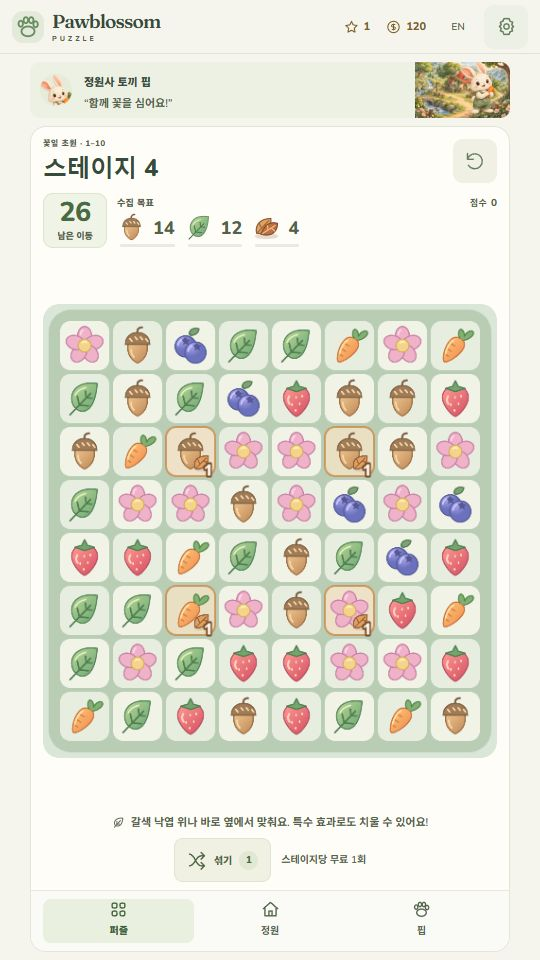
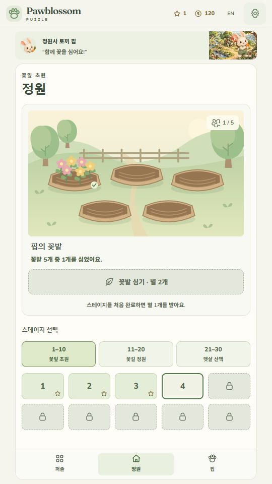
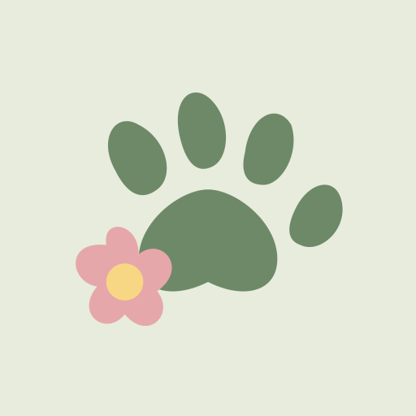
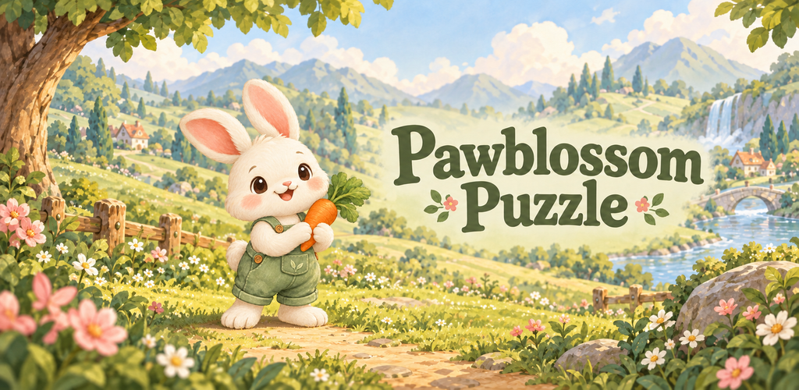

# 에셋 제작 기록

## 2026-10-21 · #190 비정형 보드의 빈칸 표시

새 이미지·벡터·폰트·음원·생성 에셋은 추가하지 않았습니다. 기존 타일 v2/낙엽과 #187/#192 연출을 재사용합니다. canonical mask의 inactive에는 타일과52×52 칸 배경을 모두 그리지 않아 실제 플레이 모양을 표시하며, 빈칸과 구간 낙하·줄 특수 도달 범위를 한영 안내합니다. 기존 에셋 바이트는 유지합니다. 검증과 미검증은 android-release/roadmap 상단 및 Git 밖 `qa/feedback-20261021/190`에 기록합니다.

## 2026-10-21 · #189 정사각 꽃폭탄 규칙과 선택 실습

새 그림·원본/표시 이미지·SVG·PNG·폰트·생성 프롬프트를 추가하지 않았습니다. 기존 타일 v2와 #187의 꽃폭탄 표시/폭발 연출을 2×2 생성에도 재사용하고 한영 도움말·본판과 분리된 선택 실습에 정사각 패턴을 연결했습니다. 기존 직선 교환/특수 탭 실습은 규칙1을 보존합니다. 구 판은 기존 규칙으로 이어지고 새 판부터 정사각을 사용할 수 있음을 한영 복원 안내에 표시합니다.

실습 완료의 생성 폭탄은 별도 CSS 몸체/심지/32px 타일로 본판의 둥근 실루엣을 따릅니다. 완료 셀은 불투명도를 낮추지 않으며 한영 접근성 이름에 생성된 꽃폭탄을 명시했습니다. 성공 피드백과3×3 범위 설명은 분리했습니다. 이 표시 보완 후 UI/실습290개·타입·두 빌드를 별도 확인하며, 앞선 전체 관련18파일1,295개와 범위를 합산하지 않습니다.

기준 main `7ff7b07`, 브랜치 `codex/189-square-flower-bomb`입니다. 관련18파일1,295개·타입·두 웹 빌드 각38파일/에셋 전수 바이트/production 복원 근거와 소스 동결은 기존 개발 기록 및 Git 밖 `qa/feedback-20261021/189`에 보존합니다. 실제 브라우저/사용자 감각·단말/스토어는 별도이며 핍 반응 그림·오디오·기존 에셋 바이트는 바꾸지 않았습니다.

## 2026-10-21 · #188 핍 먹이·놀이 반응과 꽃무늬 코인

기준 main `ae216c084d801ca3f288dc89ef8c60da7a40538a`, 브랜치 `codex/188-pip-care-garden-demo`입니다. 기존 자체 캐릭터 `public/assets/pip.png`를 참조하여 내장 image_gen으로 먹이·공놀이 두 반응을 만들었고, 총괄이 같은 캐릭터 정체성과 투명 배경을 시각 검토했습니다. 생성 PNG 원본은 `assets/source/pip-feed-source-v1.png`, `assets/source/pip-play-source-v1.png`에 새 이름으로 보존합니다. 표시용 `public/assets/pip-feed-v1.webp`(36,024바이트), `public/assets/pip-play-v1.webp`(31,376바이트)는 원본의 의미를 편집하지 않고 420×420 안으로 축소해 WebP 품질90/알파100으로 변환한 파일입니다. 두 파일의 알파 범위는0~255입니다. 기존 기본 핍·승패 반응 원본은 유지합니다.

핍은 당근 주기/공놀이 뒤 해당 그림과 반응 문장을 표시합니다. 리본과 물뿌리개 장착 도형은 이 프로젝트에서 직접 작성한 SVG이며, 기존 코인 SVG의 달러 기호는 꽃무늬 정원 화폐 도안으로 바꿨습니다. 코인 이름·잔액·첫 완료 보상은 그대로입니다. 외부 캐릭터·게임 그림·폰트는 추가하지 않았고 음량·최종 믹스는 바꾸지 않았습니다. 생성 에셋은 플레이 가능한 시제품용이며 최종 사용자 감각·실기기 검수와 출시 검증은 별도입니다.

생성일2026-10-21, 도구 내장 image_gen, 참조 `public/assets/pip.png`, 원문 프롬프트:

- 먹이 반응: Use case: precise-object-edit. Asset type: transparent character reaction sprite for the original Pawblossom Puzzle Android game. Edit target/reference: the provided original Pip rabbit. Preserve the EXACT identity: cream white fluffy rabbit, large asymmetric upright ears with pink inner ears, warm large brown eyes, peach cheeks, tiny pink nose, sage green gardener overalls with wooden buttons and stitched leaf pocket. Keep the same warm soft hand-painted storybook rendering and friendly proportions. Change the pose/action only: Pip sits comfortably with little feet visible, holding a carrot with one small bite missing near its mouth, eyes gently smiling, clearly enjoying feeding. Both paws anatomically clear. Full body centered with generous transparent padding, whole ears and feet fully inside frame. The carrot is clearly recognizable orange with green leaves. No separate floating objects, UI, frame, labels, text, particles, floor, background, logo or watermark. True transparent background preserving fine fur alpha. High small-size readability, clean silhouette, original character only. This is a reusable feeding reaction, not a change to the game's main character design.
- 놀이 반응: Use case: precise-object-edit. Asset type: transparent original Pip rabbit play reaction sprite for Pawblossom Puzzle. The supplied image is the character identity/edit reference. Preserve exactly the same cream-white fluffy rabbit, large pink inner ears, warm brown eyes, tiny pink nose, peach cheeks, sage-green gardener overalls with wooden buttons and leaf-embroidered pocket, soft hand-painted storybook finish. Change pose/action only: a lively but grounded small joyful hop beside a single little patchwork play ball, one foot lifted, paws open in delight, ears lifted, happy open smile. No carrot in this pose. Keep correct rabbit anatomy and the same recognisable character silhouette. The ball is soft garden-toy material, warm apricot and sage panels, not a logo. Full body with both ears, paws and feet visible, centered with transparent padding so nothing is clipped. True transparent background with clean fine fur alpha. No scene, floor, particles, text, UI, frame, watermark or additional characters. Prioritise readability when shown at 160px. This is a play/joy reaction of the original identity, not a redesigned character.

동결 근거는 Git 밖 `Pawblossom-builds/qa/feedback-20261021/188-art/prompts.json`, `export-verification.json`과 `188/source-manifest.json`에 보존합니다. 실제 브라우저 자연 입력은 총괄 인계 뒤 실시하며 VM 검사를 실브라우저 검증으로 합산하지 않습니다.

## 2026-10-21 · #187 타일 v2와 기존 특수블록 연출

기준 main `afdb09c0f275b97d4f4e9af9d82c90ef4fa32ff5`, 작업 브랜치 `codex/187-tile-special-effects`입니다. 기존 자체 벡터 `public/assets/tiles/`의 딸기·당근·블루베리·도토리·잎·꽃 path/배치를 바탕으로 `public/assets/tiles-v2/` 여섯 SVG를 직접 확장했습니다. 원본 여섯 파일은 보존하며 외곽선 4~4.5 단위, 진한 가장자리·밝은 반사면·내부 음영과 작은 바닥 그림자를 추가했습니다. 외부 그림·PNG·AI 이미지 생성·생성 프롬프트·추가 폰트는 없습니다. 기존 형태를 유지한 자체 벡터 수정이며 상업 출시 적합성의 최종 사용자 검수는 별도입니다.

본판·목표·미리보기·도움말·교환/특수 실습은 같은 v2 경로를 사용합니다. 줄 특수는 가로 파란 방향판/세로 초록 방향판, 폭탄은 도화선과 짙은 둥근 덩어리, 무지개는 원래 타일 색을 가운데 남긴 다색 구슬로 구분합니다. 일반 타일은 45px, 특수 중앙 원본은 외형에 맞게 29~35px로 표시합니다. 기존 매치·교환·특수 규칙·저장·난수·카메라·음량은 변경하지 않습니다.

특수는 80ms 전조 뒤 210ms 넓은 줄 빔 또는 300ms 충격파와 결정적인 방향 파편을 표시합니다. 중복 행·열은 한 번만 그리고 특수 장식은 단계당 최대 8곳, 일반 매치 반짝임은 최대 12곳·파편은 최대 16개로 제한합니다. 제거범위 표시와 기존 칸당 별도 원형 장식도 통합 임시 객체 관리 안으로 묶어 활성 객체 120개 상한·종료 정리를 유지합니다. 움직임 줄이기에서는 전조·빔·파편·충격파를 생략하고 실제 제거범위와 낙엽 완료 표시를 남깁니다.

관련 회귀 5파일 437개와 전체/앱/서버 타입, testing/production 두 웹 빌드를 통과했습니다. Vite의 기존 500kB 청크 크기 경고는 남으며 성공과 구분합니다. 벡터/경로/산출물 검사·명령 원문·소스 동결본은 아래 개발 기록과 Git 밖 `Pawblossom-builds/qa/feedback-20261021/187`에 보존합니다. 총괄의 독립 검수·실제 브라우저 자연 입력·사용자 감각 검수 전 상태이며 새 APK나 단말/스토어 검증 완료가 아닙니다.

## 2026-10-21 · #179 최신 UI의 한영 소개 화면 초안

최신 게임 소스 `e4429b84c3a8a3186f34d47f1498b398a005fcfd`의 production 웹 화면을 실제 UI로 조작하여 한국어·영어 각각 퍼즐/정원/목표 미리보기 **3장씩, 총6장**을 준비했습니다. 문서 기준 main907750d는 제품 소스가 같으며 오늘 전달 APK의 testing 화면과 혼동하지 않습니다. 각 사진은 `assets/store/screenshots-v1/manifest.json`에 소스·언어·크기·원본 SHA·140자 이내 대체 설명을 기록합니다. 기존 아이콘·피처 그래픽·게임 런타임/버전·오디오·APK에는 변경이 없습니다.




새 그림·프롬프트·외부 폰트·홍보 문구·기기 프레임을 추가하지 않았습니다. 기존 자체 에셋의 게임 화면을 그대로 사용하며 **JPEG 원본 바이트를 복사해 크기 확대/잘라내기/합성/재압축을 하지 않았습니다**. 스테이지1~3 완료·현재4번·별1/120코인·첫 꽃밭은 이전 자연 QA 진행 상태입니다. 저장/Scene/보드/RNG/지갑 주입 없이 정원·스테이지 미리보기·계속·언어 전환 버튼만 사용했고 한국어를 복원했습니다. 게임 권리와 기존 생성 에셋의 출시 적합성 최종 검수는 여전히 별도입니다.

[Google Play 공식 미리보기 에셋 안내](https://support.google.com/googleplay/android-developer/answer/9866151?hl=en)를2026-10-21에 확인했습니다. 기본 이미지 조건은 JPEG 또는 RGB PNG,320~3840px·최장변2배 이내이며 게임 추천 노출 안내는9:16 세로1080×1920 이상3장 또는16:9 가로1920×1080 이상3장입니다. **이번540×960/9:16 브라우저 초안은 기본 크기 조건만 충족하며1080×1920 권장 조건은 충족하지 않습니다.** 도구에서 DPR 지정이 제공되지 않아 업스케일로 제출 해상도를 꾸미지 않았습니다. 실제 Android 화면/안전영역·고해상도 단말 원본 캡처·사용자 시각 검수·콘솔 등록은 미완료이며 manifest 상태도 제출 전 초안입니다.

원본6장의 JPEG 형식·540×960/3채널/불투명·전체 디코딩/바이트 수·SHA, 언어별3장/대체 설명 길이, 원본과 저장소 복사본의 바이트 동일성을 확인했습니다(총333,710바이트).540×960 영어 퍼즐 화면의 document/scroll 크기는540×960으로 외부 스크롤이 없고 보드/조작이 화면 안에 표시됐습니다. 콘솔 오류 로그0이며 특정 캡처 범위의 결과로만 기록합니다. Git 밖 `Pawblossom-builds/qa/issue-179-store-screenshots`에 캡처 순서·원본·DOM 경계·이미지 검증을 보존하고 임시 IAB 탭/5187 서버와 viewport override를 정리했습니다. 정식 단말/SDK 검증이나 출시 승인으로 합산하지 않습니다.

## 2026-10-16 · Google Play 스토어 아이콘과 소재 검증 (이슈 #79)

**스토어 아이콘 초안 제작·규격 검사 및 총괄 초안 시각 검수 완료, 최종 사용자/출시 소재 승인 별도**입니다. 총괄은 제출 PNG를 직접 확인하고 별도 headless Chrome에서 검수 SVG를 832×660/deviceScaleFactor=1로 렌더링하여 32/48px 식별성과 30% 모서리 반경 마스크의 심벌 잘림 없음을 확인했습니다. 실제 기기·Play Console 업로드/노출·최종 상업권리/독창성 검수는 [후속 #73](https://github.com/ChoiDaeYoung-94/Pawblossom-Puzzle/issues/73)에 계속 남습니다.



### 원본과 제작 판단

- 자체 벡터 `assets/branding/pawblossom-mark.json`의 발바닥·꽃 path와 색상 네 가지를 그대로 사용했습니다. `pawblossom-color.svg`도 참조로 보존하며 기존 브랜드/Android 파일은 바꾸지 않았습니다. 외부 에셋·AI 이미지 생성·추가 폰트·새 프롬프트는 없습니다. 자체 도형의 기술적 확장이며 최종 권리/상업 사용 적합성 확정은 별도입니다.
- 기존 launcher의 `legacyScale: 1.2`를 중심 (54,54)에 적용합니다. adaptiveScale 0.95보다 작은 화면의 심벌을 키우되, 새 도형/과도한 확대 없이 브랜드 배경 `#E7ECDC`가 정사각형 전체를 채웁니다. 외부 그림자·둥근 모서리·배지·홍보 문구는 없습니다.
- 확인일 2026-10-16: [Google Play 아이콘 규격](https://developer.android.com/distribute/google-play/resources/icon-design-specifications)과 [미리보기 에셋 안내](https://support.google.com/googleplay/android-developer/answer/9866151?hl=en)를 읽었습니다. 제출 아이콘은 **512×512·32-bit PNG(with alpha)·sRGB·최대1024KB·full square**입니다. 모서리 반경 30%와 외부 그림자는 Play가 적용합니다. alpha 채널을 유지하면서 배경을 불투명하게 채울 수 있습니다.
- 제출 파일은 `play-icon-v1.png` 하나입니다. `play-icon-preview-v1.svg`는 512px 정사각형, 256px 마스크, **실제48/32px** 정사각형/마스크를 함께 배치한 검수 전용이며 제출하지 않습니다. 실제 Play 출력/그림자 재현으로 단정하지 않습니다.

### 내보내기와 해시

Node **24.21.0**, sharp **0.35.5**, libvips **8.18.7**, librsvg **2.63.2**, lcms **2.19.1**에서 실행했습니다. sharp는 기존 번들로만 사용하며 프로젝트 의존성/잠금 파일은 추가하지 않았습니다. 내보내기 스크립트는 인자로 전달한 sharp 또는 별도 설치한 sharp를 사용하므로 저장소 코드에 외부 경로를 하드코딩하지 않습니다. 같은 버전/도구의 재내보내기 일치를 검사하며 다른 렌더러 버전의 동일 바이트까지 보장하지 않습니다.

실행한 정확한 PowerShell 명령(내보내기만 sharp 필요):

```powershell
. ./scripts/use-dev-tools.ps1
$sharpModule = 'C:/Users/user/.cache/codex-runtimes/codex-primary-runtime/dependencies/node/node_modules/sharp'
node scripts/export-store-icon.mjs $sharpModule
npm run store:check
npm run store:test
```

실제 내보내기 연산은 `sharp(Buffer.from(svg)).toColourspace('srgb').ensureAlpha().withIccProfile('srgb').png({compressionLevel:9,palette:false}).toFile(output)`입니다. SVG는 `store-icon-source.mjs`에서 원본 JSON의 path/fill/legacyScale로 파생하며 `export-store-icon.mjs`가 SVG·PNG·검수 SVG를 보존합니다.

| 파일/프로파일 | 규격·바이트 | SHA256 |
| --- | --- | --- |
| 브랜드 JSON (CRLF 작업 트리 원본) | 기존 파일 보존 | `067cd74c00d4ee2562bc81207f222089ec3b70d63de9c2f807cff39d36066079` |
| 브랜드 JSON (LF 정규화, Git/CI 기준) | 내용 동일 | `2ca6a6b9f9321fa70e90bf69b4b9d568220ab9360e0f49178f6c978c4ef2e9bd` |
| 브랜드 color SVG (LF) | 기존 파일 보존 | `5bac19d8d987895cd5ff5687557fc819ed733a03c19464ce0cf97ae0965dbbc5` |
| `play-icon-source-v1.svg` (LF) | 512×512, 751바이트 | `3db10c2929ae7a6c5d024bcf4f6b8f6682b1de573adf5dd68fa9549e4162e0ec` |
| `play-icon-v1.png` | **512×512, RGBA8 (32-bit), 12,527바이트** | `21b8cd48bb2872f0dd5fb47d9f1052485d467fd6764f7fe37a7255968edd584c` |
| 내장 sRGB ICC 프로파일 | iCCP 해독 결과 | `c56e1685d888f5edb92fe07f2750f387f8fe8e91b32ff8fb0b56bfbbb9458353` |
| `play-icon-preview-v1.svg` (LF) | 832×660, 101,339바이트 | `768a33fc8f4d4952251e8851149c740e46e688400c3b16269899efc08d621cd7` |

sharp metadata/stats와 Node PNG 해독으로 color type 6·bit depth8·4채널·sRGB 프로파일·모든 alpha=255를 확인했습니다. 1,024KiB보다 작으며 네 모서리는 원본 배경색입니다. alpha 존재와 실제 투명 픽셀 존재를 구분합니다.

### 반복 검증과 현재 검증 상태

`assets/store/store-assets-v1.json`은 아이콘/기존 피처 그래픽의 규격·바이트·SHA256·source 및 9개 참조 원본 해시를 보존합니다. PNG는 원시 바이트, 텍스트 참조는 명시적 LF 정규화 해시를 사용해 Windows/CI 줄바꿈 차이를 허용합니다. `npm run store:check`는 필수 아이콘1+피처1·고정 경로·공식 크기/형식·아이콘 최대크기·sRGB 프로파일·필수 참조를 강제하고, SVG가 브랜드 JSON에서 파생되는지도 검사합니다. 피처 그래픽은 기존 1024×500 RGB PNG(1,313,700바이트)를 그대로 검사하며 아이콘 전용1024KB 한도를 피처 그래픽에 적용하지 않습니다.

검증기는 Node 내장 기능만 사용하고 8-bit RGB/RGBA·non-interlaced PNG로 범위를 제한합니다. 전체 청크 CRC, IDAT 해독 길이·필터0–4, 알파/불투명, ICC 해독·해시, IEND·뒷바이트를 확인하며 `tRNS`와 지원하지 않는 critical chunk/인코딩은 거부합니다. 벡터를 직접 래스터화하거나 임의 PNG 전체 형식을 지원하지 않습니다. 픽셀의 예술성·권리·실제 Play 노출을 자동 판정하지 않습니다.

기준 main `7c28da8a06429182d8b158ff93ba0a10b2b77504` 위 작업 트리에서 **기존349개·스토어 경계12개·타입 검사·launcher 원본 일치·store:check·git diff --check 통과**했습니다. 경계 검사는 손상/절단/CRC, RGB/RGBA tRNS, manifest 빈 목록/누락/중복/규격/참조 변경, 투명 픽셀, 한도/해시/프로파일 불일치를 포함합니다. Node test 파일을 Vitest 검색 패턴에 두어 최초 전체 검사에서 suite 충돌이 났고, 기존 QA 스크립트 위치로 분리한 뒤 전체349개와 별도12개를 다시 통과했습니다. CI Node22·24는 스토어 검사와 기존 production/testing 빌드를 함께 실행하도록 연결했으며 최신 PR/main 실행 결과는 PR에 기록합니다. 로컬 dist/기존 Vite 서버를 보존하므로 로컬 웹 빌드는 반복하지 않았습니다. runtime 화면 변경이 없어 새 게임 브라우저/Android 검증으로 합산하지 않습니다. APK/AAB·Android 동기화·버전·SDK·광고/결제·오디오·콘솔/Drive 변경은 없습니다.

## 2026-10-16 · Google Play 피처 그래픽 초안 (이슈 #77)

**초안 제작·파일 규격 확인 완료, 총괄 초안 시각 검수 완료(최종 사용자/출시 소재 승인 별도)**입니다. 최종 출시 소재 승인·실제 기기 스크린샷·콘솔 업로드/노출 검증은 미완료입니다. 한 장의 소개 삽화이며 실제 게임 화면이나 추가 플레이 기능을 나타내지 않습니다. 원본과 최종본은 `assets/store`에만 보존하고 runtime/public/Android/audio/package/version/dist/서버는 변경하지 않았습니다.



### 공식 규격과 디자인 판단

확인일 2026-10-16: [Google Play 미리보기 에셋 안내](https://support.google.com/googleplay/android-developer/answer/9866151?hl=en)의 피처 그래픽 **필수 규격**은 JPEG 또는 **24-bit PNG(no alpha), 1024×500**입니다. 핵심 요소 중앙 배치·cutoff zone 회피·추가 UI overlay 고려·가장자리 배경·작은 화면 세부 묘사 절제·게임과 색채 일치·앱 아이콘과 중복되는 큰 브랜딩 회피는 **Highly recommended(권고)**로 구분합니다. 공식 본문에는 안전영역의 고정 픽셀 수치가 없어 임의 수치를 공식 규격으로 쓰지 않습니다. 이 초안의 제작 여백 100px(좌우)·55px(상하)은 자체 기준입니다.

최종 1024×500에서 핍 실루엣은 대략 x=228–474/y=101–421, 제목은 x=500–902/y=160–298입니다. 핵심 요소는 자체 여백 안에 있으며 중앙 (512,250) 주변의 가상 재생 버튼이 제목에 일부 겹칠 가능성은 남습니다. 미리보기 영상은 만들거나 등록하지 않았으며 실제 Play 노출 형식별 crop/overlay는 콘솔 단계에서 별도 확인합니다. 배경의 집·산·강·꽃은 기존 `meadow.png`를 참고한 소개 삽화 요소이며 새로운 지역/상호작용을 약속하지 않습니다.

[Google Play 메타데이터 정책](https://support.google.com/googleplay/android-developer/answer/9898842?hl=en)의 허위·무관·과도한 메타데이터 금지를 확인했습니다. 표시 문구는 **Pawblossom Puzzle** 하나이며 가격·순위·수상·리뷰·다운로드 유도·스토어 배지·허위 보드/UI·새 동물/기능은 없습니다. 한국·미국 공용 제목 초안이며 별도 슬로건은 없습니다.

- KO alt 초안: `꽃이 핀 초원에서 당근을 안고 웃는 크림색 토끼 핍과 Pawblossom Puzzle 제목`
- EN alt 초안: `Pip, a cream rabbit in sage gardening overalls, smiles with a carrot in a flower meadow beside the Pawblossom Puzzle title.`
- 두 alt는 각각 140자 이하입니다. Play Console 입력·실제 보조 기술 검증은 미완료입니다.

### 참조·생성·출처

내장 `image_gen.imagegen`을 사용했습니다. 1차는 참조 기반 생성, 2차는 핍 크기/상단 여백만 요청한 편집입니다. 창작 생성·수정은 imagegen에서만 했으며 Python 이미지 편집·새 외부 에셋·폰트 추가는 없습니다.

- 정체성 참조: `public/assets/pip.png` (자체 imagegen 시제품). 크림 털·갈색 눈·분홍 귀/볼·세이지 멜빵·나무 버튼·잎 포켓·당근을 유지합니다.
- 배경/그림체 참조: `public/assets/meadow.png` (자체 imagegen 시제품).
- 보조 표정/동작 참조: `assets/source/pip-win-v1.png` (이슈 #62 자체 핍 변형). 한 캐릭터의 참고이며 두 번째 동물이 아닙니다.
- 참조 파일 SHA256: `public/assets/pip.png` = `be54a5a265d05cff964eff3177e637a1540138c7680802ab0a553496e118bcba`, `public/assets/meadow.png` = `fdd7aa15f95518167d355d8aecb5952ee13d54d380956ed087d397a0ef4d4195`, `assets/source/pip-win-v1.png` = `df3601c2c9015f403c42e95a817d3772c12fe977bfa4910d2dfae5afbbe4f7da`입니다.
- 브랜드 확인: `assets/branding/pawblossom-color.svg`, `pawblossom-mark.json`의 샐비어 `#6E8968`·배경 `#E7ECDC`·꽃 `#E6A7AA`·노랑 `#F7D784`. 기존 SVG는 발바닥/꽃 심벌이고 타이틀 글자는 없습니다. 큰 앱 아이콘 중복을 피하려고 심벌을 합성하지 않았습니다.
- 제목은 기존 영문 Fraunces 제목의 둥근 세리프 인상을 imagegen이 그렸습니다. Fraunces 글꼴 파일로 조판한 결과나 확정 로고가 아닙니다. 정확한 실제 폰트 조판/기존 SVG 합성은 필요하지 않아 수행하지 않았습니다.
- OpenAI 출력 사용 조건 참고는 위 핍 기록과 같은 [이용약관 Content/Ownership](https://openai.com/policies/row-terms-of-use/)입니다. 자체 참조와 AI 생성 사실을 보존하며 최종 권리·독창성/상업 사용 적합성은 출시 검수 항목으로 남깁니다.

내장 원본 경로(동일 바이트를 아래 Git 파일에 복사하여 외부 경로 의존 없음):

- 1차: `C:\Users\user\.codex\generated_images\01a143f2-aee1-7383-a361-a51cc9bd2787\exec-8c586a90-ab49-4542-9a0c-11097913d153.png` → `assets/store/play-feature-base-v1.png`
- 여백 수정: `C:\Users\user\.codex\generated_images\01a143f2-aee1-7383-a361-a51cc9bd2787\exec-d01531e6-a3e5-4708-850d-377bcc0c63f1.png` → `assets/store/play-feature-source-v1.png`

### 파일 검사와 기술 내보내기

| 파일 | 규격·형식 | 알파/불투명 | 바이트 | SHA256 |
| --- | --- | --- | ---: | --- |
| `assets/store/play-feature-base-v1.png` | 1794×877, RGB 8-bit/channel PNG | no alpha / opaque | 2,464,138 | `0bf43f085bf6fad1a9ae7ed6fc81c663fb64b69e0c6129592f294bb70bd9b43d` |
| `assets/store/play-feature-source-v1.png` | 1793×877, RGB 8-bit/channel PNG | no alpha / opaque | 2,377,262 | `502bde83e94287c2fbda99a254f475d3520fae4ea21072f1cad882e3384eb0dd` |
| `assets/store/play-feature-v1.png` | **1024×500, 24-bit RGB PNG** | **no alpha / opaque** | **1,313,700** | `aaeeab330e36941dd89cc0a6b232ab4503cd218f52f8ddaa5477af593c19b4f4` |

sharp 0.35.5/libvips 8.18.7로 전체 파일 해독·metadata/stats·SHA256·PNG IHDR 검사를 수행했습니다. 최종 PNG는 color type 2(Truecolor), bit depth 8, channels 3, hasAlpha=false, isOpaque=true입니다. imagegen 원본이 정확한 요청 픽셀 수를 보장하지 않아 **기술적 규격/인코딩 내보내기**만 아래처럼 수행했습니다. 1793×877 원본의 비율을 유지하는 cover+centre 리샘플링으로 1024×500에 맞추며 위아래 가장자리 배경 합계 약 0.9px(최종 기준)이 잘립니다. 덧칠·합성·타이포/색상 등 창작 수정은 하지 않았고 프로젝트 의존성도 추가하지 않았습니다.

```js
await sharp('assets/store/play-feature-source-v1.png')
  .resize({ width: 1024, height: 500, fit: 'cover', position: 'centre', kernel: 'lanczos3' })
  .toColourspace('srgb').removeAlpha()
  .png({ compressionLevel: 9, palette: false })
  .toFile('assets/store/play-feature-v1.png');
```

최종 파일을 view_image로 육안 확인하여 제목 철자·한 캐릭터·복장·손/발·당근·여백·기존 배경 일치를 점검했습니다. 기준 main `4740ba1cae2fe03a76b21e93db67789d3594f3f3` 위 작업 트리에서 Node 24.19.0으로 `node scripts/generate-launcher-assets.mjs --check`, `node node_modules/typescript/bin/tsc --noEmit`, `node node_modules/vitest/vitest.mjs run`을 실행하여 아이콘 일치·타입 검사·자동 349개(15개 파일)를 통과했습니다. 로컬 npm 명령이 PATH에 없어 기존 스크립트의 같은 실행 파일을 직접 호출했습니다. 로컬 웹 빌드는 dist 보존을 위해 수행하지 않았습니다. 앱 실행 화면을 바꾸지 않아 새로운 runtime 브라우저/Android 검증 결과로 표시하지 않습니다. 총괄 검수·최신 PR/main Node 22·24 CI 결과는 이슈/PR에 보존합니다.

### 1차 프롬프트 전문

```text
Use case: ads-marketing / compositing.
Asset type: Google Play feature graphic DRAFT for the original cozy match-3 game Pawblossom Puzzle. One cohesive hand-painted introduction illustration, not a gameplay screenshot.
Input images: Image 1 (pip.png) is the sole character identity reference. Image 2 (meadow.png) is the existing game's landscape, palette and gouache style reference. Image 3 (pip-win-v1.png) is a supporting expression/pose reference of the SAME rabbit, not a second character.
Primary request: Compose a polished, calm, welcoming wide banner that introduces Pip in his existing flower meadow. Preserve the exact cream rabbit identity, rounded head/body proportions, long peach-pink inner ears, dark brown eyes, peach cheeks, sage-green short gardening overalls, wooden buttons, leaf pocket, cream paws and small fluffy tail. Pip holds one recognizable orange carrot with green leaves and smiles toward the viewer; one rabbit only.
Scene/backdrop: Simplified existing meadow, warm ivory sunlight, sage and mint green hills and soft foliage, a few existing pink flowers. Use only landscape elements already in meadow.png; keep peripheral background soft, sparse and subordinate. Do not invent new locations or structures.
Style/medium: Same warm hand-painted gouache storybook brushwork as the input images, soft natural light, crisp readable character silhouette. Palette matches #6E8968 sage, #E7ECDC pale cream-green, #E6A7AA dusty pink and #F7D784 warm yellow accents.
Composition/framing: Wide landscape aspect ratio exactly 1024:500 (2.048:1), opaque edge-to-edge artwork. Intended final export 1024 by 500 pixels. Keep all important elements well inside an internal production margin of 100px left/right and 55px top/bottom at final size. Pip stands fully visible in the left-center, about x=280, ears above y=75 and feet above y=430. Title sits in the right-center, about x=650 y=230, no overlap with Pip or carrot. Leave the geometric center uncluttered for potential Play overlays. Edges contain only soft background greenery, never title or face. Big clear forms, no dense fine details.
Text (verbatim, only visible text): "Pawblossom Puzzle". Set on two balanced lines, "Pawblossom" above "Puzzle", with exact capitalization and spelling, a warm rounded readable serif inspired by the game's Fraunces headings, dark sage green against a quiet pale cream-green open background. No heavy frame, badge, app icon duplication or extra logo.
Constraints: A single original marketing illustration, no fake UI, game board, buttons, score, screen, device mockup or screenshot. No added animals/characters, new costumes, regions, modes, social features or unimplemented features. No price, rank, awards, review claims, promotional words, call-to-action, store badge, watermark or third-party marks. Not imitating any existing game's art. Preserve the supplied original character and palette. No transparency.
```

### 여백 편집 프롬프트 전문

```text
Use case: precise-object-edit / identity-preserve.
Input image 1 is the edit target, the Pawblossom Puzzle feature graphic draft. Make ONE targeted composition correction only: reduce Pip the rabbit, including his carrot, proportionally to about 83 percent of his current size and position him slightly lower, still left-center. At final 1024 by 500 scale, keep his highest ear tip below y=65 and his lowest feet above y=425, with his face around x=340 y=220. Fill the newly revealed area naturally using the SAME existing meadow background. Do not change rabbit identity, expression, pose, cream fur, pink ears and cheeks, dark brown eyes, sage gardening overalls, wooden buttons, leaf pocket or carrot.
Preserve the exact existing text "Pawblossom Puzzle", its exact spelling, two-line layout, size, color and position. Preserve existing gouache style, colors, sunlight, wide aspect ratio exactly 1024:500, background composition and all other elements. Single rabbit only. No new objects, characters, buildings, locations, text, UI, logos, device images, badges, claims or watermark. Edge-to-edge opaque artwork, no transparency. This is a marketing illustration draft, not a gameplay screenshot.
```


제작일: 2026-10-08. 현재 에셋은 첫 시제품용입니다. 스토어용 최종 아트 검수는 남아 있습니다.

| 파일 | 제작 방식 | 용도 |
| --- | --- | --- |
| `public/assets/meadow.png` | Codex 내장 imagegen 생성 | 꽃잎 초원 배경 |
| `public/assets/pip.png` | Codex 내장 imagegen 생성, 투명 배경 | 정원사 토끼 핍 |
| `public/assets/tiles/*.svg` | 프로젝트에서 직접 작성한 벡터 | 딸기·당근·블루베리·도토리·잎·꽃 |
| `src/icons.ts` | 프로젝트에서 직접 작성한 SVG | UI 아이콘 |
| `android/app/src/main/res/drawable/pawblossom_icon.xml` | 프로젝트에서 직접 작성한 Android 벡터 | 시제품 앱 아이콘·시작 화면 |
| `src/audio/AudioManager.ts` | 프로젝트에서 직접 작성한 음형과 Web Audio 합성 | BGM 1곡·효과음 8종 |
| Nunito, Fraunces | `@fontsource` 로컬 패키지, SIL Open Font License | 영문 본문·제목 |

폰트 라이선스 원문은 `public/licenses/Nunito-OFL.txt`, `public/licenses/Fraunces-OFL.txt`에 포함되어 배포 빌드에 함께 들어갑니다. 한국어는 기기 기본 글꼴을 사용합니다. 기존 게임의 그림·음악을 추출하거나 사용하지 않았습니다. 라이브러리 코드는 각 패키지 라이선스가 적용되며 프로젝트 전체에 별도 오픈소스 라이선스를 지정하지 않았습니다.

## 배경 생성 프롬프트

Original polished hand-painted 2D storybook woodland village environment, landscape 3:2 composition. Mint green rolling hills, ivory sunlight, rounded trees, sandy path, a small cozy cottage with a strawberry-red rounded roof, carrot garden and pink flowers, a winding river. Cozy afternoon, sage green, cream, peach and muted coral palette. Keep the central third readable for a cottage and future overlays. No characters, typography, logos, watermarks, or imitation of any existing game. Rich gouache texture with clean forms suitable for a friendly casual puzzle game.

## 핍 생성 프롬프트

One original adorable cream rabbit gardener, full body, front three-quarter view. Dark brown eyes, peach cheeks and inner ears, sage green overalls with a tiny leaf detail, holding one carrot. Warm hand-painted gouache shading with crisp readable edges and rounded proportions. Friendly casual game character. Transparent background, no scenery, no text, no logo, no watermark, no imitation of an existing character.

원본 생성 결과를 프로젝트 PNG로 복사했습니다. 그림은 실제 브라우저에서 확인했고, 블록 SVG는 Phaser SVG 로더로 래스터화하여 표시합니다. 배경에는 나중에 추가할 수 있는 요소가 그려져 있으므로 그림 속 소품 전체가 현재 상호작용 가능한 기능을 뜻하지 않습니다.

## 출시 전 보강

2026-10-11 첫 교환 실습은 기존 자체 제작 SVG 블록과 CSS 테두리·체크 표시를 사용합니다. 소리는 기존 Web Audio `match` 효과음을 재사용했습니다. 외부 에셋과 생성 프롬프트 추가는 없습니다. 한국어 360×800 화면과 영어 입력 흐름을 확인했으며 실제 Android 터치·음향 검수는 남아 있습니다([실습 기록](practice-qa.ko.md)).

2026-10-11 첫 플레이 안내는 기존 자체 제작 블록 SVG와 `src/main.ts`·`src/style.css`에서 작성한 도형을 재사용했습니다. 추가 외부 에셋과 생성 프롬프트는 없습니다. 영어 데스크톱과 한국어 360×800 화면을 브라우저에서 확인했습니다. 안내 삽화도 시제품이며 실제 Android의 글꼴과 가독성 검증은 남아 있습니다.

- 핍의 표정·동작 세트 제작과 정원 단계 아트의 실기기 검수
- 작은 화면에서 블록 형태, 특수블록 표시, 목표 아이콘 가독성 확인
- 저사양 기기 텍스처 메모리·로딩 측정 후 해상도와 압축 최적화
- 앱 적응형 아이콘·스토어 아이콘·스크린샷·피처 그래픽 제작
- 최종 음색과 음량을 휴대폰 스피커·이어폰으로 청취하여 보강

### 2026-10-14 특수 블록 효과 표시

방향 화살표·제거 칸 테두리·줄·원형 효과는 `src/BoardScene.ts`의 Phaser Graphics로 직접 작성했습니다. 외부 그림·프롬프트·추출 에셋은 사용하지 않았습니다. 시제품 연출이며 Android 기기에서 작은 보드의 가독성과 움직임을 확인할 예정입니다.

### 2026-10-14 Android 적응형·단색 아이콘 (이슈 #20)

기존 자체 제작 발바닥·꽃 벡터의 경로와 색상을 `assets/branding/pawblossom-mark.json`에 단일 원본으로 옮겼습니다. 새 외부 에셋·생성 프롬프트는 없습니다. `npm run assets:generate`로 Android XML과 검수용 SVG를 재생성하고 `npm run assets:check`로 원본과의 일치를 확인합니다. 웹 빌드에도 일치 검사를 연결해 CI에서 드리프트를 잡습니다. 생성 파일을 직접 수정하기보다 JSON 원본을 수정합니다.

일반·원형 벡터는 API 24/25를 위한 `mipmap-anydpi`, 전경/배경을 나눈 적응형은 `mipmap-anydpi-v26`, 단색 테마 레이어는 `mipmap-anydpi-v33`에 둡니다. Manifest는 mipmap을 참조하며 시작 화면은 배경 없는 같은 전경 도형을 사용합니다. 기존 기본 템플릿 PNG는 사용 경로에서 제외되었으나 파일 자체는 보존했습니다.

[Android 적응형 아이콘 공식 안내](https://developer.android.com/develop/ui/compose/system/icon_design_adaptive)의 레이어·마스크·안전 영역 설명을 확인했습니다. 전경은 108×108dp에서 중심 기준 0.95 배율로 배치합니다. 4배 SVG 렌더의 불투명 픽셀 범위를 검사해 최대 반경 32.71dp, 외곽 크기 55×48dp가 중앙 66dp 안전 원에 들어가는 것을 확인했습니다. 이는 SVG 검수이며 실제 OEM 런처를 실행한 결과는 아닙니다.

시작 화면은 기존 Theme.SplashScreen의 단색 배경·전경 도형·후속 테마 연결을 유지하고 인위적인 대기 시간을 추가하지 않습니다. [Android 시작 화면 공식 안내](https://developer.android.com/develop/ui/views/launch/splash-screen)를 참고했습니다. 실제 기기의 시작 화면·일반/원형·테마 아이콘은 새 APK에서 검수합니다.


빌드된 APK에서 anydpi·v26·v33 리소스와 전경·단색 도형이 포함된 것을 aapt로 확인했습니다. APK/AAB 빌드와 APK v2 서명 검증을 통과했습니다. 스토어 512px 아이콘·피처 그래픽·최종 단말 검수까지 끝난 출시 에셋으로 표시하지 않습니다.

### 2026-10-14 정원 성장 단계 (이슈 #24)

`src/GardenArt.ts`에서 배경·울타리·길·다섯 꽃밭·꽃을 직접 SVG로 작성했습니다. 외부 에셋과 생성 프롬프트는 없습니다. 저장된 꽃밭 수에 따라 정확히 0~5곳에만 꽃이 표시되며, 새 꽃밭에 450ms 성장 연출을 적용합니다. 움직임 줄이기 설정에서는 연출을 생략합니다. 아직 실기기 검수가 남은 시제품 아트입니다.

별 2개 소비·중복 탭 방지·최대 5곳 제한·재실행 복원·한국어/영어 설명을 확인했습니다. 저장 실패 경고를 성공 안내가 가리지 않도록 했습니다. 브라우저 360×800 및 640×360에서 확인했으며, 별·코인·기존 완료 스테이지 저장 형식을 유지합니다.


### 2026-10-14 낙엽 바닥층 (이슈 #26)

`public/assets/obstacles/leaf-pile.svg`의 갈색 겹잎·잎맥·그림자는 직접 작성한 벡터입니다. 보드의 바닥색·테두리·겹 수 점·제거 테두리는 `BoardScene.ts`에서 직접 그립니다. 외부 에셋·생성 프롬프트는 없습니다. 초록색 일반 잎 블록과 갈색 낙엽 목표를 구분하며, 아직 시제품 단계입니다.

320×568·360×640·360×800 세로, 640×360·800×360 가로 화면에서 목표·보드·도구의 한 화면 배치를 확인했습니다. 실제 손가락 조작과 작은 겹 수 표시는 사용자 APK 재시험에서 검수합니다.


### 2026-10-14 낙엽 겹 감소와 추가 연출 (이슈 #30)

`public/assets/obstacles/leaf-single.svg`는 한 장 낙엽의 자체 제작 벡터입니다. 기존 겹잎 그림을 두 겹에, 새 한 장 그림을 한 겹에 사용하고 크기·바닥색·숫자 2/1로 구분합니다. 외부 에셋·생성 프롬프트는 없습니다.

`src/BoardEffects.ts`에서 실제 단계의 낙엽 변경 값으로 2 → 1 또는 ✓, 짧은 낙엽 조각 날림과 테두리 감쇠를 만듭니다. 일반 매치의 반짝임, 줄 제거의 빛 이동, 폭발·색 제거의 확산 원도 직접 작성했습니다. 신규 음원은 없으며 기존 확정 믹스를 유지합니다. 움직임 줄이기에서는 새 이동 장식을 생략하고 겹 변화 기호를 유지합니다. 시제품 연출이므로 휴대폰 가독성·프레임과 반복 피로감은 새 APK에서 검수합니다.

| 두 겹 → 한 겹 표시 | 남은 한 겹 |
| --- | --- |
|  |  |

### 2026-10-14 핍 결과 반응 (이슈 #34)

기존 자체 제작 `public/assets/pip.png`를 결과 화면에 재사용했습니다. 성공 시 한 번 가볍게 뛰는 동작과 별 장식, 실패 시 작은 기울임과 응원 문구를 `src/style.css`·`src/main.ts`에서 직접 작성했습니다. 기존 별·잎 SVG 아이콘을 재사용하고 새로운 외부 에셋·생성 프롬프트는 없습니다. 원본 얼굴을 바꾼 표정 이미지 세트를 제작한 것은 아니며 표정 전용 아트는 후속 항목입니다.

동작은 850ms 후 멈추고 움직임 줄이기에서는 생략합니다. 별 장식은 장식으로 숨기며 실제 새 보상은 첫 일반 완료에만 표시합니다. 360×640·320×568·640×360의 결과·버튼 배치와 한국어/영어·움직임 줄이기를 Chrome에서 확인했습니다. 실기기 반응·복귀 검수가 남은 시제품 연출입니다.


### 2026-10-15 배경 요청 시점 보강 (이슈 #47)

기존 meadow.png에 HTML 지연 로딩·비동기 디코딩 힌트를 적용했습니다. 핍은 첫 결과 반응을 위해 초기 준비를 유지합니다. 원본 PNG와 생성 프롬프트·이미지 해상도는 동일하며, 변경 전후 production 빌드의 두 PNG SHA256도 일치했습니다. 작은 화면에서 보이지 않는 배경 요청을 지연한 검증은 [브라우저 기록](browser-qa.ko.md)에 있습니다. 그림·폰트 삭제나 새 외부 에셋 도입은 없습니다. Nunito/Fraunces OFL 원문은 public과 dist에서 일치하며 기존 테스트 APK의 원문 해시도 읽기 점검에서 일치했습니다. 이는 최종 출시 아트·Android 검수 완료를 뜻하지 않습니다.

### 2026-10-16 핍 성공·격려 전용 아트 (이슈 #62)

제작 도구는 Codex 내장 `image_gen`이며 성공·격려 각각 1회, `transparent_background=true`로 생성했습니다. 자체 제작 `public/assets/pip.png`만 캐릭터·화풍 참조로 사용했습니다. 참조 SHA256은 `be54a5a265d05cff964eff3177e637a1540138c7680802ab0a553496e118bcba`, 1,166,317바이트이며 기존 원본·메인·친구 화면은 유지합니다. 기존 게임/캐릭터 모사나 외부 이미지 다운로드는 없습니다.

생성 도구의 실제 출력 원본 경로는 다음과 같습니다. 동일 바이트를 `assets/source`에 각각 한 장씩 Git 보존하므로 프로젝트가 이 외부 경로에 의존하지 않습니다. 원본은 public/dist에 배포하지 않습니다.

- 성공: `C:\Users\user\.codex\generated_images\01a11a8c-0d58-7790-9dc7-218775f5bdb2\exec-2d68cbb1-e452-4d5e-a857-f1df639717f3.png` → `assets/source/pip-win-v1.png`
- 격려: `C:\Users\user\.codex\generated_images\01a11a8c-0d58-7790-9dc7-218775f5bdb2\exec-4a1f6847-d522-4416-be85-1e6c477ac70a.png` → `assets/source/pip-retry-v1.png`

| 파일 | 치수 | 바이트 | SHA256 |
| --- | --- | ---: | --- |
| `assets/source/pip-win-v1.png` | 1254×1254 RGBA | 1,189,851 | `df3601c2c9015f403c42e95a817d3772c12fe977bfa4910d2dfae5afbbe4f7da` |
| `assets/source/pip-retry-v1.png` | 1254×1254 RGBA | 1,175,952 | `32935dc9250a015c9b571db6631f041d0953b46bc163e4a4707acaac2271b2c8` |
| `public/assets/pip-win-v1.webp` | 420×420 RGBA | 32,384 | `648cc94781553afc6cfc192fb179192c0712e554c0fd2456d8f4e1c889f51124` |
| `public/assets/pip-retry-v1.webp` | 420×420 RGBA | 31,666 | `033655e3371509ae5bac05010257aa0c35c9eefa2188f0c2e56c8d2e9e3da9e3` |

이미지 창작 수정은 내장 생성 도구에서만 했으며 후처리는 기존 번들 sharp 0.35.5/libwebp 1.6.0의 기술 변환입니다. 원본에 `sharp(source).resize({width:420,height:420,fit:'inside',withoutEnlargement:true,kernel:'lanczos3'}).webp({quality:90,alphaQuality:100,effort:6}).toFile(target)`를 적용했습니다. 크롭·배경 합성·그림 덧칠은 없습니다. 140 CSS px의 3배 해상도이며 이미지당 해독 RGBA 크기는 705,600바이트(원본 6,290,064바이트)입니다. 실제 GPU/브라우저 메모리 총량 측정과는 구분합니다. 새 프로젝트 의존성은 추가하지 않았습니다.

변환 후 완전 투명/불투명/부분 알파 픽셀은 성공 111,568/1,083/63,749, 격려 111,262/1,081/64,057입니다. 원본과 사용 파일 모두 알파를 가지며 Chrome의 실제 해독·canvas 알파 검사도 수행합니다. 성공은 웃는 감은 눈과 큰 미소, 격려는 열린 갈색 눈과 작은 미소로 구분합니다. 크림색 털·분홍 긴 귀·샐비어 멜빵·나무 버튼·잎 포켓·당근·과슈 질감의 일관성과 작은 결과 화면을 육안 검토했습니다. 두 그림은 **시제품 검수 상태**이며 Android 실기기·저사양 WebView·글꼴 배율·최종 출시 권리/시각 검수는 남아 있습니다.

사용 조건 참고: [OpenAI 이용약관 Content/Ownership](https://openai.com/policies/row-terms-of-use/), 발효 2026-01-01·확인 2026-10-16. 법이 허용하는 범위에서 OpenAI와 사용자 사이의 출력 권리 배정이 명시되지만 출력의 고유성·제3자 권리를 보장하는 것은 아닙니다. AI 생성 사실과 자체 참조 출처를 기록하며 출시 검수를 별도로 유지합니다.

성공 프롬프트 전문:

```text
Use case: identity-preserve / game character variant.
Input image 1 is the ORIGINAL PAWBLOSSOM PUZZLE character Pip, the sole identity and style reference. Create one sibling character pose asset for this same game. Keep the exact cream rabbit identity, head/body proportions, long peach-pink inner ears, round dark-brown eyes when open, peach cheeks, sage-green short gardening overalls, two wooden buttons, tiny leaf detail on the pocket, cream paws and small fluffy tail. Preserve the soft hand-painted gouache brushwork, warm ivory lighting, crisp readable cutout silhouette and existing palette. Keep one recognizable orange carrot with green leaves. Full body centered with both ears and both feet completely visible, comfortable transparent padding around all edges, no cropping. Readable at about 100–140 screen pixels tall. Single isolated rabbit only, genuinely transparent alpha background, no scene, no frame, no text, no symbols, no stars, no watermark, no added costume/brand or imitation of another character. Square composition.
Primary request: SUCCESS expression and pose. Pip celebrates a completed harvest with a joyful open smile, eyes softly closed in happy upward crescents, ears lifted. Hold the carrot proudly upright in one paw close to the body; the free paw is raised in a small cheerful wave. Stable standing pose, a subtle lively lean, warm friendly delight. Preserve the original character design and clothing details. No jumping, props, extra paws or detached elements.
```

격려 프롬프트 전문:

```text
Use case: identity-preserve / game character variant.
Input image 1 is the ORIGINAL PAWBLOSSOM PUZZLE character Pip, the sole identity and style reference. Create one sibling character pose asset for this same game. Keep the exact cream rabbit identity, head/body proportions, long peach-pink inner ears, round dark-brown eyes when open, peach cheeks, sage-green short gardening overalls, two wooden buttons, tiny leaf detail on the pocket, cream paws and small fluffy tail. Preserve the soft hand-painted gouache brushwork, warm ivory lighting, crisp readable cutout silhouette and existing palette. Keep one recognizable orange carrot with green leaves. Full body centered with both ears and both feet completely visible, comfortable transparent padding around all edges, no cropping. Readable at about 100–140 screen pixels tall. Single isolated rabbit only, genuinely transparent alpha background, no scene, no frame, no text, no symbols, no stars, no watermark, no added costume/brand or imitation of another character. Square composition.
Primary request: ENCOURAGING TRY-AGAIN expression and pose. Pip looks directly toward the player with kind open dark-brown eyes, relaxed brows, a small gentle closed smile, head slightly tilted. Hold the carrot safely against the chest with one paw; the free paw gives a small reassuring open-paw wave close to the shoulder. Calm stable standing pose, patient and optimistic. No tears, sadness, shame, anger or failure symbols. Preserve the original character design and clothing details; no extra paws or detached elements.
```

## 2026-10-16 · 모션 감소 보드 표시 (이슈 #70)

`src/BoardScene.ts`의 선택 체크·안쪽 테두리와 힌트의 두 칸 테두리·연결선은 Phaser Graphics로 직접 그리는 자체 벡터/프로그램 연출입니다. 신규 그림·외부 에셋·생성 프롬프트는 없습니다. 키보드의 바깥 이중 테두리/네 모서리와 선택 체크를 구분하며, 색만으로 의미를 전달하지 않습니다. 특수 범위는 실제 엔진 제거 칸의 기존 테두리/방향 기호, 낙엽은 기존 겹잎·숫자/완료 체크를 사용합니다.

OS 움직임 줄이기에서는 선택/힌트 확대·바운스, 교환/낙하 이동과 제거 축소/상승 점을 생략하고 짧은 페이드를 유지합니다. 일반 모드의 기존 연출·음형/음량은 유지합니다. [브라우저 검증과 적용 경계](browser-qa.ko.md)에 기록하며 Android 실기기 가독성·최종 감각/출시 에셋 검수는 아직 남아 있습니다.
