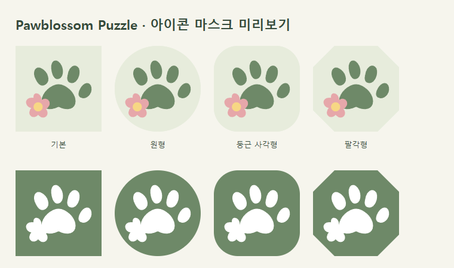
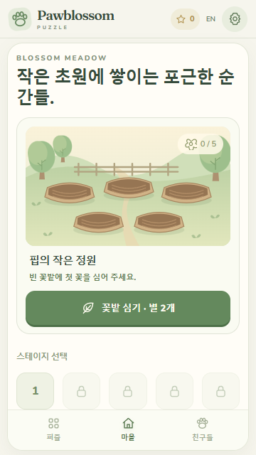
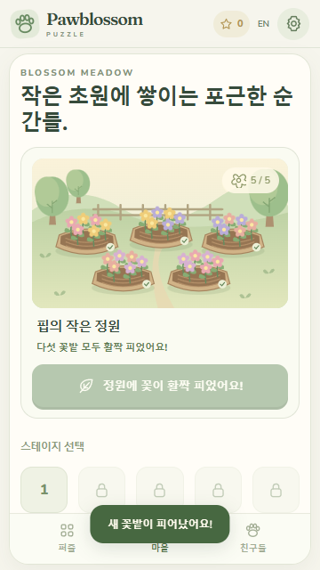
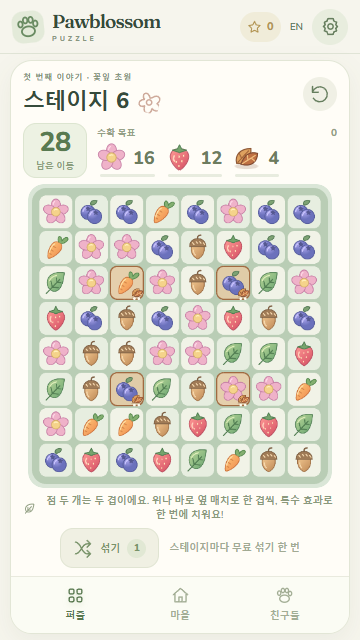
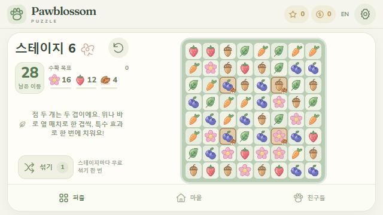
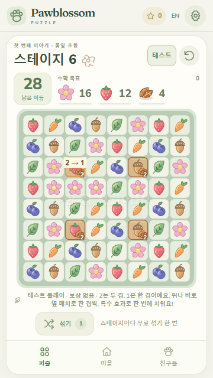
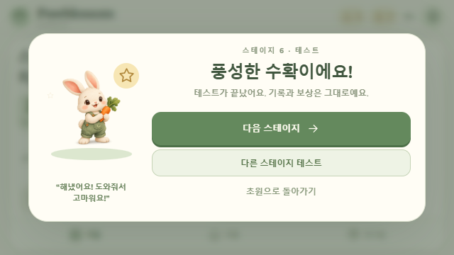

# 에셋 제작 기록

제작일: 2026-10-08. 현재 에셋은 첫 시제품용입니다. 스토어용 최종 아트 검수는 남아 있습니다.

| 파일 | 제작 방식 | 용도 |
| --- | --- | --- |
| `public/assets/meadow.png` | Codex 내장 imagegen 생성 | 꽃잎 초원 배경 |
| `public/assets/pip.png` | Codex 내장 imagegen 생성, 투명 배경 | 정원사 토끼 핍 |
| `public/assets/tiles/*.svg` | 프로젝트에서 직접 작성한 벡터 | 딸기·당근·블루베리·도토리·잎·꽃 |
| `src/icons.ts` | 프로젝트에서 직접 작성한 SVG | UI 아이콘 |
| `android/app/src/main/res/drawable/pawblossom_icon.xml` | 프로젝트에서 직접 작성한 Android 벡터 | 시제품 앱 아이콘·시작 화면 |
| `src/audio/AudioManager.ts` | 프로젝트에서 직접 작성한 음형과 Web Audio 합성 | BGM 1곡·효과음 8종 |
| Nunito, Fraunces | `@fontsource` 로컬 패키지, SIL Open Font License | 영문 본문·제목 |

폰트 라이선스 원문은 `public/licenses/Nunito-OFL.txt`, `public/licenses/Fraunces-OFL.txt`에 포함되어 배포 빌드에 함께 들어갑니다. 한국어는 기기 기본 글꼴을 사용합니다. 기존 게임의 그림·음악을 추출하거나 사용하지 않았습니다. 라이브러리 코드는 각 패키지 라이선스가 적용되며 프로젝트 전체에 별도 오픈소스 라이선스를 지정하지 않았습니다.

## 배경 생성 프롬프트

Original polished hand-painted 2D storybook woodland village environment, landscape 3:2 composition. Mint green rolling hills, ivory sunlight, rounded trees, sandy path, a small cozy cottage with a strawberry-red rounded roof, carrot garden and pink flowers, a winding river. Cozy afternoon, sage green, cream, peach and muted coral palette. Keep the central third readable for a cottage and future overlays. No characters, typography, logos, watermarks, or imitation of any existing game. Rich gouache texture with clean forms suitable for a friendly casual puzzle game.

## 핍 생성 프롬프트

One original adorable cream rabbit gardener, full body, front three-quarter view. Dark brown eyes, peach cheeks and inner ears, sage green overalls with a tiny leaf detail, holding one carrot. Warm hand-painted gouache shading with crisp readable edges and rounded proportions. Friendly casual game character. Transparent background, no scenery, no text, no logo, no watermark, no imitation of an existing character.

원본 생성 결과를 프로젝트 PNG로 복사했습니다. 그림은 실제 브라우저에서 확인했고, 블록 SVG는 Phaser SVG 로더로 래스터화하여 표시합니다. 배경에는 나중에 추가할 수 있는 요소가 그려져 있으므로 그림 속 소품 전체가 현재 상호작용 가능한 기능을 뜻하지 않습니다.

## 출시 전 보강

2026-10-11 첫 교환 실습은 기존 자체 제작 SVG 블록과 CSS 테두리·체크 표시를 사용합니다. 소리는 기존 Web Audio `match` 효과음을 재사용했습니다. 외부 에셋과 생성 프롬프트 추가는 없습니다. 한국어 360×800 화면과 영어 입력 흐름을 확인했으며 실제 Android 터치·음향 검수는 남아 있습니다([실습 기록](practice-qa.ko.md)).

2026-10-11 첫 플레이 안내는 기존 자체 제작 블록 SVG와 `src/main.ts`·`src/style.css`에서 작성한 도형을 재사용했습니다. 추가 외부 에셋과 생성 프롬프트는 없습니다. 영어 데스크톱과 한국어 360×800 화면을 브라우저에서 확인했습니다. 안내 삽화도 시제품이며 실제 Android의 글꼴과 가독성 검증은 남아 있습니다.

- 핍의 표정·동작 세트 제작과 정원 단계 아트의 실기기 검수
- 작은 화면에서 블록 형태, 특수블록 표시, 목표 아이콘 가독성 확인
- 저사양 기기 텍스처 메모리·로딩 측정 후 해상도와 압축 최적화
- 앱 적응형 아이콘·스토어 아이콘·스크린샷·피처 그래픽 제작
- 최종 음색과 음량을 휴대폰 스피커·이어폰으로 청취하여 보강

### 2026-10-14 특수 블록 효과 표시

방향 화살표·제거 칸 테두리·줄·원형 효과는 `src/BoardScene.ts`의 Phaser Graphics로 직접 작성했습니다. 외부 그림·프롬프트·추출 에셋은 사용하지 않았습니다. 시제품 연출이며 Android 기기에서 작은 보드의 가독성과 움직임을 확인할 예정입니다.

### 2026-10-14 Android 적응형·단색 아이콘 (이슈 #20)

기존 자체 제작 발바닥·꽃 벡터의 경로와 색상을 `assets/branding/pawblossom-mark.json`에 단일 원본으로 옮겼습니다. 새 외부 에셋·생성 프롬프트는 없습니다. `npm run assets:generate`로 Android XML과 검수용 SVG를 재생성하고 `npm run assets:check`로 원본과의 일치를 확인합니다. 웹 빌드에도 일치 검사를 연결해 CI에서 드리프트를 잡습니다. 생성 파일을 직접 수정하기보다 JSON 원본을 수정합니다.

일반·원형 벡터는 API 24/25를 위한 `mipmap-anydpi`, 전경/배경을 나눈 적응형은 `mipmap-anydpi-v26`, 단색 테마 레이어는 `mipmap-anydpi-v33`에 둡니다. Manifest는 mipmap을 참조하며 시작 화면은 배경 없는 같은 전경 도형을 사용합니다. 기존 기본 템플릿 PNG는 사용 경로에서 제외되었으나 파일 자체는 보존했습니다.

[Android 적응형 아이콘 공식 안내](https://developer.android.com/develop/ui/compose/system/icon_design_adaptive)의 레이어·마스크·안전 영역 설명을 확인했습니다. 전경은 108×108dp에서 중심 기준 0.95 배율로 배치합니다. 4배 SVG 렌더의 불투명 픽셀 범위를 검사해 최대 반경 32.71dp, 외곽 크기 55×48dp가 중앙 66dp 안전 원에 들어가는 것을 확인했습니다. 이는 SVG 검수이며 실제 OEM 런처를 실행한 결과는 아닙니다.

시작 화면은 기존 Theme.SplashScreen의 단색 배경·전경 도형·후속 테마 연결을 유지하고 인위적인 대기 시간을 추가하지 않습니다. [Android 시작 화면 공식 안내](https://developer.android.com/develop/ui/views/launch/splash-screen)를 참고했습니다. 실제 기기의 시작 화면·일반/원형·테마 아이콘은 새 APK에서 검수합니다.

빌드된 APK에서 anydpi·v26·v33 리소스와 전경·단색 도형이 포함된 것을 aapt로 확인했습니다. APK/AAB 빌드와 APK v2 서명 검증을 통과했습니다. 스토어 512px 아이콘·피처 그래픽·최종 단말 검수까지 끝난 출시 에셋으로 표시하지 않습니다.

### 2026-10-14 정원 성장 단계 (이슈 #24)

`src/GardenArt.ts`에서 배경·울타리·길·다섯 꽃밭·꽃을 직접 SVG로 작성했습니다. 외부 에셋과 생성 프롬프트는 없습니다. 저장된 꽃밭 수에 따라 정확히 0~5곳에만 꽃이 표시되며, 새 꽃밭에 450ms 성장 연출을 적용합니다. 움직임 줄이기 설정에서는 연출을 생략합니다. 아직 실기기 검수가 남은 시제품 아트입니다.

별 2개 소비·중복 탭 방지·최대 5곳 제한·재실행 복원·한국어/영어 설명을 확인했습니다. 저장 실패 경고를 성공 안내가 가리지 않도록 했습니다. 브라우저 360×800 및 640×360에서 확인했으며, 별·코인·기존 완료 스테이지 저장 형식을 유지합니다.

### 2026-10-14 낙엽 바닥층 (이슈 #26)

`public/assets/obstacles/leaf-pile.svg`의 갈색 겹잎·잎맥·그림자는 직접 작성한 벡터입니다. 보드의 바닥색·테두리·겹 수 점·제거 테두리는 `BoardScene.ts`에서 직접 그립니다. 외부 에셋·생성 프롬프트는 없습니다. 초록색 일반 잎 블록과 갈색 낙엽 목표를 구분하며, 아직 시제품 단계입니다.

320×568·360×640·360×800 세로, 640×360·800×360 가로 화면에서 목표·보드·도구의 한 화면 배치를 확인했습니다. 실제 손가락 조작과 작은 겹 수 표시는 사용자 APK 재시험에서 검수합니다.

### 2026-10-14 낙엽 겹 감소와 추가 연출 (이슈 #30)

`public/assets/obstacles/leaf-single.svg`는 한 장 낙엽의 자체 제작 벡터입니다. 기존 겹잎 그림을 두 겹에, 새 한 장 그림을 한 겹에 사용하고 크기·바닥색·숫자 2/1로 구분합니다. 외부 에셋·생성 프롬프트는 없습니다.

`src/BoardEffects.ts`에서 실제 단계의 낙엽 변경 값으로 2 → 1 또는 ✓, 짧은 낙엽 조각 날림과 테두리 감쇠를 만듭니다. 일반 매치의 반짝임, 줄 제거의 빛 이동, 폭발·색 제거의 확산 원도 직접 작성했습니다. 신규 음원은 없으며 기존 확정 믹스를 유지합니다. 움직임 줄이기에서는 새 이동 장식을 생략하고 겹 변화 기호를 유지합니다. 시제품 연출이므로 휴대폰 가독성·프레임과 반복 피로감은 새 APK에서 검수합니다.

| 두 겹 → 한 겹 표시 | 남은 한 겹 |
| --- | --- |
|  |  |

### 2026-10-14 핍 결과 반응 (이슈 #34)

기존 자체 제작 `public/assets/pip.png`를 결과 화면에 재사용했습니다. 성공 시 한 번 가볍게 뛰는 동작과 별 장식, 실패 시 작은 기울임과 응원 문구를 `src/style.css`·`src/main.ts`에서 직접 작성했습니다. 기존 별·잎 SVG 아이콘을 재사용하고 새로운 외부 에셋·생성 프롬프트는 없습니다. 원본 얼굴을 바꾼 표정 이미지 세트를 제작한 것은 아니며 표정 전용 아트는 후속 항목입니다.

동작은 850ms 후 멈추고 움직임 줄이기에서는 생략합니다. 별 장식은 장식으로 숨기며 실제 새 보상은 첫 일반 완료에만 표시합니다. 360×640·320×568·640×360의 결과·버튼 배치와 한국어/영어·움직임 줄이기를 Chrome에서 확인했습니다. 실기기 반응·복귀 검수가 남은 시제품 연출입니다.

### 2026-10-15 배경 요청 시점 보강 (이슈 #47)

기존 meadow.png에 HTML 지연 로딩·비동기 디코딩 힌트를 적용했습니다. 핍은 첫 결과 반응을 위해 초기 준비를 유지합니다. 원본 PNG와 생성 프롬프트·이미지 해상도는 동일하며, 변경 전후 production 빌드의 두 PNG SHA256도 일치했습니다. 작은 화면에서 보이지 않는 배경 요청을 지연한 검증은 [브라우저 기록](browser-qa.ko.md)에 있습니다. 그림·폰트 삭제나 새 외부 에셋 도입은 없습니다. Nunito/Fraunces OFL 원문은 public과 dist에서 일치하며 기존 테스트 APK의 원문 해시도 읽기 점검에서 일치했습니다. 이는 최종 출시 아트·Android 검수 완료를 뜻하지 않습니다.
