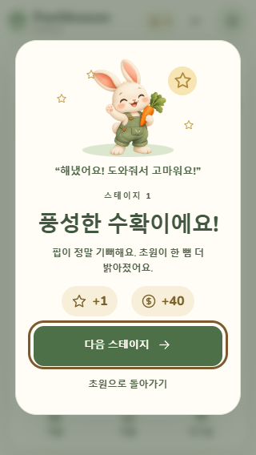
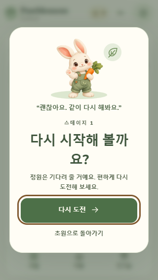
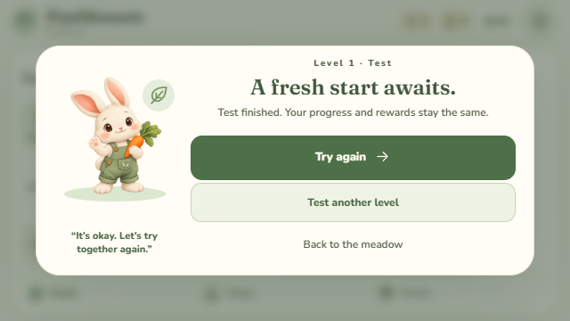

## 2026-10-21 · #167 스테이지 미리보기·이어하기 검수 대기

기준 main `a550c12adf02ee2a63e7072f6fc18919ecc4652d`의 `codex/167-stage-preview-resume`에서 지도 선택과 다시 시작에 목표·초기 이동 미리보기를 추가했습니다. 같은 일반 회차는 기존 Scene·보드·RNG 그대로 이어가고, 새 회차는 명시적 확인 뒤 시작합니다. 취소·Escape·Android 뒤로가기, 잠금·이전 회차·모달·백그라운드 보호와 시험 회차 구분을 구현했으며 현재 미커밋·독립 검수 대기입니다.

**최신 전체 검사는 36파일 2,455통과·1실패입니다.** `full-04-layout-final.log`의 `reward-ledger.test.ts:100` 동시 8 worker 검사에서 신규 1건 assertion은 통과했으나 duplicate 기대 7·실제 4가 관측됐습니다. 나머지 3건 결과·BEGIN/BUSY·DB 행수는 이 원문으로 확정하지 않습니다. 이전 소스의 전체 성공은 이력이며 최신 전체 성공으로 합산하지 않습니다. 실패 뒤 재실행·기대값·timeout·worker·서버 코드 변경 없이 중단했고, 원인 미확정 #122는 이번 UI 작업과 분리합니다.

최신 관련 UI·엔진·저장·스테이지·낙엽 검사 5파일 280개는 통과했습니다. 실제 testing/production dist에서 KO/EN × 320×568·390×844·640×360 × 일반/감소 모션의 24조합을 확인했습니다. 초기 진행 저장 fixture로 30번을 시작한 뒤 실제 Scene의 합법 교환을 trusted 터치로 실행하고, 전체 localStorage·Scene·보드·낙엽·RNG·이동·점수·지갑 보존, 취소·이어하기·명시적 재시작/다른 스테이지 시작, 기본 초점·Escape·44px 버튼·모달 접근과 빌드별 시험 진입 구분을 검사했습니다. 72PNG와 pageerror 0·외부 요청 0을 보존했습니다. 초기 큰 레이아웃과 정정 후 결과는 버전별로 구분합니다.

별도 actual testing dist의 Capacitor App bridge stub 5항목은 등록된 native back 콜백의 취소 우선순위, 비활성 상태 확인 차단, 언어 재렌더·원래 버튼 초점 복귀, 시험 회차의 일반 이어하기 구분과 시험 재시작의 정상 체크포인트 보존을 통과했습니다. 실제 Android 기기·TalkBack·실제 광고/결제 SDK·스토어 검증은 아닙니다. 최신 두 빌드는 타입·에셋 검사와 flags 구분/서버 마커 0을 확인했으며 APK·Android sync·Drive·버전·최종 오디오 믹스는 변경하지 않았습니다.

원문·명령·버전별 산출물·SHA는 Git 밖 `Pawblossom-builds/qa/issue-167-stage-preview/`의 `STOP-checkpoint.json`, `source-dist-freeze.json`, `actual-dist-report.json`, `native-language-report.json`과 로그에 보존했습니다. 이번 기록은 문서만 추가하며 기존 소스/dist 동결 manifest는 유지하고 문서 LF 해시는 별도로 보존합니다. 검사·빌드 재실행과 커밋·푸시·PR은 아직 수행하지 않습니다. 아래 과거 작업 상태는 당시 이력입니다.

## 2026-10-20 19시 연장 · #153 최신 main 통합 산출물 대조

PR157 반영·정확한 main CI39406780626 성공 후 main `90845643e37197674a901936892c06b03a7f947b`를 PR155 작업에 병합했습니다. 문서 충돌은 양쪽 이력을 보존했으며 제품 main.ts LF SHA256=`8f2c6de414246d661d95f000648020892a3e0e97ace6f10e70e71f0b0cc564ef`, UI 검사=`18dcc693221f9871929495376a0a995bf5352803333c781070d25a5b71f427ae`로 원래 head9ad4579와 같습니다. 새 검사 진단은 최신 main의 그대로이며 통합 전체2,379개·타입·스토어12·두 빌드를 통과했습니다.

최종 production30파일이 기존 `qa/issue-153/route-production-build-hashes.json`과 모두 동일합니다. 따라서 아래 PR155의 Chrome32조합144PNG 및 총괄 자연 입력의 산출물 동일성을 확인한 것이며, 이번 통합 뒤 브라우저를 재실행했다고 합산하지 않습니다. 새 근거는 `qa/issue-153-integration/source-build-review.json`과 버전별 로그입니다. 원래 실패 CI39400594900과 #122는 보존하며 새 head 필수 CI/병합은 아직 대기입니다. Android/TalkBack·구형 단말·광고·구매·스토어 검증을 대신하지 않습니다. 아래 현재/미병합 표현은 당시 이력입니다.

## 2026-10-20 · 통합 상태와 총괄 자연 입력 검수 (#154)

제품·검사 기준 main `be328c75372d4a1b2a2dd36faf39722330406186`에 PR146/148/150/151/152가 반영됐습니다. [정확한 main CI39397742294](https://github.com/ChoiDaeYoung-94/Pawblossom-Puzzle/actions/runs/39397742294)는 Node22·24 각각2,373개·스토어12개·타입/두 웹 빌드 성공입니다. 아래 작업별 제출 승인/CI 대기는 당시 이력이며 [통합 PR·검증 경계](android-release.ko.md) 상단이 현재 상태입니다. 이번 문서 변경은 브라우저·전체 검사를 재실행하지 않습니다.

총괄은 main5839의 production을 Git 밖에 고정해 IAB390×844/한국어에서 실제 튜토리얼·연습과 키보드 교환으로 스테이지1을 완료했습니다. 15이동/점수430에서 첫 보상 별1·코인40, 실제4매치 특수 블록의 즉시 사용, 무료 섞기1→0과 이동16/점수400 보존을 확인했습니다. 다음 스테이지2→reload에서 이동24/점수0/당근12·블루베리10/지갑1·40 유지, 정원1완료·2가능·3잠김, 정상 설정/고객센터 표시를 확인했습니다. 난수·Scene·완료 수량·저장 fixture 주입이 없는 자연 플레이이며, reload 전후 보드 전체 행렬 동일성·실기기/물리 오디오는 측정하지 않았습니다. 이 산출물은 main be328과 같은 앱 bundle이고 원본 PNG3개·범위는 Git 밖 `Pawblossom-builds/qa/manual-20261020-main5839/manual-checkpoint.json`에 보존했습니다.

후속 #153/[PR155](https://github.com/ChoiDaeYoung-94/Pawblossom-Puzzle/pull/155) head `9ad4579499385d7da4b9a04a72c6025bcc2e854b`는 **로컬 검증 완료·필수 CI 실패로 Draft 미병합**입니다. 최종 로컬 UI153/전체2,377개·타입/스토어12/두 빌드, 실제 dist Chrome 일반/감소 모션과6화면 흐름32조합144PNG·오류0은 해당 branch의 근거입니다. [CI39400594900](https://github.com/ChoiDaeYoung-94/Pawblossom-Puzzle/actions/runs/39400594900)는 Node22 command/Node24 start의 서버 원장 동시 검사에서 각각1실패이며 성공으로 합산하지 않습니다. 안내 onNotice·결과 onMove는 fixture, 자연 타이머/DOM/Chrome AX·실제 심기 토스트·합법 화면 이동은 브라우저 실행입니다. 실패/버전별 해시와 일반1.3초·감소.01ms, 수동/브라우저 trusted 이벤트를 구분한 상세 기록은 PR155의 기존 docs와 `qa/issue-153/checkpoint.json`에 보존합니다.

총괄은 이 미병합 최종 production(main LF SHA256 `8f2c6de414246d661d95f000648020892a3e0e97ace6f10e70e71f0b0cc564ef`)도 별도 고정했습니다. 실제5행6열↔6행6열 교환으로 당근3개를 맞춰 이동24→23/점수0→30/당근12→9, 블루10·지갑1/40 보존을 확인했습니다. 안내 종료 뒤 DOM 빈값, KO→EN→설정→퍼즐→KO 뒤 이전 안내·toast 빈값과 목표/보상 유지도 확인했습니다. 이 수동 입력은 활성 안내1.3초 실측이나 활성 중 화면 이탈 검사가 아니며 실제 Chrome fixture QA·구형 API 미제공 단위 검사와 구분합니다. frozen30파일이 최종 production manifest와 모두 같고 `qa/manual-20261020-notice-final/manual-checkpoint.json`·PNG2개에 보존했습니다. 이를 main의 자연 성공 검증으로 합산하지 않습니다.

자신의 IAB 탭2·3/viewport override와 preview5198은 모두 정리했고 Listen0을 확인했습니다. 사용자 Chrome·5173과 저장은 사용하지 않았습니다. Cua AX는 실제 Chrome AX/TalkBack 검증을 대신하지 않습니다. Android/구형 WebView·실제 광고/구매/스토어·최종 청취는 미완료이고 #73/#122 및 기존 보류를 유지합니다. 별도 APK 테스트 안내 문서는 만들지 않았습니다.

## 2026-10-20 · 종료된 임시 안내 정리 (#153, 로컬 최종 검증 완료·PR 제출 승인 대기)

기준 main/origin main `be328c75372d4a1b2a2dd36faf39722330406186`, 브랜치 `codex/153-transient-notice-cleanup`에서 [#153](https://github.com/ChoiDaeYoung-94/Pawblossom-Puzzle/issues/153)를 구현했습니다. 현재 최종 소스의 자동 검사·testing/production Chrome 검증이 모두 완료되었으며, PR 제출은 총괄의 후속 승인을 기다립니다. 아래 이전 현재/최신/제출 표현은 당시 이력입니다. Git 밖 `C:/Users/user/Documents/ChatGPT/Pawblossom-builds/qa/issue-153`에 로그·JSON·PNG·소스/빌드 해시를 보존합니다.

`clearBoardNotice()`가 키·텍스트·pop을 함께 비우며 새 회차/시험 이어하기/애니메이션 종료/허용된 퍼즐 이탈이 같은 정리를 사용합니다. 재생 중인 새 애니메이션이 있으면 늦은 종료 이벤트를 무시하고, 기존 activeRound가 이전 Scene 안내를 막습니다. 일반 toast는 기존 3200ms와 현재 timer 일치 보호 아래 키·visible·텍스트를 함께 정리합니다. 활성 한영 전환과 일반 모션의 1300ms를 유지하고, 만료 뒤 언어를 바꿔도 빈 DOM을 유지합니다. 엔진·저장·보상·오디오·버전·SDK/운영 설정은 변경하지 않았습니다.

총괄 검수 후 `getAnimations?.()`로 API 미제공 분기의 예외 방어를 추가했습니다. [Capacitor v8 Android 문서](https://capacitorjs.com/docs/android)의 WebView Chrome60 최소 조건과 [MDN BCD](https://raw.githubusercontent.com/mdn/browser-compat-data/main/api/Element.json)의 해당 API Chrome84/mirror 차이를 확인한 최소 방어입니다. API 미제공 단위 fixture에서 예외 없이 텍스트·키를 비우고 번역으로 재발표하지 않는 것을 검사합니다. Vite 전체 산출물이나 다른 API의 Chrome60/구형 WebView 호환성·지원 확대·실기기 실행 검증을 뜻하지 않습니다.

| 검증/버전 | 명령·결과 |
|---|---|
| API 방어 전 이력 | 관련 UI151, 전체35파일2,375개·49.80초 성공. 해당 소스의 두 빌드/브라우저 기록도 별도 보존하며 최종 소스 실행으로 합산하지 않음 |
| 최종 API 방어·화면 이탈 포함 | `npm.cmd test -- tests/ui-flow.test.ts` 153/153; `npm.cmd test -- --reporter=default --reporter=json --outputFile.json=<QA>/full-route-final.json` 35파일2,377/2,377·52.44초·변경 후 전체1회. 신규 회귀4개와 기존 만료 기대 수정. 기본 timeout/worker2/원장·lock·CI 설정 유지 |
| 최종 타입·스토어·빌드 | `npm.cmd run typecheck`, `store:check`, `store:test` 12/12, `build:test`→`build`. 전체/앱/서버 타입·에셋 원본 포함. testing 세 flags true/production 세 flags false. 기존 500kB chunk 경고 유지 |
| 총괄 독립 확인 | 최종 UI153/153·전체/앱/서버 타입·diff whitespace. root-related-route-final.json/log·root-typecheck-route-final.log·root-reviewed-source-route-final.json. 앞선151개 기록과 구분 |
| 최종 testing Chrome | `--transient-only` 일반 모션 KO/EN×320×568·640×360:4조합16PNG. `--transient-only --transient-reduced`:4조합8PNG. 기본6화면 흐름 KO/EN×4크기:8조합48PNG. 각 오류0 |
| 최종 production Chrome | testing과 같은 일반4조합16PNG·감소4조합8PNG·기본6화면8조합48PNG. 각 오류0. 두 모드 최종 합계32조합144PNG |

최종 재현은 `scripts/use-dev-tools.ps1` dot-source 및 기존 `PAWBLOSSOM_PLAYWRIGHT_MODULE` 설정 후 `node scripts/play-focused-ui-qa.mjs [--transient-only [--transient-reduced]] --output=<새 폴더>`입니다. `route-testing-*`/`route-production-*`만 API 방어·화면 이탈 포함 최종 산출물 증거입니다. source manifest는 `validated-source-route-final.json`, 빌드 파일별 SHA256은 `route-*-build-hashes.json`입니다. main LF SHA256 `8f2c6de414246d661d95f000648020892a3e0e97ace6f10e70e71f0b0cc564ef`, 검사 LF SHA256 `18dcc693221f9871929495376a0a995bf5352803333c781070d25a5b71f427ae`로 고정합니다.

Chrome155.0.8059.85 새 headless context/합성 저장/origin에서 실제 dist·DOM·Chrome AX를 검사합니다. 일반 모션은 isTrusted=true animationend의 elapsedTime=1.3을 확인하고, 수동으로 공급한 이전 animationend(isTrusted=false)는 별도 분리합니다. 모션 감소는 기존 전역 CSS .01ms/실제 trusted elapsedTime=0.00001을 확인하며 1300ms 노출로 주장하지 않습니다. 감소 모션의 활성 보드 번역은 같은 브라우저 task 안에서 확인합니다. 일반 모션의 활성 보드/토스트 AX, 자연 만료 뒤 빈 DOM/AX, 번역 왕복, 연속 안내, restart/설정이탈·1500ms뒤복귀/이전 회차 콜백, 결과→다음 회차를 검사합니다. toast 3200ms는 두 모션에서 자연 만료를 관측합니다. onNotice 안내·onMove 결과 수량은 fixture이며 토스트는 실제 꽃 심기 UI입니다. 자연 성공 플레이·TalkBack·구형 단말·Android·실서비스 검증으로 주장하지 않습니다.

실패는 `testing-reduced/summary.json`과 로그에 보존합니다. 꽃밭 화면에서 숨겨진 퍼즐 안내의 AX root를 요구한 QA 절차 오류이며, 퍼즐로 돌아와 ready 뒤 빈 AX를 검사하도록 수정했습니다. 제품 코드 실패나 assertion 완화/재시도 정책 변경이 아닙니다. `testing-transient`는 isTrusted 분리 전 중간 증거이며, API 방어 전 `testing-*-final`/`production-*` 기록도 최종과 구분해 보존합니다. 총괄의 `manual-20261020-main5839` 자연 플레이는 be328과 동일한 이전 production bundle에서 수행한 별도 기록이며 이번 소스 실행으로 합산하지 않습니다.

APK/AAB 생성·Android 동기화·단말 전달·버전 증가·최종 오디오 믹스·계정/광고/결제/실서비스 설정은 보류 상태 그대로입니다. 실제 TalkBack/구형 환경과 출시 검증은 미완료입니다.

화면 이탈 경계는 실제 합법 설정 이동으로 추가 재현했습니다. API 방어 포함·이탈 정리 전 production에서 canLeave=true 상태의 matched 안내가 설정1500ms 뒤 퍼즐 복귀 시 text/pop을 유지하며 애니메이션을 다시 시작했습니다(`route-observe-before.json/png`). switchView의 canLeave 통과 후 nonpuzzle 분기에 clearBoardNotice 호출 한 곳과 차단/허용 이탈 회귀1개만 추가했습니다. 수정 뒤 동일 절차의 `route-observe-after.json/png`는 숨김/복귀 text 빈값·pop=false·animations=[]입니다. 앞선 API 방어 포함 UI152/전체2,376·48.45초와 `compat-*` 두 모드72PNG씩 성공은 이탈 수정 전 이력으로 구분합니다. 외부 관측 스크립트 첫 실행의 Windows ESM c: 경로 로더 오류는 브라우저 실행 전 준비 오류였고 file URL로 고쳤습니다.

## 2026-10-20 · 설정 저장 안내와 고객센터 (#149, PR 제출 승인)

기준 main/origin main `1917ee84c07fb13193a01c58b14a2448a13f8893`, 브랜치 `codex/149-settings-clarity`에서 [#149](https://github.com/ChoiDaeYoung-94/Pawblossom-Puzzle/issues/149)를 구현했습니다. **로컬 검증·총괄 독립검수 완료·Ready PR 제출 승인**입니다. 총괄은 관련UI149개·전체/앱/서버 타입·diff·최종 production PNG와 정상/문제 표시 범위, CSS 전 전체/이후 브라우저 검증 구분을 독립 대조하고 제출을 승인했습니다. PR/main 필수CI와 병합은 총괄 후속입니다. 아래 이전 작업의 최신/현재/제출 표현은 당시 이력입니다. Git 밖 `Pawblossom-builds/qa/issue-149/checkpoint.json`에 기준/소스 LF SHA·명령·버전 경계·로그·PNG를 연결합니다.

최신 production의 정상 설정을 먼저 보존했습니다. 소리/언어 조작은 중복 안내보다 앞에 있어 중복이 해당 조작을 밀어냈다고 설명하지 않습니다. 진행 안내를 앱 내 진행 이전 기능 미제공 범위로 줄이고, 문제 없는 saveNew/saveSaved의 중복 카드만 접습니다. recovered/모든 problem·retry/reload·live/설정 경고 배지는 유지합니다. 회복 후 재시도에 초점이 있으면 카드/버튼을 유지하고, 언어 DOM 교체에도 초점 의도를 전달하며, 초점을 떠난 뒤 정상 카드를 접습니다. 고객센터 doeud1410@gmail.com은 선택 가능한 일반 텍스트이며 mailto/발송·새 홈페이지·구매/복원 동작을 추가하지 않았습니다.

| 정상 설정 내부 높이 (scrollHeight/clientHeight px) | 기준 | 최종 |
|---|---|---|
| KO320×568 / KO390×844 | 852/429 · 835/637 | 769/429 · 750/637 |
| KO640×360 / KO1280×720 | 723/241 · 799/561 | 692/241 · 750/561 |
| EN320×568 / EN390×844 | 846/429 · 830/637 | 768/429 · 749/637 |
| EN640×360 / EN1280×720 | 736/241 · 795/561 | 691/241 · 749/561 |

정상 높이는31~85px 감소했으며 설정 내부 스크롤을 허용합니다. 퍼즐/문서 외부 스크롤0과 가시 버튼44px/hit를 유지합니다. 전체 설정 무스크롤이나 모든 조작이 첫 화면에 노출된다고 주장하지 않습니다.

| 검증/버전 | 실제 실행·결과 |
|---|---|
| 앱/단위 로직·여백 보강 전 | Node24.21.0/Vitest4.1.11 관련UI149/149(신규15), 전체35파일2,373/2,373·45.71초·전체1회. 기본5초/worker2·worker/SQLite/retry/업무 assertion·고정lock·CI 유지. source `validated-source.json` |
| 타입/스토어·초기 두 빌드 | 전체/앱/서버 typecheck, store원본/12개, build:test→build(에셋 원본 포함) exit0. 여백 보강 전 testing/production 설정 각8조합80PNG, 기존6화면 흐름 각48PNG·오류0 |
| 후속 CSS 최소 보강 | 총괄 읽기에서 문장/초점 링 접촉을 발견해 실제 Range/outline bounds로 KO320·EN640 경고/회복 상태의 -0.81~-4.81px 겹침을 관측. .storage-card button margin-top8px만 추가. 정상 카드는 숨겨져 정상 높이 불변 |
| 최종 CSS 검증 | 이후 main/i18n/tests·package/lock·검사 설정은 LF SHA 동일. QA에 실제 글자/링 측정만 보강. 전체를 반복하지 않고 build:test→build(전체/앱/서버 타입·에셋 포함)와 설정 testing/production 각80PNG·최종production 기본6화면48PNG를 새로 검증. 각8조합 오류0, 경고/회복 focus-visible 글자/링 간격3.1875px·겹침0·44px/hit·정상 높이 불변 |
| 정적·최종 산출 | flags3false·src/dist서버마커0·허용7파일·기존docs보존·diff whitespace0. 최종 source `validated-source-final.json`. CSS 전 전체 성공을 최종 CSS 포함 전체 재실행으로 합산하지 않음 |

기존 play-focused-ui-qa에 --settings-only를 추가했습니다. Chrome155.0.8059.85·새 headless context/합성 origin/저장에서 KO/EN4크기를 확인했습니다. 정상 언어 왕복·실제 Range 메일 선택(user-select:text, 가로 넘침0), backup 쓰기 QuotaExceededError→재시도 Enter/Space→회복을 실제 Storage API 경로로 확인했습니다. 재시도 초점을 유지한 채 selectOption 변경 이벤트를 발생시켜 언어 DOM 교체 후 초점을 검증했고, Tab으로 reset에 이동하면 정상 카드가 접히는 것을 확인했습니다. 손상 primary+정상 backup 복구, 외부 기록 충돌/명시 불러오기 취소·재시도 무덮어쓰기, 손상/미지원 원문 보존도 실제 브라우저에서 확인했습니다. 각 문제의 카드·live·설정!·복구 조작을 보존합니다. resetPending/reset-failed/read-error/primary-write-failed 등 전체 표시 분기는 12상태 DOM mock 단위 검사이며 해당 경계를 모두 실제 브라우저로 재현했다고 주장하지 않습니다. 기본6화면의 결과는 기존 onMove 완료수량 fixture로 자연 성공 플레이와 구분합니다.

메일의 실제 발송/메일 앱 실행과 단말 long-press 복사는 실행하지 않았습니다. ‘게임 내 진행 이전 기능 미제공’은 OS 백업/D2D 이전 불가능·완전 로컬/전송 없음·광고 제거 구매 복원 미지원이라는 뜻이 아닙니다. Android allowBackup/OS 전송 설정이나 실제 복원 검증을 변경하지 않았습니다. 실기기/TalkBack·OS 백업/전송·운영 서비스/광고/구매/스토어·PR/main CI·출시는 별도입니다. 이번 명령 실패는 없으며 초기 CSS 시각 결함/검사 성공의 관측 범위를 구분합니다. Vite500kB 청크·Node 실험 경고는 남습니다. #122 미확정 CI 실패 원인 해결을 주장하지 않습니다. 서버/엔진/저장 스키마/보상·가격/SDK/의존성/Android/APK/sync·버전·최종 오디오 믹스·계정/콘솔/상품/배포는 바꾸지 않았습니다. 사용자 조치·질문은 없습니다.

## 2026-10-20 · 회차 복원 안내와 섞기 설명 (#147, PR 제출 승인)

기준 main/origin main `2d31df97720b7ad180b6949c1ed0f54946289fae`, 작업 브랜치 `codex/147-resume-notice-ui`에서 [#147](https://github.com/ChoiDaeYoung-94/Pawblossom-Puzzle/issues/147)의 좁은 UI 수정을 마쳤습니다. **로컬 검증·총괄 독립검수 완료·Ready PR 제출 승인**입니다. 총괄이 관련 UI134개·전체/앱/서버 타입·source LF SHA/production 플래그/diff와 주요 활성·키보드 PNG, 전체2,358개 및 브라우저 summary/문서의 검증 경계를 대조하고 제출을 승인했습니다. PR/main 필수CI·최신 main 확인과 병합은 총괄 후속입니다. 아래 #144/이전 날짜의 현재/제출 상태는 당시 이력이며, #144는 PR146으로 반영된 뒤 이번 기준에 포함됩니다. 최종 소스 LF SHA·명령·로그·PNG는 Git 밖 `Pawblossom-builds/qa/issue-147/checkpoint.json`에 보존합니다.

최신 production을 먼저 빌드해 합성 저장 회차를 재로드했습니다. Chrome155.0.8059.85·KO/EN×320×568/390×844/640×360/1280×720의 활성 PNG8장에서 기존 복원 toast가 하단 nav와 모두 겹쳤습니다. 640×360에서는 canvas와도2/8, tools와는6/8 겹쳤습니다(실제 bounds와 이미지 근거, 입력 차단을 뜻하지 않음). KO1280 섞기 설명의 글자별 Range는 마지막 ‘번’ 한 글자가 별도 줄인 것을 확인했습니다. #129의 과거 사진만으로 이번 재현을 대신하지 않았습니다.

복원 안내만 기존 board-hint 안의 상대 표시로 옮기고, 기본 힌트를 visibility로 숨겨 원래 높이를 유지했습니다. 3200ms 만료·표시 중 언어 변경·새 회차/화면 이탈·유효한 첫 주 포인터/보드 키 입력 정리를 연결했으며, 현재 timer handle과 round를 비교해 취소된/이전 콜백을 무시합니다. Tab으로 보드에 초점이 오면 키보드 도움말을 우선하고 초점을 강제로 옮기지 않습니다. KO/EN 섞기 설명을 짧게 줄이고 .tool-note만 어절 줄바꿈을 적용했습니다. 폭 상한 확대·전역 nowrap·일반 planted/저장 안내 toast·저장/보상/엔진 정책은 변경하지 않았습니다.

| 검증 | 기준/실행 결과 |
|---|---|
| 관련 UI | `npm.cmd exec vitest run tests/ui-flow.test.ts` 134/134(수명 회귀4개 추가). DOM mock은 표시 상태·3200ms 예약/취소·언어·늦은 콜백·입력/회차/이탈 정리와 저장 무쓰기 경계만 확인 |
| 최종 전체1회 | Node24.21.0/Vitest4.1.11 `npm.cmd test`, 35파일2,358/2,358·50.39초. 기본5초/worker2/기존worker·SQLite/retry/업무 assertion·CI 유지, 동일 소스 전체 rerun 없음 |
| 타입·스토어·빌드 | `typecheck` 전체/앱/서버, `store:check`, `store:test`12개, `build:test→build`(에셋 원본 포함) 모두 exit0. 최종3flags=false·src/dist서버마커0·diff whitespace0 |
| 활성 복원 전후 | 기존 `play-focused-ui-qa.mjs --resume-only` 확장. baseline8조합16 PNG, testing/production 각8조합32 PNG. 활성/만료/키보드 우선 화면·실제 bounds·Chrome AX를 저장. 최종 각8조합에서 menu/canvas/tools 겹침0·문서 overflow0·만료 전후canvas/hint geometry 동일 |
| 실제 수명/입력 | KO/EN 4크기 모두 실제 저장 회차 재로드→활성 문구/초점불변→언어 왕복·저장 불변→자연 만료→만료 후 언어 변경 재표시 없음. 실제 Tab 도움말 우선·Arrow 입력 정리·Enter선택/Escape·첫 마우스 선택/저장 불변·restart/설정 이탈 정리. 늦은 콜백 직접 재호출은 단위 회귀로 구분 |
| 기존 흐름·목표 | 같은 QA 기본6화면 흐름 testing/production 각8조합48 PNG·오류0. 기존 goal-accessibility testing24확인/AX20/PNG12, production20확인/AX20/PNG8 성공. 이전 #144 실행을 이번 성공에 합산하지 않음 |

새 headless context와 합성 origin/저장을 사용했고 사용자 Chrome/5173/5197 저장·서버를 사용하지 않았습니다. 실제 dist 응답에 Game 관찰 참조만 추가합니다. 수명 검증은 실제 재로드/DOM/키보드·마우스와 자연 타이머이며, 가짜 시간/저장 판정을 주입하지 않았습니다. 기본6화면 흐름의 결과 완료 수량은 기존 onMove fixture로서 자연 성공 플레이와 구분합니다. 실제 expiry.observedMs는 활성 PNG/AX 확보 후부터 잰 남은 대기 시간(약3초)이며, 타이머 시작부터3200ms를 정확히 실측한 값으로 설명하지 않습니다. 3200ms 예약은 소스/단위 회귀에서 별도로 확인했습니다. 기존 목표 QA의 dateKst는 과거 고정값이며 이번 실행일2026-10-20과 구분합니다.

이번 작업의 명령 실패는 없었으며 baseline에서 관측한 제품 문제와 구분합니다. 기존 Vite500kB 청크/Node SQLite·타입 변환 경고는 남습니다. 실기기/TalkBack·네이티브 touch·일반/모션 감소 전체 오디오·실서비스·PR/main CI·출시는 새 검증하지 않았습니다. Android/APK/AAB/sync·버전·최종 오디오 믹스·SDK/의존성/서버/가격/계정/상품/공개 배포는 변경하지 않았습니다. #122의 미확정 CI 실패 원인 해결을 주장하지 않습니다. 사용자 조치·질문은 없습니다.

## 2026-10-20 · 플레이 중심 UI 검증 체크포인트 (이슈 #144)

기준 main/origin main은 `a4b4992c5499ed8a7ca5adee8eec2a4e1c3a0f23`, 작업 브랜치는 `codex/144-play-focused-ui`입니다. [#144](https://github.com/ChoiDaeYoung-94/Pawblossom-Puzzle/issues/144)의 앱·문구·접근성 수정을 마치고 **총괄 독립검수 완료·Ready PR 제출 승인**입니다. 총괄은 관련 UI130개·전체/앱/서버 타입·diff/체크포인트와 주요 production/testing PNG를 독립 검수했고 확정 기능 회귀를 발견하지 않았습니다. PR/main 필수CI와 병합은 별도 후속입니다. 아래 이전 날짜의 최신/현재 표현은 당시 이력입니다. 최종 소스의 LF SHA와 명령·로그·PNG는 Git 밖 `Pawblossom-builds/qa/issue-144/checkpoint.json`에 연결합니다.

- KO/EN 제목을 ‘핍의 정원/정원/정원사 핍/설정’처럼 짧게 다듬고, 목표·점수·실제 보상·튜토리얼 행동을 명시했습니다. 현재 없는 이웃/업데이트 약속 카드를 제거했습니다.
- 넓은 화면에서 보조 그림 폭을 280px로 낮춰 퍼즐(1280×720에서 약356px)이 시선의 중심이 되도록 했습니다. 기존 자체 에셋을 재사용하며 큰 그림자·반짝임·둥근 장식을 줄였습니다. 화면 높이 기반 보드와 작은 가로 화면의 좌측 정보/우측 퍼즐 배치는 유지합니다.
- 완료/잠금 스테이지 이름에 상태를 넣고 잠금 disabled를 유지합니다. 결과의 별/코인은 숨김 텍스트로 종류와 수량을 함께 읽습니다. 심기 후 DOM 교체로 초점이 body로 사라지는 것을 기준 브라우저에서 재현했고, 비활성 심기 버튼 대신 갱신된 상태 문장으로 초점을 잇습니다. 가로 정원 스크롤은 기준에서도 유지됐으며 수정 후에도 같은 위치를 보존했습니다.

| 검증 대상 | 명령/경계 | 결과 |
|---|---|---|
| 관련 UI | `npm.cmd exec vitest run tests/ui-flow.test.ts` | 최신130/130. 상태 이름·보상 종류·초점/scroll 회귀5개 추가. 문구 번역 검사는 번역 원본으로 기대값 연결 |
| 최신 전체 | `npm.cmd test`, Node24.21.0·Vitest4.1.11·worker2·기본5초 | 35파일2,354/2,354, 47.99초, 최종 소스로1회 실행. 타임아웃/retry/SQLite/업무 assertion/CI 변경 없음 |
| 정적/빌드 | `typecheck` 전체·앱·서버, `store:check`, `store:test`, `build:test→build` (에셋 원본 검사 포함) | 모두 exit0, store12/12. testing flags3true/production3false. src/dist 서버 마커0, diff whitespace0 |
| 새 UI 브라우저 | `play-focused-ui-qa.mjs` · KO/EN×320×568/390×844/640×360/1280×720 | baseline48 PNG, testing48, production48. 각8조합×퍼즐/정원/핍/설정/튜토리얼/결과. 각 실행 pageerror0·문서 overflow0·퍼즐 전체 표시/내부 무scroll·가시 버튼44px/hit·nav 영역·Enter/Space 심기·초점/scroll·지갑·저장/언어 왕복·실습·보드 키보드·재로드·결과 AX·모션 감소 확인 |
| 유휴 힌트 회귀 | `idle-hint-qa.mjs`, production390×844·일반/모션 감소 | 각5확인=10, PNG8·오류0. 선택/Escape·설정 복귀·자연7.5초·Scene restart/remove·이전 callback 경계 유지 |
| 기존 목표 회귀 | `goal-accessibility-qa.mjs` | testing24확인·AX20·PNG12, production20확인·AX20·PNG8. 실제 키보드/콜백/연쇄·언어/저장 유지. testing만 시험 이어하기+5 포함 |

실제 브라우저 심기는0→1→2꽃밭과 별4→2→0에서 확인했습니다. DOM stub 회귀는 isConnected/disabled와 초점 함수를 수동 준비한 단위 검사이며 실제 DOM 교체 증거와 구분합니다. 450ms 이내 중복 입력은 기존 단위 회귀로만 확인했고, 4→5꽃밭 완성 직후 초점과 열린 결과창의 언어 변경 후 보상 종류 AX는 직접 브라우저 실행하지 않았습니다(해당 경로 코드 읽기만 수행).

Chrome155.0.8059.85의 새 headless context와 합성 origin/저장을 사용했습니다. 실제 dist를 응답하고 Game 관찰 참조만 추가합니다. 결과 준비에 완료 수량을 onMove 콜백으로 공급한 것은 fixture이며 실제 퍼즐 성공 플레이로 세지 않습니다. 튜토리얼 실습과 키보드 조작·DOM/Chrome AX는 실제 입력입니다. 기존 목표/유휴 스크립트의 내장 dateKst는 과거 고정값이므로 실제 이번 실행일2026-10-20은 체크포인트/로그 파일 시각으로 구분합니다. 보유 사용자 저장·기존 Chrome·5173/5197 서버를 사용하지 않았고 이 세션은 preview 서버를 생성하지 않았습니다. 각 QA의 browser/context는 finally로 닫습니다.

초기 실패를 최종 결과와 합산하지 않습니다. `before-1/2/3`는 QA 작성 중 clipping 판정·selectOption 초점 준비·native dialog 순서 기대를 바로잡은 도구 실패이며 summary의 stack을 보존했습니다. `ui-initial.log`의125개 중7실패는 바뀐 문구를 기대하던 검사입니다. 당시 PATH에 npm이 없어 선택한 pnpm이 로컬 설치를 재구성했고, 원래 패키지를 복원한 뒤 정식 npm 고정lock 설치본과 비교해 복구했습니다. repo npm ci는 기존 프로세스의 native binding 잠금(EPERM)으로 실패했고, Git 밖 cwd npm.cmd ci로142패키지 설치→동일 파일 유지/누락 파일 복원→필수 패키지 불일치0을 확인했습니다. 생성된 pnpm lock/설정/캐시는 repo 밖에 보존했고 package/lock은 변경하지 않았습니다. `build-testing-initial.log`는 npm PATH 실패, `build-testing-ui1.log`는 DOM NodeList 반복 타입 오류로, Array.from 수정 뒤 최종 타입·빌드가 통과했습니다. 원문은 모두 QA 폴더에 남깁니다.

기존 Vite500kB 청크·Node SQLite/타입 변환 경고는 남습니다. #122 CI 실패 원인을 이번 UI 성공으로 설명하거나 해결했다고 주장하지 않습니다. 최신 PR/main CI, 실제 폰/TalkBack·광고·구매·스토어/공개 배포는 별도입니다. APK/AAB·Android sync·버전·최종 오디오 믹스·서버/보상 규칙·계정/상품 설정은 변경하지 않았습니다.

## 2026-10-18 · 최신 통합과 브라우저 근거 구분 (이슈 #139)

최신 구현/검사 main은 `ca57341fbd269d82cfac63d1be9f173384ad68cc`이며 정확한 main CI39111374076 Node22·24 각각2,349개·스토어12개·타입/두 빌드 성공을 확인했습니다. [최신 통합 상태](android-release.ko.md)를 우선합니다. #134/#137/#122 parallel 후속은 서버/검사·문서 변경이며 #129 브라우저 실행 대상과 앱 src/public tree 및 production JS/CSS3개 byte가 같습니다.

아래 Chrome37개·목표 AX20개·pageerror0은 **#129에서 실제 실행한 결과**이며 이번 문서 작업에서 재실행한 것이 아닙니다. 일반/모션 감소 힌트10개·KO/EN 작은 세로/가로 목표20개·두 탭 저장7개의 합성 fixture/실제 입력·PNG/AX/로그 구분을 유지합니다. 실제 폰 터치·Android 회전/글꼴 배율·TalkBack·청취/오디오 포커스·실서비스·스토어는 미완료이고 #73을 유지합니다. 짧은 복원 안내의 하단 글자 가림은 최종 감각 검수 후보이며 입력 차단으로 과장하지 않습니다.

## 2026-10-18 · 누적 통합 확인 (이슈 #129)

검증 대상은 PR#133 head `3d3b52f8cec63cbb24ea8ef8aa586cd49e608558`와 전체 tree가 같은 main `dc210437bc3ec02b07cc2e86cd4ebb430ac891bc`의 **production dist**입니다. 세 flags 모두false이고 시작/완료 시 src/public tree·JS/CSS3개 hash가 같았습니다. [최신 통합·각 PR/main 검사·과거 실패 구분](android-release.ko.md#현재-통합-상태--2026-10-18--129)을 우선하며 아래 제출 전/현재 표현은 당시 이력입니다.

Chrome155.0.8059.80, 새 headless context·합성 저장을 사용했습니다. 실제 실행은 다음 순서이며 Android/실제폰/TalkBack 검증이 아닙니다.

| 범위 | 실제 확인과 준비 경계 | 결과 |
|---|---|---|
| 유휴 힌트 | 기존 idle-hint-qa.mjs,390×844·일반/모션 감소. 실제 선택/Escape·설정 복귀·자연7.5초. Scene restart/remove와 옛 callback 호출만 수명 fixture | 두 모드 각5개=10, 오류0·viewport PNG8개 |
| 목표 읽기 | 기존 goal-accessibility-qa.mjs,KO/EN×320×568·640×360. seed42 저장/목표·낙엽 경계는 fixture, 키보드 이동·실제 Phaser 콜백·재로드·언어 전환·Chrome AX를 확인 | 4화면 각5개=20, 오류0·AX20개·viewport PNG8개 |
| 두 탭 저장 | 기존 #118 스크립트의 출력 경로/시작 SHA만 바꾼 사본. 실제 두 탭의 설정 변경·Enter/Space 재시도·불러오기 취소/수락·320×568 버튼 hit test | 7개, 오류0·기록 원문 불변과 명시 복원 뒤 저장 성공 |

총37개 순차 확인을 통과했습니다. `#goals` 하위 비무시 StaticText는 목표당 기대 문장 하나이며 장식 image0을 확인했습니다. 별도 board 상태의 동일 목표 요약은 의도된 안내이고 페이지 전체 문자열1회를 주장하지 않습니다. 두 겹→한 겹은 더미 수가 유지되고 칸의 겹이 줄어드는 것을 fixture와 구분해 기록했습니다. production에는 무광고 시험 이어하기가 없으므로 testing 전용 +5 확인을 이번20개로 합산하지 않았습니다.

Git 밖 `C:\Users\user\Documents\ChatGPT\Pawblossom-builds\qa\issue-129`에 summary/AX/PNG/로그와 시작 tree·bundle hash를 보존했습니다. 두 탭 그림3개 중 KO320은 실제 viewport, EN은 fullPage, KO 안내는 부분 crop으로 서로 구분합니다. KO320 목표 일부완료·EN640 일부완료·일반 모드 재시작 힌트 PNG를 직접 읽었고 canvas/목표 전체와 중앙 hit test·수평 넘침0을 확인했습니다. 저장의 재시도 버튼은44px 이상/화면 안 hit test를 확인합니다. 사용자5173·기존 Chrome/진행을 사용하지 않고 browser/context/임시 preview server를 finally에서 닫았습니다.

수동 사진 검토에서 복원 toast가3.2초 동안 하단 메뉴 글자를 일부 가리는 시각 후보가 있습니다. pointer-events:none·포커스 불변이므로 입력 차단이나 접근성 전체 실패로 보고하지 않습니다. 공통 bottom을 올리면 짧은 가로의 보드를 가릴 수 있어 자동으로 위치를 바꾸지 않았습니다. 복원 안내를 기존 힌트 영역에 표시하는 선택지는 언어/회차/키보드·만료 복구와 함께 별도 감각 검수 후 판단합니다. 표본 밖 UI·Android 글꼴 배율·실제 터치/청취·TalkBack은 여전히 미검증입니다.

## 2026-10-18 · 목표 완료·남은 이동 접근성 (이슈 #120)

기준 main `013188d3286166d2bd187c6372ff1773a7449cb8`, `codex/120-goal-accessibility`의 **로컬 검증·총괄 독립검수 완료·Ready PR 제출 승인** 상태입니다. 최신 PR/main Node22·24 CI는 제출 뒤 별도 확인 대상입니다. 총괄이 AX 추출의 목표 영역 StaticText1회/장식 이미지 제외와 production4화면 각5확인·5AX·pageerror0을 독립 대조하고 KO320×568 일부완료 PNG의 체크·더미3·화면 배치를 직접 검토했습니다. 각 목표는 KO/EN 남음 또는 완료 문장 하나를 sr-only로 제공하고, 그림은 빈 alt·시각 숫자/체크는 aria-hidden으로 둡니다. 기존 board-keyboard-status는 available일 때 현재 칸/선택 뒤에 남은 이동·목표 요약을 붙입니다. 목표 영역의 문장 한 번과 별도 보드 요약의 같은 문장은 각각 의도된 탐색/상태 안내이며, 페이지 전체 문자열 출현 수 한 번을 요구하지 않습니다.

신규 `scripts/goal-accessibility-qa.mjs`는 실제 dist를 별도 headless Chrome context/합성 origin `http://goals.pawblossom.invalid`에 제공하며 응답에 Game 관찰 참조만 추가합니다. seed42 정상6스테이지 저장 복원, 열매 수집/낙엽2→1·제거/전체완료 및 시험 실패 준비는 명시적 fixture입니다. 앱의 판정·상태 콜백을 대체하지 않으며 이후 Tab·Enter·Escape·방향키·Space 교환/연쇄/입력 차단, 언어 버튼, 시험 이어하기 버튼은 실제 입력입니다. 두 겹→한 겹의 더미4 유지와 현재 칸 겹1, 일부완료/더미3, 저장 재로드, 언어 왕복, 최종 이동1회 차감·busy 요약 배제와 같은 상태 재통지의 DOM 무쓰기를 확인했습니다. VM은 updateGoals의 live 무쓰기/상태 재조회 없음, 마지막 이동 완료와 +5 초기 콜백의 모달 차단을 추가 확인합니다.

Chrome **155.0.8059.80**, KO/EN × **320×568·640×360** 각4화면에서 testing **24개 순차 확인**, production **20개 순차 확인**, pageerror 각0입니다. 각 화면의 초기/겹감소/일부완료/재로드/전체완료 **5개 AX 스냅샷=총40개**에서 `#goals` 하위 비무시 StaticText가 기대 목표 문장과 정확히 같고 장식 image가0인 것을 Chrome CDP Accessibility 트리로 검사했습니다. live MutationObserver로 busy 안내와 최종 요약, 같은 상태 무쓰기를 관찰했습니다. testing의 +5는 실제 무광고 시험 버튼 경로이며 네이티브 광고/보상 SDK를 실행한 결과가 아닙니다.

사진은 fullPage 없이 실제 viewport로 **testing12장·production8장**을 저장했습니다. 화면 안 canvas·목표 전체·중앙 hit test·수평 넘침0을 함께 확인했으며 KO320 일부완료/EN640 +5 화면을 직접 검토했습니다. 결과는 Git 밖 `C:\Users\user\Documents\ChatGPT\Pawblossom-builds\qa\issue-120\browser-testing` 및 `browser-production`의 summary/AX JSON/PNG입니다. context/browser는 finally에서 닫고 임시 서버를 만들지 않았습니다. 사용자5173·기존 Chrome·사용자 진행은 사용하지 않았습니다. DOM 대역과 Chrome AX 성공은 Android·폰·TalkBack 기기 검증이 아닙니다. 전체 자동/빌드/해시와 실패 이력은 [개발 기록](android-release.ko.md#현재-작업-상태--2026-10-18--120)에 보존합니다. 아래 #119 이하 기록은 당시 이력입니다.

## 2026-10-18 · 유휴 힌트 자연 만료와 복귀 (이슈 #119)

기준 main `00dfc3b0b8ff77f6f40aa3376e710a4a6ed251bc`, `codex/119-idle-hint-recovery`입니다. 신규 `scripts/idle-hint-qa.mjs`는 실제 production dist를 새 headless Chrome context/합성 origin `http://hint.pawblossom.invalid`에 제공하고 Game 관찰 참조만 응답에 노출합니다. KO 합성 저장의 tutorialSeen/music/sfx만 준비하며 실제 앱의 보드/판정/타이머/시간은 대체하지 않습니다. 키보드 Enter 선택→자연7.9초 만료→Escape→7초 동안 힌트 없음→자연7.5초 이후 힌트와 선택 중 자연 만료→실제 설정 클릭/pause→복귀→새7.5초 흐름을 일반/모션 감소에서 검사합니다. Scene restart/remove와 보관한 이전 callback 재호출은 수명 경계 fixture입니다.

결과는 Git 밖 `C:\Users\user\Documents\ChatGPT\Pawblossom-builds\qa\issue-119`에 보존합니다. 최초 `browser-production`은 일반 모드 Escape·설정 흐름 성공 뒤 리스너 기대값 오류로 중지했습니다. 실제 InputPlugin의 pause/sleep 구독을 고려하여 최초 생성과 재시작의 전체 수를 비교하도록 QA를 고쳤으며 제품 코드는 바꾸지 않았습니다. 최종 결과는 `browser-production-final/summary.json`과 일반/모션 감소 각 viewport PNG이며 최초 실패와 합산하지 않습니다. 사진은 fullPage 옵션 없이 **390×844 실제 viewport**로 찍고 canvas 전체가 화면 안에 있는지·중앙 hit test·수평 넘침0을 함께 확인합니다. 사용자5173/기존 Chrome 창/진행은 사용하지 않고 새 headless context/browser만 finally에서 닫습니다. 서버를 열지 않습니다. Android·실제폰/TalkBack 완료를 뜻하지 않습니다.

최종 Chrome **155.0.8059.80**, 두 모드 **각5개 확인=10개**, pageerror0, viewport PNG8개 통과입니다. `no-preference-restart-hint.png`와 `reduce-settings-return-hint.png`를 직접 확인했으며 화면 안 canvas/중앙 hit test/수평 넘침0입니다. 최초와 재시작의 전체 리스너 수(create0/pause2/resume1/sleep2/wake1, pointerdown1)가 같고, 실제 destroy 뒤 이전 callback은 효과·블록 getter를 호출하지 않습니다. handler/ready 응답 뒤부터 관찰한 힌트 wall 시간은 일반 Escape7,508ms·설정7,480ms, 모션 감소 Escape7,498ms·설정7,493ms입니다. 이 수치는 정확한 만료 시작점 측정이 아니며, timer delay7500·7초 미표시·이후 표시 및 단위 검사의 실제 Clock7,499+1ms와 구분합니다. 현재 source/build 해시는 `checkpoint.json`과 [개발 기록](android-release.ko.md#현재-작업-상태--2026-10-18--119)에 보존했으며 총괄의 관련154개·타입·정적 검사·동일3개 LF SHA·최종 브라우저/화면 독립검수 완료 및 Ready PR 제출 승인 상태입니다. 최신 PR/main Node22·24 CI는 제출 후 별도 확인합니다.

## 2026-10-18 · 저장 전 외부 원문 변경 차단 (이슈 #118)

기준 main `fdfc242f81723bc5dd0d34962b57517f7d3c589e`, `codex/118-save-source-conflict`, [이슈 #118](https://github.com/ChoiDaeYoung-94/Pawblossom-Puzzle/issues/118)입니다. `SaveStore`는 load 때 관찰한 primary/backup/reset **원문**과 본인이 성공한 부분 쓰기를 추적하고, 저장 직전에 이미 달라진 키를 발견하면 디스크를 쓰지 않고 conflict로 차단합니다. 정규화한 백업 기준과 원문은 분리하며, 읽지 못한 키와 실제 없는 키도 구분합니다. 현재 메모리는 유지하고 확정된 충돌은 반복 재시도·외부 삭제/원문 복원으로 풀지 않습니다. 명시적인 기존 기록 불러오기 또는 사용자 초기화만 새 기준을 만듭니다. 초기화 대기 상태에서도 충돌 안내를 먼저 표시합니다.

아래 #58의 “매치마다 디스크를 다시 읽지 않는다/동시 다중 창 충돌 해결 범위 밖”은 당시 이력입니다. 이번 범위는 **저장 전에 이미 관찰 가능한 외부 변경의 차단**이며, 여러 키의 읽기/쓰기 전체는 원자적이지 않습니다. 검사와 쓰기 사이 경쟁, 관찰 전 변경, ABA, 동시 merge·다른 기기/클라우드 복구는 해결하지 않습니다. [HTML Web Storage 표준](https://html.spec.whatwg.org/multipage/webstorage.html#the-localstorage-attribute)은 여러 agent cluster 사이 locking을 가정하지 않도록 설명합니다. storage 이벤트를 잠금이나 필수 검증으로 사용하지 않습니다.

격리된 실제 headless Chrome **155.0.8059.80**, production dist, **390×844**, 별도 Vite preview loopback 임시 포트/새 origin·합성 프로필의 두 탭으로 검증했습니다. 시작 checkpoint가 backup 원문을 정규화하므로 B 부팅 뒤 A를 명시 재로드하여 두 탭을 같은 원문 기준에 맞췄습니다. 이후 A 음악 설정 실제 클릭 저장 → B 오래된 언어 설정 실제 select → 영어 conflict·새로 불러오기 표시/primary·backup·reset 원문 불변/메모리의 영어·기존 음악 설정 유지 → Enter/Space 반복 재시도 무쓰기·포커스 유지 → 새로 불러오기 취소 무변경 → 수락 후 A 설정·진행 복원/충돌 해제 → B 새 설정 저장 성공을 확인했습니다. pageerror0입니다. 사용자 5173/기존 Chrome 창·진행을 사용하거나 초기화하지 않았고 harness의 context/browser/preview 서버는 finally에서 정리했습니다. 최종 실행 근거는 아래 저장 기록에 연결합니다. 실제 Android·폰/TalkBack 또는 사용자 진행 복구 검증이 아닙니다.

근거는 Git 밖 `C:\Users\user\Documents\ChatGPT\Pawblossom-builds\qa\issue-118`의 `two-tabs.mjs`, `summary.json`, `conflict-en.png`이며 최초 검증을 보존합니다. UI 우선순위 최종 변경 뒤 production 재빌드의 최종 근거는 **`checkpoint/browser-checkpoint`의 harness/summary/EN390px·KO320px PNG**입니다. 최초320px 사진은 비활성 탭의 갱신 전 화면이 남아 접근 근거로 사용하지 않았습니다. 최종 harness는 A를 bringToFront한 뒤 실제 click·visible 상태·retry bounds141.52×44/화면 안 center hit test·수평320=320을 확인하고 사진을 직접 검토했습니다.7개 순차 확인/pageerror0, 최종 production flags3개 false입니다. 중간 `checkpoint`/`browser-final` 결과와 원본은 보존하고 최종 근거와 구분합니다. 최종 자동 검사·실패 이력·LF SHA와 총괄 관련 독립검수 완료·Draft 제출 승인·최신 head 원격 전체 Node22/24 대기 상태는 [개발 기록](android-release.ko.md#2026-10-18--저장-전-외부-원문-변경-차단-이슈-118)에 관리합니다. APK/AAB·Android sync·버전·최종 오디오 믹스·계정/키/env·Drive/콘솔/상품·폰 테스트/전달은 수행하지 않습니다.

## 2026-10-17 · 보상형 시험 이어하기 (이슈 #95)

기준 main `f55c6ee0b189aa272daaa0916333c9f6c4ce9a4c`, 작업 `codex/rewarded-test-continue`의 로컬 검증과 총괄 검수 결과입니다. **네이티브 SDK 실행과 Chrome IPC fixture를 구분합니다.** 신규 `scripts/rewarded-continue-qa.mjs`는 실제 dist를 격리 headless Chrome155.0.8059.80에 제공하고 Android plugin/앱/결제 상태만 명시적 IPC fixture로 공급합니다. 실제 광고·UMP·OS overlay·기기 검증이 아닙니다. 합성 준비는 seed42 보드/기존 낙엽 주입과 `onMove` 이동 축소이며, 실패 확정과 +5 이후 플레이는 실제 canvas 포인터 입력입니다. 앱의 목표·판정은 바꾸지 않습니다.

| 검사 | 현재 결과/범위 |
| --- | --- |
| 자동/타입/빌드 | `npm test -- --reporter=dot` **561개(기존532+신규29)**, `tsc --noEmit`, `npm run store:check`, `npm run store:test`12개, `npm run build:test`, `npm run build` 통과. 기존500kB chunk 경고는 유지합니다. 총괄의 부분 독립 검사 수를 더하지 않습니다. |
| 보상형 testing dist | `node scripts/rewarded-continue-qa.mjs --output=.../rewarded-testing-final` **KO/EN × 320×568·360×640·640×360=6개 화면 + 경계15개**, pageerror0. 초기 자동 load/show0·각 명시 버튼, earned 단독0·실제 closed 상태 fixture 뒤 +5·중복0·실제 canvas 재입력·동일 Scene/engine/pieces/leafObjects/개별 piece identity·점수/목표/셔플·보드/낙엽·저장 raw bytes 보존. |
| 지급 경계 | 취소/load 실패/show 실패/무보상 닫힘/다른 requestId·attemptId/이전 revision/구형 계약/IPC 실패/비활성·현재 요청 조회 우선/홈·새 회차의 오래된 완료/결제 pending/일반 회차 부재를 검사했습니다. 실패/취소 뒤 명시적 새 요청은 같은 회차에서 가능하며 광고·무광고 경로가 1회를 공유합니다. VM은 stale DOM/Scene·저장 쓰기 수·언어 갱신과 추가 계약 경계를 담당합니다. |
| 기존 무광고/아트 | `test-continue-qa.mjs` testing6개 화면+경계1묶음, production6개 화면; `result-art-qa.mjs` testing30개 화면+4개 경계, production18개 화면+4개 경계. 각 pageerror0. 아트 QA의 성공/실패 종료는 hooks fixture이며 자연 퍼즐 풀이와 구분합니다. |
| 수동 광고/결제 회귀 | `test-ads-qa.mjs --dist` testing **120개 배치**와 전면/보상형 무지급·비활성·중복·Escape/back·AudioContext·billing unknown/pending/owned 보호 통과. `billing-qa.mjs`는 별도 testing Vite5195 **소스 + IPC**에서36개 배치와 구매창 활동 보호 통과; `--dist` testing 웹은 진입 없음만 확인한 별도 검사이며 네이티브36개 검사로 세지 않습니다. |
| production 부재 | 보상형 fixture6개 일반 실패 화면에서 보상/무광고 버튼 부재·광고 IPC0, 수동 광고/결제의 실제 웹 및 Android IPC fixture 모두 진입·IPC0. 마지막 primary dist `testTools/androidTestAds/androidTestBilling=false`입니다. |
| 화면/활동/저장 | body·게임 페이지 스크롤0/수평 넘침0, 44px 이상 버튼과 비겹침·모달 내부 스크롤로 모든 버튼 접근을 확인했습니다. KO320/EN640 top/control PNG를 직접 확인했습니다. 광고 earned만으로 보드/오디오를 재개하지 않고 닫힘 뒤에도 document/native 비활성을 유지합니다. |

결과는 Git 밖 `C:\Users\user\Documents\ChatGPT\Pawblossom-builds\qa\issue-95`에 보존합니다. 최종 폴더는 `rewarded-testing-final`, `rewarded-production-final`, `no-ad-testing-final`, `no-ad-production-final`, `result-art-testing-final`, `result-art-production-final`, `manual-ads-testing-final`, `manual-ads-production-final`, `billing-source-ipc`, `billing-testing`, `billing-production-final`입니다. 신규 보상 QA summary는 소스/Java/해당 dist JS·CSS SHA-256을 포함합니다. 기존 수동 광고/결제/아트 QA는 `--output`과 실행 시 KST 날짜를 지원하도록 고쳐 과거 docs JSON/PNG를 덮어쓰지 않았습니다. 첫 `rewarded-testing-1` 실패는 fixture에 지원하지 않는 billing state `pending`을 넣어 이벤트가 거부된 원인이며, 실제 계약인 `state:idle, entitlement:pending`으로 수정한 최종 결과만 성공 근거로 사용합니다. 이전 중간 결과는 삭제하지 않습니다.

`billing-testing`은 날짜 자동화 전의 중간 실행이라 JSON의 고정 `dateKst:2026-10-15`가 남아 있으며 실제 실행은2026-10-17입니다. 이 웹 진입 부재 결과를 최신 네이티브 전체 검증으로 합산하지 않습니다. 최종 광고/결제 소스IPC/아트 보고서는 실행 KST2026-10-17을 기록합니다. `local-verification-checkpoint.json`에 각 보고서·명령 결과·현재 소스와 두 변형 QA 소스 해시 일치·마지막 production dist 해시 일치를 보존합니다.

기존 root Vite5173·사용자 Chrome/탭은 유지했고 이번에 연 testing5195는 종료했습니다. 각 headless browser는 finally에서 닫습니다. 광고 완료 receipt는 클라이언트 사실이며 Google `RewardItem`의 수량/type이나 AdMob 운영 `5 moves` 설정·SSV·서버 지급 검증이 아닙니다. [네이티브 계약/직접 Java 검사 범위](android-release.ko.md#2026-10-17--보상형-시험-광고와-실패-회차-이어하기-연결-이슈-95), 실제 단말·운영·정책/스토어 미완료 [#73](https://github.com/ChoiDaeYoung-94/Pawblossom-Puzzle/issues/73)을 보존합니다. APK/AAB·sync·폰 테스트/전달·버전·운영 ID·콘솔/상품·최종 믹스는 보류합니다. 구현·로컬 검증·총괄 검수를 마쳤으며 최신 PR/main 검사·반영 근거는 GitHub에 기록합니다.

## 2026-10-17 · 시험 이어하기 이동 +5 (이슈 #87)

기준 main `9617bfed7e1b10498267e7968a574888afc3816f`, 작업 `codex/87-test-continue-moves`입니다. `TEST_TOOLS_ENABLED && testingLevel`인 실패 결과에만 광고 없는 **시험 이어하기 +5**를 추가했습니다. 동일 round/Scene/engine/블록 Container·보드/낙엽/점수/목표/셔플을 보존하고 이동만5 추가하며 회차당1회입니다. 사용 여부는 메모리 상태이며 새 라운드에서만 초기화합니다. SDK 광고·보상 콜백 카운터·실제 광고 지급/서버에는 연결하지 않았습니다.

| 검사 | 결과와 범위 |
| --- | --- |
| 자동 검사 | Node24.21.0 `npm test` **532개(기존492+신규40)** 통과. 현재 라운드/Scene/engine/Container identity, 저장 원문 바이트와 쓰기 수 유지, 기존 hooks로 재실패/성공, 1회 제한·새 라운드 초기화·언어 갱신·빠른 중복/stale DOM/round, 성공/일반/production·busy/unready/shutdown/destroy/sleep 차단, paused 허용과 문서/앱 비활성 유지. 총괄의 독립211개 검사/타입 성공은 이 수에 추가 합산하지 않습니다. |
| 빌드·스토어 | `npm run store:check`, `npm run store:test` **12개**, `npm run build:test`, `npm run build`(타입/launcher 원본 검사 포함) 통과. 기존500kB chunk 경고는 남습니다. 마지막 dist는 production으로 복구했고 세 flags=false와 `git diff --check` 통과를 확인했습니다. |
| 신규 브라우저 QA | `scripts/test-continue-qa.mjs`, 격리 Chrome **155.0.8059.80** 실제 dist. KO/EN 각각320×568·360×640·640×360, testing **6개 화면+경계1묶음**, production **6개 화면**. 실패 직전과 이어하기 뒤 실제 canvas 마우스 입력, 두 번째 실패 버튼 부재, 새 회차의1회 사용, 빠른 이중 DOM click·이전 callback 재호출 차단, Scene/엔진/보드/낙엽 표시/각 piece identity·진척과 저장 raw bytes 유지. 일반/production에서 버튼 없음, pageerror0. |
| 결과 아트 회귀 | `scripts/result-art-qa.mjs`의 시험 실패 Tab 순서를 새 버튼에 맞추고 시험 이어하기 모달 내부 스크롤을 허용했습니다. 일반/시험 성공의 기존 한 화면 기준·44px 버튼·수평 경계·버튼 비겹침·아트/보상/이미지 해독/실패/지연 경계를 유지합니다. testing **30개 화면+4개 경계**, production **18개 화면+4개 경계**, pageerror0. |
| 화면·스크롤 | 시험 버튼/안내의 KO/EN6개 화면을 확인했습니다. 320px 시험 실패 화면만 캐릭터/여백·제목을 다듬었습니다. EN640×360은 모달 내부7px 스크롤이 있으며 모든 버튼에 접근 가능합니다. 나머지 시험 이어하기 표본은 내부 스크롤0, 모든 표본에서 body/페이지 스크롤0·겹침 없음입니다. |

**합성 준비와 실제 입력을 구분합니다.** 신규 QA는 dist JS 응답에 Game 관찰 참조만 노출합니다. 격리 QA 문맥에서 seed42 엔진/보드와 기존 낙엽을 주입·paint하고 `onMove`로 이동을1로 줄여 빠른 실패를 준비합니다. 그다음 실패 확정·이어하기 후 실제 플레이·두 번째 실패는 실제 canvas 포인터 입력으로 검증합니다. 성공 분기는 이어하기 뒤 실제 이동을 한 뒤 목표 수집/낙엽 완료를 `onMove`에 주입한 fixture이며 자연 플레이로 성공까지 푼 검증이 아닙니다. 게임 본체의 목표·판정은 완화하지 않았고 identity 비교는 준비가 끝난 현재 실패 보드를 기준으로 합니다. 동적 언어 갱신은 `ui-flow`의 VM에서 `changeLanguage`를 직접 호출하여 같은 버튼 callback·문구·1회 제한을 확인한 자동 검사입니다. 신규 브라우저의 KO/EN 화면 검증은 언어별 별도 문맥이며 이 VM 결과를 브라우저의 동적 언어/초점 유지 검증 근거로 합산하지 않습니다. 과거 localization 언어 검증은 해당 이력에 보존합니다. 기존 결과 아트 QA의 종료도 Scene hooks fixture이며 실제 퍼즐 풀이로 세지 않습니다.

production 결과 아트의 첫 실행에서 POST_RENDER 교체 전에 이전 active Scene을 준비 완료로 보는 QA 대기 조건의 경합이 드러났습니다. 현재 Scene의 입력 가능 상태와 저장 checkpoint/보드 일치를 확인하도록 고친 뒤 두 변형을 다시 검사했습니다. 앱의 교체 순서·성공/실패 판정은 변경하지 않았습니다. 테스트 main harness도 실행된 결과 타이머를 큐에서 제거하도록 수정해 한 번만 실행되는 실제 setTimeout 의미를 따릅니다.

이번 JSON/PNG/로그는 Git 밖 `C:\Users\user\Documents\ChatGPT\Pawblossom-builds\qa\issue-87`에 보존합니다. 최종 결과 폴더는 `testing-ready-final`, `production-final`, `result-art-testing-final`, `result-art-production-final`입니다. 과거 `docs/performance/result-art-*-20261016.json`/스크린샷은 덮어쓰지 않았습니다. 기존 아트 스크립트는 출력 경로와 날짜만 메모리에서 새 폴더로 치환해 실행했습니다. 새 안내 문서는 만들지 않았고 사용자 Chrome/기존 탭/서버를 조작하지 않았으며 생성한 headless context/browser는 모두 닫았습니다.

실제 광고 시청/보상형 지급·동의/SSV·네이티브 중복/활동 복귀·단말·서비스/스토어와 최종 사용자 감각 검수는 [#73](https://github.com/ChoiDaeYoung-94/Pawblossom-Puzzle/issues/73) 미완료입니다. +5는 초안입니다. APK/AAB·Android sync/Java 빌드·버전/SDK·계정/콘솔·최종 오디오 믹스 변경과 단말 테스트/APK 전달 보류를 유지합니다.

## 2026-10-16 · 보상형 시험 광고와 콜백 단발 기록 (이슈 #83)

기준 main `662c95aee9c9818c1579bb9d1b4b1bc86b4aec84`에서 `codex/rewarded-test-ads`로 작업했습니다. debug + testing의 기존 수동 광고 모달에 전면/보상형 선택과 **시험 보상 이벤트 (현재 실행)**를 추가했습니다. 숫자는 네이티브 `onUserEarnedReward` 콜백을 해당 표시 시도에 한 번 기록한 것으로, 서버 검증된 운영 보상이나 게임 지급이 아닙니다. 별·코인·이동·보상·잠금·회차·저장 스키마·오디오 믹스·버전은 변경하지 않았습니다. 보상량/type을 임의 설정하거나 상품처럼 표시하지 않습니다.

`bridgeVersion:2`, `format`, `rewardEvents`와 기존 snapshot의 필수 타입/안전한 정수/revision 순서를 검사합니다. 누락·손상·구형 브리지는 요청을 차단하고 실제 overlay를 임의로 닫지 않습니다. 형식은 네이티브에서 확정하며 준비/진행/표시 중 바꾸지 않습니다. `RewardLedger`는 해당 attempt의 show와 보상 콜백을 각각 한 번만 허용합니다. 취소·실패·폐기·TTL·파괴·새 attempt에서 무효화하며, 기존 billing 광고 차단을 보상형에도 보수적으로 적용합니다. 실제 표시 중 권한이 차단되어도 SDK 전면창은 유지하고 이후 보상 기록 권한만 폐기합니다.

| 검사 | 이번 변경의 결과·범위 |
| --- | --- |
| TypeScript/자동 검사 | 독립 `npx tsc --noEmit`, `npm test` **369개 통과**. 형식 선택/중복/수명, 구형·누락·타입 오류·역순·숫자 감소 차단, JS 명령에 의한 가산 없음, 두 형식의 보드/오디오 회귀 포함. 최초 mock `Promise<unknown>` 오류는 수정 후 독립 타입 검사로 통과했습니다. 앞선 연속 명령의 최종 exit 0을 타입 성공 근거로 쓰지 않았습니다. |
| 순수 Java | 동일 debug 원본 `RewardLedger.java`를 JDK 21.0.12.1+1/JUnit 4.13.2로 컴파일·실행하여 **5개 통과**. 매칭 시도·표시 전 거부·show/earn 중복·무효화·이전 시도·새 ledger 초기화 검사입니다. SDK 취소/실패/파괴 각각을 재현한 것으로 합산하지 않습니다. |
| SDK API 컴파일 | dry-run 목록 확인 후 `:app:compileDebugJavaWithJavac :app:compileReleaseJavaWithJavac` 통과. 최종 네이티브 콜백 try/catch 수정 이후 다시 컴파일했습니다. GMA 25.4.0/UMP 4.0.0/Billing 9.1.0 유지. 리소스 처리·compile용 라이브러리 JAR 의존 작업과 APK/AAB 패키징은 구분합니다. 앱 package/assemble/bundle·Capacitor sync 없음. release 의존성/클래스에서 시험 SDK 및 `TestAdsPlugin`/`RewardLedger` 제외 확인. |
| testing 웹 빌드·실제 dist IPC | `npm run build:test` 통과. `scripts/test-ads-qa.mjs --dist --output=<새 외부 폴더>`에서 **6개 검사 묶음·120개 배치**, 오류/외부 요청 0. KO/EN × 320×568·360×640·640×360 × 전면/보상형 × 10상태의 화면 내 배치·44px 버튼/select·내부 스크롤 후 마지막 버튼 접근을 확인했습니다. |
| 기존 주요 브라우저 회귀 | `scripts/batched-browser-qa.mjs --suite=development\|testing\|production --output=<각각 새 외부 폴더>`로 **development 6개·testing 4개·production 5개 스크립트 통과**. 실제 보드 입력/회차 저장/복구/터치 취소/가독성/오디오/결과창/Billing을 모드별로 구분합니다. testing dist 광고 검사는 native IPC 대역 전체 경로를 실행합니다. |
| production 웹 빌드·미노출 | `npm run build` 통과. 실제 웹 및 Android IPC 대역 각각 설정의 시험 광고 진입 없음·광고 IPC **0회**. 마지막 primary dist의 세 flags 모두 **false**. 기존 Phaser 큰 청크 경고는 남아 있습니다. |

브라우저의 광고/동의/timeout/보상/권한 이벤트는 **IPC snapshot 대역 주입**입니다. 클릭·impression·dismiss 등으로 가산하지 않는 네이티브 구현은 코드 검토와 순수 ledger 검사로 분리합니다. 두 형식의 실패/취소·수동 재시도·역순 응답·중복 snapshot·billing unknown/pending/owned 차단·비활성 show 차단·Escape/Android back 대역의 overlay 유지·복귀 상태 조회·새 브리지 실행 시 0을 확인했습니다. 언어 전환/초기 저장 정규화를 마친 뒤 각 광고 구간 전후 **저장 문자열 바이트 일치**를 확인했습니다. 새 브리지 실행 대역의 초기화를 실제 Android WebView 새로고침 시 plugin 초기화라고 주장하지 않습니다.

실제 Chrome AudioContext의 suspend와 복귀 후 **설정 버튼의 실제 입력을 통한 resume**, 캔버스 접근 상태 복귀를 확인했습니다. 사용자 입력 전 자동 resume 보장 결과가 아닙니다. Scene 실제 입력·회차·오디오 복구는 별도 기존 QA로 구분합니다. 선택창 label/KOEN option·실제 focus를 확인했고 작은 가로 화면은 필요할 때 내부 스크롤합니다.

최초 일반 development 5173의 native 진입 timeout은 정상적인 시험 광고 false 설정 때문이었습니다. 기존 총괄 서버를 변경하지 않았고 별도 5174 testing 소스에서 배치 확인 후 그 서버만 종료했습니다. 최종 전체 광고 근거는 testing dist입니다. 초기 실패/최종 성공 산출물 모두 Git 밖 `C:\Users\user\Documents\ChatGPT\Pawblossom-builds\v0.1.7\issue-83-*`에 보존합니다. `issue-83-testing-dist-2/report.json`에는 소스/QA/네이티브·실행 dist SHA-256과 120개 배치·6개 검사 결과가 있습니다. `issue-83-native`에는 컴파일/dry-run/release 의존성/JVM 로그, `issue-83-{development,testing,production}-regression`에는 각 기존 QA 결과·스크린샷을 보존합니다. 자체 Chrome/HTTP 서버는 finally에서 종료하며 사용자 Chrome·총괄 5173은 보존합니다.

공식 [Google Android Rewarded 문서](https://developers.google.com/admob/android/rewarded)(2026-10-15 갱신, 2026-10-16 확인)의 Legacy Java `RewardedAd.load`/`RewardedAdLoadCallback`·`OnUserEarnedRewardListener`·main thread와 시험 ID `ca-app-pub-3940256099942544/5224354917`를 사용합니다. **Google 제공 광고의 보상→닫힘 순서만 지원**하며 mediation 일반 순서 지원 완료를 주장하지 않습니다. 실제 SDK 표시/UMP/OS 복귀·운영 보상 정책/서버 검증·SSV·실서비스·스토어 검증은 [#73](https://github.com/ChoiDaeYoung-94/Pawblossom-Puzzle/issues/73) 미완료입니다. 새 APK/AAB·Android 동기화·기기 시험·APK 전달·Drive/콘솔·상품 설정은 수행하지 않았습니다.

## 2026-10-16 · 보드 모션 감소와 화면 복귀 입력 (이슈 #70)

2026-10-16 main 통합: 기존 PR 35개 중 **35개 Squash merge · 0개 기반 규칙 선반영 완료**입니다. 앱 소스 기준은 `116020bdd550fbc98f38ee998905c83ea1b933d5`이며 원래 최종 head `f1edcf6`와 코드·에셋·네이티브/검증 자료가 동일하고 최신 AGENTS·이슈/PR 템플릿을 추가했습니다. 초기 네 개발 PR은 그 버전의 로컬 테스트/웹 빌드, CI 도입 이후에는 각 새 head의 Node 22·24 성공과 병합 tree 일치를 확인했습니다. 최신 main에서 **자동 349개·JVM 구매 검증 8개·testing/production 웹 빌드·브라우저 주요 경로**를 확인했고 마지막 primary dist 세 flags는 false입니다. 기존 원격/로컬 작업 브랜치 35개씩은 보존·내용 통합·고유 변경 부재·미사용 확인 후 정리했습니다. [PR별 검증·정리 근거](performance/main-integration-20261016.json), [보류 검증 #73](https://github.com/ChoiDaeYoung-94/Pawblossom-Puzzle/issues/73)을 보존합니다. 단말 테스트·APK 전달과 실서비스·출시 검증은 계속 보류합니다.

이번 최신 main 브라우저 검사는 testing/production 각각 움직임 줄이기·KO/EN·작은 세로/가로 전체 8개 표본(각 5회 복귀 실제 터치), 언어/버전 6개 흐름과 production 자연 보드 4개 smoke를 새 격리 Chrome에서 확인했습니다. 아래 기존 240회 독립 복귀 결과와 합산하지 않습니다. JVM은 Gradle 의존성을 dry-run으로만 확인한 뒤 같은 순수 Java 원본을 JDK/JUnit으로 실행하여 Android 패키징을 피했습니다. APK/AAB·동기화·기기 시험은 수행하지 않았습니다.

기준 `4f750dec9753473b2f369e87bc1bbd3ffa0e65d3`의 `codex/68-localization-version`에서 `codex/70-reduced-motion-board`로 작업했습니다. `BoardScene`과 `BoardEffects`가 같은 OS 선호 조회 함수를 사용합니다. 모션 감소 상태의 선택은 안쪽 테두리+체크, 힌트는 두 칸 테두리+연결선/밑줄로 표시해 키보드 바깥 이중 테두리/모서리와 구분합니다. 비필수 확대·바운스·교환/낙하 공간 tween·제거 축소/상승 점은 생략합니다. 매치 제거는 180ms fade, 특수 범위는 실제 제거 칸/방향 표시, 낙엽은 단계별 겹 수와 완료 체크를 유지합니다. 새 외부 에셋·설정 UI·제품 디버그 진입은 없습니다.

**적용 경계:** 포인터 제스처 시작/탭·키보드 진입/조작·7.5초 힌트 표시·교환 시작/무효 원복·제거·낙하 시작 시 OS 설정을 조회합니다. 이미 실행 중인 tween을 OS 변경 순간에 전부 취소하지는 않습니다. 다음 조작에서 이전 선택 확대/바운스 또는 정적 표시를 정리하고 현재 모드로 다시 표시하며, 다음 제거/낙하 단계는 새 선호를 읽습니다. OS용 matchMedia listener는 추가하지 않았습니다. 일반 모드의 연출 수치와 엔진 판정·난수·오디오 호출·대기 순서(교환 140ms, 무효 원복 150ms, 특수 범위 180ms, 제거 후 200ms, 낙하 후 300ms, 셔플 단계 250ms)는 유지합니다.

취소된 새 터치의 `wasCanceled` 종료는 기존 선택을 유지하던 의미를 보존합니다. 이때 정적 선택이 보이는 것은 기존 선택이 유효하기 때문이며, 이동/점수는 소비하지 않습니다. Escape는 포인터 down과 선택/선택 확대만 정리하고 키보드 커서·힌트는 직접 지우지 않습니다. blur·PAUSE/RESUME/SLEEP/WAKE·섞기·종료는 `cancelInput`으로 선택/힌트/확대·커서·포인터를 정리합니다. `pointerupoutside`는 진행 중인 주체 포인터의 종료일 때만, `gameout`/resize는 down이 있을 때만 이 전체 취소를 적용합니다. 포인터 제스처가 없는 gameout/resize는 키보드 상태를 보존합니다. 정적 Graphics는 종류별 한 객체를 재사용하고 Scene 종료 시 참조를 비우며, 기존 BoardEffects의 120개 상한과 tween 정리를 유지합니다.

반복 검사에서 **동일한 CSS 수정 전 dist에서도 간헐적 화면 복귀 실패**를 확인했습니다. 부모 DOM은 224×224인데 숨김 상태에서 만든 Phaser inline 크기/입력 bounds가 0으로 남아, 실제 캔버스가 다시 224×224로 보인 뒤에도 터치 좌표가 유효하지 않았습니다. 부모 크기 재조회나 rAF 갱신만으로 통과/실패가 섞였으므로 재시도 통과를 완료 근거로 삼지 않았습니다. 정사각 부모가 canvas의 CSS 표시 크기를 소유하도록 명시하고, 복귀/ResizeObserver에서 부모 크기를 먼저 조회하며 숨김 화면의 불필요한 refresh를 피했습니다. 최종 반복 검사는 복귀 후 고정 지연을 넣지 않고 실제 터치와 bounds/배율을 검사합니다.

| 검사 | 결과와 근거 |
| --- | --- |
| 전체 자동 검사 | `npm test` **349개 통과**. Scene 회귀 **94개**를 두 모드로 실행해 기존 포인터 취소/다중 입력·객체 보존·특수·낙엽·키보드·수명 경계와 정적 선택/힌트·설정 반전/진행 중 변경을 검사했습니다. 동일 시드 두 모드의 엔진 결과/보드·오디오 호출·대기 순서 일치, UI 복귀 부모 조회 순서도 확인했습니다. Phaser/DOM 대역 검사는 실제 브라우저 입력과 구분합니다. |
| testing 전체 브라우저 | `npm run build:test`와 격리 headless Chrome에서 **두 모드 × KO/EN × 320×568·640×360 = 8개 표본**. [기술 JSON](performance/issue-70-reduced-motion-testing-20261016.json). |
| production 전체 브라우저 | `npm run build`와 동일 **8개 표본**. [기술 JSON](performance/issue-70-reduced-motion-production-20261016.json). 마지막 dist의 `testTools/androidTestAds/androidTestBilling`은 **모두 false**입니다. |
| 독립 화면 복귀 반복 | 각 빌드의 별도 Chrome 실행·새 문맥 **8개 × 10회 = 80회** 설정 왕복, 그중 40회 안내 모달을 포함합니다. 매회 복귀 즉시 실제 canvas 터치 선택과 양수 bounds/유한 입력 배율을 확인했습니다. 전체 검사의 40회 왕복과 합쳐 **빌드별 120회**, 두 빌드 총 240회입니다. [testing](performance/issue-70-scale-recovery-testing-20261016.json), [production](performance/issue-70-scale-recovery-production-20261016.json). |
| 추가 화면 smoke | production의 두 모드 × **390×844·1280×800 = 4개 표본**. 정사각 보드·화면 내 배치, KO 실제 touchscreen/EN 실제 mouse의 선택 좌표와 자연 보드 유효 교환·이동 1회/점수·저장 주의 배지 없음(`saveWarning:false`)을 확인했습니다. 별도 fixture 저장 거부 진단은 `fixtureSave` 필드로 구분합니다. [기술 JSON](performance/issue-70-layout-smoke-production-20261016.json). |

전체 표본은 자연 생성 보드의 **실제 두 칸 touchscreen 탭 → 실제 엔진 swap 판정 → 이동 1회/점수/안정 저장**부터 확인합니다. 메모리에만 주입한 보드/낙엽 fixture에서는 실제 탭 무효 교환·일반 매치의 낙엽 2→1·특수 즉시 탭 `activate`의 2→0·특수+특수 CDP touch drag `swap`의 콤보를 구분합니다. 임시 관찰 래퍼는 tween 공간 속성, 단계별 낙엽 상태, 생존 객체 동일성, 대기와 엔진 결과를 읽습니다. 특수 범위 Graphics가 실제 표시된 구간도 확인합니다. UI 설정/안내·CDP touchCancel/outside·키보드 전환·실시간 media 전환은 실제 입력이고, 테스트용 `paint/showHint/cancelInput` 호출과 fixture 주입은 브라우저 내 관찰/준비 작업입니다. 제품 소스나 dist 파일을 수정하여 이런 진입을 남기지 않았습니다. dist 응답에서만 Game 참조를 노출해 검사합니다.

fixture의 낙엽 배치/남은 총수는 실제 레벨 30의 정상 checkpoint 조건과 다르므로 저장 검증에서 거부되며, 콤보 스크린샷의 저장 주의 배지는 이 검사 준비로 생긴 예상 결과입니다. **fixture 구간과 해당 스크린샷은 정상 저장 근거가 아닙니다.** 별도 메모리 낙엽 주입→실제 특수 탭으로 경고 발생과 직전 자연 보드 저장의 불변을 재확인했고, 자연 보드 smoke 4개에서는 실제 저장 반영 및 경고 없음이 통과했습니다. 제품 저장 검증은 완화하거나 변경하지 않았습니다.

각 전체 표본에서 선택/7.5초 힌트/유효·무효 교환/특수·콤보/겹낙엽/취소·모달/OS 설정 양방향 전환/섞기/5회 Scene 교체/객체 정리/가로 넘침을 확인합니다. 기술 JSON은 `src/main.ts`, CSS, Scene/Effects/공통 함수, 두 회귀 테스트와 QA 스크립트 및 실제 실행 dist JS/CSS·index·build-info의 SHA-256을 보존합니다. 대표 [모션 감소 선택](screenshots/issue-70-production-reduce-ko-320-selection.png), [정적 힌트](screenshots/issue-70-production-reduce-hint.png), [특수 범위](screenshots/issue-70-production-reduce-combo.png), [일반 모드 가로](screenshots/issue-70-production-no-preference-en-640-selection.png)를 별도 이슈 #70 이름으로 저장했고 이전 QA 이미지는 보존했습니다. 자체 HTTP 서버는 띄우지 않고 Playwright route로 dist를 제공했으며 격리 Chrome은 finally에서 종료합니다.

Android OS/WebView의 실제 움직임 줄이기 설정·작은 화면 가독성·손가락 조작감·회전/중단 복귀·사용자 최종 감각 검수는 **미완료**입니다. 단말 테스트·APK 전달은 폰 연결까지 보류합니다. 새 APK/AAB·Android 동기화·버전 증가·Drive/콘솔·광고/결제 설정 변경은 없습니다. 웹 빌드의 기존 큰 청크 경고는 유지합니다.

## 2026-10-16 · 화면 언어와 버전 단일 원본 (이슈 #68)

이슈 #66의 clean `e3a8373`에서 `codex/68-localization-version`으로 작업했습니다. 지역/친구 제목과 핍 alt를 KO/EN 번역에 연결하고 주 메뉴의 초기 aria-label을 기존 동적 번역과 맞췄습니다. 헤더 언어 버튼의 접근성 이름도 전환 대상 언어에 맞춥니다. 열린 결과창의 문구만 갱신하며 보상·저장 확정·종료음·300ms 타이머·이미지 요청·버튼 DOM을 다시 만들지 않습니다. 안내/실습/시험 선택창과 설정의 교체된 초점은 같은 ID로 복원합니다. 표시 중인 짧은 알림만 번역하며, 시간이 끝난 토스트/애니메이션은 언어 변경 때문에 다시 발표하지 않습니다.

`package.json`의 **0.1.7**을 Vite `__APP_VERSION__` → `APP_VERSION` → 설정 표시로 공급합니다. 버전은 올리지 않았으며 `build-info.json`의 기존 세 boolean 키와 production 가드는 유지했습니다. README는 30스테이지 초안·v0.1.7 개발 상태로 정정했습니다. AGENTS/로드맵은 최신 사용자 지시인 **단말 테스트·APK 전달 보류 → 폰 연결 후 총괄의 설치·입력·저장·복귀·로그 일괄 점검 → 사용자 최종 감각 검수와 변경 결정 → 후속 구현** 순서를 명시합니다.

| 검사 | 결과와 근거 |
| --- | --- |
| 전체 자동 검사 | **296개 통과**. 기존 284개에 KO/EN 키·치환 변수 정합, package 버전과 실제 설정 표시, 번역 연결, 첫 완료/재완료/실패/최종/시험 결과 상태·노드·핸들러·종료음/아트 호출, 300ms 대기, 실습 선택/시험 묶음/저장 경고, 만료 알림 회귀 12개 추가. DOM 대역 검사는 실제 브라우저 검사와 구분합니다. |
| testing 웹 빌드·실행 | `npm run build:test` 통과. **KO/EN × 320×568·360×640·640×360 = 6개 흐름**, 결과 **36개** 통과, pageerror 0. [testing 기술 JSON](performance/issue-68-localization-testing-20261016.json). |
| production 웹 빌드·실행 | `npm run build` 통과. 동일 **6개 흐름**, 결과 **24개** 통과, pageerror 0. 시험 진입 없음과 `testTools/androidTestAds/androidTestBilling` **모두 false** 확인. [production 기술 JSON](performance/issue-68-localization-production-20261016.json). 마지막 dist는 이 production 빌드입니다. |
| development 버전 | 별도 임시 Vite 서버와 격리 Chrome에서 KO/EN 설정 표시 **v0.1.7**, select 초점 보존과 개발용 시험 선택 진입을 확인했습니다. 세 모드의 버전 원본은 같습니다. [development 기술 JSON](performance/issue-68-localization-development-20261016.json). |

재현 도구는 `scripts/localization-version-qa.mjs`입니다. Node **24.21.0**(`scripts/use-dev-tools.ps1`)과 번들 Playwright의 headless Chrome **155.0.8059.41**을 사용했습니다. 각 보고서에는 소스·설정·QA 스크립트 SHA-256을 보존합니다. 실제 canvas 두 칸 click으로 유효 교환하고 연쇄 도중 실제 헤더 click으로 언어를 변경했습니다. 직전 안정 회차 유지 → 이동 정확히 1회·점수 증가 → 무료 섞기 사용 상태·보드·낙엽·수집·저장 보존을 비교하고 새로고침 복원을 확인했습니다. 메뉴/친구/마을은 헤더 click, 설정은 실제 select로 언어를 전환했습니다. 저장 실패를 주입한 뒤 경고/재시도·설정 보조 이름·초점을 확인했습니다.

**모달이 열려 있으면 헤더/설정은 접근할 수 없는 정상 dialog 동작**입니다. 새 언어 버튼을 추가하지 않았습니다. 열린 안내/실습·시험 선택·결과창의 번역 회귀는 숨겨진 기존 select의 `onchange`를 관찰용으로 호출한 검사이며 실제 사용자 입력이라고 주장하지 않습니다. 이 호출에서 실습 선택/완료·선택한 시험 묶음·초점·결과 버튼/핸들러/아트 노드를 보존했습니다. 결과 이미지가 대기 중이어도 기본 핍과 버튼을 유지하고, 해독 후 교체한 뒤에도 번역 때문에 재요청/재시작하지 않습니다. 실제 모달 바깥 헤더 좌표 click 차단, Tab 순서, 시험 선택 취소 후 같은 결과 복귀, 다음 버튼 1회 진행을 확인했습니다.

가로 넘침과 dialog의 화면 내 배치를 검사했습니다. 친구/마을/설정 하단은 기존 내부 스크롤로 접근합니다. 대표 화면은 `screenshots/issue-68-{testing,production}-{ko-320,en-640}-{village,journal,settings,result}.png`에 보존하며 과거 QA 파일은 덮어쓰지 않았습니다. 기존 Phaser 500KB 번들 경고는 남아 있습니다. 사용자 Chrome에는 연결하지 않았고 자체 Chrome/context와 임시 Vite 서버는 검사 후 종료했습니다.

이번 검증은 Android OS·WebView·TalkBack·실제 청취·스토어/광고/구매 검증을 대신하지 않습니다. 새 APK/AAB·Android 동기화·버전 증가·Drive/콘솔 작업은 수행하지 않았으며, 실기기/출시/운영 수익화 완료를 뜻하지 않습니다.

## 2026-10-16 · v0.1.7 누적 빌드 회귀 (이슈 #66)

앱 소스 **c6b157826ba9e7fed79d1f748ef606131f2b0e1b**를 실제 Chrome **155.0.8059.41**의 새 headless 프로세스와 임시 context로 검사했습니다. 사용자 Chrome에는 연결하지 않았습니다. 기존 QA 소스를 메모리에 읽어 **출력 경로와 기록 날짜만** 바꿔 실행하며 과거 JSON·스크린샷을 보존했습니다. [집계·원본 스크립트/결과 해시](performance/batched-browser-20261016-v0.1.7.json)에 15개 스크립트 실행과 범위를 기록합니다. 원본 보고서·화면·stdout은 Git 밖 `C:\Users\user\Documents\ChatGPT\Pawblossom-builds\v0.1.7\browser-{development,testing,production}`에 보존했습니다. 원본 파일명의 과거 날짜는 기존 스크립트 경로를 유지한 것이며 새 외부 폴더와 보고서 dateKst는 2026-10-16입니다.

| 대상 | 이번 재검사 |
| --- | --- |
| Vite development | 실제 키보드/100회 Scene 교체 **12개**, 안정 회차 **8개**, 저장 오류·충돌 보호 **14개**, CDP/DOM 터치 취소 **14개**, 가독성 **104개 화면**, 실제 Web Audio 복구 **11개 묶음** |
| testing dist | 핍 결과 **30개**+오류/지연 **4개**, KO/EN 세로·가로 실제 터치 **4개 표본**, 웹 광고/Billing 시험 진입 미노출 각각 **1개** |
| production dist | 핍 결과 **18개**+오류/지연 **4개**, KO/EN 세로·가로 터치 **4개 표본**, 광고/Billing 마커·진입 미노출 각각 **2개**, 실제 Web Audio **4개 묶음** |

104개 가독성 표본은 활성 일반 텍스트 최소 **4.569:1**, 보이는 조작 상자 **44×44px 이상**, 겹침·body overflow 0입니다. Infinity 측정이 JSON에서 null로 저장된 값은 집계 최솟값에서 제외하고, 원본 실행 stdout과 유한 수치의 최솟값을 대조했습니다. 비활성·장식·캔버스와 표본 밖 영역에 대한 전체 접근성 준수를 의미하지 않습니다. 결과/저장/터치·오디오 보고서에 pageerror 또는 오류는 없습니다. 한국어 320×568 성공과 영어 640×360 시험 재도전 화면을 직접 확인했고 버튼과 전용 아트가 화면 안에 표시됩니다. [한국어 화면](screenshots/v0.1.7-result-ko-320.png), [영어 가로 화면](screenshots/v0.1.7-result-en-640.png).

재현은 `scripts/use-dev-tools.ps1` dot-source와 `PAWBLOSSOM_PLAYWRIGHT_MODULE=C:/Users/user/.cache/codex-runtimes/codex-primary-runtime/dependencies/node/node_modules/playwright/index.mjs`를 설정한 셸에서 진행합니다. development는 포트 5173 Vite 서버, testing은 `npm run build:test`, production은 `npm run build`와 포트 4173 preview 서버 및 `PAWBLOSSOM_QA_ORIGIN=http://127.0.0.1:4173`를 준비합니다. 각 모드에 `node scripts/batched-browser-qa.mjs --suite=development|testing|production --output=<존재하지 않는 별도 폴더>`를 사용합니다. 모드 이름은 하나씩 전달합니다. 마지막 dist와 Android 에셋은 **production/세 flags false**입니다.

Web Audio와 DOM/CDP 입력은 실제 브라우저 API지만 저장 read/write 실패·visibility/nativeActive 경계는 QA 주입입니다. 이번 웹 광고/Billing 검사는 실제 웹 플랫폼에서 진입/IPC 미노출을 확인한 것으로 SDK 실행이나 Android IPC 대역 검사의 새 실행이 아닙니다. 실제 Android 설치/업데이트·OS 다중 터치/회전·TalkBack·전화/Bluetooth·오디오 포커스·청취·광고/결제와 구분합니다. APK·AAB 정적 검증은 [Android 기록](android-release.ko.md)에 관리합니다.

## 2026-10-16 · 오디오 복구·중단 안정화 (이슈 #64)

AudioManager 초기화 실패 시 생성한 노드와 컨텍스트를 정리하고, 외부 closed 상태는 다음 명시적 unlock에서 설정을 유지하여 재생성합니다. 이전 세대 이벤트·늦은 resume/suspend/close·destroy 뒤 완료는 새 자원을 건드리지 않으며, 자동 resume pending도 새 gesture 재시도를 막지 않습니다. 믹스·음형·엔벌로프는 그대로입니다.

- `npm test` **284개**(새 오디오 경계 27개), `npm run build:test`, `npm run build` 통과. 최종 dist의 **testTools/androidTestAds/androidTestBilling 모두 false**. 기존 Phaser 500KB 번들 경고는 유지됩니다.
- `scripts/audio-recovery-qa.mjs`: 실제 Chrome **155.0.8059.41**의 Web Audio·오실레이터·출력을 사용한 [11개 검사 묶음](audio/recovery-browser-qa-20261016.json). 생성 7단계/curve/connect 실패 주입→모든 생성 노드 disconnect·context closed→다음 실제 click 재시도를 확인했습니다. 첫 입력 지연 생성, 음악/SFX OFF 실제 출력 0, visibility+명시적 pause 중첩, 과거 SFX 0, 외부 close→명시적 재생성/OFF 보존, 중단 음성/타이머 0, destroy 전체 노드 disconnect·closed를 검사했습니다. 실제 resume/suspend/close의 완료 전달만 지연한 경우에도 destroy 뒤 부활이 없습니다.
- 자동 재생 검사는 `document-user-activation-required`와 CDP `userGesture:false`로 준비·호출·관찰합니다. **hasBeenActive:false·suspended·resume 1회 미완료**를 먼저 assert하고, 실제 click 뒤 **resume 2회·running·음악 타이머 1개**를 확인했습니다. `user-gesture-required`는 이 Chrome의 문서 단위 Web Audio 제한을 재현하지 못했으므로 성공 근거로 사용하지 않았습니다.
- 같은 스크립트의 `--production`은 실제 최종 dist에서 [4개 검사 묶음](audio/recovery-production-qa-20261016.json)을 실행했습니다. 세 flags false·시험 선택 UI 없음, gesture unlock, OFF 저장/복원, visibility 주입 후 suspended→running, KO/EN×320×568·640×360 4개 표본을 확인했습니다. 개발 서버에서도 같은 4개 설정 화면의 가로 overflow 없음과 음악/SFX/언어/설정 조작 치수 44px 이상을 검사했습니다. 작은 가로 화면의 설정 하단은 기존 내부 스크롤로 접근합니다. 화면은 `docs/audio/recovery-{ko,en}-{320x568,640x360}-20261016.png`로 보존했습니다.
- `scripts/audio-output-qa.mjs --unchanged`는 기준 **2632d6e6342fa1ef142e596c0a4e87252d015303**와 동일 조건으로 [11개 표본](audio/recovery-output-qa-20261016.json)을 비교합니다. 48kHz·2초, RMS 변화 절댓값 ≤0.0001dB·샘플 차이 ≤0.000001, 무음 0·클리핑 0·동시음 20·극단 피크 약 0.95입니다. 기준 코드 반복 렌더의 대조 오차도 기록했으며 비트 동일성·LUFS·휴대폰 체감 측정은 아닙니다.
- `scripts/audio-regression-qa.mjs`는 기존 스크립트를 메모리에서 날짜/출력 경로만 바꿔 실행하여 과거 기록을 보존합니다. [키보드 12개](audio/recovery-keyboard-20261016.json): 실제 Tab/방향키/Enter/Space·모달·KO/EN·100회 Scene 전환·보상 저장 통과. [회차 8개](audio/recovery-round-20261016.json): 앱 비활성/연쇄 직전 안정 상태·특수/낙엽/이동·무료 섞기·시험 무보상·손상 회차·저장 실패·결과 300ms 전 저장 통과. [실행 원본 SHA와 집계](audio/recovery-regression-20261016.json) 및 이번 날짜의 별도 스크린샷을 보존했습니다. 과거 keyboard/round 이미지와 20261015 JSON은 기준 커밋 바이트로 복구했습니다.

모든 위 브라우저 검사에서 pageerror는 0개입니다. visibility는 document.hidden/이벤트 주입, 네이티브 앱 활동은 기존 nativeActive→syncActivity 경계 호출이며 OS 창 숨김·Android 홈/전화·오디오 포커스·Bluetooth·실제 청취를 대신하지 않습니다. 새 APK/AAB·버전·콘솔·Drive·광고/결제 변경은 없습니다. [오디오 동작 근거와 재현 명령](audio-direction.ko.md#2026-10-16--초기화-실패종료중단-복구-이슈-64)을 참고합니다.

## 2026-10-16 · 핍 성공·재도전 전용 아트 (이슈 #62)

`ResultPip`은 결과 표시 후 해당 종류의 이미지만 요청합니다. 첫 화면/첫 결과 전에는 새 이미지 요청이 0개이며 성공·격려 각각 420×420 WebP 32,384/31,666바이트입니다. 기본 `pip.png`를 고정 영역 안에 계속 표시하다가 실제 이미지 해독을 마친 동일 노드로 교체합니다. 애니메이션은 그림 밖 고정 wrapper에 적용하여 교체 시 재시작하지 않습니다. 실패·해독 거부·동기 예외·decode 메서드 부재는 기본 그림을 유지하며 종류별 성공/실패 결과를 세션 안에서 캐시합니다. 초기 원본·메인/친구 그림은 그대로입니다.

- `npm test`: 기존 249개와 새 지연 요청·해독 대기·실패 캐시·동시 요청·오래된 결과 분리·동기 예외/메서드 없음 8개, 총 **257개 통과**.
- `npm run build:test`, `npm run build` 통과. 마지막 `dist/build-info.json`의 testTools/androidTestAds/androidTestBilling은 모두 false입니다. 기존 Phaser 번들 500KB 경고는 남습니다.
- `scripts/result-art-qa.mjs`를 실제 dist와 격리 headless Chrome **155.0.8059.41**에서 실행했습니다. 제품 파일은 바꾸지 않고 제공하는 JS 응답에 Game 참조만 관찰자로 노출합니다. 종료는 실제 Scene onMove 콜백과 기존 종료 판정·300ms 타이머를 통과하며 실제 이용자 터치로 퍼즐을 푼 검증과 구분합니다.
- KO/EN × 320×568·360×640·640×360에서 일반 성공·실패·완료 레벨 재플레이, testing에서 시험 성공·실패를 포함해 **production 18개 / testing 30개 화면**을 검사했습니다. 각 문맥에서 처음 새 이미지 요청 0개, 첫 결과 종류만 1개, 기본 이미지 표시/해독 뒤 교체, 실제 WebP 해독·완전 투명/부분 알파/불투명 픽셀, 고정 영역 치수 유지가 통과했습니다. 결과 내부와 body 스크롤 없음, 버튼 최소 44×44px·화면 내 배치·겹침 없음, 첫 결과 버튼 초점·Tab의 모달 내 순환·시험 선택 취소 복귀를 확인했습니다. Chrome native dialog의 끝 Tab sentinel은 잠시 body를 가리킬 수 있으며 다음 Tab이 모달 첫 버튼으로 순환하는 실제 동작도 검사했습니다.
- 두 빌드에서 각각 요청 차단·404·잘못된 이미지 바이트·다음 결과까지 응답 보류 **4개 경계**를 검사했습니다. 실패 후 같은 결과를 다시 열어도 새 요청은 1개로 유지하며 기본 핍과 버튼을 사용합니다. 이미지 응답을 보류한 채 다음 스테이지/시험 선택을 실행할 수 있고, 뒤늦은 성공 이미지는 새 재도전 결과를 덮지 않습니다. 기본 핍/전용 그림의 상호 error 재귀가 없으며 페이지 오류는 **0개**입니다.
- 각 조건에서 이미지 요청/화면 표시 전 회차 종료 저장, 첫 일반 성공 +1별/+40코인, 재플레이·시험 무보상과 일반 저장 보존을 확인했습니다. 기존 `round-save-qa.mjs` **8개**, `board-keyboard-qa.mjs` **12개**(100회 Scene 교체 포함)도 통과했습니다. 이 두 검사는 메모리에서 서버 주소 5173→5175, 기록 날짜/출력 경로만 이번 작업용으로 치환했으며 기존 스크립트와 과거 기록은 보존했습니다.

원시 근거: [production 18개·오류 경계](performance/result-art-production-20261016.json), [testing 30개·오류 경계](performance/result-art-testing-20261016.json), [키보드 12개](performance/result-art-board-keyboard-20261016.json), [회차 8개](performance/result-art-round-save-20261016.json). [제작 프롬프트·참조/원본/사용 파일 SHA256과 변환](assets.ko.md#2026-10-16-핍-성공격려-전용-아트-이슈-62)을 기록했습니다.

| 작은 성공 화면 | 작은 격려 화면 | 가로 시험 결과 |
| --- | --- | --- |
|  |  |  |

시제품 아트와 브라우저 통합 검증 상태입니다. 실제 Android WebView·저사양 단말 로딩/메모리·회전/복귀·글꼴 배율·TalkBack·최종 시각/권리 검수는 미완료입니다. APK/AAB·버전 증가·Drive/콘솔 작업·광고/결제·보상/레벨/음량 규칙 변경은 없습니다.

## 2026-10-16 · 로컬 저장 실패·손상 복구 (이슈 #58)

`SaveStore`에서 첫 실행·정상 로드·사본 복구·손상·미지원 형식·읽기 실패·기존 기록 충돌과 쓰기 결과를 구분합니다. 기존 v1 primary의 필수 영구 기록(완료 배열, 해제 레벨, 별·코인·정원)은 구조를 검증하고, 구형 선택 필드(언어·소리·안내)는 정규화합니다. 완료 ID 정규화와 손상 회차만 폐기하는 호환을 유지합니다. `null`, `{version:1}` 같은 불완전 구조는 정상 기록으로 승격하지 않습니다. backup은 선택 필드와 회차까지 검증된 완전한 payload만 허용합니다.

정상 primary가 우선이며 복구 사본은 `pawblossom.save.v1.backup` **1개**입니다. 기존 검증 기록을 backup에 쓴 다음 primary를 교체합니다. backup 쓰기 실패는 primary를 건드리지 않고, primary 쓰기 실패는 검증된 이전 기록을 남깁니다. 여러 localStorage 키는 원자적이지 않으며 사본은 최신 진행보다 한 번 뒤일 수 있습니다. 첫 저장 중 primary만 실패하면 새 정상 사본에서 복구될 수도 있습니다. primary 또는 backup이 미래 형식이면 자동 덮어쓰기와 구형 사본으로의 롤백을 막습니다. 정상 primary+미래 backup은 정상 진행을 읽되 쓰기는 차단합니다. 읽기 예외에도 자동 쓰기를 막습니다.

일반 쓰기 장애 재시도는 최신 플레이·보상·회차를 그대로 저장하며 매치마다 디스크를 다시 읽지 않습니다. 최초 읽기 실패 뒤 기존 기록을 발견하면 현재 진행과 섞지 않고 충돌로 보호합니다. 설정의 기존 기록 불러오기는 확인 후 이번 실행을 버리고 재로드합니다. primary→backup 순차 읽기 실패와 반복 재시도에서도 재검증만 한 기록을 현재 진행의 출발점으로 취급하지 않습니다.

초기화 확인 취소는 쓰기와 메모리를 바꾸지 않습니다. 확정하면 `pawblossom.save.v1.reset`에 정확한 값 `1`을 먼저 기록하고 새 회차를 backup→primary 순서로 한 번 저장한 뒤 표시를 제거합니다. 표시 기록 실패는 초기화하지 않습니다. 표시 기록 이후의 실패/종료는 이미 확정된 초기화를 유지하므로 과거 primary·backup으로 돌아가지 않습니다. 표시 제거 실패 역시 저장 미완료로 안내합니다. 손상·미지원 표시 값은 자동 초기화하지 않습니다. 구매 권한·시험 회차를 진행 저장에 추가하지 않았습니다.

KO/EN 저장 상태·재시도·필요한 경우 기존 기록 불러오기를 기존 설정에 연결했습니다. 상단 설정의 작은 표시는 퍼즐 높이를 늘리지 않습니다. 오류 토스트를 매번 만들지 않고 상태가 달라질 때 단일 live 영역을 갱신합니다. 복구 회차의 일반 재개 토스트도 중복하지 않습니다. 재시도는 화면을 재생성하거나 포커스를 옮기지 않으며 성공 직후에도 집중한 버튼을 유지합니다. 저장 장애가 일반 플레이나 음악을 일시정지하지 않습니다. 기존 음량과 광고·결제 시험 코드는 변경하지 않았습니다.

- 자동 검사 **210개** 통과: 키별 저장 대역, 단계별 읽기/쓰기/초기화 실패, 구조·미래 형식·복구·재실행, 최신 보상·정원·회차, 초기화 취소/실패/완료, 시험·결제 분리 포함.
- 격리 headless Chrome **155.0.8059.41**에서 `scripts/save-recovery-qa.mjs`의 실제 `Storage.prototype` 오류 주입 **14개 시나리오** 통과. [상세 기록](performance/save-recovery-20261016.json), [손상 안내](screenshots/save-error-settings-mobile.png), [기존 기록 충돌](screenshots/save-conflict-mobile.png)을 보존합니다. 실제 재실행·순차 읽기 실패·반복 재시도, Enter/Space 포커스 유지, 반복 알림 없음, 음악 AudioContext 실행·일반 보드 활성 유지도 확인했습니다.
- 320×568·360×640·390×844·640×360 각각 KO/EN에서 오류 설정 버튼 **44px 이상**, body·일반 퍼즐 스크롤 없음. 설정 내용은 기존 내부 스크롤로 접근합니다. 기존 `readable-controls-qa.mjs` **104개 화면 표본**도 통과했으며 최소 대비 **4.569:1**, 활성 타깃 크기·겹침·토글·언어 포커스 검사 통과입니다. 재생성된 날짜 15의 과거 원시 기록·스크린샷은 이번 변경에서 제외했습니다.
- 기존 회차 저장 Chrome **8개**, 보드 키보드 Chrome **12개**(100회 Scene 교체 포함), 일반·testing 웹 빌드 통과. 이후 읽기 순서 수정은 관련 자동 검사와 저장 오류 Chrome만 재검사했습니다.
- 최종 실제 production dist **4개 크기×KO/EN 8개 표본**에서 정상 primary+미래 backup 보호, 실제 클릭/Space, 재시도 포커스·44px·body 스크롤 없음, 테스트 진입 미포함 확인. [production 기록](performance/save-recovery-production-20261016.json)의 `testTools`, `androidTestAds`, `androidTestBilling`은 모두 false이며 페이지 오류는 0개입니다.

실제 Android 저장소 소진·프로세스 강제 종료·업데이트/재설치·TalkBack은 미검증입니다. localStorage의 모든 기록이 사라지는 경우나 물리적 저장 장치 손상에 대한 복구를 보장하지 않습니다. 클라우드·다른 기기·동시 다중 창 저장 충돌 해결은 범위 밖입니다. 기존 Phaser 번들 크기 경고는 남습니다. APK/AAB 제작·전달, 버전 증가, Drive 업로드·콘솔 변경·새 SDK 추가는 하지 않았으며 별도 APK 안내 문서를 만들지 않았습니다.

## 2026-10-15 · 작은 글자 대비·터치 영역 (이슈 #50)

메뉴·설정·결과·퍼즐 보조 글자를 녹색/갈색 계열 안에서 진하게 조정했습니다. 기본 버튼도 어두운 녹색으로 조정하고 비활성 버튼은 채도 낮은 바탕·점선·비활성 동작으로 구분합니다. 언어·설정·재시작·테스트 선택·오디오 토글·하단 메뉴·챕터 탭·결과 버튼의 실제 CSS 상자를 최소 44×44px로 확보했습니다. 오디오 토글은 52×44px 버튼 안에 기존 크기 트랙을 표시합니다. 상단과 하단 메뉴의 포커스 테두리는 상자 안쪽에 표시해 낮은 가로 화면의 경계에서 잘리지 않게 했습니다.

오디오 설정은 전체 화면을 다시 만들지 않고 해당 버튼의 상태·`aria-checked`만 갱신합니다. Space/Enter 후 같은 버튼에 포커스가 남으며, 설정 언어 선택을 변경해도 선택 상자에 포커스가 남습니다. 음량·퍼즐 판정·보상 규칙은 변경하지 않았습니다.

격리된 headless Chrome 155에서 320×568·360×640·390×844·640×360 각각 KO/EN으로 퍼즐·설정·마을·친구·테스트 선택·시험 실패/승리·일반 첫 보상 결과를 확인했습니다. 마을·설정·친구는 내부 스크롤의 처음과 바닥을 따로 측정했습니다. 320×568/640×360 KO/EN에서는 튜토리얼 처음/실습 단계와 각각의 바닥도 확인하고 건너뛰기로 닫았습니다. 총 **104개 화면 표본**에서 활성 DOM 버튼/선택/링크 상자는 44px 이상이며, 보이는 터치 영역끼리 겹치지 않습니다. 퍼즐과 body의 가로·세로 스크롤은 없습니다. 메뉴와 긴 안내/선택 dialog의 내부 스크롤은 유지합니다.

대비는 [W3C의 일반 텍스트 4.5:1 설명](https://www.w3.org/WAI/WCAG22/Understanding/contrast-minimum.html)을 목표로 확인했습니다. CSS 전경색과 글자 채움만 잠시 숨긴 실제 화면 PNG 배경을 3px 간격으로 표본화했습니다. 반투명/그라데이션도 렌더링된 배경을 읽으며 안티앨리어싱 글자 픽셀을 전경색으로 쓰지 않습니다. 비활성 글자·`aria-hidden` 장식 그림/기호·SVG·화면 밖 숨김 안내는 일반 텍스트 표본에서 제외합니다. 측정된 활성 텍스트의 최소 대비는 **4.569:1**이며 대표 값은 다음과 같습니다.

| 표본 | 전경 / 실제 배경 | 대비 |
| --- | --- | --- |
| 테스트 선택 설명 | `#6a795f` / `#fffdf5` | 4.569:1 |
| 언어 버튼 | `#506849` / `#f6f5ed` | 5.619:1 |
| 설정 오디오 보조 설명 | `#53634b` / `#fafbf2` | 6.191:1 |
| 무료 섞기 보조 설명 | `#53634b` / `#fffdf7` | 6.344:1 |
| 기본 버튼 | `#fffdf1` / `#4d7048` | 5.520:1 |
| 진행 초기화 버튼 | `#8a513b` / `#fffdf7` | 6.217:1 |

44px은 이번 프로젝트의 사용성 목표입니다. [W3C의 최소 타깃 크기 설명](https://www.w3.org/WAI/WCAG22/Understanding/target-size-minimum.html)에 있는 24 CSS px 기준과 동일하다고 표현하지 않습니다. 이 기록은 표본 밖 영역, 캔버스 그림/타일, 전체 WCAG 준수나 실제 Android 접근성 검증을 의미하지 않습니다.

재현 도구는 `scripts/readable-controls-qa.mjs`이며 기존 5173 testing 서버와 `PAWBLOSSOM_PLAYWRIGHT_MODULE`을 사용합니다. 개발 HMR의 영향을 막고 브라우저 context에만 관찰 함수를 주입합니다. [104개 화면 원시 기록](performance/readable-controls-20261015.json)에 전경·배경·대비·버튼 크기·겹침·스크롤 값을 보존했습니다. 결과 화면 호출은 이 격리 context의 관찰 함수로 수행하며, 실제 판정·보상·저장·키 입력 회귀는 기존 `board-keyboard-qa.mjs` 12개 시나리오(100회 Scene 교체 포함)와 `round-save-qa.mjs` 8개 시나리오로 별도 통과했습니다. 페이지 오류는 0개입니다. 회차 QA는 HMR 쿼리가 붙은 main 경로도 관찰하도록 패턴만 보완했습니다.

대표 화면은 `screenshots/readable-320-ko-{puzzle,settings,menu-bottom,result-reward,tutorial-practice-bottom}.png`와 `screenshots/readable-640-en-{puzzle,settings-bottom,test-picker,result-retry,tutorial-practice-bottom}.png`입니다. 초기 메뉴/설정과 바닥을 구분하며, 작은 화면에서 잘린 상단 콘텐츠는 내부 스크롤로 접근합니다.

자동 검사 **142개**, 일반·테스트 웹 빌드가 통과했습니다. 마지막 `dist`는 production(`testTools:false`)으로 복구했습니다. 실제 production dist를 5174 preview에서 4개 크기×KO/EN으로 실행해 테스트 선택 미포함·body 스크롤 없음·토글 Space 후 포커스/3px 테두리를 확인했습니다([기록](performance/readable-controls-production-20261015.json)). 모든 격리 Chrome을 종료합니다. Phaser 번들 크기 경고는 남으며 실제 Android 터치·글꼴 배율·TalkBack·실외 가독성은 묶음 APK 단계에 남습니다. 이번에는 APK/AAB 제작·업로드나 별도 테스트 안내문을 만들지 않았습니다.

## 2026-10-15 · 숨겨진 배경 요청 지연 (이슈 #47)

초원 배경에만 `loading="lazy" decoding="async"`를 적용했습니다. 핍은 초기 요청을 유지하여 첫 결과 화면에서 이미 준비됩니다. 정적 그림을 모두 지연한 사전 실험에서는 핍 응답을 1초 늦췄을 때 결과 동작 850ms 뒤에 그림이 표시되어 그 방식을 채택하지 않았습니다. 그림 픽셀·해상도·폰트·사운드는 변경하지 않았습니다.

개발 소스 메모리 실험을 먼저 확인한 뒤, 실제 production dist를 임시 HTTP 서버로 제공해 변경 전후를 비교했습니다. 각 조건은 새 Chrome context이며 JS 응답에 Game 참조 관찰자만 주입했습니다. 관찰자는 제품 파일이나 출시 번들에 추가하지 않습니다. 이미지 수치는 서버가 전송한 PNG 본문의 합이며 다른 JS·CSS·SVG·폰트를 합친 전체 초기 전송량과 다릅니다.

| 초기 화면 | 변경 전 PNG 본문 | 변경 후 PNG 본문 | 동작 |
| --- | --- | --- | --- |
| 320×568·360×640·640×360 | 4,177,644B | 1,166,317B | 보이지 않는 배경 3,011,327B 요청을 표시 시점까지 지연 |
| 390×844·1440×900 | 4,177,644B | 4,177,644B | 처음부터 보이는 배경·핍을 요청 |

작은 화면의 초기 PNG 본문은 약 72.1% 줄었습니다. 여섯 조건(다섯 비율과 360×640의 핍 응답 1초 지연)에서 첫 결과 핍이 열릴 때 이미 준비됐으며 추가 PNG 응답은 없었습니다. 친구 탭과 390×844 크기 변경 후 보이는 그림이 모두 표시됐습니다. 배경을 처음 표시할 때 지연했던 요청이 발생했으며, 정적 파일 `max-age=3600`인 이 HTTP 환경에서 재로드 PNG 응답 본문은 0B였습니다. 이는 Capacitor 캐시 동작을 확인한 값이 아닙니다.

[변경 전](performance/image-loading-before-20261015.json)·[변경 후](performance/image-loading-after-20261015.json)에 브라우저·조건·원본 PNG 해시·요청을 보존했습니다. 재현 도구 `scripts/image-loading-qa.mjs`는 기존 production `dist`를 사용하고 설치된 Playwright 진입 파일을 `PAWBLOSSOM_PLAYWRIGHT_MODULE`로 지정할 수 있습니다. `--before`는 변경 전 코드의 산출물 검사용이며 `--output=`에 기술 기록 경로를 지정할 수 있습니다. 모든 격리 Chrome과 임시 서버는 종료합니다. 페이지 오류·누락 경로는 0개, 자동 검사 142개와 일반·테스트 웹 빌드가 통과했습니다. dist/public의 두 OFL 원문은 일치합니다.

APK 크기는 줄인 것이 아니며 LCP·FPS·Android 디코딩·배터리를 측정한 것은 아닙니다. 모든 원본 에셋은 배포에 남습니다. Android 회전 시 표시·첫 결과·저사양 로딩·TalkBack 검증은 묶음 APK 단계에 남겨 둡니다. 이번 변경에 APK/AAB 제작·업로드는 없습니다.

## 2026-10-15 · 보드 키보드 조작·초점·상태 안내 (이슈 #46)

보드에 하나의 Tab 진입점을 두고 방향키로 8×8 커서를 이동합니다. Enter/Space는 기존 `BoardScene.tap/attempt`로 선택·인접 교환·특수 바로 사용을 처리하고 Escape는 선택만 취소합니다. 커서는 선택 확대와 구분되는 이중 테두리·모서리 모양입니다. 현재 열매·행/열·특수 종류·낙엽 남은 겹과 선택 칸을 한국어/영어 DOM live 상태로 안내합니다. 조회·이동·선택·취소는 판정·난수·이동 횟수·보상을 소비하지 않습니다.

키보드 안내와 커서는 Tab 초점 또는 보드 키 입력 때 표시합니다. 마우스/터치 전환에서는 커서만 숨겨 진행 중인 Phaser 포인터 제스처를 유지하고 기존 게임 힌트를 보여 줍니다. 실제 키 이벤트에서 Web Audio를 unlock합니다. 보드 이외의 UI·입력창·조합키·모달은 키를 가로채지 않습니다. busy/finished/미준비/비활성 Scene은 조작을 거부하고, blur·PAUSE/RESUME/SLEEP·SHUTDOWN/DESTROY·회차 교체 때 커서·선택·제스처를 정리합니다. DOM 리스너는 문서 수명에 한 번만 등록하며 새 Scene이 재등록하지 않습니다. 재시작은 보드로 강제 focus하지 않고 결과 dialog의 기본 초점 복귀와 사용자의 버튼 흐름을 유지합니다.

자동 검사 **142개**(기존 128개+키보드 회귀 14개), 일반·테스트 웹 빌드, 에셋 일치 검사와 TypeScript 검사를 통과했습니다. 기존 Phaser 번들 크기 경고는 남습니다. 기존 `activeRound` 콜백 guard, 정상 checkpoint, 시험 회차 분리와 결과 타이머 이전 즉시 settle 규칙을 유지했습니다.

격리 headless Chrome **155.0.8059.41**의 실제 Phaser·키 입력 검사 **12개 시나리오**를 통과했습니다. 실제 Tab/Arrow/Enter/Space/Escape로 유효·무효 교환, 특수와 낙엽, 연쇄 중 반복키, KO/EN 네 특수 종류, 마우스/터치 탭·swipe 전환, 모달/설정/창 blur, 승리·실패와 저장·보상을 확인했습니다. 100회 전환 동안 보드 keydown 리스너는 1개, document 키 리스너는 0개, window keydown/keyup은 각각 1개로 유지됐고 canvas/Scene도 각각 1개였습니다. 세로 390×844와 가로 640×360에서 gameplay body scroll이 없으며 초점·커서를 직접 화면으로 확인했습니다. 원시 결과는 [검증 JSON](performance/board-keyboard-20261015.json), 화면은 [세로](screenshots/keyboard-portrait.png)·[가로](screenshots/keyboard-landscape.png)에 보존했습니다. 재현 도구는 `scripts/board-keyboard-qa.mjs`이며 QA 관찰자는 격리 브라우저의 main 응답에만 주입하고 `finally`에서 Chrome을 닫습니다.

기존 회차 저장·복구 브라우저 **8개 시나리오**와 Game 생명주기 **12개 검사**도 다시 통과했습니다. 후자는 SVG 지연·부팅 전 선택·처리 중 Scene 교체·강제 GC·100회 전환을 포함합니다. 기존 결과 파일을 덮어쓰지 않도록 임시 QA 출력에 실행했고 pageerror는 모두 0개였습니다. 개발 서버가 없어 testing 모드 5173 서버를 시작했으며 사용자 Chrome을 조작하지 않았습니다.

이는 접근성 기초 구현과 브라우저 검증입니다. 실제 Android TalkBack 발화·읽기 순서와 Android 외부 키보드·실기기 초점·회전은 미검증이며 전체 접근성 적합성을 판정하지 않습니다. APK/AAB 제작·업로드와 PR 병합은 수행하지 않았습니다.

## 2026-10-15 · 반복 플레이 리스너 누적 수정 (이슈 #41)

Phaser 3.90.0의 `Game.start()`는 `VisibilityHandler`에서 `document.visibilitychange` 콜백을 등록하지만 `Game.runDestroy()`는 해당 콜백을 제거하지 않습니다. 회차마다 Game을 파괴·재생성하던 앱과 순수 Phaser 최소 재현에서 누적을 확인했습니다. 확인 범위는 문서 리스너와 이벤트 emitter의 잔류이며 이전 Scene이나 GPU 메모리의 대규모 누수로 해석하지 않습니다.

Game은 문서 수명 동안 한 번만 생성합니다. 회차 요청 때 엔진·저장·목표를 준비하고, 최신 Board 하나를 `POST_RENDER`에서 `stop` → `remove` → `add`합니다. 설치된 `SceneManager.processQueue()`는 추가를 제거보다 먼저 처리하므로 같은 키의 교체를 처리 중 큐에 넣지 않습니다. `SceneManager.render()`가 `isProcessing=false`로 바꾼 뒤 Game이 `POST_RENDER`를 발생시키는 순서를 로컬 소스에서 확인했습니다. 이전 회차의 준비·알림·이동 콜백을 무시하고, SHUTDOWN/DESTROY 경로로 입력·효과·힌트·Tween을 정리합니다. 로드된 타일·낙엽 텍스처는 재사용합니다.

동일한 격리 headless Chrome **155.0.8059.41**과 실제 Phaser를 사용해 수정 전 커밋 `0445cab`과 수정 후 소스를 각각 메모리에서 변환·실행했습니다. 기존 개발 서버 5173은 없어 가상 route로 로컬 에셋을 공급했습니다. HMR·서버·사용자 Chrome·Android를 사용하지 않았으며 Capacitor는 웹 조건입니다.

| 관측값 | 수정 전 시작 → 30회 전환 | 수정 후 시작 → 30·60·100회 전환 |
| --- | --- | --- |
| document visibilitychange 리스너 | 2 → 32 | 2 → 2 |
| Game 생성 누계 | 1 → 31 | 1 → 1 |
| 생존 Game / 관리 Scene / canvas | 각각 1 | 각각 1 |
| 이전 Scene WeakRef 강제 GC 후 생존 | 0 | 0 |
| 현재 힌트 타이머 / 효과 / Tween | 1 / 0 / 0 | 1 / 0 / 0 |
| 관리 텍스처 키 수 | 20 | 20 유지 |
| Scene 추가 큐 / 작업 큐 | 0 / 0 | 0 / 0 |

수정 후 브라우저 **12개 검사 항목**을 통과했습니다. 실제 첫 부팅 전 연속 선택, SVG 응답 지연 중 재선택과 이전 로더 제거, 같은 task의 빠른 선택, 실제 Scene UPDATE의 `isProcessing=true` 중 교체, 생성된 힌트 Tween·낙엽 효과의 SHUTDOWN/DESTROY와 GC를 확인했습니다. 교체 직후 버튼과 Scene 직접 호출의 섞기는 보드·남은 횟수를 바꾸지 않고 거부됩니다. 테스트/안내 모달·설정 화면은 활동 복귀 후에도 일시정지를 유지합니다. 연쇄 중 250ms 비활성 구간에서 타일·이동이 불변이고, 복귀 뒤 이동이 정확히 한 번 감소하며 안정된 checkpoint가 새로고침 후 복원됩니다. 정상 첫 완료 보상·결과 표시·다음 레벨 교체도 확인했고 **pageerror는 0개**입니다.

초기 회차 복원 중 저장 실패 경고가 복원 성공 안내에 덮이는 문제도 수정 전 실행에서 재현했습니다. 저장 성공 때만 복원 안내를 표시하도록 보완했고 저장 실패에도 메모리 보드는 복원되어 플레이하며 이전 디스크 기록은 유지됩니다. Game 부팅 전 ResizeObserver/화면 복귀의 scale 갱신도 준비 상태를 검사합니다. 자동 검사 **128개**, `npm test`, `npm run build`, `npm run build:test`가 통과했습니다. 기존 Phaser 번들 크기 경고는 남습니다.

재현 코드는 `scripts/game-lifecycle-qa.mjs`입니다. 설치된 Playwright 진입 파일을 `PAWBLOSSOM_PLAYWRIGHT_MODULE`에 지정하고 실행하며 `--baseline`은 `0445cab` 소스를 읽어 수정 전을 재현합니다. 결과는 [수정 전 JSON](performance/game-lifecycle-before-20261015.json), [수정 후 JSON](performance/game-lifecycle-after-20261015.json)에 소스 SHA256·브라우저·수치·검사·오류를 보존합니다. 모든 Chrome은 `finally`에서 닫습니다. 초기 조사에서 확인한 최소 Phaser 재현·연쇄·오디오·이미지 비용의 선택 원시 값은 [조사 JSON](performance/investigation-20261015.json)에 보존했습니다.

초기 조사에서 효과·Tween·오디오 interval의 지속 누적은 발견하지 못했습니다. 오디오 50회 연속 중단/재개는 Chrome 명령 큐가 약 1.3초 동안 전환된 후 3초 대기 시 running으로 수렴했으므로 짧은 조기 표본을 영구 정지로 판단하지 않습니다. 당시 dist는 그림 PNG 2개가 약 73.4%였지만 이번 수정에는 그림 변환·오디오 믹스 변경을 포함하지 않습니다.

강제 GC·headless 프레임 통계·힙 표본은 저사양 Android의 FPS·발열·배터리·프로세스/GPU 메모리 합격 근거가 아닙니다. 실제 Android의 반복 플레이·전화·홈·화면 잠금·복귀·강제 종료·업데이트 저장 유지 검증은 다음 묶음 APK 단계에 남습니다. 이번 작업에서는 APK/AAB를 만들거나 업로드하지 않았습니다.

## 2026-10-15 · 진행 중 회차 저장·복구 (이슈 #40)

`pawblossom.save.v1` 키와 `SaveData.version:1`을 유지하고 선택 필드 `inProgress`에 자체 `schema:1`과 레벨 구성 서명을 추가했습니다. 8×8 타일 종류·특수, 고정 낙엽 위치·겹 수와 제거 목표, 이동·점수·수집·무료 섞기, 현재 해제 ID를 검증합니다. 안정되지 않은 매치·이동 없는 보드·이미 완료/실패한 회차·오래된 레벨 구성은 복원하지 않습니다. 잘못된 회차만 폐기하고 완료·별·코인·정원·설정은 유지합니다. 큰 배열은 크기로 거부하고 완료 ID는 최대 120개만 검사합니다. 검증과 스냅샷 복원은 초기 보드 생성 난수를 소비하지 않습니다.

새 정상 회차, 이동 연출 완료, 무료 섞기 완료 때 깊은 복사로 저장합니다. 교환·연쇄·앱 숨김·설정 저장 중에는 직전 안정 상태를 유지합니다. 정상 재시작·스테이지 선택·초기화는 새 회차이며, 테스트 플레이와 그 재시작/완료는 정상 회차를 바꾸지 않습니다. 앱 재실행과 테스트 선택창의 일반 플레이 복귀는 정상 회차를 이어갑니다. 완료/실패 시 회차 제거와 첫 완료 보상을 한 번의 저장으로 즉시 처리하고 300ms 타이머는 결과창 표시만 담당합니다. 이전 회차·종료 후 이동 콜백과 늦은 결과 타이머는 무시합니다.

자동 검사 **123개**를 통과했습니다. 회차 손상 19종, 잠금/구성 호환, 복사·난수 미소비·큰 입력 거부, 저장 실패, 연쇄 판정과 이동 완료 사이 종료, 시험 분리, 섞기, 재시작/선택/초기화, 종료 전 보상·중복 콜백을 기존 검사와 함께 확인했습니다. 일반·테스트 웹 빌드도 성공했습니다.

실제 Phaser를 격리된 headless Chrome에서 실행한 **8개 시나리오**가 통과했습니다. 캔버스 특수 타일 탭과 연쇄 도중 비활성 조건·새로고침, 특수/두 겹 낙엽 제거 뒤 보드와 수치 복원, 무료 섞기 복원, 시험 이동·일반 복귀·시험 중 재실행, 손상 회차만 폐기, 영어 안내·저장 불가, 결과창 300ms 전 종료의 완료 보상 유지와 실패 회차 제거를 확인했습니다. pageerror는 0개였습니다. 화면은 `screenshots/round-save-recovery-mobile.png`에 남겼습니다.

재현 도구는 `scripts/round-save-qa.mjs`입니다. 기존 개발 서버 `127.0.0.1:5173`을 확인하고 실행하며, 설치된 Playwright의 진입 파일을 `PAWBLOSSOM_PLAYWRIGHT_MODULE`에 지정할 수 있습니다. 관찰용 접근자는 이 격리 브라우저의 main 응답에만 주입하며 `finally`에서 Chrome을 닫습니다.

이는 같은 기기 로컬 저장 검증입니다. 실제 Android 강제 종료·앱 업데이트·저장 공간 장애·오프라인 검증과 클라우드/다른 기기 복원을 뜻하지 않습니다. 저장 실패 시 이전 디스크 기록으로 되돌아갈 수 있으며 안내를 표시합니다. 기존 Phaser 번들 크기 경고는 남습니다. 이번 작업에서는 APK/AAB를 만들거나 업로드하지 않았습니다.

## 2026-10-14 · 콘텐츠 묶음과 앱 복귀 (이슈 #36·#38)

30스테이지 초안은 10개 단위로 선택합니다. 이전 10개 완료 기록의 11번 이어가기, 일반 선택의 잠금 유지, 테스트 30번 완료의 무보상·무저장, 탭 키보드 Home 전환을 Chrome에서 확인했습니다. 테스트 선택창은 360×640·320×568·640×360에서 모든 버튼을 표시하며 스크롤이 발생하지 않습니다.

문서 visibility와 네이티브 활성 상태가 모두 활성일 때만 오디오를 재개하고, 퍼즐 화면에서 안내·테스트·결과 dialog가 닫혔을 때만 Scene을 재개합니다. Android listener 등록 뒤 초기 상태를 조회하며 조회 도중 들어온 상태 이벤트가 우선합니다. 에셋 로딩 뒤 Scene CREATE에서 조건을 다시 적용하여 첫 안내 아래의 보드도 멈춥니다.

자동 검사 93개를 통과했습니다. 문서/Android 이벤트 순서 반전, 중복 상태 이벤트, 지연 초기 상태, 모달·설정 화면 복귀, 테스트 결과에서 선택 취소, 늦은 Scene 준비를 검사했습니다. 기존 제스처 취소 회귀 검사도 유지합니다.

실제 Phaser 브라우저에서는 유효 교환 직후 네이티브 비활성 조건을 넣었습니다. 650ms 동안 타일 위치·크기·투명도·보드·낙엽·이동이 그대로였으며 복귀 후 연쇄가 끝나면서 이동은 정확히 한 번 줄었습니다. 문서 표시만 돌아와도 네이티브 비활성 중에는 오디오/Scene이 멈춰 있었습니다. 테스트 선택·결과 복귀·설정 안내 중 비활성 전환에도 보드가 뒤에서 재개되지 않았습니다. 첫 실행 안내 역시 에셋 로딩 후 멈춤을 확인했습니다.

15번(열매 3종)·30번(열매 2종+낙엽)을 세 화면 비율에서 검사했습니다. 퍼즐 페이지 스크롤 없이 목표와 보드·도구가 표시됐고 작은 가로 화면의 두 자리 번호 제목 줄바꿈도 수정했습니다. 기록한 pageerror는 없습니다. 일반·테스트 웹 빌드가 성공했으며 기존 Phaser 번들 크기 경고는 남습니다.

이 기록의 Android 상태는 브라우저에서 조건을 주입한 검증이며 실제 OS의 전화·화면 잠금·홈 전환 검증과 다릅니다. 당시에는 진행 중 보드를 복원하지 않았으며 후속 이슈 #40에서 로컬 회차 복원을 추가했습니다. 이번 작업은 APK/AAB를 새로 만들거나 업로드하지 않았습니다.

# 첫 시제품 브라우저 점검

2026-10-08 로컬 Vite 서버를 Chrome에서 점검했습니다. 아래는 실제 브라우저 조작 결과이며 Node 모의 실행 회귀 테스트와 구분합니다.

- 데스크톱에서 타일 SVG가 검은 사각형으로 표시되는 현상을 발견했습니다. 일반 이미지 로더를 Phaser SVG 로더로 변경한 뒤 6종 그림이 표시되는 것을 확인했습니다.
- 유효한 블록 드래그에서 교환·제거·낙하가 실행되고 이동 22→21, 점수 0→30으로 갱신되는 것을 확인했습니다.
- 영어·한국어 전환과 새로고침 후 한국어 설정 복원을 확인했습니다.
- 무료 섞기를 사용하면 버튼이 0회로 비활성화되고 이동 횟수는 소비되지 않는 것을 확인했습니다.
- 마을 화면의 잠긴 레벨, 별 부족 시 꽃밭 버튼 비활성화, 퍼즐 화면으로 복귀를 확인했습니다.
- 390×844 및 360×800 화면에서 가로 넘침이 없는 것을 DOM 너비와 스크린샷으로 확인했습니다. 작은 화면은 세로 스크롤 방식이며 하단 도구와 메뉴까지 스크롤이 필요합니다.
- 최종 브라우저 콘솔 오류는 기록된 범위에서 없었습니다.

실제 화면 기록은 `screenshots/prototype-desktop.jpg`, `screenshots/prototype-mobile.jpg`입니다. 테스트 중 HMR은 플레이 상태를 새로 시작할 수 있습니다.

아직 전체 10레벨 수동 클리어, Android 실제 터치·성능·생명주기, 사운드 실제 청취를 검증한 것은 아닙니다. 난이도와 튜토리얼, 완성된 마을 아트 변화, 수익화 연동은 후속 범위입니다. [독립 코드 검토](prototype-review.ko.md)와 함께 확인합니다.
## 2026-10-16 터치 취소·다중 입력·화면 전환 검증 (이슈 #60)

설치된 Phaser 3.90.0의 `InputManager.onTouchCancel → Pointer.touchcancel(wasCanceled=true) → InputPlugin.processUpEvents → pointerup` 경로를 확인했습니다. 취소 종료를 정상 탭/스와이프로 실행하던 보드는 입력 주체·시작 시각·정상 종료·보드 내부 좌표를 검사합니다. 본인 종료는 busy/비활성 상태에도 먼저 down을 비우고, 보조 버튼·다른 손가락 종료는 주체를 빼앗지 않습니다. 동시에 시작하거나 다른 손가락이 남은 상태의 새 터치는 받지 않습니다.

캔버스 밖 종료·gameout·PAUSE/RESUME·SLEEP/WAKE·크기 변경·SHUTDOWN/DESTROY·무료 섞기·인식한 키보드 조작에서 이전 제스처를 정리합니다. gameout/resize는 진행 중 포인터가 있을 때만 정리해 키보드 커서와 선택을 보존합니다. Scene 제거 시 자신의 입력/Scene/공유 scale 리스너를 해제합니다.

첫 교환 실습은 primary pointer의 정상 up에서 탭/스와이프를 한 번 실행합니다. 본인 pointercancel/lostpointercapture·capture 예외·보드 밖 종료·DOM 교체·비활성/blur/resize 뒤 up은 실행하지 않습니다. 모든 포인터 click은 추가 실행하지 않으며 Enter/Space·보조 기술의 detail=0 click은 유지합니다. 연속 취소/스와이프 뒤 Chrome이 다음 정상 up/lostcapture만 보내고 native click을 생략한 사례를 관찰했으며, 실제 CDP 두 번 탭 회복을 확인했습니다. 다른 ID cancel은 주체를 지우지 않고 정상 up 뒤 자동 lostcapture도 결과를 중복 실행하지 않습니다.

| 검사 | 결과와 증거 |
| --- | --- |
| 전체 자동 검사 | **249개 통과**. 기존 210개에 보드/실습 입력 회귀 39개 추가. 포인터·Scene/DOM 대역 검사는 실제 플랫폼 입력과 구분합니다. |
| 새 터치 브라우저 검사 | **14개 시나리오 통과**, pageerror 0. [터치 기술 JSON](performance/touch-cancellation-20261016.json), `scripts/touch-cancellation-qa.mjs`. |
| 기존 키보드·회차·Scene 수명 | **12 / 8 / 12개 통과**. [키보드 JSON](performance/board-keyboard-20261016.json), [회차 JSON](performance/round-save-20261016.json), [Scene JSON](performance/game-lifecycle-after-20261016.json). 기존 lifecycle의 저장 실패 검사는 #58의 지속 경고 영역과 복구 사본 실패 상태로 갱신했습니다. |
| 일반/testing 웹 빌드 | `npm run build`, `npm run build:test` 통과. 마지막 dist는 production으로 복구했습니다. 기존 Phaser 큰 번들 경고는 남습니다. |
| 빌드 결과 실제 실행 | 각 빌드 **KO/EN × 390×844/640×360, 4개 표본** 통과, pageerror 0. [testing JSON](performance/touch-testing-20261016.json), [production JSON](performance/touch-production-20261016.json), `scripts/touch-build-qa.mjs`. 특수 취소 시 모든 저장 불변·다음 탭 이동 1회/점수·새로고침 회차 복원·실습 취소 뒤 합성 click 차단·Enter/Space·시험 진입 포함/제외 확인. 복원 재기록 시 backup이 최신 정상 회차로 회전하는 #58 동작도 확인했습니다. |

새 검사는 사용자 Chrome과 분리한 **headless Chrome 155.0.8059.41**에서 수행했습니다. 실제 canvas 좌표에 CDP `Input.dispatchTouchEvent(touchStart/Move/Cancel/End)`를 보내고 Phaser가 전달한 `isTrusted=true`, `wasCanceled`, DOM 타입과 좌표를 관찰했습니다. 직접 `scene.input.emit`으로 실제 터치를 대신하지 않았습니다. 일부 다중 손가락·보조 ID/버튼/capture 예외는 DOM `TouchEvent`/`PointerEvent` 오류 주입이며 isTrusted=false로 기록합니다. 보드·낙엽·이동·점수·주 저장/backup을 비교하고 취소 다음 정상 입력·네 방향 유효 교환·두 칸 탭·특수 사용/교환·무효 무이동을 확인했습니다. 실제 touch down 중 **100회 Scene 교체** 뒤 canvas/Scene/scale 취소 리스너는 각 1개, pause/sleep 리스너 총수는 각각 2개로 유지됐습니다(Phaser 자체 리스너 포함).

검사 도구·소스/설치된 Phaser 원문의 해시와 최종 빌드 플래그는 [최종 검증 요약](performance/touch-verification-20261016.json)에 보존합니다.

화면은 [실습 완료](screenshots/touch-practice-20261016.png), [보드](screenshots/touch-board-20261016.png), [키보드 세로](screenshots/touch-keyboard-portrait-20261016.png)/[가로](screenshots/touch-keyboard-landscape-20261016.png), [회차 복원](screenshots/touch-round-save-20261016.png)에 보존합니다. 과거 2026-10-15 QA 산출물은 덮어쓰지 않고 이번 결과를 날짜 16 파일로 보존했습니다.

실제 Android OS 가장자리 제스처·홈/전화/잠금/광고 뒤 복귀·물리 회전·기기 다중 터치·TalkBack은 미검증입니다. 브라우저 resize와 활동 상태 주입을 단말 OS 검증으로 표현하지 않습니다. APK/AAB·앱 버전·Drive/콘솔·시험 SDK·확정 음량/레이아웃/언어는 변경하지 않았으며 출시 완료를 뜻하지 않습니다.
