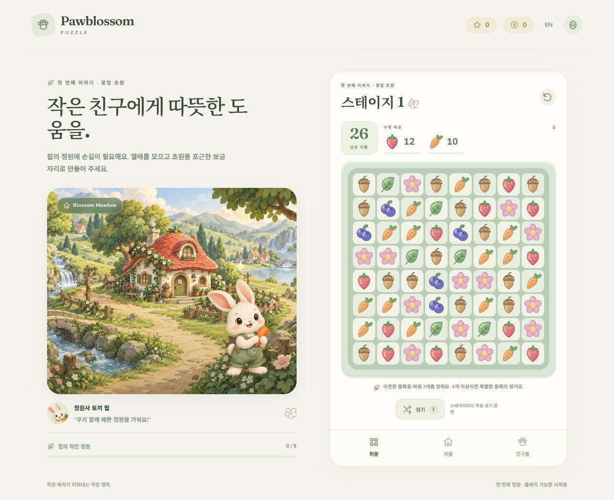

## 2026-10-23 · #245 다음 개편의 대표15판과 재미 검수 기준

지도/HUD/자체 그림 개편과 별도로, 다음 콘텐츠 개편은 아래15판을 먼저 비교합니다. 현재100판의 수치·배치·엔진/RNG·저장 서명은 이번 계획에서 바꾸지 않았으며 새 운반 목표나 목표 도움 특수도 아직 구현하지 않았습니다. 전체100판의 상용 난이도 확정이 아니라 먼저 고칠 지점을 찾는 표본입니다.

| 대표 판 | 비교할 경험 |
|---|---|
|1|기본 교환·목표 이해와 특수를 만들어 볼 이동 여유의 기준|
|4|처음 보는 단겹 낙엽을 별도 목표로 이해하는지|
|6|두겹 낙엽에 일반 매치와 특수의 차이를 읽을 수 있는지|
|15|장애물 없는 세 색 목표에서도 특수 생성·조합을 선택할 여유가 있는지|
|30|두겹 낙엽12곳과 높은 색 목표의 마무리 부담|
|31|30→31의 형태 도입이 적절한 휴식인지|
|34|U자 공급·생성 공간에서 특수/연쇄 선택이 충분한지|
|36|처음 상자를 치운 공간이 후속 매치와 연쇄의 보상으로 이어지는지|
|40|U자·상자8개의 종합에서 완료 가능성과 터지는 즐거움의 차이|
|55|비스듬한 형태·두겹 낙엽의 도전 기준|
|56|넓은 정사각·단겹 낙엽에서 특수 생성 여유가 돌아오는지|
|57|56 뒤 연못·상자6개로 부담이 갑자기 커지는지|
|90|혼합 목표의 마지막 색 수집이 정밀한 선택인지 반복 대기인지|
|96|후반 회복판도 성공감과 연쇄를 주는지|
|100|마지막 혼합 목표를 마무리하는 선택과 실패 이유를 납득할 수 있는지|

우선 검수는34·36·40,55→56→57,90·100 순서입니다. 기존 `qa/content-100-20261022/after-final100-runs20.json`의 목표 우선 정책에서34/40은 각각15/20·19/20완료지만 이동당 특수 생성은.310/.286, 추가 제거 단계는.427/.375입니다. 완료율만으로 쾌감을 판정하지 않습니다.55→56→57은18/20→20/20→9/20완료, 생성.369→.414→.271·추가 제거 단계.554→.597→.398로 회복 뒤 급변을 살필 근거입니다.90/100은6/20·8/20완료, 평균 색 목표 부족4.1/4.6개·낙엽 부족0·상자 부족.1개라 장애물 뒤 색만 남는지 관찰합니다. 평균 부족은 실패판만이 아닌20판 전체 평균입니다.

이 숫자는 기존 고정20시드와 교환만 선택하는 자동 정책의 결과를 읽은 것이며 새 시뮬레이션·사람 승률·실폰 검수 결과가 아닙니다. 직접 특수 탭 누락·조합 범위 근사의 한계가 있고, 이동당 추가 제거 단계는 `totalCascades/totalMoves`로 연출 시간이나 연쇄 발생 확률과 다릅니다. 보드 활성 칸 수와 목표가 달라 단순 생성/제거량 차이를 형태의 인과 효과로 단정하지 않습니다.

다음 구현의 판단 기준은 ① 새 규칙 한 가지를 먼저 이해하고 뒤에 혼합하는지 ② 상자 개방 뒤 실제 공급·특수 선택이 생기는지 ③ 마지막 목표를 향한 유효한 선택이 보이는지 ④ 도전 뒤 회복에서 여유가 돌아오는지입니다. 낙엽은 타일 이동을 막지 않으므로 상자와 같은 공간 개방 규칙으로 설명하지 않습니다. 기존 합계 지표에는 상자 개방 전후의 시간 순서가 없으므로 그 보상은 실제 플레이에서 별도 확인해야 합니다. 이동 수만 올리거나 특수 생성 난수를 유리하게 바꾸는 방식으로 덮지 않으며, 변경 시 동일 조건 전후 비교와 회차 서명/영구 진행 보호를 함께 검증합니다. 단계별 신규 규칙·데이터 변경은 후속 이슈/PR에서 분리합니다.

## 2026-10-22 · #219 최소100판과 학습·도전·회복 파형

현재 100판은 PR220/main340으로 통합했고 PR 최초CI39729150932는양Node2,909개/store12/두빌드성공입니다. 정확main 최초CI39729465596의Node24 원장1실패는#122에별도보존했으며Node22만전체성공입니다. 사용자APK는UI검수후보로Drive전달/재다운로드SHA일치까지완료했으며android-release상단과같은소스입니다. 아래검증후속예정표현은최초구현인계시점이며사람난이도검수는여전히남았습니다.


로컬 최초 전체 검사는44파일2,909개 중2,908성공/1실패였고, 실패는 구41범위밖 invalid fixture였으며 새상한 밖 LEVEL_COUNT+1로 고쳐 해당14입력 검사를 모두 통과했습니다. 원래 원장 동시성/timeout/거절 기대는 유지했습니다. store12·타입3config·production/testing 두빌드/flags·독립읽기검수는 성공했고, 실화면/최초PR·정확main CI는 후속 근거로 분리합니다.

출시 준비 콘텐츠를100판/11장으로 확장했습니다.1–10은3매치·특수 실습과4번 단겹/6번 두겹 낙엽 landmark를 유지합니다.11–30은 색 목표를 점진적으로 늘리고 일부 이동을2회 줄여 초반 이후 난도를 검토합니다.31–35의 다섯 mask 도입과36–40의 상자 도입/ID·형태는 유지하되 기존 낮은 색 목표를 높여30→31·35→36의 부담 하락을 줄이는 설계입니다. 엔진/RNG/매치·낙하·특수 규칙은 바꾸지 않습니다.

새60판은 각 판의 형태·이동·목표 수·낙엽 좌표/겹·상자 좌표를 명시한 별도 표입니다. 단순 복제 대신 각 장의1·6번째를 여유 이동/낮은 목표의 회복,4·9·10번째를 혼합과 더 높은 목표의 도전으로 두고 나머지에서 재료를 교대합니다. 혼합은 한 색+낙엽+상자로 실제 목표3칸을 유지합니다. 같은 매치로 두 장애물을 함께 칠 수 있으므로 수량 합만으로 난이도를 단정하지 않습니다.

| 구간/장 | 배치와 학습 의도 | 회복과 도전의 구별 |
|---|---|---|
|41–50 꽃잎 회랑|넓은 square/rounded에서 단겹·두겹 후 상자/혼합 교대|41/46은 낮은 두 색 목표,44/49/50은 외곽 상자와 중앙 낙엽의 혼합|
|51–60 물결 산책|연못의 끊긴 낙하와 외곽 상자 사이 열린 중앙 사용|51/56은30개 안팎 목표·32이동,59/60은 연못/U 혼합|
|61–70 모래시계 길|허리 양쪽 낙엽과 위쪽 열린 생성 공간을 유지|61/66은 적은 단겹,69/70은6–8 두겹과 상자·한 색34–35|
|71–80 숲의 갈림길|U자 두 팔과 아래 광장, 다른 형태의 복습 교대|71/76은33–34이동,79/80은 U/rounded 혼합35–36|
|81–90 비스듬한 언덕|비스듬한 열 구간과 특수의 직선을 연결|81/86은34이동/낮은 두 색,89/90은 slant/pond 혼합36–38|
|91–100 꽃빛 축제|다섯 형태를 재방문해 색·두겹·상자를 종합|91/96은34이동,99/100은 pond/U 혼합·최종100은34이동을 확보|

상자는 주로(1,1)/(1,6)/(6,1)/(6,6)에 간격을 두고 두며, 낙엽은 상자와 겹치지 않는 활성 칸에 둡니다. 각 판에 상자 제거 전에도 열린2×3/3×2(상자 없음은3×3) 생성 공간이 있고 상수0/시드19에서 안정 생성·합법 이동이 있음을 검사합니다. 좁은 모양은 연쇄가 적을 수 있으므로 목표/이동을 모양과 함께 판단합니다. 고립 칸과 전체 목표 접근성/사람 체감은 단순 hasMoves 검사와 구분합니다.

총괄의 변경 전 고정20시드×2정책×40판 표본에서 goal 정책 장평균 성공률은95% 이상인 반면 random은1–10=92%,11–20=67%,21–30=48%,31–35=86%,36–40=74%였습니다.30번 평균 사용22.5/34→31번11.8/26,35번15.6/30→36번11.3/28의 부담 하락과 U의 낮은 연쇄 신호를 근거로 삼았습니다. 정책·시드·수량을 바꾸지 않은 전후 비교는 총괄이 수행했고 최초안과 한 번 조정한 최종안을 아래에 구분합니다. 교환만 고르는 정책의 직접 특수 탭 누락·조합 범위 근사 한계가 있어 사람 난이도/최적성으로 확대하지 않습니다.

변경 전 실제 콘텐츠/DB·동결 golden은 덮거나 재서명하지 않습니다. 구1–35 engine golden은 fixture 자체의 옛 레벨로 같은 입력/seed/RNG 기대를 재생하며, 현재 콘텐츠와 같다는 assert만 새 재설계와 분리했습니다. 구 콘텐츠와 서명이 다른 primary checkpoint는 회차만 버리고 영구 완료/재화/Pip/정원은 유지하며 엄격 backup은 그대로 거절합니다. 구40완료→41,100완료·별100/정원 풍경·서버100/101 경계를 검사합니다. 원문·최종 소스와 전후 표본은 Git 밖 `qa/content-100-20261022`에 보존하고 전체/두빌드/실화면/필수CI는 총괄 후속입니다.

최초100판 post의 goal 장평균41–50/51–60/61–70/71–80/81–90/91–100은75.5/50/45/37/36.5/34%였고 혼합80번0%·100번5%로 과도한 색 수집 부담이 관측됐습니다. 이 최초안은 성공으로 표현하지 않고 원문을 보존합니다. 총괄 승인으로1–10은 변경 전 정의로 복원하고 신규 각 장1/6 회복판은 유지, 나머지 두 색 목표는 각각×.85/혼합 한 색은×.70 반올림으로 한 번 조정했습니다.39/67의 상자 두 칸을 옮겨 초기 고립 포켓도 없앴습니다.

최종 같은20시드·두 정책 표본에서 goal 기존 구간1–10/11–20/21–30/31–35/36–40은100/97.5/91.5/94/91%, 새6장은90.5/79/75/67/69/58.5%였습니다.100번은40%·평균 색 목표 부족4.6으로 후반 도전이 남는 초안으로 유지했고 추가 수치 조정은 하지 않았습니다. 총괄의 geometry 검사와 회귀 BFS에서100판 모두 상자 제거 전 연결성분1개/활성 장애물·비중복/목표3칸을 확인했습니다. 이 결과는 같은 정책의 소표본이며 사람 체감이나 출시 난이도 검수 완료가 아닙니다.

## 2026-10-22 · #195 나무상자 36–40 고정 표본(재설계 전 이력)

기존 1–35의 콘텐츠 JSON·서명과 변경 전 mask V2의 각12교환/RNG(총420교환)를 그대로 비교합니다. 새36–40은 색 목표 두 개와 고정1hit 나무상자4/6/4/6/8개를 모두 치우는 별도 목표를 가지며 이동28/30/30/32/34회입니다. 챕터5 「숲속 빈터」만 추가하고 기존 챕터4의31–35 범위를 유지합니다.

`node scripts/balance-report.mjs --runs=16 --levels=36-40`으로 각정책/레벨에 같은 시드1–16을 사용한160판을 검사했습니다. 무작위 완료14/13/10/9/14판, 현재 목표 우선16/16/15/15/16판입니다. 현재 보드의 직교 매치와 직접 특수 범위로 상자 피해를 추정하며 후보의 실제 교환 결과·미래 보충 난수는 조회하지 않습니다. 제안 이동/목표를 유지했고 유리한 시드 선별이나 기대/시간제한 완화는 하지 않았습니다. 소표본 자동 정책 결과로 사람 난이도·최적성을 보장하지 않습니다.

원시 결과·변경 전 엔진/DB·검사 로그·최종 두 웹 빌드와 동결은 Git 밖 `Pawblossom-builds/qa/integration-20261022/195`에 보존합니다. 총괄의 최종 소스 전체 자동 검사는43파일2,735개가 통과했습니다. 아래 과거 표본과 최신 검증을 합산하지 않습니다.

총괄이 동결 testing `index-ChhRKn1u.js`에서 실제 키보드로36번을12이동/980점/16이동 남음,40번을20이동/1,730점/14이동 남음으로 완료했습니다. 현재 칸의 접근성 이름을 읽어 외부에서 인접 매치 후보를 고른 뒤 실제 입력만 했으며 저장·Scene·RNG를 주입하거나 미래 보충을 조회하지 않았습니다. 두 회차 모두 무료 섞기·이어하기 없이 완료했지만 자동 후보를 사용한 두 판으로 사람 난이도를 대표하지 않습니다. 상자 입력 무소모, 파괴 칸의 같은 단계 보충,38번의 실제 무료 섞기 전후56타일 구성·4상자 좌표 보존,빈칸 클릭 무소모,일반1번26이동/0점/0재화 복귀와 재실행도 확인했습니다.

37번320×640 KO·640×360 EN 및39/40번640×360 KO·40번320×640 KO에서 페이지 스크롤 없이 보드8행이 표시됐습니다. 가로 canvas 하단304px는 퍼즐 하단/메뉴 상단과 같습니다.37번 EN 미리보기는 긴 설명을 dialog 내부에서 스크롤하며 시작/취소 버튼을 사용할 수 있습니다. 콘솔 오류는0건이며 근거는 `browser-final.json`과 해당 화면들입니다. CI·Android/APK/Drive·실단말 검증은 별도 후속 단계입니다.

## 2026-10-14 · 30스테이지 콘텐츠 초안 (이슈 #36)

1~10의 ID·목표·이동·낙엽 위치를 그대로 두고 11~30을 추가했습니다. 초원·꽃길·햇살의 10개 단위 선택은 스테이지 묶음 이름이며 새 배경 아트나 지역 시스템을 뜻하지 않습니다. 첫 공개 버전의 콘텐츠 수는 아직 확정하지 않았습니다.

새 콘텐츠는 대각선·가장자리·십자 낙엽 배치, 한 겹과 두 겹 혼합, 낙엽 없는 세 가지 수확 목표를 번갈아 제공합니다. 기존 규칙으로 목표 선택과 특수 사용의 비중을 늘렸습니다. 최대 표시 목표는 열매와 낙엽을 합쳐 세 개입니다.

[원시 결과](balance/content-30-100.json)는 보드 시드 1~100, 무작위·현재 목표 우선 두 정책의 총 6,000회 플레이입니다. 무료 섞기를 쓰지 않습니다. 기존 1~10의 데이터와 자동 결과는 직전 낙엽 보고서와 정확히 일치했습니다.

| 구간 | 무작위 완료율 범위 | 목표 우선 완료율 범위 |
| --- | --- | --- |
| 1~10 | 85~98% | 97~100% |
| 11~20 | 42~81% | 91~99% |
| 21~30 | 23~53% | 76~95% |

27·30번은 목표 우선도 각각 76·81%로 실패가 늘고, 무작위 정책은 24·23%입니다. 목표를 고르는 행동이 후반에 더 큰 영향을 주는 초안이며, 실제 이용자 난이도와 완료 시간을 측정한 값은 아닙니다. 후반 부담을 실제 플레이에서 조정해야 합니다.

저장 스키마와 키는 유지합니다. 연속 완료 기록의 첫 미완료 ID를 복원하여 기존 10개 완료 저장은 11번을 해제하며 별·코인·정원 보상을 추가하지 않습니다. 30번까지의 완료·별 저장, 마지막 진행 상한, 재플레이 보상, 테스트 모드의 보상 분리도 검사했습니다.

자동 검사 87개·출시용 웹 빌드, Chrome 360×640·320×568·640×360에서 선택창·잠금·키보드 탭 전환·저장 호환을 검증했습니다. 이 변경에는 APK/AAB 재빌드·배포와 실기기 시험 요청이 없습니다. 기존 Phaser 번들 경고는 남아 있습니다.

# 초반 스테이지 난이도 점검

## 2026-10-14 첫 낙엽 목표

이슈 #26에서 4~10스테이지에 고정 바닥층을 추가했습니다. 낙엽은 타일 이동을 막지 않고, 같은 칸 또는 직교 이웃 매치로 단계마다 한 겹씩 줄어듭니다. 특수 효과가 직접 닿으면 두 겹도 모두 치워집니다. 모두 치운 **더미 수**가 목표이며 열매 목표도 함께 만족해야 완료됩니다. 새 특수가 만들어져 타일이 남는 칸 아래의 낙엽도 매치 판정에 포함합니다. 타일 낙하·섞기·막힌 보드 재생성과 별개로 바닥 위치를 유지합니다.

1~3스테이지의 이동·목표·규칙은 유지합니다. 4는 한 겹 4곳, 5는 한 겹 6곳, 6은 두 겹 4곳, 7은 두 겹 6곳, 8은 한 겹 8곳, 9·10은 두 겹 8곳입니다. 추가 목표에 여유를 주기 위해 이동은 4·5에서 26회, 6~8에서 28회, 9·10에서 30회로 설정했습니다. 기존 완료 ID·별·코인·정원 저장 형식과 첫 완료 보상 규칙은 유지하므로 재플레이로 보상을 중복 지급하지 않습니다.

`node scripts/balance-report.mjs --runs=100`으로 각 스테이지·정책당 시드 1~100, 총 2,000회를 실행했습니다. [원시 결과](balance/leaves-100.json)는 schema 2이며 남은 낙엽 더미의 평균도 기록합니다. 목표 정책은 현재 보이는 매치·특수 범위·낙엽 피해를 추정합니다. 후보 평가에 엔진 교환 결과나 미래 보충 난수를 쓰지 않고, 실제 선택한 이동만 난수를 소비합니다. 특수 조합 추정은 단순한 휴리스틱이므로 정답 탐색이 아닙니다. 정책이 개선되어 이전 schema 1 결과와 완료율을 직접 비교하지 않습니다.

| 스테이지 | 무작위 완료율 | 목표 정책 완료율 |
| --- | --- | --- |
| 1 / 2 / 3 | 98 / 97 / 87% | 100 / 100 / 100% |
| 4 / 5 / 6 | 94 / 86 / 92% | 100 / 100 / 99% |
| 7 / 8 | 86 / 89% | 99 / 97% |
| 9 / 10 | 88 / 85% | 99 / 99% |

이는 이용자 성공률이 아닙니다. 첫 장애물 소개가 진행을 과도하게 막지 않는지 확인하는 자동 기준이며, 실제 이해도·플레이 시간·후반 긴장감은 재시험 후 조정합니다. 자동 테스트 70개로 겹 중복 제거·특수 직접 제거·연쇄 스냅샷·바닥 고정·무효 이동·목표 완료·기존 보상 보존을 검사했습니다. 실제 Chrome에서도 특수 탭 후 낙엽 목표 감소, 섞기 유지, 영어 안내, 5가지 화면 비율을 확인했습니다.

2026-10-11 · [이슈 #6](https://github.com/ChoiDaeYoung-94/Pawblossom-Puzzle/issues/6) · 튜토리얼 PR #5를 기반으로 한 후속 변경입니다.

## 변경 이유와 범위

기존 스테이지는 `state.ts`의 공식으로 생성됐습니다. ID·목표 종류·목표 수량을 그대로 유지하여 `src/levels.ts`의 명시적인 데이터로 분리했습니다. 저장 ID 1~10, 잠금 해제와 첫 완료 보상 규칙은 바꾸지 않았습니다. 진행 중 보드는 기존과 같이 재실행 시 새로 시작합니다.

첫 플레이에 이동 여유를 주기 위해 1스테이지를 22→26회, 2·3스테이지를 22→24회로 조정했습니다. 4~10스테이지는 24회와 기존 목표를 유지했습니다. 어려운 후반 구간을 자동 수치만으로 일괄 완화하지 않았습니다.

## 재현 방법

프로젝트 루트에서 실행합니다. 명령 결과는 JSON이며 기존 데이터와 새 데이터를 따로 비교할 수 있습니다.

```sh
npm run balance:report -- --baseline --runs=100
npm run balance:report -- --runs=100
```

원시 결과: [변경 전](balance/baseline-100.json), [변경 후](balance/opening-100.json).

- 각 정책·스테이지에 보드 시드 1~100을 사용합니다. 각 보드는 실제 `BoardEngine`으로 생성·제거·보충·자동 재배치합니다.
- 무작위 정책은 합법 이동에서 균등 선택합니다. 목표 정책은 현재 보드의 즉시 매치에서 남은 목표 수집량을 우선하고 특수 생성·발동에 간단한 가점을 부여합니다. 동점은 무작위 선택합니다.
- 선택 난수는 보드 난수와 분리합니다. 후보 비교에 `swap()` 결과나 미래 보충 블록을 사용하지 않습니다. 실제로 고른 이동만 엔진의 난수를 소비합니다.
- 수동 무료 섞기는 사용하지 않습니다. 잘못된 교환은 이동을 쓰지 않으므로 합법 교환만 비교합니다. 엔진의 막힌 보드 자동 재배치는 적용됩니다.
- `legalMoves()`를 힌트와 점검에서 공유합니다. 조회가 보드·특수·난수를 보존하며 실제 교환 결과와 일치하는지 테스트합니다.

## 결과

각 셀은 100회 중 완료한 비율입니다. 이 값은 실제 이용자 성공률이 아닙니다.

| 스테이지 | 이동 전→후 | 무작위 전→후 | 목표 우선 전→후 |
| --- | --- | --- | --- |
| 1 | 22→26 | 90%→97% | 99%→100% |
| 2 | 22→24 | 86%→93% | 100%→100% |
| 3 | 22→24 | 78%→84% | 97%→99% |
| 4 | 24 유지 | 86% 유지 | 99% 유지 |
| 5 | 24 유지 | 74% 유지 | 99% 유지 |
| 6 | 24 유지 | 78% 유지 | 98% 유지 |
| 7 | 24 유지 | 63% 유지 | 91% 유지 |
| 8 | 24 유지 | 64% 유지 | 95% 유지 |
| 9 | 24 유지 | 41% 유지 | 93% 유지 |
| 10 | 24 유지 | 40% 유지 | 90% 유지 |

9·10스테이지에서 두 정책의 차이가 큽니다. 목표를 보고 선택하는 행동이 영향을 주는 구간이므로 실제 플레이에서 목표 이해도·힌트 사용·재도전 부담을 확인해야 합니다. 100회 표본의 작은 차이로 세밀한 순위를 정하지 않습니다.

## 검증과 한계

- 테스트 4개 파일 35개 통과: 기존 32개에 데이터 유효성·합법 이동 조회의 무변경성·모든 이웃 교환 일치 검사 3개를 추가했습니다.
- TypeScript·Vite 빌드 성공. 기존 Phaser 번들 크기 경고는 남아 있습니다.
- 고정 시드 1~3의 보고서를 두 번 실행하여 동일한 JSON 결과를 확인했습니다.
- Capacitor 동기화와 Android `assembleDebug bundleRelease` 재빌드 성공. 테스트 APK·서명 전 AAB에 조정된 레벨을 반영했습니다. 기존 SDK 메타데이터 권한·flatDir 경고는 남아 있습니다.
- 한국어 브라우저에서 1스테이지 26회와 목표 12·10개, 무료 섞기 사용 후 이동 횟수 유지, 재시작 시 섞기 복원을 확인했습니다. 검증용 탭은 닫았습니다.
- 새 에셋·음악·외부 리소스는 추가하지 않았습니다.



목표 정책은 간단한 휴리스틱으로, 특수 효과를 정확히 예측하거나 여러 수를 탐색하는 최적 플레이가 아닙니다. 무작위 정책도 초보자의 시선·실수·학습을 재현하지 않습니다. 플레이 시간·피로·이탈·터치·사운드를 측정하지 않았으며 Android 실기기와 실제 이용자 검증이 남아 있습니다. 결과를 근거로 출시 준비가 끝났다고 판단하지 않습니다.
