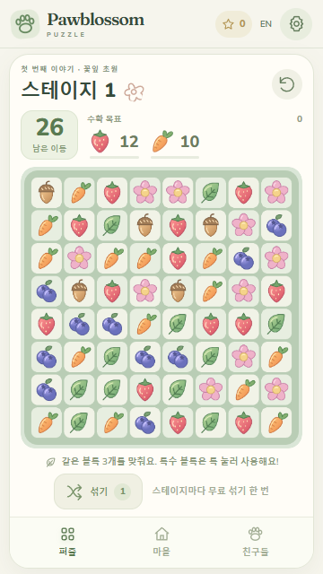
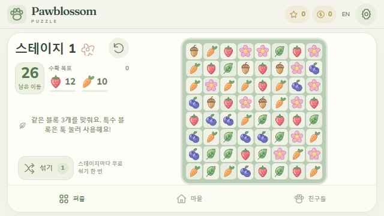
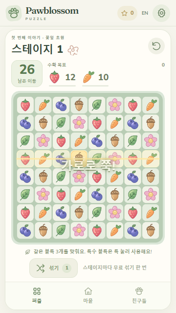
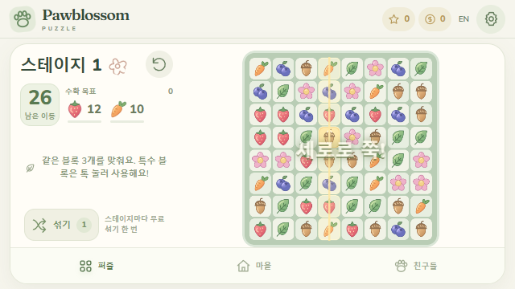
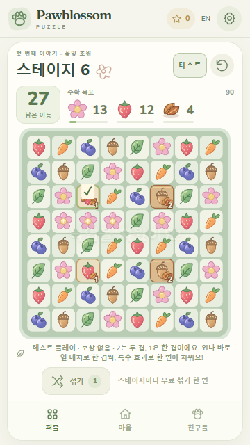
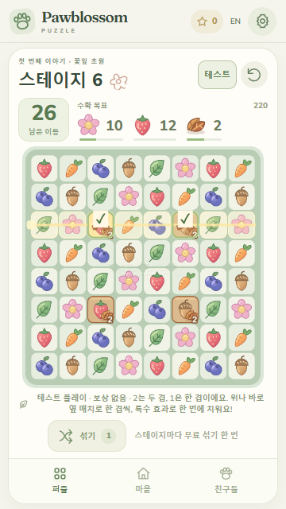
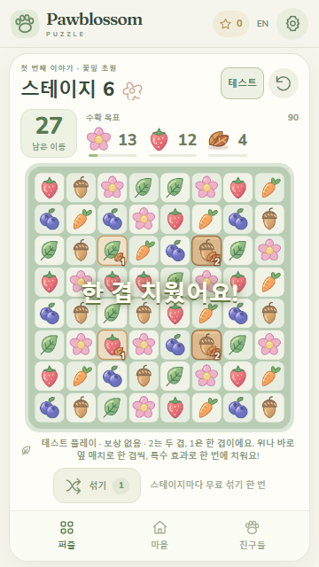
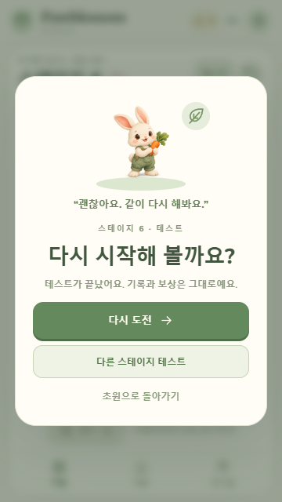

# 실기기 플레이 피드백 수정

## 2026-10-22 · #227 성장 완료 후 교감·소유 안내

핍의 먹이/놀이 버튼은 실제 상한까지 남은 증가분만 표시하고0인 항목은 생략합니다. 성장·친밀도가 모두100일 때는 증가량 대신 무료 간식/놀이 반응 감상임을 한영으로 안내합니다. 한쪽만100이거나 마지막96→100 행동은 기존10코인을 유지하며 비용/모델/저장/반응 이미지·효과음·2400ms 수명은 바꾸지 않았습니다.

소품 버튼의 접근성 이름은 소품명과 구매 가격/무료 장착/장착 중 상태를 함께 읽습니다. 기존 잠금과 disabled는 유지합니다. 소유한 후반 정원 선택 꾸미기는 기본/선택 어느 모습을 보고 있어도 과거 가격을 반복하지 않고 영구 소유·무료 전환을 안내하며 미소유 가격은 유지합니다. 관련 UI/기존 핍 모델387개와 타입3설정이 통과했으며 실제 무료 행동의 재화·수치·회차 보존, 서로 다른 반응과 종료, 소품3상태, 한영 소유 설명을 확인했습니다. 두 웹 빌드/소스 동결은 Git 밖 `qa/issue-227-pip-care-labels/writer`에 보존하며 최종 실화면·전체검사·CI·APK는 총괄 후속입니다.

총괄은 무료 행동 안내를 「핍과 간식 시간을 즐겨요 / 핍과 신나게 놀아요」와 대응 영어로 다듬고 관련387개·타입 포함 두 빌드를 다시 확인했습니다. 최종 testing `index-CZCxoOR-.js`의 실제 UI에서 KO320세로/EN640가로, 무료 간식/놀이별 그림·재화 불변, 체험의 성장100·친밀도92에서 +8만 표시하고 마지막10코인을 쓴 뒤 무료로 바뀌는 흐름을 확인했습니다. 리본40코인 구매·소품 벗기·무료 장착 이름, 연못 복원 별24개/꾸미기240코인 이후 양쪽 모습의 영구 소유·무료 전환을 확인했습니다. 체험 종료와 reload 후 정상27완료·28진행의 이동20/점수820/목표25·19·낙엽3/별17·코인710이 복원됐습니다. `qa/issue-227-pip-care-labels/browser`에 화면과 소스별 기록을 보존합니다. 실단말·실SDK·필수 CI·APK는 이 실화면 확인에 포함하지 않습니다.

## 2026-10-22 · #225 후반 세 공간 복원·미리보기

100스테이지의 첫 완료 진행에 연못50/60·쉼터70/80·꽃아치90/100의 기초/완성을 연결했습니다. 단계마다 별12/14/16개씩 총84개이며 기존 꽃밭10개와 합쳐94개입니다. 기본 완성에는 코인이 필요하지 않습니다. 완성한 공간의 선택 꾸미기는 각각240/360/480코인으로 한 번 영구 소유하고 기본/소유 꾸미기는 무료로 바꿉니다. 기존 소유물·가격·첫 완료40코인/1별·재플레이 추가 보상0을 유지합니다.

꽃밭/연못/쉼터/꽃아치44px 탭에서 한 장면을 크게 보고 방향키·Home·End로 선택합니다. 기존5꽃밭·등불은 꽃밭에서만 편집하고 새 공간은 전용 자체SVG로 빈터/기초/완성/별도 형태 꾸미기를 그립니다. 방문 핍과 대사·반응, 완료 시 기존 reward 효과음을 해당 공간에 연결하고 구 꽃밭 기본 SVG 바이트를 유지합니다. 핍의 다음 별 복원 목표는 기존 유료 풍경 목표와 독립적으로 표시합니다.

현재/바뀔 모습 전환 미리보기는 조건·별·코인이 부족해도 열어 볼 수 있고 확정은 차단합니다. 취소·ESC·Android 뒤로·언어/경로/비활성·다른 모달·오래된 DOM은 소비하지 않습니다. 확정은 save/세대/일반·체험/route/scene/현재 DOM을 확인한 뒤 자기 모달을 닫고 기존 commitCare에서 현재 잔액·단계를 다시 계산해 재화와 선택을 한 payload로 저장합니다. 실패·충돌은 원래 메모리/primary를 보존하며 취소/실패에 효과음·보상을 재실행하지 않습니다.

정상 저장에는 optional `gardenDesign.spaces` 부재를 자동 삽입하지 않습니다. 존재하면 세 공간의 단계/소유/선택을 엄격히 검증하고 실제 completed 정규화 뒤 고유 개수를 사용합니다. testing 체험만 임시1600코인/100별/100완료 조건을 공통으로 사용하며 전부 소유하면70코인/6별이 남습니다. 나가면 정상 save·회차·선택 구역/꽃칸을 복원하며 진행/재화 수입을 쓰지 않습니다. 순수/저장/UI 수명 회귀와 타입·두 웹 빌드를 이 묶음에서 검증하고 원문 로그/실패 초기 결과/소스 동결을 Git 밖 `qa/issue-225-garden-spaces/writer`에 보존합니다. 최종 전체검사·실화면·필수 CI·APK/단말 검증과 장기 재미는 총괄 후속이며 상용화 전체 완료를 뜻하지 않습니다.

작성자 검증은 관련3파일433개 성공 뒤 시험50완료로 일반49개 해금 조건을 채울 수 없는 경계를 포함한 UI6개 묶음을 재확인했습니다. 타입3설정과 production/testing 두 빌드는 성공했고 배포 플래그는 각각 모두false/모두true입니다. 기존 큰 번들 경고는 남습니다. 최초 수명 검사1실패는 테스트가 실제 백업 키(`pawblossom.save.v1.backup`)와 다른 키를 차단한 fixture 오류였으며 원문을 보존하고 정확한 키로 고쳤습니다. 성공 수량을 전체검사나 실단말 성공으로 합산하지 않습니다.

총괄의 첫 전체44파일2,950개 성공은 작성자 동결본 기준이며, 이후 꽃밭5개 완성 화면의 다음 공간 안내와 꽃아치 선택 꾸미기의 덩굴 윤곽을 다듬었습니다. 이 조정 뒤 UI/정원399개·타입3설정·두 웹 빌드를 통과하고 독립 추가 읽기 검수를 마쳤습니다. 최종 production `index-BTb26rjt.js`에서 정상23완료/24번30이동·0점/13별·550코인·기존노을꽃밭이 보존되고 꽃밭의 목표 버튼이 저장 없이 연못으로 이동했습니다. testing `index-Nc4UI0oG.js`에서 실제 체험을 처음부터 진행해 기존450코인/10별과 새1080코인/84별을 소모한70코인/6별, 소유 꾸미기 무료 왕복과 체험 종료·reload 후 정상24번/13별·550코인·연못미소유 복귀를 확인했습니다.

320×568 KO·390×844 KO와640×360 EN의 미리보기/취소·초점 복귀·44px 구역 탭·Home/End/방향키·가로 넘침 없음·짧은 화면 dialog 내부 스크롤을 확인했습니다. 처음 모드 전환에서 검증용 정적 서버가304로 이전 index를 재사용해 JS404가 났고, 원문 HTTP 기록과 전용 QA query URL로 분리했습니다. 제품 오류로 합산하지 않습니다. 실제 브라우저의 소스별 범위·그림·전체 체험 기록은 Git 밖 `qa/issue-225-garden-spaces/browser-demo.json`에 보존합니다. 원본 Phaser/레벨을 그대로 둔 앞선5654dd4 production의21–23번 실제 UI 첫 완료와24번 진입은 별도 자연 진행 근거이며 이 새 UI의100개 전수 완료나 사람 난이도 검수로 표현하지 않습니다. 필수 PR/정확 main CI·Android/실서비스·장기 재미는 아직 별도입니다.

## 2026-10-22 · #223 가장자리 스와이프

최신 사용자 제보를 바탕으로390×844 브라우저의21번 동일 보드에서 내부→오른쪽 최외곽 교환을 비교했습니다. 종료점이 canvas 오른쪽 여백일 때30이동/0점으로 누락되고, 같은 시작에서 타일 안에 놓으면29이동/70점/낙엽8→6으로 정상 처리되어 종료점 gate 결함을 확인했습니다. Android 실단말의 모든 제보 원인을 확정한 것은 아닙니다.

정상 pointerup은 시작 칸과 주방향의 바로 이웃으로만 교환하고 종료점이 여백·비정형 빈칸이어도 해당 이웃이 유효하면 처리합니다. Phaser가 canvas 시작 터치의 정상 touchmove에도 gameout을 보내므로 동일 target·동일 identifier의 단일 터치만 종료까지 보존합니다. 마우스/기타 gameout, 외부 target의 pointerupoutside, touchcancel, 다른 포인터, 세대 변경, resize·일시정지·모달 취소 보호는 유지합니다. 실습도 정상 pointer capture 종료에서 같은 방향 규칙을 사용하며 취소/DOM교체/합성click 중복은 계속 차단합니다. 실제 매치 없는 교환의 왕복은 입력 누락과 구분합니다. 설치 Phaser Pointer·InputManager의 touchmove→setCanvasOut→InputPlugin gameout→touchend/cancel 원본 호출 회귀, 보드/실습 입력과 타입 검사를 확인했습니다(최종 보드216개/관련4파일 최초243개, 타입3설정 성공). 최종 브라우저·CI·단말 검증은 총괄 후속입니다. 원문·소스 동결·검사 로그는 Git 밖 `qa/issue-223-edge-swipe`에 보존합니다.

총괄의 최종 전체 검사는44파일2,940개를 통과했고 타입·에셋과 production/testing 두 빌드를 확인했습니다. 동결 production `index-xNSqbFYW.js`의390×844 실제 브라우저에서 상단 여백 종료가29→28이동·70→120점·꽃22→19·낙엽6→5로 정상 처리됐습니다. canvas 밖 마우스 종료는 기존대로 취소됐습니다. 초기에 읽은 canvas Y가 폰트/레이아웃 정착 후293.609→301.297로 달라져 바깥 종료와 내부 여백 종료를 실제 hit target으로 구분했으며, 이를 입력 실패로 합산하지 않았습니다. 수정 전/후 그림·실제 좌표·접근성 읽기는 Git 밖 before/after-repro.json에 보존합니다. 필수 PR/정확 main CI와 Android 실단말은 아직 별도이며 APK를 재생성하지 않았습니다.

## 최신 100스테이지 전달 · 2026-10-22 · #221

[34031f1 검수 후보 APK](https://drive.google.com/file/d/1L6dRtO4sJook8Erle_A2ALkdM-VMMZJT/view)0.1.7/code8·11,146,331bytes/SHA256 `7fa11bfc90ba5ee17e227107428098a1e747d1a6a24577c9ef9b0538840d21c6`를 기존Drive에 추가하고 실제 재다운로드 크기/해시 일치·웹38/비웹536·기존서명·production복원을 확인했습니다.100판/11장과 오늘 핍·정원 개선을 포함하며 별도 테스트 안내 파일/새예약은 없습니다. 상세 검증 수명은 android-release 상단을 기준으로 합니다.

PR220 head5ac 최초CI39729150932는 양Node44파일2,909개/store12/타입/두빌드 성공 뒤 main340으로 병합했습니다. **정확main 최초CI39729465596은Node24 원장1실패/Node22성공**이며#122 원인·owner는미확정입니다. APK는UI·게임 검수 후보이며 출시/서버검증완료가아닙니다. 같은head재실행·500ms/5초/8worker/seed/기대완화없음. Node24 후속store/build는skip이며 PR성공으로 대체하지 않습니다.

실화면KO320×640/EN640×360/390×844의100선택·현재장재열기·실제교환34→33/110점/낙엽8→7,정상21/30이동0점/430코인/별10/노을복귀를확인했습니다. 100개 사람완주·폰·실서비스·장기재미·40이후성장/재화흐름은미검증입니다. 개발자명/공개지원·개인정보호스팅과#73실광고/구매/복원/환불/스토어도남았습니다. 아래 이전 인계의후속예정/9fa최신표현은당시이력입니다.

## 2026-10-22 · #219 100스테이지와 콘텐츠 재설계

최신 사용자 지시에 따라100스테이지와 새6장(41–100)을 추가하고11–40의 목표/이동 부담을 재검토했습니다. 기존1–10 학습 지점·31–35 mask/36–40 상자 도입을 유지하며 새 장은 단/두겹 낙엽·상자·혼합을 학습/도전/회복으로 교대합니다. 각 판의 구체 좌표/수치와 근거는 levels.ts와 level-balance 상단에 기록했습니다. 실제 색+낙엽+상자 목표는 최대3칸입니다.

11장 선택은 좁은 화면에서96px/44px 버튼을 가로 스크롤하고 선택·키보드 이동 때 해당 탭을 보이게 합니다. 시험 선택도 콘텐츠/장 수를 동적으로 사용합니다.100완료와 재보상 차단, 구40완료→41 해금·별100/backup, 정원 풍경의 완료 context100, 서버100/101 경계를 연결하며 풍경20/40과 체험40 미리보기는 유지합니다. 구 엔진 golden 기대와 규칙/RNG를 바꾸지 않고 옛 fixture와 현재 콘텐츠 검사를 분리했습니다. 서명 불일치 회차와 영구 진행 보호도 검증합니다.

영향 검사/초기 실패와 수정·타입 원문은 Git 밖 `qa/content-100-20261022/writer`에 보존합니다. 최초 새 server 검사에서 void 반환 기대와 UI의 옛 범위 밖99를101로 고쳤고 새 낙엽 파서의1/2 타입 추론을 명시했습니다. 배치 데이터·seed·엔진 기대를 완화하지 않았습니다. 최종 전체/웹 빌드·실제100선택/한영 작은 화면·전후 난이도 표본/필수CI·APK는 총괄 후속이며 사람 난이도/출시 완료로 표현하지 않습니다.

1–10 복원 도구가 같은 ID의 장 정의까지 치환한 범위 오류를7개 회귀에서 찾아11장 표를 명시 복원했고, 이후 levels/UI376개·실제40→41 보상/정원100 경계의 UI/garden387개가 통과했습니다. 정상 콘텐츠 데이터와 engine golden은 별개로 유지합니다. 장 탭의 노출은 가로 컨테이너 scrollLeft만 조정해 정원 편집의 세로 스크롤을 이동시키지 않습니다. 최종 난이도20시드 표본과 한 번 조정한 근거는 level-balance 상단에 구분했습니다.

## 최종 수용 검증 · 2026-10-22 오후 · #210

PR217의 실제 체험 부족 보완까지 main9fa15f0으로 통합했고 최종head7b/정확main의 최초CI39725948588/39726135273은 양Node44파일2,846개/store12/타입/두빌드 성공입니다. 실제500체험은 돌봄/소품2·작품3·풍경2 전체구매 후50잔액과 원래430코인/20노을/21번복귀를 확인했습니다. production38바이트는 이전63b와 같아 자연11–20완료와20노을 구매/재실행의 근거를 재사용합니다. 아래 자연20미검증·400유지·CI/APK후속·Draft 표현은 그 당시의 이력입니다.

[최신 검수APK9fa](https://drive.google.com/file/d/13dAbsmALhEHyLpNktoE6wB--JVrWvKvV/view)는 실제 재다운로드 SHA와 원본이 같고 source/웹38/비웹536/기존v2·production복원·native결과재사용 범위를 독립 검수했습니다. 자세한 수명/수치는 android-release 상단과 Git 밖 `2026-10-22-9fa15f0`에 기록했습니다. 옛63b CI의원장실패/원인미확정은해결처리하지않으며폰·실광고구매·장기재미는미검증입니다. 별도테스트안내파일/새예약·보류범위확대는없습니다.

## 2026-10-22 · #216 후반 완료 목표와 정원 풍경

총괄의 최종 체험 조합에서 기존 돌봄/소품/등불290코인과 새 풍경160코인을 모두 보려면450코인이 필요해 최초400체험 잔액으로50코인이 부족한 점을 확인했습니다. #216 후속으로 testing 전용 체험 잔액만500으로 보완합니다. 실제 잔액/가격/보상·production 체험 미노출은 유지하며, 같은 체험에서5꽃밭·성장/친밀도100·소품2개·작품3개·풍경2개를 모두 선택하고50코인을 남긴 뒤 원래 저장/회차/세 키와 쓰기 횟수를 정확히 복원하는 기존 기능 회귀를 확장합니다. 아래400유지/63b 근거는 최초 후보 이력으로 보존하며 새 소스의 검증·APK는 별도로 진행합니다. 이 기능 보강을 이전63b 최초CI의 원장 실패 해결로 표현하거나 동일head CI를 재실행하지 않습니다.

총괄의 실제 일반1–10 완료 관측에서5꽃밭·성장/친밀도100·공동 작품3개·소품2개를 얻고110코인이 남는 흐름을 확인했습니다. 이 수치로 장기 재미 저하를 단정하지 않으며, 후반 완료 목표가 비는 범위를 보완합니다. 노을 풍경은 서로 다른 일반 스테이지20개 완료/꽃밭4/성장100/친밀도80, 별빛은40개 완료/꽃밭5/100/100 조건으로 각80코인에 처음 한 번 소유하고 즉시 선택합니다. 기본 초원과 소유한 풍경의 이후 전환은 무료이며 같은 선택은 저장하지 않습니다. 기존 꽃밭·돌봄·소품·공동 작품 가격과 효과는 유지합니다.

선택 필드 `ownedThemes`/`theme`는 누락 상태를 유지하고 소유 배열의 최대2개·중복/hole·값·선택 소유·성장/친밀도/꽃밭/고유 완료 조건을 검증합니다. `SaveStore`는 완료 ID의 범위 필터와 중복 제거 후 실제 개수를 전달합니다. 기존 꽃/작품/등불 행동도 완료 context를 전달해 풍경 소유를 잃지 않으며, 시험 회차와 반복 완료로 일반 해금을 얻지 않습니다. 같은 `commitCare` payload로 재화와 소유/선택을 저장 성공 후 확정하고 실패·충돌·중복/늦은 버튼을 거절합니다.

기존 작품3개를 얻은 뒤 핍의 다음 목표는20/40 풍경과 현재 조건·정원 편집 링크로 이어집니다. 한영 조건/80코인/소유·선택·무료 전환/정원 ARIA를 연결합니다. 체험은 별도40완료 조건을 미리 보는 모드임을 배너에 명시하며 실제 `completed`·정상 회차/RNG를 바꾸지 않습니다.400체험 코인·fresh 디자인과 종료 시 원래 저장 복귀를 유지합니다.

자체 SVG의 하늘·초목·길·정적 해/별만 노을의 따뜻한 크림과 별빛의 차분한 보라로 구별했습니다. 꽃·핍·등불에는 전체 필터를 씌우지 않고 그림/배치와 기존 모션 감소를 유지합니다. 변경 전 기본 초원0–5단계×축하 여부12출력을 Git 밖에 보존하고 SHA로 바이트 일치를 확인했습니다. 실제 작은 화면의 색/가독성·키보드·꽃/핍/등불 조합은 총괄 실화면 검수 전까지 미검증입니다.

관련 순수/정규화 저장/핍/UI4파일428개를 첫 실행에 통과했고 타입3config·diff 검사도 통과했습니다. 원문·기본초원 이전 출력·최종 소스/diff/해시는 Git 밖 `qa/integration-20261022-afternoon/216`에 보존합니다. 전체검사·두 웹빌드·독립 검수·필수PR/정확main CI·APK는 총괄 후속 단계입니다. 새 bitmap·음원/최종 믹스·가격 인상·화폐/현금 상품·반복 보상·타이머/감소·로그인·버전 변경은 없습니다.

총괄 후속 검증: 전체44파일2,846개·스토어12개·타입/production·testing 웹빌드가 첫 실행에 성공했습니다. 전체 검사 중 두 빌드가 일부 겹쳤으며 원문은 그대로 보존했습니다. 독립 읽기 검수 승인 뒤 실제 testing320 KO/EN·568 EN에서 노을/별빛·꽃3종/작품3개/등불5번째 위치·80코인 두 번 구매 후70코인·이후 무료 전환을 확인했습니다. 320은 view/scroll259px, 대체 제목top245.5px가 미리보기 아래222.1px 밖에 보여 #213 초점 보강도 유지됩니다. 체험 종료/재실행 뒤 일반10완료·110코인·5꽃밭/기존3작품·별빛 미소유·11번28이동0점이 복귀했습니다. 저장/Scene/RNG 주입은 없으며, 정상20/40 자연 완료·OS 모션 감소·실단말 검증은 미실행입니다. 후속 문구에서 기술적인 고유 완료를 완료 스테이지/Stages cleared로 다듬고 UI·타입/두빌드·작은 화면을 다시 확인합니다. 최초 전체 검사를 최종 문구 변경 후 재실행했다고 표현하지 않습니다. 필수CI/최종APK는 이어갑니다.

## 2026-10-22 · #213 소유한 등불을 꽃밭 옆으로 무료 배치

기존5칸 꽃밭 선택을 재사용해 소유한 등불을 선택한 열린 꽃밭 옆에 무료로 옮길 수 있습니다. 버튼에 한영 꽃밭 번호와 무료를 명시하고 현재 위치/표시·숨김 상태와 정원 그림의 접근성 설명도 함께 갱신합니다. 숨긴 등불에 배치 버튼을 누르면 위치와 표시를 같은 저장 payload로 확정하며, 같은 위치에 이미 표시 중이면 저장하지 않습니다. 기존 무료 표시/숨기기 버튼은 유지합니다.

선택적 `lanternPlot`은 정수0 이상/열린 꽃밭 미만과 등불 소유를 함께 검증합니다. 누락/undefined는 현재 기본 좌표419,217을 유지하고 로드·화면 표시·일반 재저장만으로 필드를 추가하지 않습니다. null·hole 배열·분수·범위 밖·미소유는 거절합니다. 위치 선택 뒤에만 필드를 저장하며 기존 `commitCare`의 저장 확정/rollback·충돌·중복/늦은 버튼·체험 fresh 디자인/정상 복귀를 재사용합니다. 등불 구매20코인·꽃밭 확장·돌봄 가격/효과·회차/RNG와 재화 지급은 바꾸지 않았습니다.

위치는 정원480×280 안의 꽃밭 오른쪽 아래 다섯 좌표로만 이동합니다. 모든 x를205 이상으로 두어 핍의 왼쪽 전경을 피하고 등불 실루엣/빛 원의 경계가 viewBox 안에 있음을 수치 검사했습니다. 실제 한영 작은 화면에서 꽃밭/핍/등불 겹침·버튼 줄바꿈·키보드 초점·모션 감소는 총괄 실화면 후속 검수로 구분합니다.

기존 순수모델/저장/UI 검사에 경계를 보강해2파일378개를 첫 실행에 통과했고 타입3config와 diff 검사도 통과했습니다. 검사 수를 추가하지 않았고 원문·최종 diff/소스 해시는 Git 밖 `qa/integration-20261022-afternoon/213`에 보존합니다. 전체검사·두 웹빌드·CI·APK는 총괄 후속 단계입니다. 새 현금 상품/화폐/가격 인상/반복 보상/타이머·새 이미지·음원/최종 믹스·버전은 추가·변경하지 않았습니다.

총괄의 보강 전 전체44파일2,837개와 두 웹 빌드가 성공했습니다. 실제320에서 배치 후 비활성 버튼의 대체 제목 초점이 고정 미리보기 뒤(top183.5px<미리보기 아래222px)에 가려지는 점을 찾아, 기존 스크롤 복원 뒤 대체 초점만 scrollIntoView(start)하도록 수정했습니다. 같은 버튼 복귀는 원래 스크롤을 유지합니다. 후속 UI366개·타입/두빌드 성공 뒤 실제 제목top245.5px로 보이게 됐습니다. EN320의 chapter5 긴 단어가 view259/scroll264px로5px 넘치던 점도 뜻이 같은 Forest glade로 줄여 UI366개·타입/두빌드 성공과 view/scroll259px 일치를 확인했습니다. 세 단계의 검사와 빌드 원문은 각각 보존하고 최종 전체 재실행으로 합산하지 않습니다.

일반 저장에서 실제 퍼즐3·4·5·6번 완료(남은이동14/16/13/11)로 별4/160코인을 얻고, 기존 데이지/벤치를 유지한 채3꽃밭·3종·성장84/친밀도84·세 작품/100코인으로 재실행했습니다. 이 자연 진행은 바로 앞0ac3a6c production 빌드의 근거로 분리합니다. 새213 빌드는 그 저장의 등불 기본419217을 자동 변경하지 않다가 무료 선택 후 위치/소유/100코인을 재실행 유지했습니다. 기존5위치는 최초213 실제320에서 모두 확인했고, 같은 GardenArt를 유지한 최종 빌드에서는320 KO/EN의 키보드 초점·390 KO 체험5번째 위치/물뿌리개·568 EN4번째 위치/체험 종료·일반7번28이동0점/100코인 복귀를 확인했습니다. 콘솔오류0·페이지가로/세로넘침없음, 구 저장/Scene/RNG 주입없음이며 실단말·실서비스·장기 재미 검수는 별도입니다. 실화면과 소스별 범위는 browser-before-focus-fix/browser-focus-fixed-copy-before/browser-final 및208/natural-normal-3-6에 보존합니다.

## 2026-10-22 · #208 꽃을 고르고 핍과 정원 작품 완성하기

다섯 꽃밭 중 열린 칸을 선택해 초원꽃·데이지·보라꽃을 무료로 교체하고 저장할 수 있습니다. 초원꽃은 기존 다섯 색 클러스터를 유지하고 데이지는 긴 꽃잎10장, 보라꽃은 종 모양으로 직접 그려 색뿐 아니라 형태도 구별합니다. 정원 그림의 왼쪽 전경에 기존 핍/놀이 아트를 함께 놓고 꽃밭을 오른쪽에 모았습니다. 방문하면 배치한 벤치·나비·등불에 맞는 대사와 핍 그림 반응을 보이고 Lv.3 돌보기는 기존 물뿌리개를 사용합니다. 방문·표시/숨김·꽃 교체는 무료이고 보상을 지급하지 않습니다.

공동 작품은 핍의 쉼터(꽃밭1/성장20/친밀도20, 무료 벤치), 나비 꽃길(꽃밭2/성장60/친밀도40/열린 꽃2종, 무료 나비), 작은 등불(꽃밭3/성장80/친밀도80/열린 꽃3종,20코인 일회 구매)입니다. 조건과 비용을 각 버튼 옆에 표시하며 소유 후 표시/숨기기는 무료입니다. 꽃 다양성은 첫 해금 때만 확인하므로 나중에 꽃을 다시 골라도 소유를 잃지 않습니다. 핍 화면은 다음 미소유 작품과 현재 조건을 보여 주고 정원 편집 제목으로 이동·초점을 연결합니다. 기존 「성장 보상 모두 열림」문구는 공동 작품과 구분했습니다.

선택적 `gardenDesign`은 schema1/꽃5칸/소유·배치 최대3개를 엄격히 검증합니다. 잠긴 칸은 기본 초원꽃만 허용하고 중복·알 수 없는 값·hole·미소유 배치와 불가능한 꽃밭/성장/친밀도 소유 조건을 거절합니다. 필드 없는 구 저장은 로드·렌더·일반 재저장만으로 필드를 삽입하지 않습니다. 꽃/작품은 기존 `commitCare`에서 재화와 같은 payload로 저장 성공 후에만 확정하고, 실패·충돌·늦은 버튼·중복 지출을 막습니다. 체험만 fresh 디자인/400코인/10별로 시작하며 종료 시 원래 save·회차·장면·선택 칸을 복귀합니다. 별2 확장과 기존 돌봄/소품 가격·효과는 유지합니다.

긴 소개 대신 짧은 체험 배너와44px 선택 버튼·눌림/잠금 상태를 제공합니다. 정원 미리보기와 편집을 같은 부모에 두고 세로에서만 미리보기를 sticky로 유지하며 초점이 가려지지 않도록 스크롤 여백을 둡니다. 가로는 제한된 높이를 고려해 내부 스크롤을 사용합니다. 실제 작은 화면에서 핍/꽃밭 겹침과 sticky·키보드 가시성은 총괄 브라우저 검수로 남깁니다. 기존 모션 감소 규칙을 재사용하며 음원·최종 믹스·퍼즐 규칙/RNG·서버/native·버전·기존 bitmap은 바꾸지 않았습니다.

관련 순수모델/저장/핍/UI4파일417개와 타입 검사를 통과했고 이후 초점·primary 쓰기 실패를 보강한 UI366개도 통과했습니다. 첫 새 가드 fixture의 autoFrame이 `boardPending`을 미리 해소하던1개 실패는 고정 상태 대역으로 수정하고 원문을 보존했습니다. 명령 원문·최종 diff/소스 해시는 Git 밖 `qa/integration-20261022-afternoon/208`에 남깁니다. 전체검사·두 웹빌드·실제 브라우저/Android·필수CI와 사용자 감각 검수는 별도 단계입니다.

총괄의 최종 전체44파일2,837개와 타입/production·testing 두 웹 빌드가 성공했습니다. 실제 이전20ff 버전에서 자연 플레이로 얻은 별2·80코인·3번24이동 저장을 새 빌드로 열고, 꽃밭1 확장→먹이/놀이4회→성장·친밀도28/28·40코인→데이지 선택·벤치 획득을 확인했습니다. 재실행 뒤 소유/꽃/재화가 남고 체험에서3꽃밭·3종 꽃·성장84/친밀도84·세 작품을 만든 뒤 종료·재실행해도 일반28/28·40코인·1꽃밭·데이지/벤치·3번24이동으로 복귀했습니다.320×640 KO에서 미리보기 아래222px/작품 초점 위483px와 무료 숨김/표시·방문 반응,390×844 구 저장 업그레이드,568×320 EN 비고정 내부 스크롤을 확인했습니다. DOM 외부 스크롤은 없고 콘솔 오류0건이며 저장/Scene/RNG를 주입하지 않았습니다. `browser-functional.json`과 실제 화면을 같은 QA 폴더에 보존합니다. 순수 API는 첫 선택도 같은 care 정수/범위 검증을 받도록 마지막1줄을 보강하고 독립 읽기 재검수를 마쳤습니다. 실단말·Android뒤로·감소모션 실화면·장기 재미 검수는 미완료입니다.

## 2026-10-22 · #207 중복 소개와 퍼즐 핍·아이콘 비율

사용자 Android 이미지 검수에 따라 모든 화면 위에 반복되던 핍 소개·풍경 배너를 제거했습니다. 퍼즐 안의 기존 `header-pip` 노드를 유지하면서 전신을 일반 세로112px, 높이700px 이하 세로80px, 가로88px(높이340px 이하72px)로 표시합니다. 기존36px 원형 얼굴 자르기를 없애 기존 핍·놀이 아트가 온전히 보이도록 했고, 가로 왼쪽190px에서는 제목과44px 시험/재시작 버튼을 핍 오른쪽 두 행에 배치합니다. 일반 세로의 이전 소개56px+간격8px+제목44px 공간을 하나로 모은 설계입니다.

남은 목표를 실제 수집한 첫 단계에도 핍이 반응하며 기존 특수·연쇄 반응, 이동당 최대2회, 늦은 이미지 해독/취소·화면 전환의 기본 아트 복원과 모션 감소를 유지합니다. 목표 날림은 기존 연결을 사용합니다. 설정은44×44 터치 영역/22×22 SVG를 유지하고 세로로 길던 톱니 path를 대칭 자체 벡터로 바꿨습니다. 줄/칸 특수의 납작한52×42/42×52 몸체를48×48 정사각으로 바꾸고 방향 띠·화살표·색은 유지했습니다.480×480 Phaser/FIT·정사각 canvas 배치에는 변경이 없습니다.

관련3파일559개와 전체/앱/서버 타입 검사를 통과했습니다. 이후 일반 세로 핍을88→112px로 보완한 최종 CSS에 대해 UI1파일355개를 다시 통과했습니다. 목표 수집/반응·감소모션·특수 방향·정사각 몸체와 KO/EN 화면 전환·삭제된 소개 노드 참조 부재를 검사하며, CSS/DOM 대역 검사를 실제 브라우저나 Android 성공으로 확대하지 않습니다. 로그·diff·소스 해시는 Git 밖 `qa/integration-20261022-afternoon/207`에 보존합니다. 전체 검사·두 웹 빌드·실제 작은 화면/피드백·필수CI와 APK는 총괄 후속 단계입니다. 엔진·저장·재화·음원/최종 믹스·기존 bitmap·버전은 바꾸지 않았고 비공개 Slack 원본을 저장소에 추가하지 않았습니다.

총괄의 최초 전체43파일2814개와 두 웹 빌드가 성공했습니다. 실제568×320 가로에서88px 헤더 때문에 보드214px의 마지막13px와 도구5px가 하단 메뉴에 겹치는 회귀를 찾아, 높이340px 이하만72px 헤더로 보완했습니다. 이후 UI355개와 두 웹 빌드를 다시 통과했고 최종 웹에서 보드201px/아래264px, 도구 아래256px, 메뉴 위264px로 겹침 없이 확인했습니다. KO/EN·40번의 상자 포함3목표도 점검했습니다.390×844는 핍112px·보드344px,320×640는 핍80px·보드274px로 페이지 스크롤 없이 들어갑니다. 실제 시험1번 인접 교환 중 `happy`/놀이 이미지와 목표 수집 반응을 포착했습니다. 독립 읽기 검수와 실화면 근거는 같은 QA 폴더에 보존하며, 정확 PR/main CI·새 APK 및 실단말은 별도 단계입니다. 구형 수동 `image-loading-qa.mjs`의 삭제된 소개 DOM 참조는 최신 검증으로 사용하지 않았습니다.

독립 후속 검수에서 짧은 가로 도움말 행이3px로 줄어 읽기 어려운 점도 발견했습니다. 같은 크기에서 행 간격과 이동 표시를 압축해 안내32px/줄높이16px의 완전한 두 줄을 확보했습니다. 일반 KO 안내는32px 안에 모두 들어가고, 시험40 EN의 긴48px 안내는 두 줄을 표시한 뒤 나머지를 기존 영역 안에서 스크롤합니다. 보드 아래264px/메뉴 위264px와 패널 scroll/client201px는 유지됐습니다. 이 보완 뒤 UI355개·타입/두 웹 빌드 성공을 별도 `*-hint` 로그에 보존하며, 원래3px 화면과 수정 화면을 구분합니다.

## 2026-10-22 · #202 상단 별·코인 사용처 안내

상단 별·코인 숫자를 각각44px 설명 버튼으로 연결했습니다. 현재 잔액과 한영 「사용처 보기」접근성 이름을 제공하며, 별은 첫완료 획득·정원 꽃밭 확장, 코인은 첫완료 획득·핍 먹이/놀이/소품·일반 퍼즐의 무료 섞기 뒤 회차당 한 번 추가 섞기를 설명합니다. 닫기만 있는 안내창이므로 지출·이동·보상 지급을 실행하지 않습니다. 체험은 체험용 잔액과 종료 시 소멸을 명시하고 시험 회차는 일반 재화 무소비·무보상을 명시합니다.

열기에서 실제Scene/활성 상태·연쇄/전환·결과 대기·광고/결제busy·다른dialog·재화처리를 확인하고 기존 입력/모달 중지에 연결합니다. 닫기·Escape·Android뒤로는 같은 회차/저장/체험의 원래 버튼 초점과 화면 스크롤을 복귀하며, 저장 충돌 상태에서도 저장 없이 설명을 읽을 수 있습니다. 숫자1만 이상만 언어별 짧은 표기로 표시해320헤더를 보호하고(예: KO100만/EN1M), 접근성 이름과 안내창에는 원래 잔액을 유지합니다. 글자 크기·설정44px·기존 자체별/코인·경제·저장형식·엔진/서버/RNG·음원은 바꾸지 않았습니다.

UI 대역351개와 타입검사, 두 웹 빌드/flags/public·소스동결 근거는 Git 밖 `qa/integration-20261022/202`에 보존합니다. 대역의 기본hidden값과 autoFrame 때문에 생긴 새fixture 실패 원문도 보존했고 실제 동작에 맞게 대역을 수정했습니다.

총괄은 최종 testing `index-LjOVcXwF.js`에서320×640 KO·640×360 EN 설명창과44px 버튼, 열림 중 보드 ARIA 차단/닫기·Escape 후 원버튼 초점·실제 방향키 복귀를 확인했습니다. 정원 체험240코인/10별에서 체험 잔액 안내를 읽고 나와도 일반1번26이동/0점/0재화와 재실행 결과가 유지됐고 콘솔 오류0건입니다. 실제 앱에 저장/Scene/RNG를 주입하지 않았습니다. 원문은 `browser-functional.json`입니다.

최대잔액 배치는 게임과 분리한 정적 header DOM/최종CSS fixture에서 별40/코인100만(KO)·1M(EN)을 넣어 실측했습니다. 게임 스크립트/저장/엔진이 없는 순수 레이아웃 근거로,320 KO/EN와640 EN에서 가로 스크롤/버튼 겹침 없이44px 높이를 유지했습니다.320에서는 설정 오른쪽312px이며 정확한 원값의 ARIA/dialog 연결은 UI 대역검사와 별개로 구분합니다. 최초 새탭 기본1280 측정과 종료 탭을 참조한 검수 helper 오류는 별도 보존하고 명시 탭/viewport를 확인해 수정했습니다. 근거는 `header-layout-result.json`이며 최종CI·APK/Drive·Android 뒤로/실단말 성공은 별도 단계입니다.

2026-10-14 · [PR #15](https://github.com/ChoiDaeYoung-94/Pawblossom-Puzzle/pull/15) · [이슈 #14](https://github.com/ChoiDaeYoung-94/Pawblossom-Puzzle/issues/14) · v0.1.1 / Android versionCode 2

## 반영한 동작

- 최신 사용자 지시에 따라 가로·세로 지원을 유지합니다. 방향 잠금을 추가하지 않습니다. 퍼즐 화면은 사용 가능한 높이에 맞춰 정사각형 보드를 줄이고 목표·도구·하단 메뉴를 함께 표시합니다. 가로 화면은 목표와 도구를 왼쪽에 배치합니다.
- 페이지 전체 스크롤을 없앴습니다. 긴 마을·친구·설정 내용과 안내창은 필요한 경우 자기 영역 안에서 스크롤하며 하단 메뉴는 유지합니다. 높이가 작은 화면은 장식 그림을 숨겨 보드 공간을 확보합니다. 안전 영역과 동적 화면 높이를 반영합니다.
- 기존 엔진의 낙하 규칙은 정상이고, 매 단계 64개 객체를 파괴·재생성하던 표시가 새 보드처럼 보이는 원인이었습니다. 이제 제거한 블록만 파괴하고 살아남은 객체를 순서대로 내려 보냅니다. 새 블록은 빈칸 수만큼 위에서 들어옵니다. 특수 생성 칸의 그림만 교체합니다. 의도한 무료 섞기와 이동 없는 보드 재배치 때만 전체 배치를 다시 만듭니다.
- 신규 실행·초기화·언어 없는 저장의 기본은 한국어입니다. 기존에 명시한 영어는 유지하며 설정이나 상단 EN/한국어로 전환할 수 있습니다. 저장 버전·키·완료 보상은 유지합니다.
- BGM·SFX·마스터 게인을 높이고 출력 컴프레서를 유지했습니다. 첫 입력의 캡처 단계에서 오디오 잠금을 해제합니다. 실제 단말의 음량·음색·전화 복귀 검수는 새 APK에서 이어집니다.
- 줄·폭발·색 제거 특수를 누르면 바로 사용합니다. 일반 이웃과 교환해도 매치 없이 발동합니다. 색 제거를 누르면 자체 색, 교환하면 상대 색을 지웁니다. 두 특수 조합도 유지합니다. 유효한 탭·교환은 연쇄 수와 무관하게 이동 1회를 씁니다. 일반 블록 탭·실패한 교환은 이동을 쓰지 않습니다.
- 특수 조작 설명을 두 언어의 안내·보드 접근성 라벨에 반영했습니다. 피드백은 `잘했어요!`, `또 맞았어요!`, `팡팡!`으로 짧게 바꿨습니다. 한국어 제목도 읽기 편한 고딕 계열로 표시합니다.

## 검증

- `npm test`: 6개 파일, 55개 검사 통과. 기존 엔진·UI·실습·저장 검사에 특수 탭/교환·수집량·객체 보존·특수 생성 칸 낙하·한국어 기본 회귀 검사를 추가했습니다.
- TypeScript 검사·Vite 빌드·Capacitor 동기화 통과. Android `assembleDebug bundleRelease` 성공. AAB는 업로드 키 서명과 출시 검수가 끝난 파일이 아닙니다.
- 실제 Chrome에서 320×568, 360×640, 360×740, 393×851, 568×320, 640×360, 740×360, 851×393, 1024×600, 1280×800 화면을 확인했습니다. 페이지 스크롤 크기는 화면 크기와 같고 목표·보드·도구·하단 메뉴가 화면 범위 안에 들어갑니다. 임시 테스트용 브라우저는 종료했습니다.
- 실제 Phaser에서 특수 탭→제거→낙하를 실행해 생존 객체 56개의 동일성, 영향 없는 블록 alpha 1, 최종 좌표 정렬, 이동 1회 차감을 확인했습니다. 페이지 오류는 없었습니다.
- Chrome Web Audio 출력에 분석 노드를 연결해 BGM·특수 효과음에 신호가 있고, 음소거 후 신호 0, 중단·복귀 때 suspended→running을 확인했습니다. 짧은 표본의 RMS/피크는 [오디오 문서](audio-direction.ko.md)에 기록했습니다. 물리적 휴대폰 청취 결과나 모든 효과음 중첩의 최악 피크를 검증한 것으로 표현하지 않습니다.
- 변경된 특수 교환 규칙으로 기존 100시드 비교 도구를 다시 실행해 [보고서](balance/mobile-feedback-100.json)를 남깁니다. 이 도구는 탭을 선택하지 않고 교환만 사용하며 단순 goal 정책은 특수 효과를 최적으로 평가하지 않습니다. 실제 이용자의 성공률로 해석하지 않고 난이도를 이번에 추가 변경하지 않습니다.

| 세로 360×640 | 가로 640×360 |
| --- | --- |
|  |  |

## 다음 실기기 점검

1. 기존 앱을 삭제하지 않고 v0.1.1을 업데이트 설치해 완료 기록·언어·음소거 설정 유지 여부를 확인합니다. 서명 오류가 나면 삭제 전 기록합니다.
2. 가로·세로 회전 후 보드·목표·도구·메뉴가 잘리지 않는지, 실제 터치 위치가 그림과 맞는지 확인합니다.
3. 매치 직후 주변 블록이 깜빡이지 않고 위에서 자연스럽게 내려오는지 확인합니다. 이동 없음 안내가 뜬 경우의 재배치는 의도한 동작입니다.
4. 만들어진 특수를 누르거나 일반 이웃과 바꿔 즉시 사용하는지, 두 특수 조합·빠른 연속 입력·앱 복귀를 확인합니다.
5. 휴대폰 스피커에서 BGM과 효과음 음량·균형을 비교합니다. 소리 설정을 각각 껐다 켜고 앱 종료 후에도 유지되는지 확인합니다.

다음 개발은 이 재시험 결과를 반영한 뒤 특수 제거 범위 표시와 첫 장애물·출시 에셋으로 이어갑니다. 광고·결제 연동 전에는 실제 출시 대상 연령과 국가를 확정해야 합니다. 아동 친화적 문구·그림 변경만으로 스토어의 대상 연령 설정을 확정하지 않습니다. 전체 잔여 항목은 [출시 체크리스트](release-checklist.ko.md)에 관리합니다.

## v0.1.2 특수 효과 범위 표시 (이슈 #18)

특수 탭·교환을 한 번에 사용하는 규칙은 유지합니다. 엔진이 실제 발동한 특수의 위치·종류를 각 해결 단계에 `effects`로 기록하고, 표시에서는 해당 단계의 실제 제거 칸을 사용합니다. 새 특수 생성과 발동을 구분하므로 생성만 한 경우에는 폭발 범위를 보여 주지 않습니다. rainbow 조합으로 일반 블록이 특수로 바뀐 뒤 발동하는 경우도 포함합니다.

제거 직전에 180ms 동안 밝은 제거 칸 테두리와 가로·세로 줄, 폭발·색 제거의 중심 표시를 보여 준 뒤 제거·낙하를 이어갑니다. 표시 객체는 130ms 감쇠 후 정리합니다. 가로·세로 특수에는 양방향 화살표를 넣었습니다. 문구는 `특수 블록 등장!`, `가로로 쭉!`, `세로로 쭉!`, `주변도 팡!`, `같은 색이 쏙!`, `함께 팡팡!`이며 영어도 제공합니다. 효과 표시를 위해 게임 조작을 추가로 요구하지 않습니다.

자동 검사 57개와 웹 빌드를 통과했습니다. 엔진의 발동 메타데이터·중복 없는 위치·생성/발동 구분·변환된 특수, 표시의 실제 제거 좌표·줄 방향·중복 입력 잠금·표시 객체 정리를 확인했습니다. 실제 Chrome의 Phaser에서 줄 두 종류·폭발·색 제거·조합을 각각 입력해 범위 표시·이동 1회·낙하 정렬·효과 표시 잔류 0개를 확인했고 페이지 오류는 없었습니다. 단말에서 표시 길이·가독성과 앱 복귀를 추가 확인합니다.

| 세로의 가로 줄 제거 | 가로의 세로 줄 제거 |
| --- | --- |
|  |  |

## v0.1.5 낙엽 겹 감소와 효과 보강 (이슈 #30)

사용자님은 두 겹 낙엽이 주변 매치에 맞아도 줄어드는 느낌이 약하다고 알려 주셨습니다. 기존의 동일한 겹잎 그림·작은 점 표시를 두 겹의 큰 겹잎과 2, 한 겹의 작은 단일 잎과 1로 구분했습니다. 바닥의 진하기와 위쪽 테두리도 달라집니다. 피해 순간에는 실제 `LeafHit.before/after`로 2 → 1을 보여 주고 윗잎 조각을 흩날립니다. 마지막 겹 또는 특수 직접 제거에는 ✓와 더 많은 조각을 사용합니다. 완전히 치운 더미만 목표 수량을 줄이는 기존 규칙은 유지합니다.

일반 매치에 최대 12곳 반짝임, 줄 특수에 이동하는 빛, 폭발·색 특수에 퍼지는 원을 추가했습니다. 기존 실제 제거 범위 표시와 블록 객체를 보존하는 낙하는 유지합니다. 엔진·레벨 난수·이동·보상·음량 변경은 없습니다. 연출은 결과 스냅샷만 사용하며 별도의 판정을 만들지 않습니다.

`BoardEffects`는 동시에 활성화된 신규 임시 객체를 120개 이하로 제한하고 tween 완료·Scene 종료에 정리합니다. 움직임 줄이기 설정에서는 날림·위로 이동·특수 장식을 생략하며 2 → 1/✓ 기호는 남깁니다. 기존의 기본 블록 낙하까지 모두 비활성화하는 설정은 아닙니다.

자동 테스트 78개로 겹별 그림·숫자·크기, 영향을 받지 않은 블록 객체 보존, 임시 객체 상한·종료 정리·중복 범위·움직임 줄이기를 확인했습니다. 실제 Chrome의 Phaser에 고정 보드를 설정하고 입력하여 2→1과 1→0, 가로/세로 줄·폭발·색 제거를 재생했습니다. 표본의 특수 활성 객체는 16~24개, 완료 후 0개였고 페이지 오류는 없었습니다. 360×640·320×568·640×360의 보드·목표·도구가 화면 안에 들어갔습니다. 이 표본은 실기기 프레임·전체 조합의 최악 성능 검증이 아닙니다.

로컬 미리보기 서버는 이전 Vite 설정으로 계속 실행되고 있어 테스트 빌드 플래그를 반영하도록 다시 시작했습니다. APK는 설정이 적용된 새 테스트 빌드로 생성합니다. 사용자님은 v0.1.5 업데이트 후 **테스트 → 6**으로 이동해 2→1 변화와 완전 제거, 연쇄 시 과한 겹침 여부를 확인합니다.

### 후속 피드백: 낙엽 숫자 표시 간소화 (이슈 #32)

사용자님은 남은 겹 숫자의 변화만으로 충분하므로 별도 2→1 팝업은 불필요하다고 알려 주셨습니다. 한 겹 감소의 숫자 팝업을 제거하고 보드의 2/1·겹별 그림·날림은 유지했습니다. 완전 제거 ✓도 유지합니다. 기존 검사 78개와 웹 빌드를 통과했습니다. 앞으로 테스트 안내는 대화에 직접 작성하며 별도 안내 파일을 생성·업로드하지 않습니다. 이미 전달한 안내와 과거 기록은 보존합니다.

## v0.1.6 핍 반응과 결과 전환 (이슈 #34)

성공·재도전 결과에 기존 핍 그림과 한 번의 동작·응원 문구를 추가했습니다. 결과 dialog의 이름·설명을 연결하고 주 행동에 포커스를 둡니다. 테스트 완료 문구는 완료 기록·보상이 그대로임을 설명하며 보상 행을 표시하지 않습니다. 일반 재플레이에도 추가 보상을 표시하지 않습니다. 일반 첫 완료의 별 1개·코인 40개 규칙은 유지합니다.

테스트 결과의 다른 스테이지 선택에서 취소·Escape·Android 뒤로가기는 원래 결과로 복귀합니다. 선택 확정이나 일반 복귀에서는 복귀 상태를 지워 다음 선택 취소가 과거 결과를 다시 열지 않도록 했습니다. 결과 재표시는 저장·보상·결과 사운드를 다시 실행하지 않습니다. Android 뒤로가기 처리의 실기기 검수는 남아 있습니다.

자동 검사 81개, Chrome의 성공/실패 × 3비율 6개 배치, 첫 보상·재플레이 보상 없음·테스트 저장 없음·선택 취소/확정·영어·키보드 포커스·움직임 줄이기 검사를 통과했습니다. 각 결과의 버튼은 내부 스크롤 없이 화면 안에 있었고 페이지 오류가 없었습니다. 낙엽의 2→1 팝업은 없으며 한 겹 그림과 숫자 1이 남는 것을 실제 보드 입력으로 확인했습니다.

