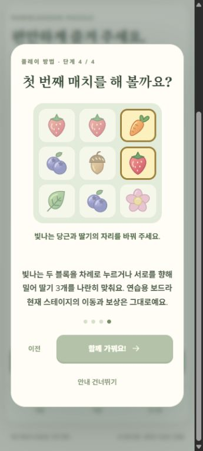
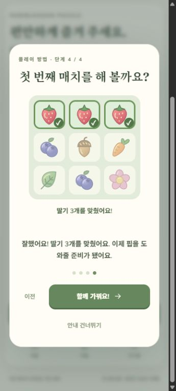

# 첫 교환 실습 검증

2026-10-11 · [이슈 #8](https://github.com/ChoiDaeYoung-94/Pawblossom-Puzzle/issues/8)

기존 설명 3단계 뒤에 첫 교환 실습을 추가하여 총 4단계가 됐습니다. 연습 보드는 실제 `BoardEngine`의 교환·제거 결과를 사용합니다. 본 게임의 보드·이동·보상과는 분리됩니다.

## 동작

- 3×3 고정 보드에서 강조한 당근과 딸기를 교환하면 맨 위 줄의 딸기 3개를 맞춥니다.
- 두 블록 탭, 위·아래 스와이프, 키보드 Enter/Space 입력을 지원합니다.
- 성공하면 실제 첫 제거 단계에 해당하는 세 칸을 체크 표시하고 시작 버튼을 활성화합니다. 낙하 과정은 재생하지 않고 매치 직후 배열을 유지하여 결과를 확인하게 합니다.
- 다른 칸은 비활성화하며, 잘못 민 방향·짧은 이동·중복 입력으로 완료하지 않습니다. 건너뛰기·Escape·Android 뒤로가기는 계속 지원합니다.
- 이전 단계로 돌아갔다 다시 들어오거나 설정에서 재열면 연습을 새로 시작합니다. 언어를 바꾸어 다시 렌더링할 때는 현재 선택과 성공 상태를 보존합니다.
- 기존에 안내를 확인한 저장 데이터에는 강제로 다시 표시하지 않습니다. 설정에서 새 실습을 볼 수 있습니다.

## 자동 검증

테스트는 기존 35개에 연습 모델 4개와 UI 흐름 3개를 추가했습니다. 실제 첫 제거 칸·딸기 수집, 두 선택 순서, 잘못된 입력, 위·아래 방향, 성공 후 중복 방지, 새 연습 초기화, 본 게임 진행·보상 불변, 언어 전환, 설정 화면 일시정지, 포인터 취소와 다른 손가락 입력을 검사합니다.

`npm test`: 5개 파일 42개 테스트 통과. `npm run android:sync`의 TypeScript·Vite 빌드와 Capacitor 동기화, Android `assembleDebug bundleRelease`가 성공했습니다. 테스트 APK·서명 전 AAB에 실습을 반영했습니다. 기존 Phaser 번들 크기·SDK 메타데이터 권한·flatDir 경고는 남아 있습니다.

## 브라우저 검증

- 한국어 360×800 화면에서 실습 설명·보드·버튼이 잘리지 않는지 확인했습니다.
- 당근 선택 후 딸기를 눌러 체크 표시와 성공 문구, 시작 버튼 활성화를 확인했습니다.
- 영어로 재열었을 때 새 보드이며 Enter·Space로 선택·완료됐습니다.
- Escape로 닫은 뒤 설정이 유지됐으며, 퍼즐 복귀 시 26회 이동·목표 12/10·별 0이 유지됐습니다.
- 검증용 임시 탭을 닫고 뷰포트를 원래대로 복원했습니다.

## 에셋과 남은 검증

기존 자체 제작 블록 SVG와 코드의 테두리·체크 표시를 사용했습니다. 새로운 외부 에셋이나 이미지 생성 프롬프트는 없습니다. 효과음은 기존 자체 합성 `match`를 재사용했습니다. 실제 사운드를 청취했다고 주장하지 않습니다.

실제 Android에서 스와이프·멀티터치·포인터 캡처·뒤로가기·배경 전환을 확인해야 합니다. 브라우저 탭/키보드 조작과 자동 입력 테스트는 기기 터치 검증을 대체하지 않습니다. 특수블록 생성·조합 실습은 아직 구현하지 않았습니다.
