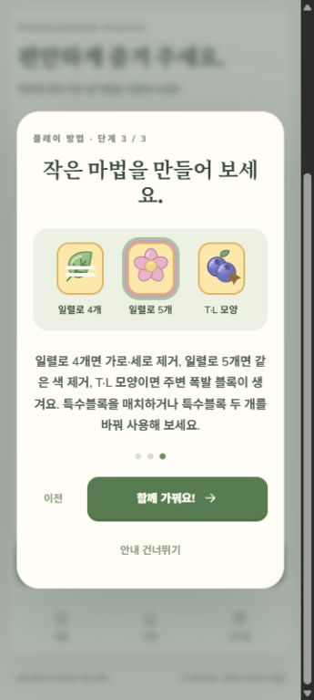

# 첫 플레이 안내 검증

작업일: 2026-10-11 · 연결 이슈: [#4](https://github.com/ChoiDaeYoung-94/Pawblossom-Puzzle/issues/4)

이 문서는 PR #5 당시 설명형 안내의 검증 기록입니다. 이후 별도 첫 교환 실습이 추가됐습니다([실습 검증](practice-qa.ko.md)). 아래의 테스트 수와 미구현 항목은 당시 상태를 기록합니다.

## 구현

- 첫 실행에 교환 → 수확 목표 → 특수블록 순서의 3단계 설명을 표시합니다. 이전·다음·건너뛰기와 설정의 다시 보기를 지원합니다.
- 안내를 닫으면 확인 여부를 저장합니다. 기존 저장에 유효한 완료 스테이지가 있으면 자동 안내를 생략하고 진행을 유지합니다. 완료 기록이 없는 기존 저장에는 안내를 표시합니다.
- 안내 중 퍼즐을 일시정지하고 퍼즐 화면에서 닫을 때 재개합니다. 설정에서 열고 닫으면 설정 화면의 일시정지를 유지합니다. 결과 처리 중에는 안내를 열지 않습니다.
- 영어·한국어 안내, 목표 아이콘의 대체 텍스트, 보드·하단 메뉴 접근성 이름을 지원합니다. Escape와 Android 뒤로가기는 안내를 먼저 닫습니다.
- 삽화는 프로젝트의 자체 SVG와 코드 도형을 재사용했습니다. 새로운 외부 아트·음악은 사용하지 않았습니다.

## 자동 검증

`npm test`: 3개 파일, 32개 테스트 통과. 기존 퍼즐 규칙 17개와 UI 흐름 5개에 안내 UI 5개·저장 호환 5개를 추가했습니다.

신규 저장, 기존 완료 기록, 손상된 완료 기록, 명시적 확인 여부, 저장 실패, 단계 이동, 건너뛰기·Escape, 설정 재열기·일시정지 유지, 언어 변경 시 단계 유지, 결과 처리와의 충돌 방지를 검사합니다.

`npm run build`: TypeScript와 Vite 프로덕션 빌드 성공. 기존 Phaser 포함 번들의 크기 경고는 남아 있습니다.

`npm run android:sync`와 `gradlew.bat assembleDebug bundleRelease`도 성공했습니다. 안내가 포함된 테스트 APK와 서명 전 AAB를 다시 생성했습니다. SDK 메타데이터 쓰기 권한·flatDir 경고는 기존 환경과 동일하며, 실기기 실행 검증을 뜻하지 않습니다.

## 브라우저 확인

- 영어: 첫 안내 3단계를 완료하고 새로고침했을 때 자동 안내가 반복되지 않았습니다.
- 한국어: 설정에서 다시 열어 세 단계를 확인했습니다. 360×800 뷰포트에서 설명과 버튼이 잘리지 않았습니다.
- Escape로 닫은 뒤 설정 화면이 유지되며, 퍼즐로 돌아왔을 때 목표와 이동 횟수가 유지됐습니다.
- 검증용 임시 탭은 닫고 뷰포트 설정은 해제했습니다.

## 남은 검증

현재 안내는 그림과 설명을 보여주는 방식입니다. 지정된 블록을 직접 교환하는 실습 보드와 초반 난이도 조정은 후속 작업입니다. Android 실기기에서 첫 부팅의 일시정지, 터치, 뒤로가기, 백그라운드 복귀와 기기 글꼴을 확인해야 합니다. 광고·결제·스토어 출시 검증은 이번 작업 범위에 포함하지 않았습니다.
